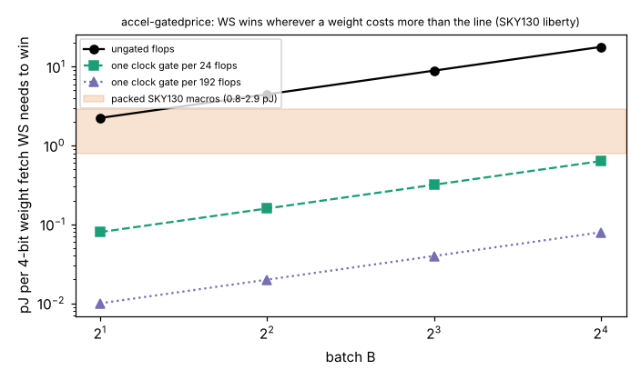

# accel-gatedprice

Eighth step of track 8 (task-specific AI accelerators) in `PROJECTS.md`. It takes two items from the "Next steps" of `accel-pdkprice`: price a **clock-gated** weight-stationary (WS) design (the integrated clock gate, ICG, is in the liberty file), and repeat the library reading with another open PDK (GF180MCU). It seemed worth doing because `accel-pdkprice` ended on "WS needs cheap idle flops", and clock gating is the standard way to make idle flops cheap. The question: if the extra accumulators of register-file WS sit behind clock gates, does WS beat output-stationary (OS) at SKY130's own prices, and how many flops may share one gate?

**Live page:** https://duncan-haywood.github.io/monorepo-projects/research/accel-gatedprice/

**Builds on.** `research/accel-fetchprice` (breakeven ratios, copied to `data/` with a test that it still equals the original), `research/accel-pdkprice` (the four OpenRAM macro access energies, copied to `data/sky130_sram.json` with the same kind of test; the flop figure is re-derived here and a test checks it against the 46.4 fJ there). Liberty files: SKY130 HD `tt_025C_1v80` and GF180MCU `mcu7t5v0` / `mcu9t5v0` `tt_025C` at 3.3 V and 5 V, from OpenROAD-flow-scripts at the commit pinned in `accel-pdkprice/fetch_pdk.sh` (Apache-2.0; fetched, not vendored). No lab in `prompt.md` works on this; no lab tag is claimed.

## Method
- Idle clock energy of a cell per cycle = mean of the CLK pin's rise table + mean of its fall table (`internal_power`, averaged over the pin's `when` groups) + `C_clk x VDD^2`. The flop is `dfxtp_1` (SKY130) or `dffq_1` (GF180), both averaged over the two data states. The ICG is `dlclkp_1/2/4` (SKY130) or `icgtp_1` (GF180) with its enable low (`!E&!TE` in GF180; SKY130 has one group). Where a table is a placeholder zero in the file it counts as 0. Wire capacitance and the clock tree are not included.
- Gated cost: the extra WS flops are clocked only when written, which is the same write count as OS and drops out like MAC energy. What is left per extra flop per cycle is `e_icg / G` for `G` flops per gate, plus flop leakage (SKY130 only, at an assumed 10 ns period; GF180 leakage is not read, and in SKY130 it is 0.0001 fJ against 46 fJ).
- Breakeven from `accel-fetchprice`: WS wins iff `cost_per_flop_cycle / e_weight < e_flop*/e_weight`. So WS needs `e_weight > cost / ratio`. The smallest `G` that wins against a macro is `ceil(e_icg / (e_weight x ratio - leakage))`.

## Reproduce
```bash
cd research/accel-gatedprice
sh ../accel-pdkprice/fetch_pdk.sh ../accel-pdkprice/pdk      # needs network
git -C ../accel-pdkprice/pdk/orfs sparse-checkout add flow/platforms/gf180
python3 -m unittest discover -s tests    # 9 tests; one skips without the pdk
python3 experiments/run.py               # stdlib only; writes results.json and results.txt
python3 experiments/figure.py            # needs matplotlib; writes experiments/gatedprice.png
```

## Results (from `experiments/results.txt`)
- **A clock gate idles at about the cost of a flop.** SKY130 `dlclkp_1`: 39.7 fJ per cycle against 46.4 fJ for `dfxtp_1` (ratio 0.86; `dlclkp_4` 0.93). GF180: ratio 1.016 and 1.018 (7-track, 3.3 and 5 V), 0.993 and 0.988 (9-track). The flop itself costs 0.35 and 0.86 pJ (7t) and 0.44 and 1.26 pJ (9t) at 3.3 and 5 V, 7.5 to 27 times SKY130's. The gate-to-flop ratio is the node-free number; it is near 1 in both nodes.
- **So one gate shared by `G` flops cuts the idle cost about `G`-fold.** On the 64x70 layer, WS needs a weight fetch above 2.2, 4.5, 8.9 and 17.8 pJ (B = 2, 4, 8, 16) ungated, and above 0.080, 0.16, 0.32 and 0.64 pJ with a gate per 24 flops (one 24-bit accumulator); the 11x64 layer needs 0.12 to 0.93 pJ.
- **That flips the `accel-pdkprice` verdict.** Against the packed SKY130 macros (0.8 to 2.9 pJ per weight) a gate per 24 flops wins in 63 of the 64 (layer, batch, macro, packing) cells; the exception is the 80-bit macro on the 11x64 layer at B = 16, which needs 27 flops per gate. In 35 of the 64 cells ungated WS loses and some gated size wins. No cell lacks a winning `G`. The largest `G` needed for any packed cell is 27; the unpacked cells need `G` of at most 3.
- **In node-free units**: ungated WS needs a weight fetch of 48 to 385 idle-flop-cycles on the 64x70 layer (71 to 560 on 11x64); with a gate per 24 flops it needs 1.7 to 14 (2.5 to 20). SKY130's packed macros cost 18 to 62 flop-cycles per weight and unpacked ones 223 to 1,932. Another node's verdict follows from its own SRAM-to-flop ratio against those thresholds. **GF180 has no SRAM macro in this tree**, so no GF180 verdict is given, only its flop and gate energies.



## Limitations
- Library characterisation values, not measurements, and the OpenRAM per-edge-versus-per-cycle ambiguity of `accel-pdkprice` carries over (halving every macro energy moves several cells).
- This prices only the idle clock energy of the gate and the flops. It leaves out the enable logic that decides when to open each gate, the extra area and routing of one gate per group, the register-file read mux, any hold-time or glitch cost at the gate, and the gate's own switching when it is enabled. No RTL was written or synthesised, so the gated design is a model of the `accel-planebatch` WS engine, not a built one.
- The gated flops are assumed written exactly as often as OS's accumulators. WS writes each accumulator once per product too, but this is taken from the structure, not checked in RTL.
- The accumulator width G = 24 is the 24-bit partial sum of the earlier projects; other grouping choices (G = 1 to 576) are in `results.txt`. Only 4-bit weights, P = 8, two layer shapes.
- GF180 is read at one corner (`tt_025C`) and only its flop and gate; the SKY130 SRAM macros are the only memory prices.

## Next steps
Write the gated WS engine in RTL (one `dlclkp` per accumulator) and synthesise it to count the extra cells; add the enable logic to the cost; find or generate a GF180 or ASAP7 SRAM estimate to give a second-node verdict; resolve the OpenRAM per-edge reading with ngspice.

## Owner steps
None. Analysis of library files only; no hardware was specified, bought or measured.

## Outside dependencies (vitamins)
The SKY130 HD, OpenRAM and GF180MCU liberty files from OpenROAD-flow-scripts (fetched at a pinned commit; Apache-2.0); Python standard library for the model and tests; matplotlib for the figure (optional); the `accel-fetchprice` and `accel-pdkprice` results.
