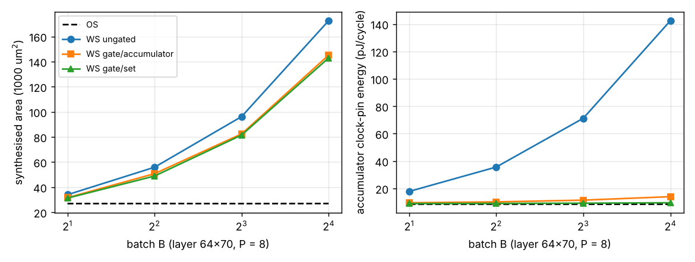

# accel-gatedrtl: does the clock-gated weight-stationary engine hold up once it is written in RTL and synthesised? (stylised)

> Update: `accel-gatedmux` found that this engine's accumulator read inflated every WS area here by 17 to 28 %; the cycle, fetch and clock-energy results stand, the WS-over-OS area ratios (for example 5.3x at B = 16) are overstated.

**Live page:** https://duncan-haywood.github.io/monorepo-projects/research/accel-gatedrtl/

Ninth step of track 8 (task-specific AI accelerators) in `PROJECTS.md`. `accel-gatedprice` priced clock-gated register-file weight-stationary (WS) scheduling from liberty files alone and ended on "write the gated WS engine in RTL and synthesise it to count the extra cells". This does that. It seemed worth doing because that verdict rested on two assumptions never checked in a design: that gated accumulators are written exactly as often as the output-stationary (OS) ones, and that the gates and enable logic add little. The question: in a built engine, what do the gates cost in cells and area, and how close does the accumulator clock energy get to OS?

**Builds on.** `research/accel-planebatch` (the engine's datapath, schedule, ports and testbench style are the same; `gated_engine.v` is a new file, not a copy of its flop code), `research/accel-gatedprice` (flop and gate clock-pin energies, read again here with its `lib.py`), `research/accel-kws` (layer shapes 64x70 and 11x64, int4 weights, int8 inputs, 24-bit accumulators). No lab in `prompt.md` works on this; no lab tag is claimed.

## Method
- `rtl/gated_engine.v`, four modes of one parameterised engine: **0** OS (one set of P accumulators); **1** WS with B sets and a write enable (a hold mux per flop); **2** WS with one clock gate per 24-bit accumulator (G = 24 flops per gate); **3** WS with one gate per set of P accumulators (G = 192). A gated accumulator is a plain flop on its gate's clock, open only in the cycles its set is written. `rtl/icg.v` is a latch-and-AND in simulation and the SKY130 `dlclkp_1` cell in synthesis.
- `rtl/tb_gated.v` runs two random problems per point and counts weight and activation fetches (as in `accel-planebatch`) and the **accumulator bits written**, counted at each flop's own clock edge (at the gate output in the gated modes).
- `src/accel_gatedrtl/rtl.py`: outputs compared with `einsum` in NumPy. Synthesis is Yosys 0.33 `synth -flatten`, `dfflibmap` and `abc` against the SKY130 HD `tt_025C_1v80` liberty file (the ICG stays a library cell), then `stat -liberty` for cells and area. Enable logic, the read mux and the counters are all in the area.
- Clock-pin energy per running cycle of the accumulator file is a model on the liberty energies (`dfxtp_1` 46.4 fJ, `dlclkp_1` 39.7 fJ, as in `accel-gatedprice`): ungated flops see the clock every cycle; in gated modes every gate sees it every cycle and the flops see it only when open, using the written-bit count from simulation.

## Reproduce
```bash
sudo apt-get install -y iverilog yosys python3-numpy
sh ../accel-pdkprice/fetch_pdk.sh ../accel-pdkprice/pdk        # from research/accel-gatedrtl; needs network
python3 -m unittest discover -s tests   # 6 tests, ~40 s
python3 experiments/run.py              # ~9 min on 4 cores: 32 simulations and 32 syntheses; writes results.json and results.txt
python3 experiments/figure.py           # matplotlib; writes experiments/gatedrtl.png
```

## Results (from `experiments/results.txt`; P = 8 lanes, 32 points)
- **The assumptions hold in RTL.** All 32 points are bit-exact against NumPy. The three WS modes take identical cycles and fetch counts, and all four modes write the same number of accumulator bits per problem (for example 98,304 on 11x64 at B = 4). So gating changes where the flops get their clock, not how often they are written, which is what `accel-gatedprice` assumed.
- **Gating removes most of the clock-pin overhead.** Accumulator clock-pin energy relative to OS: ungated WS is B times OS (2x to 16x); a gate per set is 1.00 to 1.07x; a gate per accumulator is 1.06x at B = 2 to 1.57x at B = 16 (the gates' own idle energy, 128 gates at B = 16). The gate per set wins on energy, and the gate per accumulator costs the per-gate cost the earlier project predicted.
- **Area falls 7 to 18 %, much less than the clock energy.** Against ungated WS: a gate per set is 0.92x at B = 2 down to 0.83x at B = 16 (64x70), a gate per accumulator 0.93x to 0.84x. The saving is mostly the hold mux that an ungated flop needs; gate area is small (4 to 16 gates for a set per gate). The flop count is unchanged (599 to 3,293).
- **WS stays much larger than OS.** Gated WS is 1.16x OS area at B = 2, 1.81x at B = 4, 3.0x at B = 8 and 5.3x at B = 16 (64x70; 11x64 is within 0.1), because the extra accumulator sets are flops either way. WS fetches the weights once (4,480 against 71,680 at B = 16, 64x70) at the same cycle count.
- **Takeaway.** Clock gating makes register-file WS cheap to clock, but not small. Against `accel-pdkprice`'s SRAM macros, `accel-gatedprice`'s flip to WS winning needs the area to be acceptable too: at B = 16 the gated engine is 5.3x the OS engine's cells.



## Limitations
- Cell counts and area are from synthesis with no place and route, no clock tree, no timing, and no hold or glitch analysis of the gate (the latch-based ICG is a library cell, so glitch-free by construction, but its enable timing is not checked). Wire capacitance is not counted.
- Clock-pin energy is a liberty-based model of the accumulator file only; data-path switching, the hold mux's own energy (removed by gating) and leakage are not in it, so the gate's real saving is somewhat larger than shown.
- The ungated flop is mapped to `dfxtp_1` plus a mux because `dfflibmap` does not use the library's enable flop; `edfxtp_1` is 30.0 um^2 against 31.3 for flop plus mux, so this choice moves the ungated area by under 4 % of the flop-and-mux area, not the conclusions.
- Simulation uses a behavioural latch-and-AND gate in Icarus; delta-cycle ordering there is not a timing check. One P (8), two layer shapes, random data, 4-bit weights.
- The `accel-pdkprice` macro comparison was not redone with these areas.

## Next steps
Put the engine through nextpnr or OpenROAD to get a real clock tree and timing for the gated modes; swap the register file for a small SRAM macro (mode 4) and compare area against the `accel-pdkprice` macros; sweep P; add the gate's enable-to-clock timing check; compare the same engine in GF180MCU once a macro is available.

## Owner steps
None. Simulation and synthesis only; no hardware was specified, bought or measured.

## Outside dependencies (vitamins)
The SKY130 HD liberty file from OpenROAD-flow-scripts (fetched at a pinned commit; Apache-2.0); Icarus Verilog and Yosys (apt); NumPy for the reference; matplotlib for the figure; `accel-gatedprice`'s `lib.py` for the liberty reader.
