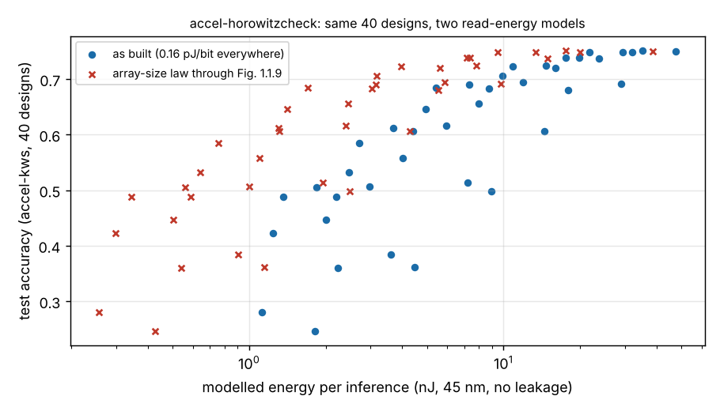

# accel-horowitzcheck: do the `accel-*` energy constants match Horowitz (2014), and does it change what `accel-kws` concluded?

Follow-up to `free-citeaudit`, which found Horowitz (2014) among the most-repeated "not re-checked" citations in the portfolio, and to track 8 (task-specific AI accelerators) in `PROJECTS.md`. **Headline:** every one of the 34 energy constants in `research/accel-*/src` that has a counterpart in Horowitz's Fig. 1.1.9 is within 4% of it (checked against the figure itself, not a secondary source), so the "typed from memory" flag can come off. The one modelling choice the figure does contradict is a single flat 0.16 pJ/bit for every on-chip array: the figure's energy grows as roughly the square root of array size. Re-costing `accel-kws`'s 40 designs with that law moves their energy to 0.23 to 0.81 of the as-built figure, but their energy ranking barely changes (Spearman 0.991) and 17 of the 18 designs on the accuracy-against-energy front stay on it. Produced with AI assistance (Claude).

**Live page:** https://duncan-haywood.github.io/monorepo-projects/research/accel-horowitzcheck/

**Why this was worth doing.** Six READMEs say their per-operation energies are "in the spirit of Horowitz (2014), not re-checked", and ten projects carry them. This run read the source and measured how much the leftover freedom matters.

**Builds on.** Horowitz (2014), "1.1 Computing's energy problem (and what we can do about it)", ISSCC, pp. 10 to 14, DOI 10.1109/ISSCC.2014.6757323, Fig. 1.1.9, read from the copy at <https://gwern.net/doc/cs/hardware/2014-horowitz-2.pdf> (the page is an image; I read the table off a render of it). Also `research/accel-kws` (its cost model and its 40-design results, imported unchanged), `research/free-citeaudit`, and every `accel-*` project that carries the constants. No CU Boulder group is built on or implied.

## Method
- **Table** (`src/accel_horowitzcheck/horowitz.py`): integer add 0.03 pJ (8-bit) and 0.1 pJ (32-bit); integer multiply 0.2 and 3.1 pJ; fp add 0.4 (16-bit) and 0.9 (32-bit); fp multiply 1.1 and 3.7; per 64-bit access, cache 10 pJ (8 KB), 20 pJ (32 KB), 100 pJ (1 MB), DRAM 1.3 to 2.6 nJ. All at 45 nm, 0.9 V, "rough".
- **Audit** (`audit.py`): parses every `research/accel-*/src/*/*.py` with `ast`, collects the top-level `E_*` constants and divides each by the figure's value (the 24-bit add by a log-log interpolation of the 8 and 32-bit points; the fp32 FLOP by the mean of add and multiply, as its comment says).
- **Re-cost** (`experiments/run.py`): `accel-kws` charges 0.16 pJ for every bit read from any array, whatever its size (the 8 KB point). Here the weight array's read energy is taken from the size law instead, with the array sized from the design's own `storage_kbit`. Three models: *as built*; *floor* (the figure's size law, but never cheaper than the 8 KB point); *paper* (the size law, extended below 8 KB along the 8 to 32 KB slope, **an extrapolation the paper does not make**). The 256-byte activation buffer is my assumption. The as-built model reproduces `accel-kws`'s published energies to 1e-14 nJ, so the only change is the read term.

## Reproduce
```bash
cd research/accel-horowitzcheck
python3 experiments/run.py      # stdlib only; reads ../accel-kws/experiments/results.json
python3 experiments/figure.py   # needs matplotlib; draws energy.png
python3 -m unittest discover -s tests -v   # 7 tests
```

## Results (from `experiments/results.txt`)
- **Constants.** Multiplies, 32-bit adds, fp32 FLOP: ratio 1.00. The 0.16 pJ/bit read is 1.024 times 10 pJ / 64. The 24-bit add (0.075) is 0.963 of the interpolated 0.0779. `accel-sparse`'s `E_NEG_PJ = 0.01` has no counterpart in the figure and stays an assumption.
- **Scaling rules.** Multiplier energy against width has a log-log slope of 1.98 (8 to 32 bit), so the "multiply energy goes as bits squared" rule in `accel-kws` and `accel-frontend` matches (16x16: 0.8 pJ used, 0.787 from the figure). The add rule "linear in bits" matches less well (slope 0.87; a 16-bit add is 0.05 pJ used, 0.055 from the figure).
- **Array size.** Slope 0.50 from 8 to 32 KB and 0.47 from 8 KB to 1 MB. In `accel-kws` the largest weight array is 16.8 KB and 4 of 40 designs exceed 8 KB; reads are 90 to 93% of modelled energy as built.

| read-energy model | energy / as built | read share | front members kept | Spearman rank vs as built |
|---|---|---|---|---|
| as built | 1.00 | 0.90 to 0.93 | 18 of 18 | 1.000 |
| floor (no cheaper than 8 KB) | 0.98 to 1.18 | 0.90 to 0.93 | 18 of 18 | 1.000 |
| paper (size law, extrapolated below 8 KB) | 0.23 to 0.81 | 0.67 to 0.88 | 17 of 18 (7 segments, 64 hidden, 8-bit drops off) | 0.991 |



## Limitations
- Fig. 1.1.9 is a rough 45 nm 0.9 V table for a processor's caches, not a synthesised weight ROM or a register file; `accel-kws`'s array is a small SRAM or latch array whose real cost this does not measure. The size law below 8 KB is extrapolated from two points.
- Only `accel-kws`'s sweep was re-costed. The surrogate, LUT and dataflow projects use the same constants but different arrays and were not re-run, so their conclusions are checked only to the extent the constants themselves are.
- I checked the constants, not the other papers cited in those READMEs (Dawid and Skene, Zhang et al. and others in `free-citeaudit`'s list remain unchecked). Leakage, the front end and the microphone are out of this model: `accel-kws` itself puts the microphone at 1,800 uW against 0.004 to 0.19 uW for the engine, so energy precision here barely matters for always-on power.

## Next steps
Remove the "not re-checked" wording from the affected READMEs (each is another project's file, so I left them; this README is the citation they can point to); re-cost `accel-surrogate*` and `accel-lut*` with the size law; measure a real small array in the open IHP or Sky130 PDK (`accel-pdkprice` has the unit handling).

## Owner steps
None.

## Outside dependencies
The Horowitz figure (read from a third-party copy; the IEEE original was not opened), `accel-kws`'s `results.json`, matplotlib for the figure. Nothing was bought or fabricated.
