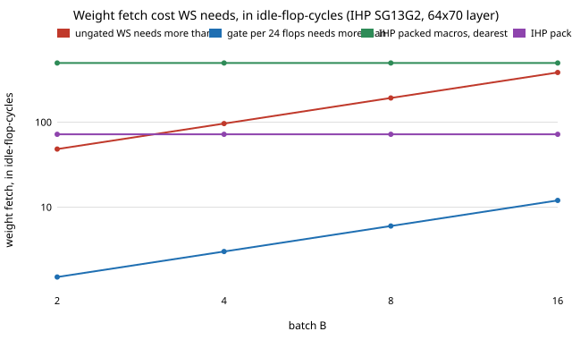

# accel-ihpprice

Does clock-gated register-file weight-stationary scheduling still beat output-stationary on a second open process, IHP SG13G2, and does the answer to "is ungated weight-stationary good enough?" depend on the node? Ninth step of track 8 (task-specific AI accelerators) in `PROJECTS.md`. It takes the "second-node verdict" next step of `accel-gatedprice`, which could not give one because GF180 has no SRAM macro in the open tree. IHP SG13G2 does: ten SRAM macros, with separate read and write energies. It seemed worth doing because every earlier verdict in this chain rests on one node (SKY130), so the headline "weight-stationary needs gated flops" could have been a SKY130 accident.

**Live page:** https://duncan-haywood.github.io/monorepo-projects/research/accel-ihpprice/

**Headline.** Gating is the robust result; the ungated verdict is node-dependent. With one clock gate per 24-bit accumulator, register-file weight-stationary (WS) beats output-stationary (OS) in all 120 (layer, batch, macro, packing) cells against IHP's own macros, needing at most 6 flops per gate. Ungated WS wins in 92 of the 120, and in 33 of the 60 packed cells, where on SKY130 it lost at nearly every packed cell. The reason is the price of a weight fetch in idle-flop-cycles: 72 to 497 for packed IHP macros against 18 to 62 for SKY130's.

**Builds on.** `research/accel-fetchprice` (breakeven ratios, copied to `data/` with a test that it still equals the original), `research/accel-pdkprice` and `research/accel-gatedprice` (the method; the SKY130 macro energies are copied to `data/sky130_sram.json`, and the SKY130 flop and gate are re-derived here and tested against the earlier 46.4 fJ). Liberty files: SKY130 HD `tt_025C_1v80`, IHP SG13G2 `stdcell_typ_1p20V_25C` and `1p50V_25C` and the ten `RM_IHPSG13_1P_*_typ_1p20V_25C` macro files, and NanGate45 `typical`, from OpenROAD-flow-scripts at the commit pinned in `accel-pdkprice/fetch_pdk.sh` (Apache-2.0; fetched, not vendored). No lab in `prompt.md` works on this; no lab tag is claimed.

## Method
- Idle clock energy of a cell per cycle = mean of the CLK pin's rise table + mean of its fall table (`internal_power`, averaged over the pin's `when` groups) + `C_clk x VDD^2`, exactly as in `accel-gatedprice`. Flops: `dfxtp_1` (SKY130), `sg13g2_dfrbp_1` (IHP), `DFF_X1` (NanGate45). Gates: `dlclkp_1`, `sg13g2_slgcp_1`, `CLKGATE_X1`. Wire capacitance and the clock tree are left out.
- **Unit check.** IHP declares `current_unit : 1uA`, so V x I x t would make its energies fJ, 1,000 times smaller than SKY130's mA. Its SRAM files state the unit as capacitive load unit x V^2 per toggle (pJ). This project uses that reading everywhere (`energy_unit_pj`); it equals the V x I x t reading for SKY130 and GF180. Evidence it is the physical one: internal clock-pin energy over `C_pin x VDD^2` is 7.4 for the IHP flop (SKY130: 7.0, NanGate45: 7.0), where the other reading gives 0.007. NanGate45 declares fF and mA, so its energies are fJ by the same rule (section B of `results.txt`).
- SRAM macro: the `A_CLK` pin has a separate scalar per combination of `A_MEN`, `A_WEN`, `A_REN`. A read is `A_MEN & !A_WEN & A_REN`, a write `A_MEN & A_WEN & !A_REN`; the fall table is zero, so the figure is per rising edge. Inference only reads weights, so reads are used. This settles the per-edge and read-versus-write questions that `accel-pdkprice` left open for OpenRAM, for these macros.
- Weight price per 4-bit weight: **unpacked** = one read per weight; **packed** = read / (word bits / 4), a best case. A macro enters the verdict for a layer only if its capacity holds the layer (17,920 weight bits for 64x70, 2,816 for 11x64); five of the ten macros hold the first and all ten the second.
- Breakeven as in `accel-fetchprice`: WS wins iff `cost_per_flop_cycle / e_weight < e_flop*/e_weight`, with cost = `e_flop` ungated or `e_icg / G + leakage` with a gate per `G` flops.

## Reproduce
```bash
cd research/accel-ihpprice
sh fetch_pdk.sh pdk                      # sparse clone of ORFS at the pinned commit (needs network)
python3 -m unittest discover -s tests    # 8 tests; the one that reads the real libraries skips without pdk/
python3 experiments/run.py               # stdlib only; writes results.json and results.txt
python3 experiments/figure.py            # stdlib only; writes experiments/thresholds.svg
```

## Results (from `experiments/results.txt`)
- **Idle flop and gate.** IHP at 1.2 V: flop 33.9 fJ per cycle, gate 25.3 fJ (gate/flop 0.75); at 1.5 V 71.2 and 56.4 fJ (0.79). SKY130: 46.4 and 39.7 fJ (0.86). NanGate45: 9.2 and 8.7 fJ (0.95). In every node an idle gate is cheaper than an idle flop, 0.75 to 0.95 of it, so the `accel-gatedprice` result that one gate shared by `G` flops cuts the idle cost about `G`-fold carries over.
- **IHP macros.** Read energy 15.6 pJ (1024x8) to 122.4 pJ (2048x64); a write costs 1.16 to 1.29 times a read. Packed, a 4-bit weight costs 2.4 to 16.9 pJ, which is 72 to 497 idle-flop-cycles. SKY130's OpenRAM macros, repriced in the same unit, are 18 to 62 packed and 223 to 1,932 unpacked; IHP's are 460 to 3,610 unpacked. IHP's SRAM is dearer relative to its flops, by about 4 to 8 times when packed.
- **Thresholds.** Ungated WS needs a weight fetch above 48 to 385 idle-flop-cycles on the 64x70 layer (71 to 560 on 11x64), i.e. 1.6 to 13.0 pJ (2.4 to 19.0) at IHP 1.2 V; with a gate per 24 flops 0.05 to 0.41 pJ (0.07 to 0.59).
- **Verdicts.** Of 120 cells (macros that fit, both packings, both layers, B = 2 to 16), ungated WS wins 92. Unpacked it wins 59 of 60: the one OS cell is the 1024x8 macro on the 11x64 layer at B = 16. Packed it wins 33 of 60; On the 64x70 layer OS wins the 512x64 and 1024x64 macros at B = 8 and 16 and the 2048x64 at B = 16; on 11x64 it wins from B = 4 for four of the ten macros and from B = 8 for eight. With a gate per 24 flops WS wins all 120 cells, and 28 of them are ones ungated WS loses. The most any cell needs is 6 flops per gate (64x64 macro, 11x64 layer, B = 16, packed).
- **So the SKY130 conclusion generalises in one direction only.** "A shared clock gate makes WS beat OS" holds on both nodes. "Ungated WS loses once weights are packed" is a SKY130 result: on IHP the macros are dear enough relative to flops that ungated WS wins about half the packed cells.



## Limitations
- Library characterisation values, not measurements. Two nodes (SKY130 and IHP SG13G2) with different SRAM sources, an OpenRAM-generated macro against IHP's compiled ones; nothing here says which is closer to silicon.
- The macro energy is the `A_CLK` pin only. For reads the other pins add roughly 0.3 pJ in the 256x64 macro (address and enable pins, under 1% of 49.6 pJ); the data-in pins have a table of about 0.33 pJ (if that is per bit, a write adds tens of pJ), so write energy is understated, and writes are not used here. The macros also carry BIST logic in the file, whose idle power is not separated.
- Macro and layer sizes do not match: bigger macros cost more per access, a confound the packed numbers share with `accel-pdkprice`. Capacity is the only fit test.
- Flop energy is an idle `dfrbp_1` (with a reset pin, so larger than a plain D flop might be); the real register-file flops may differ. The gate prices only its idle clock energy, as in `accel-gatedprice`: the enable logic, area and the register-file read mux are unpriced, and no RTL was built for IHP.
- NanGate45 enters only as a flop and gate ratio; its `fakeram` macros are generated placeholders and are not read. GF180 is not repeated (see `accel-gatedprice`).
- Only 4-bit weights, 24-bit partial sums, P = 8 and two layer shapes, as in `accel-planebatch`.

## Next steps
Synthesise the gated engine for IHP with open tools and count the enable logic and area there (`accel-gatedrtl` did it for SKY130); price the weight store as latch or flop arrays instead of a macro, since at IHP's ratio a small array might undercut the 64x64 macro; add ASAP7, whose liberty files are gzipped and use other cell names.

## Owner steps
None. Analysis of library files only; no hardware was specified, bought or measured.

## Outside dependencies (vitamins)
The SKY130 HD, IHP SG13G2 and NanGate45 liberty files from OpenROAD-flow-scripts (fetched at a pinned commit; Apache-2.0); Python standard library for the model, tests and figure; the `accel-fetchprice` breakevens and the `accel-pdkprice` SKY130 macro energies (copied to `data/`).

**Figure.** `experiments/thresholds.svg`: the weight-fetch cost WS needs, in idle-flop-cycles, against batch size, with the cheapest and dearest IHP packed macro.
