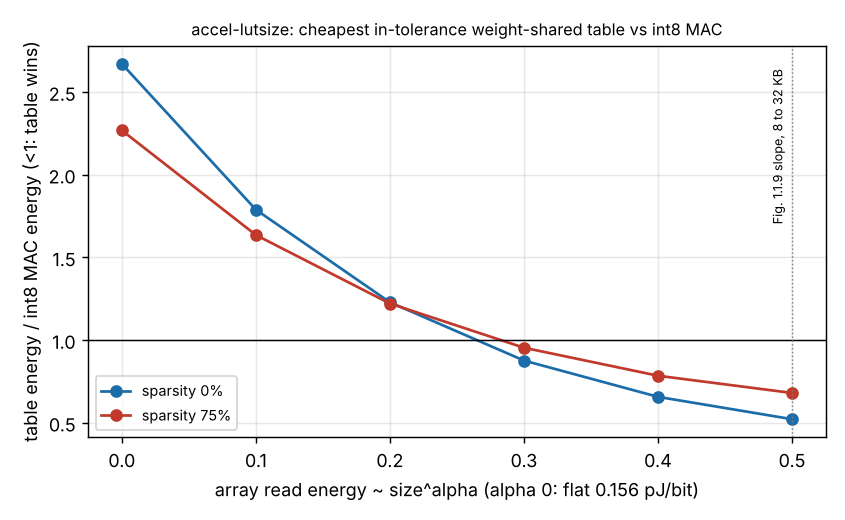

# accel-lutsize: does weight-sharing lookup-table inference beat an int8 MAC engine once small arrays cost less to read?

Follow-up to `accel-lut` (negative result) and to the next steps of `accel-horowitzcheck`, in track 8 (task-specific AI accelerators) of `PROJECTS.md`. **Headline:** `accel-lut` found that a product-table engine loses to an int8 MAC engine (about 2.7 times the energy for the cheapest design within a 2-point accuracy drop) because it charged every array a flat 0.16 pJ/bit. Pricing each array by its own size flips that verdict once the read energy grows faster than about size<sup>0.26</sup> (dense) to size<sup>0.28</sup> (75% pruned). Horowitz's figure gives a slope of 0.5 between 8 and 32 KB, but has no point below 8 KB, where every array here sits, so the sign of the answer depends on an extrapolation the source does not make. Produced with AI assistance (Claude).

**Live page:** https://duncan-haywood.github.io/monorepo-projects/research/accel-lutsize/

**Why this was worth doing.** `accel-lut`'s verdict rested on its table-read energy, which it swept over two assumed values (0.04 and 0.16 pJ/bit). `accel-horowitzcheck` then showed the repository's flat per-bit read ignores array size and listed re-costing the LUT projects as a next step. A 16-entry table is 32 bytes, so it is exactly the case where that matters.

**Builds on.** `research/accel-lut` (accuracy and nonzero counts for 10 splits, imported unchanged from its `results.json`; its multiplier and adder constants), `research/accel-horowitzcheck` (the 8 KB anchor and the size law), Horowitz (2014), ISSCC, DOI 10.1109/ISSCC.2014.6757323, Fig. 1.1.9 (checked in `accel-horowitzcheck`). Idea of weight sharing: Han, Mao and Dally (2016), ICLR, as cited by `accel-lut` (not re-verified here). No CU Boulder group is built on or implied.

## Method
- **Array read energy** per bit is `E(size) = (10 pJ / 64) * (size / 8 KB)^alpha`, anchored at Horowitz's 8 KB point. `alpha = 0` is the repository's flat 0.156 pJ/bit; `alpha = 0.5` is the figure's 8 to 32 KB slope. Because the paper has no point below 8 KB, `alpha` is **swept (0 to 0.5) and a break-even is solved for**, not chosen.
- **Arrays priced by size** (`src/accel_lutsize/cost.py`): the weight (or index) array, the activation buffer, and for the table engine the K-entry 16-bit product table (written and read). Sizes come from each layer: 64x32 and 32x10, 4-bit and 8-bit activations, dense or 75% pruned with a column index.
- **Unchanged from `accel-lut`:** designs, the accuracy of each, nonzero counts, multiplier and adder energies, the table-engine dataflow, the 2-point tolerance. The int8 baseline is the like-with-like one (activation read once per input).
- **Floor variant:** arrays never cheaper than the 8 KB point. Every array here is below 8 KB, so this is `alpha`-independent and equals the flat model.

## Reproduce
```bash
cd research/accel-lutsize
python3 -m unittest discover -s tests -v   # 7 tests, stdlib, needs numpy for the accel-lut import
python3 experiments/run.py                 # reads ../accel-lut/experiments/results.json
python3 experiments/figure.py              # needs matplotlib; draws ratio.png
```

## Results (from `experiments/results.txt`; energy in nJ per inference)
| | dense, int8 MAC | dense, share8 table | 75% pruned, int8 MAC | 75% pruned, share4 table |
|---|---|---|---|---|
| accuracy (drop vs float32) | 0.972 (0.000) | 0.956 (+0.016) | 0.969 (+0.001) | 0.954 (+0.016) |
| alpha 0 (flat) | 3.49 | 9.31 | 1.47 | 3.34 |
| alpha 0.2 | 2.62 | 3.22 | 0.93 | 1.13 |
| alpha 0.3 | 2.30 | 2.02 | 0.75 | 0.72 |
| alpha 0.5 | 1.81 | 0.94 | 0.51 | 0.34 |

- **Break-even.** The cheapest design within 2 points ties the MAC at alpha = 0.26 (dense) and 0.28 (75% pruned). At alpha 0.5 the table uses 0.52 (dense) and 0.68 (pruned) of the MAC's energy.
- **Reproduction check.** At alpha 0 the MAC is 3.49 nJ against `accel-lut`'s 3.56: the difference is 0.156 against 0.16 pJ/bit.
- **Analytic layer.** For a dense 64xN layer with K=16, the table wins at N >= 256 at alpha 0.2 and at N >= 32 at alpha 0.4 (`results.txt`).
- **Why the flip.** The table engine does many small reads (a 32-byte table per weight), the MAC engine mostly reads wide 8-bit weights from a larger array, so a size law rewards the table first. Both engines get cheaper; the table's falls faster.



## Limitations
- **The headline is conditional.** The 0.26 to 0.28 break-even is a property of this model, not a measurement: whether real sub-8 KB arrays follow a power law with that exponent depends on the memory compiler, the process and whether the arrays are SRAM, latches or flip-flops. The paper's own slope was read only between 8 KB and 1 MB.
- Horowitz's table is a processor cache at 45 nm, not a weight ROM or a 32-byte register file; a 32-byte table built from flip-flops would likely follow neither the cache law nor the flat one.
- Accuracy and nonzero counts are `accel-lut`'s: scikit-learn digits as a keyword-spotting substitute, no retraining of shared values (so low K is a lower bound on accuracy).
- Table write energy uses the same size law; the model has no leakage, wiring or control.

## Next steps
Measure a 32-byte to 8 KB array in the open Sky130 or IHP PDK (`accel-pdkprice` has the unit handling) to fix alpha below 8 KB; the answer to this project's question is then a lookup rather than a sweep. Re-cost `accel-lutwide`, `accel-lutft` and the `accel-surrogate*` family the same way.

## Owner steps
None.

## Outside dependencies
`accel-lut`'s `results.json`, `accel-horowitzcheck`'s transcription of Fig. 1.1.9 (read from a third-party copy there), NumPy through the `accel-lut` import, matplotlib for the figure. Nothing was bought or fabricated.
