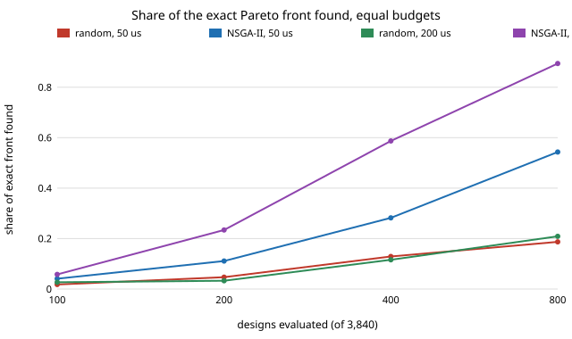

# accel-nsga: does NSGA-II find a keyword-spotting accelerator's Pareto front faster than random search? (stylised, exhaustive ground truth)

Follow-up to `accel-codesign` (track 8, task-specific AI accelerators), taking the next step its README listed: run a real NSGA-II against random search at equal evaluation budgets. The question: on a co-design space of model, lane count, weight-memory banks and supply level, how much of the exact accuracy/area/energy Pareto front does each method find for the same number of evaluated designs? Produced with AI assistance (Claude). It builds on none of the CU Boulder groups in `prompt.md` and claims no connection to them.

**Live page:** https://duncan-haywood.github.io/monorepo-projects/research/accel-nsga/

**Builds on.** `research/accel-kws` (40 trained, RTL-checked models: validation accuracy, P=1 cells, modelled energy) and `research/accel-codesign` (Yosys datapath areas for 1 to 32 lanes). NSGA-II is Deb et al. (2002), "A fast and elitist multiobjective genetic algorithm: NSGA-II", *IEEE Trans. Evol. Comput.* 6(2); constrained domination follows the same paper. Hypervolume is the usual quality indicator (Zitzler and Thiele, 1999). The framing of hardware-model co-design as search is NAAS (Lin, Yang and Han, 2021, DAC); nothing is reproduced from it.

## Method
- **Space.** 40 models x 6 lane counts (1 to 32) x 4 bank counts (1, 2, 4, 8) x 4 supply levels = **3,840 designs**. Small enough to enumerate, so the exact Pareto front is known and each search is scored against it (a real search would not have this luxury).
- **Models of the new knobs are assumed, not measured:** B banks supply B weights per cycle, so effective lanes = min(P, B); each extra bank adds 60 generic cells; supply levels 1.0/0.9/0.8/0.7 scale energy by V<sup>2</sup> and clock by 1.0/0.8/0.6/0.4 of a 100 MHz nominal. Cycles, area and energy at P=1, B=1, V=1 equal `accel-kws`'s measured values (tested). Lane areas come from `accel-codesign`'s Yosys runs.
- **Objectives:** maximise validation accuracy, minimise area and energy; constraint: latency <= deadline (50 us or 200 us). Test accuracy is never used in search.
- **Methods, equal budget in unique designs evaluated (100, 200, 400, 800):** uniform random sampling without replacement, and NSGA-II (population 20, binary tournament on rank and crowding, uniform crossover, per-gene mutation 0.25, Deb constrained domination), both stdlib Python. 30 seeds each.
- **Scores:** share of the exact front's designs found (distinct objective vectors), and hypervolume of the found front over the exact front's (area and energy divided by the space's maximum, accuracy reference 0).

## Reproduce
```bash
cd research/accel-nsga
python3 experiments/run.py        # ~15 s, stdlib only; rewrites results.json / results.txt
python3 experiments/figure.py     # rewrites front_found.svg from results.txt
python3 -m unittest discover -s tests -v    # 5 tests
```

## Results (from `experiments/results.txt`, mean of 30 seeds)
Exact fronts: 41 designs of 2,608 feasible at 50 us; 33 of 3,632 at 200 us.

| budget (of 3,840) | front found, random / NSGA-II, 50 us | front found, random / NSGA-II, 200 us |
|---|---|---|
| 100 (2.6%) | 0.02 / 0.04 | 0.03 / 0.06 |
| 200 (5.2%) | 0.05 / 0.11 | 0.03 / 0.23 |
| 400 (10.4%) | 0.13 / 0.28 | 0.12 / 0.59 |
| 800 (20.8%) | 0.19 / 0.54 | 0.21 / 0.89 |

- **NSGA-II recovers the exact front much faster.** At 20.8% of the space it has 54% and 89% of the exact front's designs against 19% and 21% for random search, and the gap grows with budget.
- **Hypervolume barely separates them.** HV ratios are 0.97 to 1.00 for both at every budget, and at 50 us random search is slightly ahead at small budgets (0.973 vs 0.968 at 100 designs; 0.996 vs 0.995 at 800). Dominated-volume saturates because many near-front designs cover almost the same volume; only the exact-front share exposes the difference. At 200 us NSGA-II is ahead by 0.001 to 0.002.
- **Reading.** If you need a good-enough front, random sampling of 2.6% of this space already gets 97 to 98% of the hypervolume; if you need the exact trade-off points, a genetic search is worth its bookkeeping. With a space this small both are cheap, and the comparison says nothing about spaces of 10<sup>9</sup>+ designs.



## Limitations
- **Stylised hardware.** Bank, supply and clock models are first-order assumptions; no RTL for banked or multi-lane engines was written or simulated, and area is generic gates. Cycles for P>1 are analytic (as in `accel-codesign`).
- **Small, structured space.** 3,840 designs, and the model dimension is a 40-row table, so gene indices carry no smoothness; NSGA-II's advantage here may differ on a continuous space. Tuned only lightly (one population size and mutation rate, not swept), so the NSGA-II numbers are not an upper bound.
- **Share of exact front is a strict metric:** ties in objective vectors collapse to one design, and a design one step off the front counts as missed.
- One deadline pair, 30 seeds, no confidence intervals beyond the per-seed spread stored in `results.json`.
- Inherits `accel-kws`'s limits: one hidden layer, weak features, a third-party dataset mirror.

## Next steps
Sweep population size and mutation rate; try a space too big to enumerate (per-layer bit widths, retrained models) where only the search can be run; replace the assumed bank and supply models with synthesised banked RTL.

## Owner steps
None. Simulation only; no hardware specified, bought or measured, so no bill of materials.

## Outside dependencies
The trained models and accuracies (from `accel-kws`, a third-party Speech Commands mirror); `accel-codesign`'s Yosys areas; assumed bank, supply and clock constants. No tools beyond the Python standard library.
