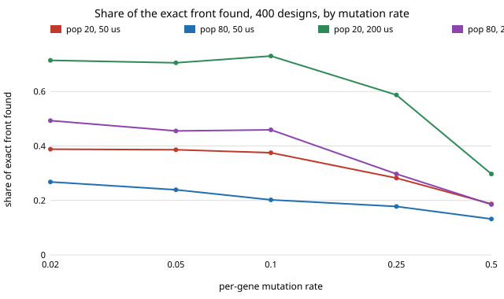

# accel-nsgatune: was `accel-nsga`'s NSGA-II win a tuning accident? A population-size, mutation-rate and crossover sweep (stylised, exact ground truth)

Follow-up to `accel-nsga` (track 8, task-specific AI accelerators), taking the first step its README listed: sweep NSGA-II's population size and mutation rate, which that project fixed at 20 and 0.25 without tuning. The question: at a budget of 400 designs (10.4% of the 3,840-design keyword-spotting co-design space), how much of the exact accuracy/area/energy Pareto front does NSGA-II find as its hyperparameters change, and does crossover matter? Produced with AI assistance (Claude). It builds on none of the CU Boulder groups in `prompt.md` and claims no connection to them.

**Live page:** https://duncan-haywood.github.io/oss-monorepo/research/accel-nsgatune/

**Builds on.** `research/accel-nsga` imported unchanged (space, constrained domination, ranking, hypervolume, random search, exact front), itself built on `research/accel-kws` and `research/accel-codesign`. NSGA-II is Deb et al. (2002), *IEEE Trans. Evol. Comput.* 6(2). Only `nsga2_x` is new: the same loop with a switch that removes crossover.

## Method
- Same space, deadlines (50 and 200 us), seeds scheme (30 seeds, `1000*seed + budget`), budget metric (unique designs) and scores (share of the exact front's designs found; hypervolume ratio) as `accel-nsga`.
- NSGA-II with population {10, 20, 40, 80} x per-gene mutation {0.02, 0.05, 0.1, 0.25, 0.5}, with uniform crossover; and a no-crossover variant (each child is a mutated copy of one tournament winner) at population 20 and 40.
- One budget, 400. `accel-nsga`'s other budgets were not re-swept.

## Reproduce
```bash
cd research/accel-nsgatune
python3 experiments/run.py        # ~3-4 min, stdlib only; rewrites results.json / results.txt
python3 experiments/figure.py     # rewrites mutation_sweep.svg
python3 -m unittest discover -s tests -v    # 4 tests
```

## Results (from `experiments/results.txt`, mean of 30 seeds, share of exact front found at 400 designs)
Random search: 0.129 (50 us), 0.116 (200 us). `accel-nsga`'s setting (pop 20, mutation 0.25): 0.282 and 0.587.

| setting | 50 us | 200 us |
|---|---|---|
| pop 20, mut 0.25 (`accel-nsga`) | 0.282 | 0.587 |
| pop 20, mut 0.05 | 0.386 | 0.705 |
| pop 10, mut 0.02 (best at 200 us) | 0.398 | 0.773 |
| pop 10, mut 0.05 (best at 50 us) | 0.399 | 0.759 |
| pop 80, mut 0.25 | 0.178 | 0.297 |
| pop 80, mut 0.5 | 0.132 | 0.185 |
| pop 20, mut 0.02, no crossover | 0.450 | 0.731 |

- **The earlier NSGA-II numbers were under-tuned.** Lowering mutation from 0.25 to 0.02 to 0.1 raises the share found at 400 designs from 0.28 to about 0.38 (50 us) and from 0.59 to about 0.71 to 0.77 (200 us). Every NSGA-II setting with population up to 40 and mutation up to 0.25 beats random search by a margin far above the seed spread (sd 0.06 to 0.14); the exceptions are the extreme settings.
- **Too much randomness erases the advantage.** Population 80 with mutation 0.5 finds 0.132 and 0.185, about the same as random search (0.129 and 0.116); with 400 designs, population 80 is 20% of the budget spent on the first generation.
- **Smaller populations and low mutation win at this budget; below about 0.1 mutation the curve is flat** (differences between 0.02, 0.05 and 0.1 are within about one seed sd at populations 10 and 20).
- **Crossover matters little, and only at some settings.** At 50 us the mutation-only variant is level with or slightly ahead of NSGA-II at every mutation rate (pop 20: 0.450 vs 0.388 at mutation 0.02, 0.296 vs 0.282 at 0.25). At 200 us it is level at mutation 0.02 (0.731 vs 0.714) but behind at mutation 0.1 to 0.25 (pop 20: 0.634 vs 0.730 and 0.474 vs 0.587; pop 40: 0.486 vs 0.663 and 0.399 vs 0.546), gaps of roughly one to two seed sd. So crossover helps a little when mutation is moderate and not at all when mutation is low; on a 4-gene space with a 40-row model table there is little to recombine.
- **Hypervolume again barely moves** (0.97 to 0.998 everywhere), and is slightly *higher* for the high-mutation settings that find less of the front. As in `accel-nsga`, only the exact-front share separates the methods.



## Limitations
- **One budget (400), one space.** The best setting is budget-dependent (a larger budget favours larger populations in general); this sweep does not show that. Four genes, one 40-row model table: no conclusions for large or smooth spaces.
- **Hyperparameters were tuned on the same exact-front score used to report them** and on the same seeds, so "best setting" figures are optimistic; the ranking of broad regions (low vs high mutation) is the robust part.
- **Same stylised hardware assumptions as `accel-nsga`** (assumed bank, supply and clock models, generic-cell areas).
- 30 seeds and no confidence intervals beyond the stored per-seed sd.

## Next steps
A space too big to enumerate (per-layer bit widths, retrained models), where hyperparameters would have to be tuned without the exact front; a budget sweep for the best settings; synthesised banked RTL in place of the assumed models.

## Owner steps
None. Simulation only; no hardware specified, bought or measured, so no bill of materials.

## Outside dependencies
Everything `accel-nsga` depends on (`accel-kws` models, `accel-codesign` Yosys areas, assumed constants). Standard library only.
