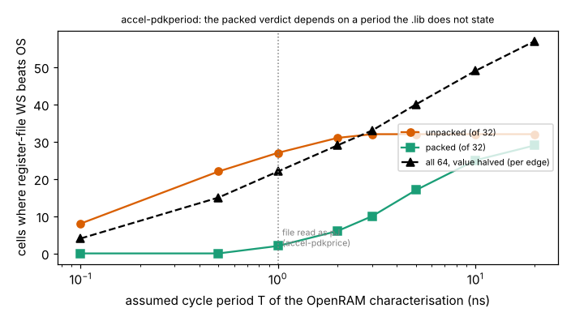

# Is the OpenRAM "access energy" in SKY130 liberty files energy at all, and does `accel-pdkprice`'s verdict survive if it is not?

Eighth step of track 8 (task-specific AI accelerators) in `PROJECTS.md`, and the "resolve the per-edge versus per-cycle reading of the OpenRAM figure" next step of `accel-pdkprice`. That project read the `clk0` `internal_power` of each OpenRAM SRAM macro as energy in pJ (10.4 to 89.5 pJ per access) and concluded that packing weights into SRAM words makes register-file weight-stationary (WS) lose to output-stationary (OS). This project reads the generator's source and finds the figure is **an average power in mW over one clock cycle**, so the energy is that value times a period the `.lib` does not state. The headline: the packed verdict is not robust, the unpacked one is.

**Live page:** https://duncan-haywood.github.io/oss-monorepo/research/accel-pdkperiod/

**Builds on.** `research/accel-pdkprice` (its `results.json`, copied to `data/` with a test that it still equals the original). Source read: OpenRAM (VLSIDA, BSD-3-Clause) `compiler/characterizer/{lib,delay,measurements,stimuli}.py` at commit `b2b069ce119d1488cbe6883b2240bceb5c7ce29a`, fetched not vendored. No lab in `prompt.md` works on this; no lab tag is claimed.

## Method
- **Source reading (tested).** `lib.py` writes the `clk0` pin's `rise_power` / `fall_power` from the `write1_power` / `write0_power` (and read) measurements, so rise and fall mean data value 1 or 0, not clock edge; a per-edge split is not what the file encodes. `delay.py` declares each as `power_measure(..., measure_scale=1e3)`, and `measurements.py` turns it into `.meas tran ... avg -V(vdd)*I(vdd) from=t_initial to=t_final`, where `delay.py` sets `t_initial`/`t_final` to consecutive entries of `cycle_times`, i.e. exactly one clock cycle. So the value is mean power in mW over one cycle of the characterisation period `T`; one cycle's energy is value x `T` (1 mW x 1 ns = 1 pJ). The file's `leakage_power_unit` is also `1mW`. `accel-pdkprice` implicitly assumed `T` = 1 ns. Five tests check these five facts against the pinned sources.
- **What the file leaves out.** `T` appears nowhere usable: the macros' `minimum_period` entries read 0.092 to 0.105 ns, far below any SRAM cycle, so they were not used (unexplained here; they may be a unit error in the pre-built files). All four write/read cases carry one identical number per macro, unlike the generator's separate write1/write0/read1/read0 values, so the shipped files were evidently post-processed; the pinned source is today's `stable`, not necessarily the version that made them.
- **Sweep.** `T` = 0.1, 0.5, 1, 2, 3, 5, 10, 20 ns (the plausible range, as no source fixes it), and a per-edge variant that halves the energy. For each of the 64 cells of `accel-pdkprice` (2 layer shapes x batches x 4 macros x unpacked/packed) count where register-file WS wins, using its unchanged thresholds, and compute each cell's flip period.

## Reproduce
```bash
cd research/accel-pdkperiod
sh fetch_openram.sh openram          # four source files at the pinned commit (needs network)
python3 -m unittest discover -s tests   # 5 tests; the source-reading one skips without openram/
python3 experiments/run.py           # stdlib only; writes results.json and results.txt
python3 experiments/figure.py        # needs matplotlib; writes experiments/pdkperiod.png
```

## Results (from `experiments/results.txt`)
- **At T = 1 ns the run reproduces all 64 of `accel-pdkprice`'s verdicts** (asserted in `run.py`), 29 WS wins: 27 unpacked, 2 packed.
- **Unpacked is nearly period-proof.** With one weight per access WS wins 8 of 32 cells at 0.1 ns, 22 at 0.5 ns, 27 at 1 ns and all 32 from 3 ns up. The unpacked flip periods run 0.025 to 2.5 ns (median 0.29 ns), so for any realistic cycle (a few ns or more) unpacked register-file WS wins everywhere.
- **Packed flips.** With weights packed into the word WS wins 0 of 32 cells at 0.1 and 0.5 ns, 2 at 1 ns, 6 at 2 ns, 17 at 5 ns, 25 at 10 ns and 29 at 20 ns. Packed flip periods run 0.79 to 31 ns (median 4.8 ns). At the cycle periods an SRAM of this size plausibly runs (a few to tens of ns) the packed verdict is split or reversed: `accel-pdkprice`'s "packed, OS wins at nearly every batch" holds only if `T` is about 2 ns or less.
- **Per-edge.** Halving the value (a per-edge reading) moves the 1 ns count from 29 to 22 of 64 and the 20 ns count from 61 to 57. It does not change the picture: the period matters more than the edge question, which the source answers anyway (rise/fall are data values).
- **Partial sums in SRAM** lose in every cell for any `T`: the verdict compares two accesses of the same macro, so the scale cancels.
- So of `accel-pdkprice`'s three conclusions, the partial-sum one is unchanged, the unpacked one strengthens, and the packed one (and with it the claim that "a real design that packs weights prefers OS or a clock-gated WS") is conditional on an unstated period. Clock-gated WS (`accel-gatedprice`) is untouched as it does not depend on macro energy as the deciding term.



## Limitations
- The central uncertainty is not resolved: no source gives `T` for the shipped macros. Settling it needs the characterisation log, regenerating the macro with OpenRAM and ngspice (not installable here) or measuring a taped-out part.
- The reading rests on OpenRAM's current `stable` source; the shipped `.lib` files may have been generated by an earlier version, or edited (all four cases carry one number).
- The energy of a cycle in which the macro idles (clock toggling with `csb` high) is a separate, smaller figure in the generator ("disabled" power) that the shipped files do not carry.
- Everything else from `accel-pdkprice` carries over: library values, not measurements; idle `dfxtp_1`; 4-bit weights, 24-bit partial sums; SKY130 at 1.8 V.

## Next steps
Regenerate one macro with OpenRAM (the generator and ngspice or Xyce) to read the characterisation `T` and the four cases separately; then re-run this sweep with the true value. Repeat with a macro whose published energy is known from a measured chip.

## Owner steps
None. Source reading and arithmetic on committed results only; nothing was bought or measured.

## Outside dependencies (vitamins)
OpenRAM characterizer sources at a pinned commit (BSD-3-Clause, fetched); `accel-pdkprice`'s results; matplotlib for the figure (optional). The macros' real cycle period is the missing input.
