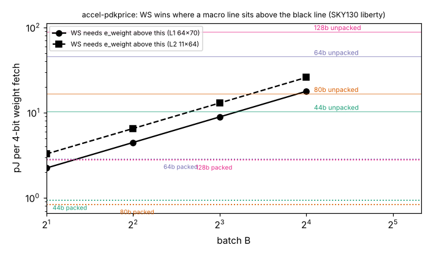

# accel-pdkprice

Seventh step of track 8 (task-specific AI accelerators) in `PROJECTS.md`, and the "source flop clock energy and SRAM read energy from an open PDK" next step of `accel-fetchprice`. That project solved for the breakeven price ratios at which register-file weight-stationary (WS) scheduling beats output-stationary (OS) on energy, and deliberately used no energy constants. This project supplies two sets from the open SKY130 libraries: the clock energy of an idle `dfxtp_1` flop from the standard-cell liberty file, and the per-access energy of the four OpenRAM SRAM macros shipped with OpenROAD-flow-scripts. The question: at SKY130's own prices, which side of each breakeven does a real design land on, and does packing 4-bit weights into wide SRAM words change the answer?

**Live page:** https://duncan-haywood.github.io/monorepo-projects/research/accel-pdkprice/

**Builds on.** `research/accel-fetchprice` (breakevens, copied to `data/` with a test that it still equals the original), `research/accel-planebatch` (the RTL counts behind them). Library files: SKY130 HD `tt_025C_1v80` liberty and the `sky130_sram_1rw1r_*_TT_1p8V_25C.lib` macro files from OpenROAD-flow-scripts at commit `e5cc6e799f5ddf36e6bdf2d8c5db73373b88f52c` (Apache-2.0; fetched, not vendored). No lab in `prompt.md` works on this; no lab tag is claimed.

## Method
- Idle flop, one clock cycle, D and Q static: `e_flop` = mean of the CLK pin's rise table + mean of its fall table (`internal_power`) + `C_clk x VDD^2` for the clock-pin capacitance + leakage x an assumed 10 ns period. Wire capacitance and the clock tree are not included.
- SRAM: the `clk0` pin's `internal_power` value, which the file gives as one number for every `csb0`/`web0` combination (read and write alike) and the same for rise and fall. It is taken as the energy of one access to one word. Word widths 44, 80, 64 and 128 bits.
- `e_weight` per 4-bit weight is the access energy (**unpacked**, one weight per access) or access energy / (width/4) (**packed**, every word full of weights, a best case).
- Register-file WS beats OS iff `e_weight > e_flop / (e_flop*/e_weight)`, from `accel-fetchprice`. WS with partial sums in SRAM beats OS iff `e_psum/e_weight < r_psum*`, taking `e_psum` as one access of the same macro.

## Reproduce
```bash
cd research/accel-pdkprice
sh fetch_pdk.sh pdk                  # sparse clone of ORFS at the pinned commit (needs network)
python3 -m unittest discover -s tests   # 12 tests; the two that read the real libraries skip without pdk/
python3 experiments/run.py           # stdlib only; writes results.json and results.txt
python3 experiments/figure.py        # needs matplotlib; writes experiments/pdkprice.png
```

## Results (from `experiments/results.txt`)
- **An idle SKY130 flop costs 46.4 fJ per cycle**: 40.5 fJ clock-pin internal power (table range 39.8 to 42.4 across slews), 5.8 fJ for the pin capacitance (1.79 fF), and 0.0001 fJ of leakage at 10 ns. Leakage is negligible next to clocking, so the earlier worry about leakage-lumped `e_flop` does not matter here; clock gating is what removes the cost.
- **The SRAM macros cost 10.35 pJ (44-bit), 16.78 pJ (80-bit), 45.62 pJ (64 x 256) and 89.55 pJ (128 x 256) per access**, i.e. 0.21 to 0.71 pJ per bit of word, rising with macro size.
- **Minimum weight-fetch energy for register-file WS to win** (ungated flops): 2.2, 4.5, 8.9 and 17.8 pJ at B = 2, 4, 8, 16 on the 64x70 layer; 3.3 to 26 pJ on the 11x64 layer.
- **Unpacked, WS usually wins; packed, OS wins.** With one weight per access every macro prices a weight at 10 pJ or more, above the threshold for all B except 44-bit and 80-bit at the largest batches (OS wins there). With weights packed into the word, a weight costs 0.8 to 2.9 pJ and OS wins at nearly every batch; the exception is the 64x256 and 128x256 macros at B = 2 on the 64x70 layer, where 2.85 and 2.80 pJ edge above 2.24 pJ. For the one macro that can hold that layer's 17,920 weight bits, the 128 x 256 (32,768 bits), packed access gives WS only at B = 2.
- **WS with partial sums in SRAM loses in every cell.** One access of a macro holds `W/4` weights but only `W/24` 24-bit partial sums, so `e_psum/e_weight >= 1` when both are packed (and 1 or more unpacked), above `r_psum*` of at most 0.48. This agrees with `accel-dataflow` and `accel-fetchprice`, and now follows from library numbers.
- So the earlier finding ("WS needs cheap idle flops") sharpens: in SKY130 a real design that packs weights prefers OS or a clock-gated WS, and register-file WS without gating pays only when weights are fetched one at a time from a wide macro.



## Limitations
- Library characterisation values, not measurements. The OpenRAM files give one scalar per macro with no separation of read and write, no dependence on the data or the address, and the clock-pin figure may be per rising edge or per full cycle (rise and fall are equal in the file); if it is per edge pair, every access energy above halves, which moves several cells (the table is sensitive to this and it is not resolved here).
- The macros do not match the accelerator: a 44 x 64 or 80 x 64 macro is too small for the 64x70 layer (17,920 bits), several would be needed, and bigger macros cost more per access, a confound the packed numbers inherit.
- Flop energy is an idle `dfxtp_1`; the real register-file flops may be enable-flops (extra mux) or gated by the synthesis flow, and the clock tree and wire load are left out. Clock gating makes the flop term near zero, and then WS wins on energy at any price.
- Only 4-bit weights and 24-bit partial sums, the two layer shapes and P = 8 engine of `accel-planebatch`; MAC energy and activations drop out as before.
- SKY130 at 1.8 V, 130 nm only; absolute energies do not transfer to other nodes, only the method does.

## Next steps
Resolve the per-edge versus per-cycle reading of the OpenRAM figure (the macro's `.sp` netlists could be simulated with ngspice if it installs); price a clock-gated WS (the ICG cell is in the liberty) and a WS with partial sums in a small flop array; repeat with another open PDK (GF180 or ASAP7 in the same ORFS tree) to see how much the verdicts move with node.

## Owner steps
None. Analysis of library files and simulation output only; no hardware was specified, bought or measured.

## Outside dependencies (vitamins)
The SKY130 HD and OpenRAM liberty files from OpenROAD-flow-scripts (fetched at a pinned commit; Apache-2.0); Python standard library for the model and tests; matplotlib for the figure (optional); the `accel-fetchprice` results.
