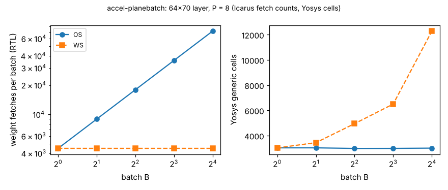

# accel-planebatch: does the weight-stationary advantage in the dataflow model survive RTL at batch above 1? (stylised)

Fifth step of track 8 (task-specific AI accelerators) in `PROJECTS.md`. `accel-plane` checked the schedule model against RTL only at batch 1; `accel-dataflow` ranked weight-stationary (WS) worst at batch 4 because it spills partial sums to SRAM. Here one parameterised Verilog engine implements both batched schedules, output-stationary (OS, loop order tile, batch, input) and WS (tile, input, batch), and the testbench counts operand fetches at the ports. The question: do the RTL cycle, weight-fetch and activation-fetch counts equal the model's at B = 1 to 16, and what does WS's saving in weight fetches cost in gates when its partial sums stay in registers?

**Live page:** https://duncan-haywood.github.io/monorepo-projects/research/accel-planebatch/

**Builds on.** `research/accel-dataflow` (`flows.simulate` is the thing being checked), `research/accel-plane` (testbench style, masked tail lanes, Yosys recipe), `research/accel-kws` (layer shapes 64x70 and 11x64, int4 weights, int8 inputs, 24-bit accumulators). No lab in `prompt.md` works on this directly, so no lab tag is claimed beyond the repository's digital-twin theme (a cheap model checked against a more faithful one).

## Method
- `rtl/batch_engine.v`: lane j owns output `t*P+j`. `WS=0` keeps one set of P accumulators and re-addresses every weight for each batch element. `WS=1` holds the weight bus still for B cycles and keeps B sets of P accumulators (a register file indexed by batch). Lanes past O are masked.
- `rtl/tb_batch.v` returns a nonzero garbage weight for out-of-range lanes, counts a **weight fetch** whenever a valid lane's (row, column) differs from the previous cycle, and an **activation fetch** whenever (batch, column) differs, over the cycles the engine runs.
- `src/accel_planebatch/rtl.py` compares every output with `einsum` in NumPy and the counts with `accel_dataflow.flows.simulate`. Area is Yosys 0.33 `synth -flatten` then `abc` to generic gates, as in `accel-plane`; memories are external.
- **Difference from the model's WS.** The model's WS writes partial sums to SRAM (its `p_wr` column in `results.txt`). This engine's WS does not: it pays in flops instead. The comparison is therefore on weight and activation fetches and cycles only; partial-sum traffic is not compared because it does not exist in this RTL.

## Reproduce
```bash
sudo apt-get install -y iverilog yosys python3-numpy   # plus matplotlib for the figure
cd research/accel-planebatch
python3 -m pytest tests -q            # 5 tests, ~6 s
python3 experiments/run.py            # ~1 min: 20 RTL runs and 20 syntheses; writes results.json and results.txt
python3 experiments/figure.py         # writes experiments/planebatch.png from results.json only
```

## Results (from `experiments/results.txt`; P = 8 lanes)
- **All 20 sweep points are bit-exact against NumPy** (2 layer shapes x B in 1, 2, 4, 8, 16 x 2 engines; 2 random problems each, identical counts across problems). The tests add tails in both dimensions, P larger than O, single-element dimensions and extreme values.
- **Cycles and fetch counts equal the model.** RTL cycles minus model cycles is 2 at every point for both engines (the same testbench handshake offset as `accel-plane`); RTL weight fetches and activation fetches equal `flows.simulate` exactly at every point, and the test suite repeats this on seven more shapes including P = 32 and B = 6.
- **WS buys weight fetches with gates, at equal cycles.** On 64x70, WS fetches the 4,480 weights once at every B, while OS fetches 4,480 x B (71,680 at B = 16). Cycles are identical (8,962 at B = 16). OS cells stay at about 3,000 and flops at about 410 for every B; WS grows from 3,024 cells and 403 flops at B = 1 to 12,284 cells and 3,297 flops at B = 16, about 192 flops (8 lanes x 24 bits) per extra batch element.
- **So the model's ranking is not the whole story.** `accel-dataflow` found WS 4.5 to 9 times worse than OS at batch 4 because of partial-sum SRAM traffic; with the partial sums held in a register file that cost disappears from the memory but appears as a 1.7x larger design at B = 4 (4,946 against 2,982 cells). Which wins then depends on the relative price of an SRAM weight fetch and a flop, which this project does not measure.



## Limitations
- Generic-gate cell counts, not a standard-cell flow, and no timing; flops-in-a-register-file for 24-bit accumulators is the simplest implementation, not the cheapest (a small SRAM would be). Only P = 8 was swept.
- Matrix-matrix without bias, ReLU or requantisation; two layer shapes; random data (counts do not depend on values).
- Fetch counting assumes a one-cycle register per lane and bus, as the model does; no real memory, bank conflicts or buffering are modelled.

## Next steps
Price the fetches: put an assumed SRAM-read energy against the flop cost and find the batch at which WS breaks even (a crossover, with the constants labelled assumed); try a WS variant with partial sums in a small SRAM macro estimate; sweep P; then `accel-policy` follow-ups.

## Owner steps
None. Simulation only; no hardware was specified, bought or measured.

## Outside dependencies (vitamins)
Icarus Verilog and Yosys from apt; Python standard library, NumPy for the tests and matplotlib for the figure; `accel-dataflow` for the schedule model.
