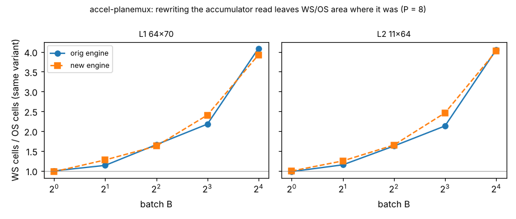

# accel-planemux: does the accumulator-read bug found in `accel-gatedmux` also inflate `accel-planebatch`'s weight-stationary area? (No: its verdict stands.)

Twelfth step of track 8 (task-specific AI accelerators) in `PROJECTS.md`. `accel-gatedmux` found that a variable-index read of the accumulator bus (`slot*P + j`) made every weight-stationary (WS) engine in `accel-gatedrtl` 17 to 28 % too large, and listed "look for the same indexing pattern in the other `accel-*` and `chip-*` engines" as a next step. `accel-planebatch/rtl/batch_engine.v` has the same `acc[slot*P + j]` read and write, and its headline ("WS costs up to 4x the generic gates") feeds `accel-fetchprice`. This is the audit: rewrite the read as an AND-OR over constant indices and the write as decoded enables, and re-run the whole 40-point sweep. It seemed worth doing because a corrected number upstream would have changed a chain of later projects; the answer turns out to be that it does not.

**Live page:** https://duncan-haywood.github.io/monorepo-projects/research/accel-planemux/

**Headline (negative).** The rewritten engine is bit-exact with identical cycles and operand-fetch counts, and **its area is within -3 % to +12 % of the original at every WS point, with no trend** (WS/OS at B = 4 on 64x70: 1.66 before, 1.62 after; at B = 16: 4.09 and 3.92). `accel-planebatch`'s WS-over-OS area ratios and everything built on them stand. The variable index mattered in `accel-gatedrtl` because the accumulators were a flat bus; here they are a Verilog array, which Yosys already maps to a per-entry mux.

**Builds on.** `research/accel-planebatch` (original engine and testbench, used in place; its committed `results.json` is reproduced exactly by the `orig` variant, which a test checks) and `research/accel-gatedmux` (the fix being transplanted). No lab in `prompt.md` works on this; no lab tag is claimed.

## Method
- `rtl/batch_engine.v` here is `accel-planebatch`'s engine with two edits: the read `acc[slot*P + j]` becomes `cur[j]`, OR-ed over `k` with `slot == k` (constant `acc[k*P + j]`); the write becomes `if (slot == k) acc[k*P + j] <= nxt[j]`. Nothing else changes.
- Same sweep as `accel-planebatch`: two `accel-kws` layer shapes (64x70, 11x64), B in 1, 2, 4, 8, 16, P = 8, OS and WS, two random problems each, Icarus Verilog against NumPy `einsum` and against `accel-dataflow`'s schedule model; Yosys 0.33 `synth -flatten` then `abc` to generic gates. Both variants are synthesised in this run (40 points), so the comparison is like with like.

## Reproduce
```bash
sudo apt-get install -y iverilog yosys     # plus numpy and matplotlib in a Python environment
cd research/accel-planemux
python3 -m unittest discover -s tests      # 8 tests
python3 experiments/run.py                 # ~2.5 min; writes results.json and results.txt
python3 experiments/figure.py              # writes experiments/planemux.png
```

## Results (from `experiments/results.txt`)
- **Function is unchanged.** All 40 runs are bit-exact against NumPy; cycles (a constant 2 above the model, the testbench handshake) and weight and activation fetches are identical between the two engines and equal the model. The tests add tails, P larger than O, P = 32 and extreme values.
- **Area does not move consistently.** `new / orig` cells for WS run from 0.968 to 1.122 (B = 2: +9.6 %, +9.5 %; B = 8: +12.0 %, +12.2 %; B = 16: -3.2 %, -3.2 %; B = 4: -1 %). For OS, whose logic is the same text in both variants, the ratio still wanders from 0.972 to 1.013 across B, so about 3 % of any difference is the technology mapper's run-to-run structure, not the design. The +10 to +12 % points are larger than that, but their sign flips with B, so I do not read them as a systematic cost of the rewrite.
- **The verdict is the same.** WS/OS cells at 64x70: B = 2 1.14 vs 1.27, B = 4 1.66 vs 1.62, B = 8 2.18 vs 2.41, B = 16 4.09 vs 3.92 (orig vs new). Flops differ by 1 to 4 of 600 to 3,300 (the rewrite lets Yosys drop a counter bit).
- **Reproducibility check.** The `orig` variant reproduces `accel-planebatch`'s committed cells and flops at all 20 points (tested), so the Yosys here matches.



## Limitations
- Generic-gate cells, not a standard-cell flow, no timing, one P. The audit covers this one engine; `accel-plane`'s `os_engine.v` and `rt_engine.v` use only constant `+:` slices and `accel-lut*`/`accel-codesign` index with loop variables, so I did not rewrite them, but I did not synthesise a before/after for them either.
- The mapper noise estimate is from one engine (OS across B), not a repeated-run study. I could not distinguish the +10 to +12 % points from noise plus a small real effect.
- Why a Verilog array behaves differently from a flat bus is inferred from the outcome, not from inspecting Yosys passes.

## Next steps
Redo `accel-gatedrtl`'s SRAM-macro comparison with the corrected engine (still open from `accel-gatedmux`); run OpenROAD for a clock tree and timing; add a `chip-*` engine audit with a before/after synthesis.

## Owner steps
None. Simulation and synthesis only; no hardware was specified, bought or measured.

## Outside dependencies (vitamins)
Icarus Verilog and Yosys (apt); NumPy; matplotlib for the figure; `accel-planebatch` and `accel-dataflow` from this repository.
