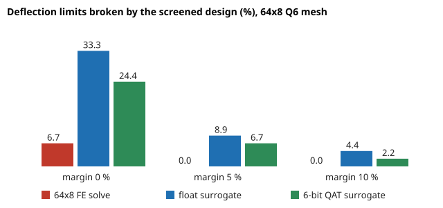

# accel-surrogatelock: with a locking-free finite-element simulator, how much surrogate error can a design loop tolerate? (stylised, preliminary)

Track 8 (task-specific AI accelerators), follow-up to `accel-surrogate2d`, whose "Next steps" asked for a locking-free element so the simulator's own error is small, then to ask how much surrogate error a design loop tolerates. Here the 2D cantilever uses a Q6 element (bilinear quadrilateral plus two incompatible bubble modes, condensed out; Taylor, Beresford and Wilson 1976) instead of the locking Q4. An 8-32-32-1 MLP imitates the solve at three mesh sizes, is quantised to 6 and 8 weight bits, and is then used to screen designs in a minimum-mass search. Produced with AI assistance (Claude).

**Live page:** https://duncan-haywood.github.io/monorepo-projects/research/accel-surrogatelock/

**Why it seemed worth doing.** `accel-surrogate2d` could only say the surrogate adds little "relative to a locking simulator's error". With a simulator that is accurate (Q6 is within 0.6 % of Timoshenko beam theory even on a 16x2 mesh, a test checks it), the surrogate's error is no longer hidden behind the simulator's, and the question that matters to a designer, how many designs the surrogate gets wrong, can be measured.

## Headline (all numbers from `experiments/results.txt`; 3 seeds)
- **Q6 fixes the locking.** Uniform beam, 16x2 mesh: Q4 gives 0.51 of the Timoshenko deflection, Q6 0.994. For the stepped test beams the remaining mesh error is the smoothed section steps, not locking: median 12.7 % (16x2), 6.0 % (32x4), 2.3 % (64x8) against a 128x16 Q6 reference, against 30.6 % and 9.2 % for Q4 in `accel-surrogate2d`.
- **The surrogate now owns a visible share of the error.** At 64x8 the surrogate is 2.3 to 2.9 % off its own FE and, against the reference, float 3.11 %, 6-bit QAT 2.86 %, FE itself 2.31 %: the surrogate adds about 0.5 to 0.8 points. The energy break-even is as before (modelled MLP 3.2 to 3.7 nJ per query, FE solve 128 nJ at 32x4 and 1,187 nJ at 64x8, i.e. 34 to 367 times; assumed constants, Q4 flop count reused).
- **Design loop.** Pool of 1,000 random designs; for each of 15 deflection limits (quantiles 0.15 to 0.85 of the pool's reference deflections) pick the lightest design the screen says meets the limit with a safety margin, then check it on the reference. With **no margin the screen picks a design that breaks the limit** in 24 to 33 % of limits at 64x8 (FE solve alone: 6.7 %). A 5 % margin cuts that to 6.7 % (QAT-6) and 8.9 % (float); 10 % to 2.2 % and 4.4 %. The FE solve on the same mesh needs 5 % to reach 0. The price of the margin is mass: +0.5 % (QAT-6) to +1.6 % over the oracle at 5 to 10 %. On the coarse 16x2 mesh even a 10 % margin still breaks 24 to 27 % of limits for the surrogates (6.7 % for the FE), because the simulator's own error is 12 %.
- **Rule of thumb from this run:** a margin of about twice the surrogate's median error keeps violations to a few percent; the 6-bit QAT surrogate was no worse than the float one in the loop (differences are within seed noise: 15 correlated limits x 3 seeds, no confidence intervals).

## Method
- `src/accel_surrogatelock/fe2d.py`: `tip_deflection(h, nx, ny, elem)` with `elem='q4'` or `'q6'` (default). Q6 uses the element-centre Jacobian for the bubble gradients so the patch test holds.
- `experiments/run.py`: for each mesh 16x2, 32x4, 64x8, 2,500 FE designs (2,000 train, 500 test), MLP trained in float then QAT at 6 and 8 bits (as `accel-surrogate2d`), error against own FE and against the 128x16 reference (100 test designs), then the design loop above. `python3 experiments/run.py` takes about 25 minutes on a CPU; `--report` rebuilds `results.txt`.
- Energy and flop figures reuse `accel-surrogate2d`'s assumed 45 nm constants (`cost.py`); the flop count is the Q4 banded estimate and ignores Q6's condensation.

## Reproduce
`PY=$(python3 platform/ci/pyenv.py pytest numpy scipy)`; `"$PY" research/accel-surrogatelock/tests/test_fe2d.py`; `"$PY" research/accel-surrogatelock/experiments/run.py`; `python3 research/accel-surrogatelock/experiments/figure.py`.

## Limitations
- The "truth" is the 128x16 Q6 model, itself a smoothed stepped beam, not a measured or exactly converged one. 2D plane stress, one load case, eight section heights, no stress or buckling constraints.
- The loop is a random-pool screen, not an optimiser; "extra mass" below zero in `results.txt` at 0 % margin means the pick broke the limit.
- Few limits and seeds, no confidence intervals. Energy is modelled, not measured.

## Next steps
Replace the random pool with a gradient or evolutionary search that queries the surrogate adaptively and re-verifies with the FE (a surrogate-assisted loop), and add stress constraints; map the 6-bit engine to RTL with `accel-kws`'s serial MAC.

## Owner steps
None. Simulation and arithmetic only.

## Outside dependencies
NumPy (BSD-3), SciPy (BSD-3). Prior work: Taylor, Beresford and Wilson (1976), *Int. J. Numer. Meth. Eng.* (incompatible-mode elements); Zienkiewicz and Taylor, *The Finite Element Method*; Timoshenko beam theory; Horowitz (2014), ISSCC; Jacob et al. (2018), CVPR. No lab in `prompt.md` works on this; no lab tag is claimed.
