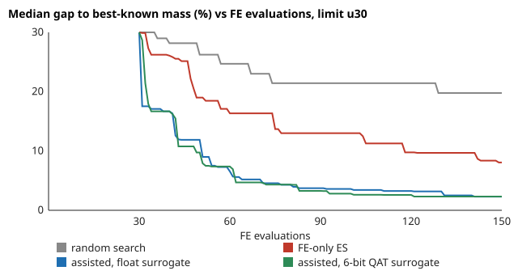

# accel-surrogateloop: does a quantised surrogate make a design search cheaper in FE solves than searching with the simulator alone? (stylised, preliminary)

Track 8 (task-specific AI accelerators), follow-up to `accel-surrogatelock`, whose "Next steps" asked for a surrogate-assisted loop in place of a random-pool screen. Same locking-free Q6 2D cantilever, 64x8 mesh as the expensive simulator. Eight section heights are chosen to minimise mass under a tip-deflection limit. Four searches get the same budget of FE evaluations: random search, a (1+10) evolution strategy on the FE solve alone, and a surrogate-assisted loop whose MLP is float or 6-bit quantisation-aware. Produced with AI assistance (Claude).

**Live page:** https://duncan-haywood.github.io/oss-monorepo/research/accel-surrogateloop/

**Why it seemed worth doing.** `accel-surrogatelock` showed a surrogate screen needs a safety margin, but its pool was random, so it could not say whether a surrogate beats just searching with the simulator. This asks that at equal simulator cost.

## Headline (all numbers from `experiments/results.txt`; 8 seeds, 150 FE evaluations each)
Gap is the best feasible mass over the best-known mass, minus 1. The best-known design is one 1,500-evaluation ES run per limit, so it is a reference, not a proven optimum.
- **Limit u30** (deflection of a uniform 30 mm beam, 7.05 mm; best-known mass 0.2122 m of height sum): median gap at 150 evaluations is random 19.8 %, FE-only ES 8.1 %, assisted float surrogate **2.3 %**, assisted 6-bit QAT surrogate **2.3 %**. At 100 evaluations: 21.4, 13.0, 3.6, 2.8 %.
- **Limit u40** (uniform 40 mm beam, 2.97 mm; best-known 0.2753): 14.0, 5.9, **2.8**, **2.5 %** at 150 evaluations.
- **Evaluations to match.** At 100 evaluations the assisted loops are already at or below what the FE-only ES reaches at 150 on both limits (u30: 3.6 and 2.8 % against 8.1 %; u40: 4.3 and 3.4 % against 5.9 %). So the surrogate saves roughly a third or more of the FE solves for this accuracy.
- **The 6-bit surrogate costs nothing visible here.** It is within seed noise of the float one (u30 at 150: 2.31 vs 2.32 %; u40: 2.78 vs 2.48 %); the worst seed is better at 6 bits on u40 (5.0 vs 6.1 %) and worse on u30 (5.1 vs 3.7 %). Eight seeds with no confidence intervals cannot rank them.
- **The surrogate still proposes infeasible designs.** Of 960 designs per limit that the surrogate chose (margin 5 %), 141 to 204 (15 to 21 %) broke the limit when the FE solve checked them. That is harmless here because every pick is verified; it is why a screen without verification needs the margins found in `accel-surrogatelock`.

## Method
- `src/accel_surrogateloop/fe2d.py`, `mlp.py`, `cost.py`: copied unchanged from `accel-surrogatelock` (Q6 FE, NumPy MLP with QAT). `loop.py` holds the three searches; each returns the best feasible mass after every evaluation.
- Every method starts with the same 30 random designs (own seed), then spends the rest of the 150 evaluations. The ES mutates the best feasible design (or the least violating one) with a success-adapted step. The assisted loop trains an 8-32-32-1 MLP on log deflection, builds 4,000 candidates (mutations of the three best feasible designs at two step sizes, plus random ones), keeps those predicted to meet the limit with a 5 % margin, sends the 10 lightest to the FE solve, retrains on everything, and repeats. The QAT variant fine-tunes at 6 weight bits after each fit and screens with the quantised network.
- `experiments/run.py` runs 8 seeds x 2 limits x 4 methods plus the two long references (about 16 minutes on 4 CPU cores); `--report` rebuilds `results.txt`.

## Reproduce
`PY=$(python3 platform/ci/pyenv.py pytest numpy scipy)`; `"$PY" research/accel-surrogateloop/tests/test_loop.py`; `"$PY" research/accel-surrogateloop/experiments/run.py`; `python3 research/accel-surrogateloop/experiments/figure.py`.

## Limitations
- The simulator is the same 64x8 Q6 model both for search and for judging, so this measures search efficiency on that model, not accuracy against a converged truth (that gap is in `accel-surrogatelock`).
- One 8-variable problem, two limits, one load case, no stress constraints. An ES in 8 dimensions is a weak baseline compared with a tuned CMA-ES or Bayesian optimisation; I did not run either, so "surrogate beats FE-only search" is shown against this ES and random search only. Hyperparameters (30 initial points, batches of 10, 5 % margin) were set once, not tuned, for any method.
- The best-known reference is a single run, and the assisted loops' best gaps stay positive, so none beat it. No confidence intervals; 8 seeds.
- The accelerator side is not touched: no energy figure here is new. The surrogate's per-query energy is as modelled in `accel-surrogatelock`, and surrogate retraining cost is not counted, only FE solves.

## Next steps
Compare against CMA-ES and a Gaussian-process Bayesian optimiser at the same budget; count retraining cost in energy; add stress constraints; map the 6-bit engine to RTL with `accel-kws`'s serial MAC.

## Owner steps
None. Simulation only.

## Outside dependencies
NumPy (BSD-3), SciPy (BSD-3). Prior work: `accel-surrogatelock`, `accel-surrogate2d`; surrogate-assisted evolutionary optimisation in general (Jin, 2011, *Swarm and Evolutionary Computation* 1(2)); Taylor, Beresford and Wilson (1976) for the element. No lab in `prompt.md` works on this; no lab tag is claimed.
