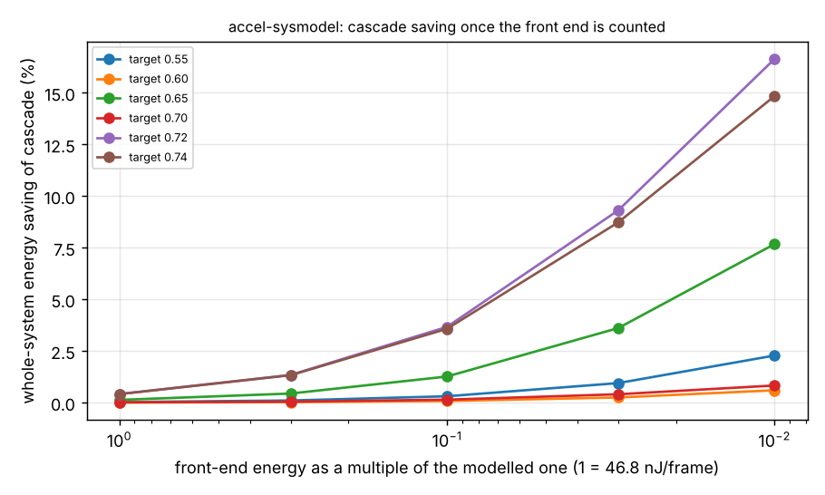

# accel-sysmodel: once the MFCC front end is counted, does the energy-optimal keyword model change?

Track 8 (task-specific AI accelerators) in `PROJECTS.md`. `accel-cascade` ended with "price the cascade against the front end in one system model"; this project does it, by joining two committed result files rather than retraining anything. Produced with AI assistance (Claude).

**Headline.** With the front end at the modelled 46.8 nJ per 20 ms frame (584.6 nJ per keyword decision at 50 frames and 4 decisions per second), the cascades' classifier-only savings of up to 28% shrink to at most 0.42% of whole-system energy, while they lose 0.3 to 1.4 points of test accuracy. And the model that is most accurate on validation (about 0.75 test accuracy) costs 23 to 26 times the cheapest model that clears 0.5 validation accuracy (about 0.47 to 0.49), yet only 5.2 to 5.8% more system energy. At this front end, spend the energy on the accurate model; a cascade or a minimal model is not where the budget goes.

**Live page:** https://duncan-haywood.github.io/monorepo-projects/research/accel-sysmodel/

**Builds on.** `research/accel-cascade` (`experiments/results.json`: 40 designs per seed with modelled energy and validation/test accuracy, and the selected single and cascade picks per target, 5 seeds) and `research/accel-frontend` (`experiments/results.json`: 46.77 nJ per frame). Energy constants are the `accel-kws` MAC model, checked against Horowitz (2014) within 4% by `accel-horowitzcheck`. No CU Boulder group is built on.

## Method
System energy per decision = 12.5 x front-end frame energy + classifier (or cascade) energy, the stream case where each frame is computed once. Cascade stage 2 reuses the same features, so it adds no front-end cost. A: for each accuracy target, the whole-system saving of `accel-cascade`'s selected single-or-cascade pick over its selected single pick (test-set energies, mean over seeds), with the front end scaled by 1 to 0.01 to ask how much cheaper it must get before cascades matter. B: per seed, the cheapest design with validation accuracy at least 0.5 against the design with the best validation accuracy.

## Reproduce
```bash
pip install numpy matplotlib
cd research/accel-sysmodel
python3 experiments/run.py        # seconds; results.json / results.txt
python3 experiments/figure.py     # system.png
python3 -m unittest discover -s tests -v   # 5 tests
```

## Results (from `experiments/results.txt`)


| target | classifier-only saving | system saving, fe x1 | fe x0.1 | fe x0.01 | test acc diff |
|---|---|---|---|---|---|
| 0.65 | 17.7% | 0.14% | 1.27% | 7.68% | -0.012 |
| 0.72 | 27.5% | 0.42% | 3.67% | 16.64% | -0.003 |
| 0.74 | 22.8% | 0.42% | 3.58% | 14.84% | -0.008 |

Cascades reach a few per cent of system energy only if the front end gets about 10 to 30 times cheaper than this implementation (or the classifier's share grows by that much); at x0.01 the saving is up to 17%. Part B: classifier 1.4 nJ vs 32 to 35 nJ, system +5.2% to +5.8%, test accuracy +0.26 to +0.29.

## Limitations
- Not a measurement: the front end and classifier use `accel-frontend` and `accel-kws` modelled constants, and the front-end scale factors are a sweep, not a design. Memory energy is a large share of the front end (`accel-frontend` varied it from 23 to 146 times the classifier).
- Only the streaming schedule is priced, and no microphone, ADC or wake logic. Front-end fidelity (`accel-frontend`) is not folded into accuracy: the classifier accuracies come from float-MFCC features in `accel-cascade`, not the 16-bit integer front end.
- Uses `accel-cascade`'s selections as committed; nothing is retrained here, so the "most accurate model" is the best of that 40-model grid.

## Next steps
Run the classifiers on the integer front end's features to see whether the 16-bit fidelity loss changes the accuracy ranking; price a cheaper front end (fewer mel bands, 8-bit FFT) against the accuracy it costs.

## Owner steps
None. Simulation only; no hardware specified, bought or measured, so no bill of materials.

## Outside dependencies
The committed outputs of `accel-cascade` (Speech Commands v0.02, CC BY 4.0, Google) and `accel-frontend`; assumed energy constants. Python with numpy and matplotlib.
