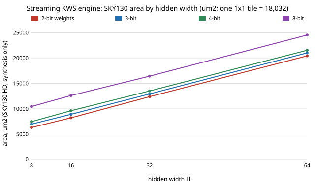

# accel-ttfit: does a keyword-spotting accelerator fit in a Tiny Tapeout tile, and how accurate can it be? (stylised, synthesis only)

Seventh milestone of track 8 (task-specific AI accelerators) in `PROJECTS.md` ("a design sized for Tiny Tapeout"). It seemed worth doing because every earlier `accel-*` area figure assumed weight memories next to the engine, and a Tiny Tapeout tile has no memory macro and only 24 pins. The question: if the weights are streamed in by the host instead, what is the smallest area of a keyword-spotting (KWS) engine that is exact against its integer reference, how does it scale with hidden width and weight bits, and which `accel-kws` model is the most accurate one that fits a tile? Produced with AI assistance (Claude).

**Live page:** https://duncan-haywood.github.io/monorepo-projects/research/accel-ttfit/

## Headline result
- The streaming engine (`rtl/kws_tt.v`) matches an integer NumPy reference on every one of 32 geometries (hidden width 8, 16, 32, 64; weight bits 2, 3, 4, 8; 70 or 120 inputs), classes and cycle counts both, in Icarus Verilog.
- Synthesised to SKY130 HD (Yosys, synthesis only) the area is **6,300 to 24,500 µm²** (661 to 2,090 cells). At 70 inputs and 4-bit weights: 7,461 µm² at H = 8, 9,612 at 16, 13,513 at 32, 21,536 at 64. Flops are 33% (H = 8) to 53% (H = 64) of the area; 8-bit weights cost about 3,000 µm² more than 4-bit at every width.
- Against an **assumed** 1x1 tile of 161 × 112 µm = 18,032 µm², the most accurate `accel-kws` model that fits in one tile is 120 inputs, H = 32, 8-bit weights, test accuracy 0.695, if the layout could be packed to 100% (it cannot); 0.616 (H = 16, 8-bit) at 70% utilisation; 0.558 (H = 16, 3-bit) at 50%. Two tiles hold H = 64 with 4-bit weights (0.738) at 70% utilisation: a 1.7× area step for about 12 accuracy points.
- Speed is not the limit: one inference is 1,351 to 8,535 cycles, 27 to 171 µs at an assumed 50 MHz; the area is.



## Method
- `rtl/kws_tt.v` is a new serial-MAC engine (one MAC per clock, same integer contract as `accel-kws`: accumulate, `>> 4`, ReLU, clip to 0..255, first-maximum argmax). It has **no memories and no address pins**: the host sends, per clock, `ui_in` = x byte or bias byte and `uio_in[WB-1:0]` = weight, in a fixed order (per neuron: two bias bytes, then the operands). Start is `uio_in[7]`; `uo_out` is the class and a done flag. The hidden vector is a rotating shift register, which removes the read mux. Cycles per inference = H·(2+IN) + 11·(2+H) + 1.
- Restrictions vs `accel-kws`, both needed to fit the pins: biases are signed 16-bit (`accel-kws` uses 24) and the accumulator is 20 bits (24 there). The random models used here stay inside both; whether the trained `accel-kws` models do was **not checked** (the trained weights are not in this repository's tree).
- `src/accel_ttfit/rtl.py`: integer reference, host-stream builder, Icarus runner, Yosys flow (`synth -flatten`, `dfflibmap`, `abc` on the SKY130 HD `tt_025C_1v80` liberty from OpenROAD-flow-scripts at the commit pinned in `accel-pdkprice/fetch_pdk.sh`, Apache-2.0, fetched not vendored).
- `experiments/run.py` simulates 4 random inputs per geometry on a seeded random model and compares with the reference; `analyze.py` joins the areas with the test accuracy of the matching `accel-kws` model (`data/accuracy.json`, copied; a test checks it still equals the source) and writes `fit.txt`.
- Tile area: 161 × 112 µm, read from a search-result snippet of Tiny Tapeout's guide ([Creating Silicon Art](https://tinytapeout.com/guides/creating-silicon-art/)); the same search returned other figures (160 × 100 µm per Efabless's description of the early shuttles). I could not reach tinytapeout.com from the container and did **not** check `tile_sizes.yaml`. Treat the tile conclusions as dependent on that number; the µm² areas are not.

## Reproduce
```bash
sudo apt-get install -y iverilog yosys python3-numpy
sh ../accel-pdkprice/fetch_pdk.sh pdk       # from research/accel-ttfit; needs network; pdk/ is gitignored
python3 -m unittest discover -s tests       # 9 tests, a few seconds
python3 experiments/run.py                  # a few minutes: 32 simulations and 32 syntheses; writes results.json, results.txt
python3 experiments/analyze.py              # writes fit.txt
python3 experiments/figure.py               # writes experiments/area_by_width.svg
```

## Results (from `experiments/results.txt` and `experiments/fit.txt`)
| H | 2-bit | 3-bit | 4-bit | 8-bit (µm², 70 inputs) | cycles |
|---|---|---|---|---|---|
| 8 | 6,300 | 6,970 | 7,461 | 10,444 | 687 |
| 16 | 8,212 | 8,901 | 9,612 | 12,607 | 1,351 |
| 32 | 12,388 | 12,926 | 13,513 | 16,430 | 2,679 |
| 64 | 20,416 | 21,014 | 21,536 | 24,537 | 5,335 |

Most accurate `accel-kws` model that fits N tiles (test accuracy, mean over 3 seeds; sd ≤ 0.007):

| tiles | 100% util | 70% util | 50% util |
|---|---|---|---|
| 1 | 0.695 (H 32, 8-bit) | 0.616 (H 16, 8-bit) | 0.558 (H 16, 3-bit) |
| 2 | 0.738 (H 64, 4-bit) | 0.738 | 0.695 (H 32, 8-bit) |
| 3 and up | 0.738 | 0.738 | 0.738 |

The table stops at H = 64 for area, so larger models in `accel-kws` (H = 128, 0.749) were not synthesised and are not in it.

## Limitations
- Synthesis area only: no placement, routing, clock tree or timing. `chip-pnr` measured final-to-mapped area ratios of 1.0 to 1.3 on small SKY130 blocks, which is why the utilisation columns exist; none of these designs was put through a flow, and whether one closes timing at 50 MHz is unknown (the 50 MHz figure is also from the search snippet).
- Accuracy is carried over from `accel-kws` models; the streaming RTL was checked on random models only, not on trained ones, and the bias and accumulator width limits above were not checked against them. The 12-point accuracy gap between one and two tiles inherits `accel-kws`'s weak feature set and third-party dataset mirror.
- The host must supply every operand every clock, so a real board needs a microcontroller or FPGA streaming weights from its own memory: the weight storage moved off the chip, it did not disappear. Its energy and area are not counted. The front end (MFCC) is also off-chip, as in `accel-kws`.
- Pin counts and timing of the streaming interface were not checked against Tiny Tapeout's current rules.

## Next steps
Run one geometry (H = 16, 8-bit) through a full open flow (OpenROAD, as in `chip-pnr`) to replace the utilisation guess with a measured packed area and a timing check; (the limits check is done: [`accel-ttretrain`](../accel-ttretrain) retrained 96 models and all fit); price the off-chip weight stream (a small SPI flash or an RP2040) against the on-chip option.

## Owner steps
Submitting to a Tiny Tapeout shuttle and paying for a tile; a microcontroller or FPGA board to stream the weights, with a priced bill of materials (not done here: no prices were looked up).

## Outside dependencies (vitamins)
Yosys 0.33 and Icarus Verilog 12 (apt), NumPy, matplotlib-free SVG via `research/_shared/linefig.py`; the SKY130 HD liberty file from OpenROAD-flow-scripts; the `accel-kws` accuracy table; the tile size and pin rules from Tiny Tapeout (not re-checked).
