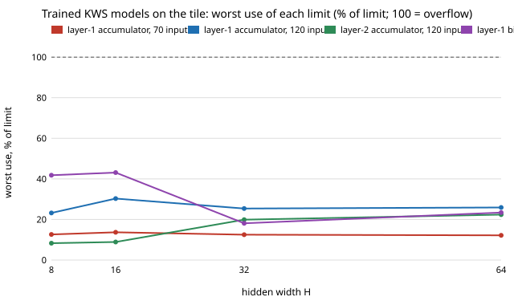

# accel-ttretrain: do trained keyword-spotting models fit a Tiny Tapeout tile's 16-bit bias and 20-bit accumulator? (yes, all 96; stylised)

**Live page:** https://duncan-haywood.github.io/monorepo-projects/research/accel-ttretrain/

Eighth step of track 8 (task-specific AI accelerators) in `PROJECTS.md`. It closes the open check in [`accel-ttfit`](../accel-ttfit): that project's streaming engine has 16-bit biases and 20-bit accumulators (`accel-kws` uses 24), and its accuracy figures came from `accel-kws` models whose weights are not in the repository, so "does a trained model stay inside those limits?" was never tested. It seemed worth doing because every accuracy-per-tile number in `accel-ttfit` depends on the answer, and because Speech Commands, which earlier runs reported as unreachable, downloaded from the Hugging Face mirror in this run.

**Question.** Retrain the `accel-kws` grid (70 and 120 inputs, hidden width 8, 16, 32, 64, weights of 2, 3, 4, 8 bits, 3 seeds: 96 models). Does any model's bias or accumulator exceed the tile's limits, and does the accuracy change when the tile's limits are applied?

## Headline result
- **No.** All 96 trained models fit. Across train and test clips, no layer-1 or layer-2 accumulator reached 2<sup>19</sup>, and no bias reached 2<sup>15</sup>. Worst cases: layer-1 bias 14,139 (43% of its limit), layer-1 accumulator 158,837 (30%), layer-2 accumulator 117,216 (22%), layer-2 bias 3,218 (10%).
- Accuracy through the tile's contract (biases clipped to 16 bits, 20-bit wrapping accumulators) equals the integer reference on every model: the largest difference is 0.0000.
- The trained seed-0 model of each of the 32 geometries, run on 30 evenly spaced test clips through `accel-ttfit`'s `rtl/kws_tt.v` in Icarus Verilog, gives the same class as the reference and the documented cycle count in all 32 (each set of clips covers all 11 classes in the reference output).
- The accuracies `accel-ttfit` used are reproduced for 3-, 4- and 8-bit weights: all 24 of those geometries are within 0.010 (largest 0.0098). The 8 geometries with 2-bit weights differ by up to +0.050 (mean change over all 32: +0.006); seed-to-seed sd at 2 bits is 0.005 to 0.082. The "most accurate model that fits one tile" table in `accel-ttfit` only picks 3-, 4- and 8-bit cells, so it stands.



## Method
- **Data.** Speech Commands v0.02 from the same third-party Hugging Face mirror as `accel-kws` (`pollen-robotics/speech-commands-v0.02`), prepared by `accel-kws/experiments/prepare_features.py` unchanged (11 classes; same hash-based "unknown" subsample). Not checked against the original archive's checksum, as in `accel-kws`.
- **Training.** `accel-kws`'s `train_qat` unchanged (40 epochs, seeds 0 to 2), imported from `../accel-kws/src`. Nothing in training enforces the tile's limits; the question is whether they are met anyway.
- **Limits** (`src/accel_ttretrain/__init__.py`): `stats` takes the largest |bias| and |accumulator| over all train and test clips; a model "fits" if both biases are below 2<sup>15</sup> and both accumulators below 2<sup>19</sup>. `tile_forward` is the engine's contract with 20-bit wraparound, so an overflow would show up as an accuracy drop, not just a flag.
- **RTL.** `experiments/rtlcheck.py` streams the trained seed-0 models through `../accel-ttfit/rtl/kws_tt.v` using that project's host-stream builder and compares classes and cycles with its reference.

## Reproduce
```bash
sudo apt-get install -y iverilog yosys python3-numpy python3-scipy python3-pyarrow
sh ../accel-kws/experiments/download.sh /tmp/sc          # about 3.3 GB
python3 ../accel-kws/experiments/prepare_features.py /tmp/sc /tmp/feats.npz   # a few minutes
python3 experiments/run.py /tmp/feats.npz       # about 6 min: 96 trainings; writes results.json, models.npz
python3 experiments/analyze.py                  # writes results.txt
python3 experiments/rtlcheck.py /tmp/feats.npz  # 32 Icarus runs; writes rtlcheck.json
python3 experiments/figure.py                   # writes experiments/headroom.svg
python3 -m unittest discover -s tests           # 8 tests, no dataset needed
```

## Results
`experiments/results.txt` has the per-geometry comparison and the headroom table; `experiments/results.json` has every model's statistics; `experiments/models.npz` holds the 96 trained integer models (`<segments>_<hidden>_<bits>_<seed>`: w1, b1, w2, b2, then the shift), which are what `accel-ttfit` listed as missing.

## Limitations
- Limits were checked on train and test clips only. A louder or differently conditioned input could reach further, but inputs are clipped to int8 and the largest use is 43% of a limit, so a doubling would not overflow; this is an argument, not a measurement.
- The result is for this one-hidden-layer MLP on this feature set (weak MFCC pooling, accuracy tops out near 0.74). A larger or differently scaled model could need more bits.
- Accuracy differences from `accel-ttfit` at 2-bit weights are within or near seed spread but were not traced to a cause; training is seeded, so numpy or BLAS version differences are a possible reason (not tested).
- 30 clips per RTL comparison, one seed per geometry. The synthesis area in `accel-ttfit` is unchanged and still synthesis-only.
- A fit on the limits says nothing about timing, pins or whether a host can stream weights (see `accel-ttfit`).

## Next steps
Run one geometry (H = 16, 8-bit) through a full open flow (OpenROAD, as in `chip-pnr`) for a measured packed area, as `accel-ttfit` proposed; price the off-chip weight stream.

## Owner steps
None. Simulation only.

## Outside dependencies
Speech Commands v0.02 (CC BY 4.0 per the mirror's dataset card; Warden 2018, arXiv:1804.03209) from a third-party mirror; Icarus Verilog for the RTL check. No lab group's work is built on here.
