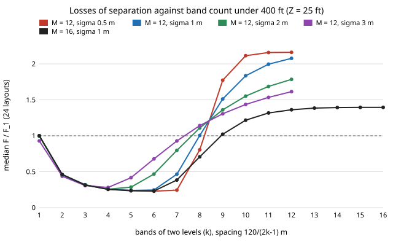
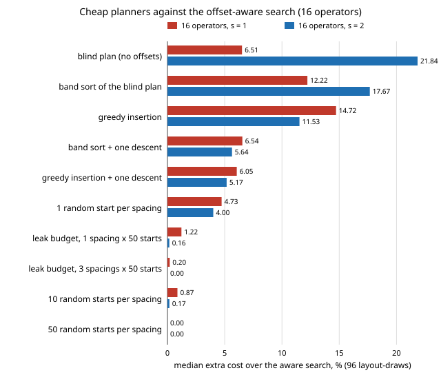

# How far apart should delivery-drone altitude layers be? Spacing a 400 ft stack from measured altitude errors

*Draft v0 of the programme's second paper (milestone 11, the airspace strand), written with AI assistance (Claude Code) from the committed results of milestones 11ah to 11az (v0 covered 11ah to 11an; 11ao to 11ay were added one section each as 6.5 to 6.15 and then folded, on 2026-11-22, into sections 6.5 to 6.9 with the corrected-grid numbers and Table A1). Target (an aim, not a claim of acceptance): the AIAA/IEEE Digital Avionics Systems Conference (DASC) or SESAR Innovation Days for the conference version, *Transportation Research Part C* for the full study. Every number below is checked against the `experiments/hub_airspace/*_results.txt` file it came from by `paper/check_airspace_numbers.py`; the figures are drawn from the same files by `paper/airspace_figures.py`. All results are preliminary (one city, one demand year, a conflict model without avoidance), as each milestone's LOG entry says.*

## Abstract

Layered urban airspace concepts give each drone operator, or each flight direction, its own altitude level, and studies of such layers commonly space the levels 25 ft apart. We ask how far apart the levels should be once drones do not hold altitude exactly, and which altitude error to plan with. On 48 layouts of 12 and 16 delivery operators in New York City (hub sites drawn at random, destinations from 2014 ride-hail pickups, an exact closed form for the en-route, transit and cross-level conflict rates), a planner that ignores altitude error always takes the thinnest spacing: 8 two-level bands under the 400 ft ceiling at 25 ft. With a cross-level leakage term, a 25 ft separation minimum and a 1 m per-drone error, the best spacing is 13.3 m (5 bands), and flying 25 ft levels instead multiplies losses of separation by a median 5.2 (12 operators) and 4.2 (16). The chosen band count is the most bands whose spacing clears the minimum by about three standard deviations of the altitude difference between two drones. We then source the error from public data. A year of NOAA airport pressure reports puts a stale altimeter setting 2.93 m (sd) off true pressure altitude and a setting from an airport 18.5 km away 4.17 m off, but separating barometric from GNSS operators in the stack never pays; drones in one pressure field share most of their barometric drift, so the pressure part of the gap between two delivery drones is about 0.54 m; 17 public PX4 flight logs show the altitude controller holds its own estimate to 0.044 m RMS; and 7 flights with RTK-fixed GNSS show the barometer itself is 1.06 m RMS off true height in level forward flight (0.81 m after 5 s smoothing). At that measured error the planner keeps 5 bands at 13.3 m in 48 of 48 layouts. The planning error is the differential error between two drones (height-keeping noise plus the estimate's own error plus the hub-to-hub pressure difference), not each drone's own drift: reading a 60-minute drift as independent per drone widens the stack to 4 bands and costs 12% more losses of separation.

## 1. Introduction

Delivery drones in a city share a thin column: in the US, 14 CFR 107.51(b) caps small unmanned aircraft at 400 ft above ground. Layered designs split that column into levels by heading or by operator, so that traffic in different levels does not conflict. Simulation studies of layered urban airspace (Doole, Ellerbroek and Hoekstra, DICUAM 2021, as read from search abstracts; full text not opened) use a 25 ft layer spacing. Crewed aviation sets its vertical separation from measured height-keeping performance: the collision risk model of Reich (1966) carries a vertical overlap probability, and the reduced vertical separation minimum (ICAO Doc 9574) was adopted after monitoring how well aircraft hold their flight level (both cited from memory, not opened in this session). We are not aware of the same reasoning applied to the spacing of small-drone layers with a sourced error budget; checking that claim against the UTM and urban-airspace literature is an open item (Section 7).

The programme's earlier airspace milestones (11a to 11ag) built the conflict model this paper rests on: a closed form for the expected en-route conflict rate of hub-and-spoke delivery traffic, checked against an exact closest-approach simulator to within 1% for one hub and 7.4% for several, and later summed exactly over destination pairs (11aa: 0.26% high on average over 24 layouts); a transit term for drones climbing and descending through lower bands (11af, 11ag, checked by Monte Carlo at 0.978); and planners that assign operators to bands. Here we add altitude error. Contributions:

1. A cross-level leakage term in that exact model, so the spacing between levels is chosen rather than swept, and a planning rule for the band count (Section 4).
2. Mixed barometric and GNSS references: when a planner should stack the two classes apart (never, in our layouts) and what the mismatch costs (Section 5).
3. A sourced error budget from public data: NOAA ISD airport pressure, a shared-field drift model, PX4 flight logs and RTK-fixed GNSS logs (Section 6), and the stack it implies.
4. Every script and results file, one command per result, MIT licensed.

## 2. Model

**Traffic.** 48 layouts: 24 with 12 operators and 24 with 16 (11ac's generator, seeds 1200 to 1223 and 1600 to 1623), each operator a hub with a service radius, cruise speed and traffic share, destinations from 2014 NYC ride-hail pickups standing in for delivery addresses, 240 flights/h for the city, 50 m horizontal separation radius R. Legs are straight, launches Poisson, and there is no avoidance or wind; counts are losses of separation to resolve, not collisions.

**Bands and transits.** k bands of two levels each (the semicircular rule splits each band by east/west heading) need (2k - 1) h <= H, with H = 120 m, the whole 400 ft column. A flight cruising in a band climbs through every lower band at its hub and descends through them at its destination; each crossing dwells tau = 2Z (1/5 + 1/4) / 2 s per level crossed (DJI Matrice 300 RTK P-mode climb and descent rates, 5 and 4 m/s). The cost of a labelling of operators to bands is F = sum W_ij [same band] + sum V_ij [j below i] + leakage, W from the exact en-route closed form and V = tau A + B the transit charge (11ag).

**Leakage (11ai).** Two legs n levels apart lose vertical separation with probability p(n) = P(|n h + e| < Z), e the gap error. For independent per-drone errors of sd sigma, e ~ N(0, 2 sigma^2); later sections replace this with sourced, pair-dependent distributions. The other-level traffic of each pair is a new exact closed form X (fast_flux's crossing sum with the other heading bit), checked against a brute-force loop in the tests. Z is the vertical separation minimum: 25 ft (7.62 m) in the main runs, 15 ft (4.57 m) as a sensitivity; both are read from the layered-airspace literature through search abstracts, not from a standard (none exists for small drones).

**Search.** For each spacing on a grid (2 m steps from 5 to 41 m, plus every band count's widest spacing 120 / (2k - 1) m), the best of 200 local-search descents over band labels; at 12 operators the descent matches exhaustive enumeration where that is feasible (11ag). F is reported relative to F_1, one band with exact altitude and no transits.

## 3. Hypotheses and how they fared

Each milestone pre-registered its predictions in a script docstring, committed and pushed before the run; the LOG records which held. The questions this paper answers, with the milestone that settled each:

| | Question | Answer | Where |
|---|---|---|---|
| Q1 | Does a 25 ft spacing fill the 400 ft column well when altitude is exact? | yes: 8 bands, within 0.25% (12 operators) and 2.1% (16) of an uncapped stack | 4.1 (11ah) |
| Q2 | With altitude error, does the spacing widen, and by how much? | yes: 13.3 m (5 bands) at sigma = 1 m; 25 ft levels cost 4 to 5 times | 4.2 (11ai) |
| Q3 | Should barometric and GNSS operators be stacked apart? | no, in 0 of 24 layouts at a 3 m mismatch; forced separation costs 3% to 8% | 5 (11aj) |
| Q4 | How large is the mismatch in a real city? | 2.93 m (stale setting) to 4.17 m (setting 18.5 km away), heavy-tailed; same plans | 6.1 (11ak) |
| Q5 | Is a drone's barometric drift a per-drone error? | no: most is shared; 0.54 m pair term for delivery missions | 6.2 (11al) |
| Q6 | How well do real drones hold altitude? | controller 0.044 m; barometer vs RTK 1.06 m (fleet RMS); 5 bands stand | 6.3, 6.4 (11am, 11an) |
| Q7 | Do airframe speed offsets, unshared between operators, change the stack? | at the 5 en-route flights' offsets, no: 5 bands in the median draw, 6 in 17 to 31 of 96; ignoring the offsets costs a median 4% to 7%; with all 12 flights, 4 bands; at twice the offset, 3 bands and about 20% | 6.5 (11ao, 11ap, 11av) |
| Q8 | Does the 3-sigma rule of 4.3 hold for a per-operator offset, and why not? | no: it picks one to two bands too few, because the planner puts operators with similar offsets next to each other (adjacent offset difference a median 0.70 of a random assignment) | 6.6 (11ap, 11aq) |
| Q9 | Can a cheap rule replace the offset-aware search? | no rule that patches the blind plan does at the measured offset; any search with the offsets beats ignoring them, and 50 random starts per spacing match the full search (Table A1) | 6.7 (11ar, 11as, 11at, 11aw) |
| Q10 | What does the planner cost? | the pair-cost tables, not the search; one shared kernel makes them 156 times cheaper with every plan unchanged, under a second per layout in all | 6.8 (11at, 11au) |
| Q11 | What replaces the 3-sigma rule under per-operator offsets? | a leak budget of 0.05 per adjacent pair (the same in every fold of a cross-validation on cost), best used as the centre of a short search (at first five spacings, two band counts either side, 250 descents, p90 within 2.7% of the full search in every cell, and within 1.4% on 24 fresh layouts and 1.5% on 24 more; a one-sided search on the budget's thin side does better at twice the offset but misses the rare draw on the other side; two below and three above, 300 descents, keeps every one of 576 fresh draws within 4.9%); the leak curve's shape does not say when the narrower three-spacing search will miss | 6.9 (11ax, 11ay, 11az, 11ba, 11bb, 11bc) |

## 4. The spacing is chosen by altitude error

**4.1 Without error, the thinnest spacing wins (11ah).** With no altitude error, levels never leak, so for a fixed plan F only grows with h (thicker levels mean longer transits) and the thinnest spacing wins. At 25 ft (7.62 m) the 120 m column holds 8 bands, and the best 8-band plan leaves a median 0.1738 (12 operators) and 0.1597 (16) of the single-band conflict count, within 1.0025 and 1.0211 of a stack with no ceiling (which would use a median 10 and 13.5 bands). Halving the spacing from 50 ft to 25 ft cuts the best F by a median 31% and 37%. A planner can grow the stack one band at a time and stay within a mean 1.8% of a full re-plan at every band count (worst mean 1.0176). This model prices a separation standard but cannot choose one.

**4.2 With error, the spacing widens (11ai).** Other-level traffic is not small: across cross-operator pairs the en-route weight in the band's other level is a median 1.566 (12 operators) and 1.453 (16) times the same-level weight, because the semicircular rule moves head-on encounters into the next level. With Z = 25 ft and sigma = 1 m, the best spacing on the 2 m grid is 13 m in 24 of 24 layouts at both sizes, and the band-count analysis (Figure A1) gives 5 bands at 13.33 m. At 7.62 m the levels sit exactly Z apart and about half of all neighbouring-level encounters are losses of separation: 11ah's error-free plan costs a median 5.175 (12 operators) and 4.236 (16) times the leakage-aware optimum. The chosen count moves with sigma: at Z = 25 ft, 6 bands at 10.91 m for sigma = 0.5 m, 5 at 13.33 m for 1 m, and 4 at 17.14 m for 2 and 3 m; at Z = 15 ft, 8 to 9 bands for 0.5 m and 7 at 9.23 m for 1 m. At the optimum, cross-level losses are a median 0.001 of F (Z = 25 ft, sigma = 1 m), and up to 0.081 at sigma = 3 m: the optimum sits at the band count where leakage has just become negligible.

**4.3 A planning rule.** Across the sweep the chosen count's spacing clears Z by 2.2 to 4.9 standard deviations of the gap error sigma sqrt 2, about 3 to 4 in the middle of the sweep. So: take the most bands whose spacing h satisfies h - Z >= 3 sigma_gap, with sigma_gap the sd of the altitude difference between two drones. A Laplace error with the same sd picks the same median 13 m (its F at the optimum is 1.5% to 2.2% higher), so the tail shape matters less than the sd at this spacing. The rule was fitted on per-drone noise; for an error that is constant per operator it is too conservative (Section 6.6). With the spacing re-chosen, altitude error at Z = 25 ft and sigma = 1 m still leaves 25% (12 operators) and 30% (16) more losses of separation than the error-free 25 ft plan (median F/F_1 0.218 and 0.207 against 0.174 and 0.160, under 11ah's transit convention).

*Figure A1. Median losses of separation per hour relative to one band with exact altitude, against the number of two-level bands at their widest spacing under 120 m, Z = 25 ft (`experiments/hub_airspace/level_leak_posthoc_results.txt`). Too few bands leave same-level conflicts; too many push the levels inside the altitude error and the curve climbs past one band's count.*

## 5. Mixed altitude references (11aj)

Drones on the same reference share most of its error, which cancels in their gap; between a barometric and a GNSS drone it does not. With half the operators on each reference, Z = 25 ft, sigma = 1 m and a mismatch sd sigma_m = 3 m (swept 0 to 5 m), a planner that knows each operator's reference never stacks the two classes apart: segregated in 0 of 24 layouts at both sizes, and in at most 5 of 24 anywhere in the grid. Forcing the classes into separate blocks of the stack costs a median 3.2% (12 operators) and 8.0% (16) over the aware plan, because it splits operators who should share or neighbour a band for en-route and transit reasons. Ignoring the mismatch costs a median 0.8% and 0.2%; the aware plan is a median 1.026 and 1.035 of one shared reference. The expensive mistake is caution: widening every level to cover the worst pair goes to 17.1 m (4 bands) and costs a median 1.075 and 1.088 of the aware plan. The aware spacing stays at 13.3 m at every sigma_m up to 5 m. A rule requiring one reference would recover the 2.6% to 8% that mixing costs.

## 6. A sourced error budget

**6.1 Reference mismatch from airport pressure (11ak).** NOAA's Integrated Surface Database (Smith, Lott and Vose 2011), 2014 METAR and SPECI reports at five New York airports, quality-controlled altimeter setting and station pressure, 8.32 m per hPa. A barometric operator flying on its own airport's latest setting is off true pressure altitude by an sd of 2.93 m at JFK (2.87 to 2.93 m at all five); a setting taken at JFK and flown near LGA (18.5 km) by 4.17 m, and 3.16 to 5.53 m over all 20 airport pairs. The tails are heavy (excess kurtosis 4.4 to 5.5 for the stale setting; 1.6% to 1.7% beyond three sd against 0.27% for a Gaussian), and the error is largest January to April (monthly sd 3.95 m in January at JFK against 1.87 m in August). Under the measured mismatch with half the operators barometric, the plan keeps 13.33 m in every cell, mixing costs a median 1.0385 (12 operators) and 1.0581 (16) of one shared reference, and a planner assuming a Gaussian of the same sd picks the same plans (median ratio 1.0000, worst single layout 1.0045). A barometer zeroed at take-off and never reset drifts 1.59 m (sd) over a 30-minute flight and 3.05 m over 60 minutes at JFK.

**6.2 Drift is shared (11al).** Two drones in the same pressure field both read the current pressure, which cancels in their gap; what is left is the pressure change between their take-off times plus the pressure difference between their hubs. New York delivery missions in these layouts are short (a median 3.45 min per operator at 12 operators), so a drone's own drift is a median 0.207 m; the pressure part of a pair's gap is a median 0.543 m (12 operators) and 0.554 m (16), mostly the hub-to-hub difference (0.561 m at the median hub separation of 3.8 km, under a field that scales linearly with distance). For long missions the shared field halves the pair error: 0.548 (30 min) and 0.523 (60 min) of the independent figure. The aware planner keeps 13.33 m in 24 of 24 layouts at sigma_n = 1 m for every mission length. A planner that reads the 60-minute drift as an independent per-drone error widens to 17.14 m (4 bands) and costs a median 12.0% (12 operators) and 12.4% (16) more losses of separation. A post hoc check found the station-to-station pressure difference barely grows with distance (sd = 2.189 m + 0.0412 m/km over 10 station pairs), so if that floor were real pressure structure rather than instrument noise the hub-to-hub term would be up to about 2.3 m, still inside the mismatch sweep of Section 5.

**6.3 Height keeping in public flight logs (11am).** From 454 PX4 Flight Review logs matching "Mission" (PX4: Meier, Honegger and Pollefeys 2015), 17 had at least 30 s of level, en-route Mission flight. The flight technical error (altitude estimate minus setpoint) is a median 0.043 m RMS per flight (95% CI 0.035 to 0.050), fleet 0.044 m, near-Gaussian within a flight, with a 1/e correlation time of 1.40 s. At that noise alone the planner would take 7 bands at 9.23 m in 24 of 24 layouts, and the 1 m assumption of Sections 4 and 5 would cost a median 5.2% (12 operators) and 8.4% (16). But the error is measured against the drone's own estimate, which cannot see the estimate's error. On the same flights the detrended barometer-minus-GNSS altitude is a median 0.921 m RMS (fleet 1.336 m), an upper bound that counts GNSS noise as barometer noise, and at that bound the plan returns to 5 bands at 13.33 m.

**6.4 The barometer against RTK height (11an).** An RTK-fixed receiver reports height to a few centimetres. Of 400 downloaded public logs, 98 had RTK-fixed solutions and 7 had 30 s of RTK-fixed level forward flight. Barometric minus RTK altitude, line-detrended, is a median 0.826 m RMS en route (95% CI 0.60 to 1.38) and 0.345 m in hover; fleet RMS en route 1.058 m. Most of it is fast sensor noise (median 1/e time 0.23 s), but after a 5 s centred mean, roughly what an estimator would average over, the en-route median is still 0.420 m and the fleet RMS 0.814 m, because the noisiest flights' error is slow. A speed-dependent static-pressure offset reaches about 1.4 m at 10 m/s on some airframes. With per-flight noise sqrt(FTE^2 + r^2), raw or smoothed, the planner picks 13.33 m (5 bands) in 24 of 24 layouts at both sizes and every mission length, and the 1 m assumption costs a median 1.0000.

*Figure A2. The sourced vertical error terms in metres (sd or fleet RMS): PX4 flight technical error, the pressure part of two delivery drones' gap, barometer minus RTK height (smoothed and raw), barometer minus GNSS, a 30-minute take-off drift, and the two airport-setting mismatches. The dashed line is the 1 m per-drone error behind the 13.3 m spacing. Drawn from `px4_height_stats_results.txt`, `drift_share_stats_results.txt`, `rtk_baro_posthoc_results.txt`, `px4_height_posthoc_results.txt`, `pressure_stats_results.txt` and `pressure_ref_results.txt`.*

**6.5 Airframe speed offsets do not cancel between operators (11ao, 11ap, 11av).** The speed term of 6.4 is a static-pressure (position) error: constant for one airframe at one cruise speed, so it cancels between drones of one operator but not between operators flying different airframes. Each operator draws its offset from the 5 measured en-route flights (-4.70, -1.44, +0.81, +1.06 and +1.55 m at 10 m/s; sd of the difference between two operators 3.281 m), scaled by s, with 4 draws per layout (96 layout-draws per fleet size and offset size), delivery ages. The *aware* planner knows every operator's offset; the *blind* plan is 6.4's, made without offsets and scored under them. Sections 6.5 to 6.9 report the 32-spacing grid on which every band count from 1 to 12 is reachable. The grid of Section 2 lacked a 6- and an 11-band spacing (it rounds 120/(2k - 1) to six decimals, and for k = 6 and 11 the rounding lands just above, so the spacing fits one band fewer); 11au found the gap and 11av closed it. On the old grid the rerun reproduces every recorded aware plan exactly (96 of 96 draws per cell). Results run only on the old grid are marked *(30-spacing grid)*.

At the measured size (s = 1) the aware planner keeps 5 bands at 13.33 m in the median draw and takes **6 bands in 17 and 31 of 96 draws** (12 and 16 operators), 11 never; the blind plan costs a median **1.0438 and 1.0651** of the aware plan (p90 1.2417 and 1.2056, worst 1.7254). At s = 2, a crude stand-in for cruise above 10 m/s, the aware stack thins to **3 bands at 24.00 m** and the blind plan costs **1.2048 and 1.2184**. The blind plan's excess grew with the grid fix because, without offsets, the planner takes 6 bands in 26 of 48 layouts (median spacing **10.91 m** at 16 operators), a thinner stack that the offsets then penalise; the old grid gave 1.0342 and 1.0183 at s = 1. *(30-spacing grid:)* at s <= 0.5, a fleet that has calibrated half the offset away, nothing changes (blind/aware 1.0000); a planner that knows only the offsets' spread is within a median 1.0277 and 1.0219 of the aware one. Taking instead every flight whose speeds span 5 m/s (12 flights, -7.44 to +8.86 m at 10 m/s, pair sd 5.655 m; 7 of them less certain) at 12 operators, the measured size gives **4 bands at 17.14 m** and the blind plan costs a median **1.1526** (worst 1.9966); at s = 0.5 the stack stays at 13.33 m (92 of 96) with blind/aware 1.0021. So the 5-band stack holds at the 5 en-route flights' offsets and under half of either set, but the offset grows as v squared, and at delivery cruise speeds it, not the barometer's noise, would set the spacing unless operators calibrate their static-pressure error.

**6.6 The planner sorts operators by offset, so the fleet's spread overstates the spacing (11ap, 11aq; 30-spacing grid).** The rule of 4.3 with sigma_gap = sqrt(sigma_pair^2 + sd(b_i - b_j)^2) and sigma_pair = 1.061 m (pair noise and pressure) gives 5, 4, 3 and 2 bands at s = 0.25, 0.5, 1 and 2 for the 5-flight set, against the search's 5, 5, 5 and 3; for the 12-flight set 5, 4, 2 and 1 against 5, 5, 4 and 3. The pair-averaged leak one level apart at the search's choice is not small (0.0663 at 13.33 m, s = 1, against 0.0488 for a Gaussian of the same sd), so the search exploits the error's structure, not its averaged shape. Recording its labellings shows how: over operator pairs one level apart, the conflict-weighted mean offset difference is a median **0.7035** (12 operators) and **0.7010** (16) of its mean under 200 random permutations of the same offsets, below 1 in 74 and 84 of 96 draws at s = 1 (the blind plan gives 0.9060 and 0.9376 on the same statistic). The share of adjacent weight on pairs more than 3 m apart falls from 0.3220 to 0.1266 and from 0.3282 to 0.1635, and reassigning the offsets at random after planning costs the aware plan a median 1.0482 and 1.0467 (worst 1.7969). At s = 2 the sorting looks weaker overall (0.7237 and 0.7985), which is composition: where 13.33 m is kept the planner sorts harder (0.3731 and 0.4885), and where it thins to 24.00 m the same-level ratio exceeds 1 in all 107 such draws, because an offset difference inside one level is itself separation. A spacing rule for per-operator offsets should therefore use the offsets of the operators it will make adjacent, after sorting, not the fleet's spread (Section 6.9 builds that rule).

**6.7 Cheap planners against the search (11ar, 11as, 11at, 11aw).** Table A1 lists every rule tested, in increasing search effort, as its median cost relative to the aware search (200 descents per spacing) under the same true offsets; each rule takes its best spacing on the grid unless the row says otherwise. The rules are: the closed-form 3-sigma spacing on the sorted plan's adjacent pairs; the blind plan's bands re-ordered by mean offset (band sort); operators inserted one at a time in offset order into the cheapest band (greedy insertion); either followed by one local descent; and R random starts per spacing, each descended. Every aware score reproduces exactly in 384 of 384 draws, and moving to the corrected grid shifts the median of band sort, greedy insertion and their descents by at most 0.0099.

*Table A1. Median cost of each rule as a ratio to the aware search, 96 layout-draws per cell (`exact_rules_results.txt`; the leak-budget rows, held out by layout, from `budget_cv_results.txt` and, for the five-spacing row, `tail_rule_results.txt`; the one-spacing rule's cross-validated budget is 0.05, the multi-spacing rules' 0.027 in most folds). Descents: local descents per layout-draw that see the true offsets.*

| Rule | Descents | 12 op., s = 1 | 12 op., s = 2 | 16 op., s = 1 | 16 op., s = 2 |
|---|---|---|---|---|---|
| blind plan (no offsets) | 0 | 1.0438 | 1.2048 | 1.0651 | 1.2184 |
| 3-sigma closed form, sorted plan at its spacing | 0 | 1.1835 | 1.4338 | 1.2408 | 1.4738 |
| band sort of the blind plan | 0 | 1.0944 | 1.1623 | 1.1222 | 1.1767 |
| greedy insertion in offset order | 0 | 1.1227 | 1.1001 | 1.1472 | 1.1153 |
| band sort + one descent | 32 | 1.0592 | 1.0444 | 1.0654 | 1.0564 |
| greedy insertion + one descent | 32 | 1.0585 | 1.0385 | 1.0605 | 1.0517 |
| 1 random start per spacing | 32 | 1.0345 | 1.0245 | 1.0473 | 1.0400 |
| leak budget 0.05, 50 starts at its one spacing (6.9) | 50 | 1.0091 | 1.0078 | 1.0122 | 1.0016 |
| leak budget 0.027, 50 starts at it and its two neighbours (6.9) | 150 | 1.0000 | 1.0000 | 1.0020 | 1.0000 |
| leak budget 0.027, 50 starts at it and two band counts either side (6.9) | 250 | 1.0000 | 1.0000 | 1.0000 | 1.0000 |
| 10 random starts per spacing | 320 | 1.0070 | 1.0000 | 1.0087 | 1.0017 |
| 20 random starts per spacing | 640 | 1.0002 | 1.0000 | 1.0055 | 1.0000 |
| 50 random starts per spacing | 1 600 | 1.0000 | 1.0000 | 1.0000 | 1.0000 |

Three readings. First, no rule that patches the blind plan without a search beats it at the measured offset: re-ordering whole bands breaks the order the blind plan chose for conflicts and transits, and a single greedy pass cannot reproduce the search's restarts. At twice the offset greedy insertion plus one descent is the best of these patches (beating the blind plan in **88 and 76** of 96 draws). Second, any search with the offsets in its cost tables beats ignoring them: one descended random start per spacing is below the blind plan's median in every cell and beats it in 58 to 85 of 96 draws per cell. Ten starts are within 1% everywhere, twenty fall short at 16 operators and the measured offset (**1.0055**), and fifty match the aware search's median in all four cells. Starts built from the greedy insertion reach the search no sooner than random ones *(30-spacing grid:* as single starts 1.0773 and 1.0753 against 1.0396 and 1.0493). Third, the 3-sigma closed form on adjacent pairs is one band too conservative even after sorting: its median is 4 bands at the measured offset and 2 at twice it, and it picks 6 bands in **0 of 384** draws, because 6 bands need sigma_adj <= 1.10 m and the median after sorting is 2.26 m and 2.58 m. Of the four milestones' 20 pre-registered predictions, 13 held: 2 of 5 for 11ar, 4 of 5 for 11as, 3 of 5 for 11at and 4 of 5 for 11aw.

*Figure A3. Table A1 at 16 operators as the median extra cost over the aware search, in per cent (ratio minus one), at the measured offset (s = 1) and twice it (s = 2); ordered roughly by search effort, from no descents (top) to 50 random starts per spacing (bottom). Drawn by `paper/airspace_figures.py` from `exact_rules_results.txt` and `budget_cv_results.txt`.*

**6.8 What the planner costs (11at, 11au).** Searching is cheap; building the per-pair leak tables is not. *(30-spacing grid:)* 200 starts over 30 spacings and 8 offset draws take a median **7.4 CPU s** per layout against **252** s for the whole analysis. Each table entry is a mean over the 64 pair-noise sds of the same even function of one variable, so one kernel tabulated on a 1 mm grid gives every entry to within **3.65e-08** of the direct computation, and a 20-start search returns the same plan on kernel tables as on direct ones in **384 of 384** draws. Building all 240 tables per layout falls from a median **214.8 s** to **1.39 s** (median ratio 156). Since F depends on the spacing only through the tables, only the widest spacing of each band count needs searching: with those 10 spacings the best plan was the same in 379 of 384 draws, and in all 5 exceptions the 30-spacing winner's labels cost less at the wider spacing of its band count, so the misses came from the random starts. A planner with kernel tables, one spacing per band count and 20 starts is a median 1.0014 and 1.0030 of the aware search at the measured offset for **0.54 and 0.81 CPU s** per layout. On the corrected grid every rule of Table A1 for one layout, both offset sizes and 4 draws took a median 9.9 and 13.3 CPU s (12 and 16 operators).

**6.9 A leak budget picks the spacing (11ax, 11ay, 11az, 11ba, 11bb, 11bc).** The 3-sigma rule asks h - Z >= 3 sigma_adj, a Gaussian leak probability one level apart of Phi(-3) = 0.00135, and sits one band below the search (6.7). A budget rule keeps the same practitioner inputs (the measured offsets, the conflict weights, the blind plan sorted by offset, a 1.061 m pair sd) but replaces the sd with the leak itself. At each band count's widest spacing it averages, with conflict weights over the cross-operator pairs one level apart, P(|h + d + e| < Z) with d the pair's offset difference and e ~ N(0, 1.061^2), and takes the most bands whose mean leak is within a budget p. At the 3-sigma-equivalent budget the rule already picks **3 bands at twice the offset**, one more than the closed form, because sorting leaves few large differences between neighbours. Calibrated on the conflict cost of the plan it leads to, with a leave-one-layout-out cross-validation over all 48 layouts and 52 budgets, every fold picks the same budget, **0.05** (48 of 48 folds) for the one-spacing rule (0.027 in most folds for the three-spacing rule, whose neighbours absorb a looser budget); calibrated on band-count agreement instead it was 0.07. The band count is a weak target: at twice the offset the search splits between 3 bands and 5 or 6, and no budget matches it in more than 54 of 96 draws in any cell. The spacing is what matters, and there the budget works (Table A1): 50 starts at its one spacing are within about 1% of the full search held out, and searching its band count and both neighbours brings the median to **1.0000, 1.0000, 1.0020 and 1.0000**, within 1% of the full search in 69 to 83 of 96 draws per cell (one spacing: 44 to 56) at 150 descents instead of 1 600. What the neighbours do not close is the tail at twice the offset: the three-spacing rule's p90 is **1.0678** (12 operators) and **1.0522** (16), against p90 1.1042 and 1.0918 for one spacing, and its worst draw at 12 operators still costs 1.5472, where the right band count is two or more away from the budget's. Of the three-spacing rule's draws above 1.05 at twice the offset, 11 of 11 at both fleet sizes have the best band count two or three away from the budget's (7 and 9 of them three away). The leak curve does not say which draws those are (11az): adding k_B - 2 or k_B + 2 only where the leak is flat between them (a ratio r cross-validated under a 200-descent cap, r = 1 in most folds) extends 6 to 36 of 96 draws per cell and changes no cell's p90 or worst draw, and a random choice of the same number of extra spacings does as well in every cell (four of five predictions refuted). The worst draw shows why: its leak is 1.3e-7 at 3 bands and 0.04 at 4 and 5, the budget picks 5 and the best plan is 3, so the answer sits at the foot of a cliff that a flatness test will not cross. Post hoc, adding the band count of a safety-size budget (1e-4 to 0.01) as a fourth spacing lowers that cell's p90 from 1.0678 to 1.0404 and its worst draw to 1.1581 and leaves the other three cells' p90 and worst draw unchanged. That gain came with the per-fold budgets: under one budget frozen on all 48 layouts (0.02716) it is gone, and on 24 fresh layouts (11ba, 192 draws, eight predictions written before the run) the cliff rule lowers the worst cell's p90 only from 1.0747 to **1.0566**, through one draw, and stays above 1.05 in two cells. The reason is the side of the tail: under the frozen budget the three-spacing rule's draws above 1.05 have their best band count above the budget's in 26 of 26 on the old layouts and 15 of 16 on the fresh ones, so the budget usually sits at the foot of the cliff (about 1e-6 at 3 bands, a few per cent at 4) and the cheaper plan is two or three band counts thinner, while the cliff rule adds a band count at or below it. What does close the tail is searching two band counts either side, always (250 descents): p90 **1.0081, 1.0170, 1.0124 and 1.0267**, median 1.0000 in every cell, worst draw 1.3715 at 12 operators and twice the offset (seven of that cell's tail draws are three band counts from the budget's, out of its reach; the oracle over all twelve band counts, 600 descents, has worst draw 1.0211 there). On the 24 fresh layouts, with nothing refitted, the five-spacing search holds: p90 **1.0137, 1.0065, 1.0080 and 1.0085**, median 1.0000 in every cell. Post hoc, a one-sided search one band count below and three above (the same 250 descents) brings the twice-the-offset p90 to 1.0016 and 1.0079 on the old layouts and **1.0028 and 1.0004** on the fresh ones; it was chosen after the fresh results were seen, and on a second set of 24 fresh layouts (11bb, 192 draws, eight predictions pushed before any layout was built) it held where the tail is thin-side and failed where it is not: twice-the-offset p90 **1.0000 and 1.0044** against the five-spacing search's 1.0014 and 1.0079, but p90 1.0037 against 1.0028 at 12 operators and the measured offset, and a worst draw of **1.1099** against 1.0278 on the one draw (of six above 1.05 for the three-spacing rule) whose best band count is two below the budget's. Their union, two below and three above (300 descents), was chosen post hoc on all three data sets and then tested on a third set of 24 fresh layouts (11bc, 192 draws, eight predictions pushed before any layout was built): its worst draw is **1.0447**, its twice-the-offset p90 **1.0000 and 1.0092** against the five-spacing search's 1.0000 and 1.0156, and pooled over all 72 fresh layouts (576 draws) it matches the 600-descent oracle's p90 and worst draw in every cell (worst draw 1.0489, five-spacing search 1.1105). It contains both narrower searches, so it is never worse than either; what the test settled is that 50 more descents keep every fresh draw within 5% of the full search. The search's own plans accept a median adjacent leak of 0.0096 (12 operators) and **0.0197** (16) at the measured offset. 11ax and 11ay each held three of five predictions, 11az one, 11ba seven of eight, 11bb six of eight, 11bc seven of eight. So for per-operator offsets the 3-sigma reading of Section 4.3 gives way to a leak budget of a few per cent per adjacent pair, set by the trade between same-level and cross-level conflicts rather than by a safety-style tail probability, best used as the centre of a short, lopsided search over spacings (two band counts below the budget's, three above).

## 7. Discussion: what a planner should do

1. **Size the spacing by the differential error between two drones, not by each drone's error.** For barometric drones in one city that is the estimate's own error (about 1 m, Section 6.4) plus the hub-to-hub pressure difference (about 0.5 m at 4 km), plus a controller error of a few centimetres. A take-off drift of several metres is mostly shared and must not be added per drone.
2. **With a 25 ft minimum, that gives 5 two-level bands at 13.3 m (about 44 ft) under 400 ft, not 8 at 25 ft.** The rule h - Z >= 3 sigma_gap reproduces the search's choice; under per-operator offsets, where the gap error is not Gaussian, a leak budget of about 0.05 per adjacent pair takes its place (Section 6.9; 0.05 in every fold of a cross-validation on cost), best used as the centre of a search over two band counts below it and three above (300 descents; every one of 576 fresh draws within 4.9% of the full search, 11bc); flying 25 ft levels with metre-scale error multiplies losses of separation by 4 to 5.
3. **Do not stack barometric and GNSS operators apart, and do not widen every level for the worst pair.** Fix the mismatch instead (one reference, or a broadcast correction); mixing costs 3% to 6% at New York's measured mismatch.
4. **Calibrate the static-pressure error before widening the stack.** At the measured size the operator-specific speed offset costs 4% to 7% with the 5 en-route flights and 15% with all 12 flights (4 bands); at twice it (faster cruise) the stack thins to 3 bands. Halving it keeps 5 bands under both sets of flights (Section 6.5).
5. **A Gaussian at the measured sd is enough for per-drone and shared-field errors, not for per-operator offsets.** Heavier measured tails changed no plan in any of the four sourced error models of 6.1 to 6.4; for the per-operator offset of 6.5 a Gaussian at the pair sd, through the 3-sigma rule, widens the stack by one to two bands more than the planner needs. Model the offset per operator and let the band assignment absorb it: the planner puts operators with similar offsets in neighbouring levels (Section 6.6), so the offset that matters is the difference between neighbours, not the fleet's spread. That sorting happens operator by operator inside the search, and no patch of an offset-blind plan reproduces it at the measured offset; but any search that has the offsets in its tables beats ignoring them, even one descended random start per spacing, and 50 starts per spacing match the full search (Table A1, Section 6.7). The expensive step is building the per-pair leak tables, and one shared kernel makes that 156 times cheaper (Section 6.8).

## 8. Limitations

- The offset strand's first runs (11ao to 11at) used a spacing grid with no 6- or 11-band spacing (a rounding gap found in 11au). The planners and the cheap rules were rerun on the corrected grid (11av, 11aw), and Sections 6.5 to 6.9 report those numbers; the results marked *(30-spacing grid)* (the s <= 0.5 runs, the spread-only planner, the 12-flight set, the arrangement statistics of 6.6, the greedy-start curves and the CPU figures of 6.8) were not rerun. Where a corrected-grid rerun exists, every median plan stood, and the medians of band sort, greedy insertion and their descents moved by at most 0.0099.
- One city (New York), one demand year (2014 ride-hail pickups standing in for delivery addresses), 48 synthetic operator layouts; operator counts and shares are not sourced.
- Conflicts are expected losses of separation in a model with straight legs, Poisson launches, vertical transits, no avoidance and no wind; the planner scores the expected count only, not its spread.
- The separation minima Z (15 and 25 ft) come from the layered-airspace literature through search abstracts; no small-drone vertical separation standard exists.
- The height-keeping data are 17 and 7 flights chosen by their uploaders (tests and demonstrations, not delivery operations); none of the 7 RTK flights flew on barometric height, so the error a barometer-referenced estimate inherits is inferred by smoothing, not observed. The speed term is fitted on ground speed, from 5 flights, and is not extrapolated past 10 m/s; operators draw offsets from those flights at random (Section 6.5).
- Airport pressures stand in for the field at hub scale; ISD cannot resolve it below about 10 km, and hourly reports interpolated linearly understate sub-hourly tails.
- Per-drone noise is independent between drones and constant over a flight; at 16 operators the counts rely on local search, with about 0.5% noise per layout.

## Figures

Figures A1 and A2 are drawn by `python3 paper/airspace_figures.py` (stdlib only, `research/_shared/linefig.py`) from the committed results files.

## Before submission (owner and later sessions)

1. Open and cite the layered-airspace papers properly: Doole, Ellerbroek and Hoekstra (DICUAM 2021) and the 15 ft study behind Z = 4.57 m were read only as search abstracts; the BlueSky reference (Hoekstra and Ellerbroek, ICRAT 2016) is in `PROPOSAL.md` but its venue is unchecked. Open Reich (1966) and ICAO Doc 9574 for the vertical-overlap framing. Survey the UTM literature (NASA UTM, U-space) for prior vertical-spacing analyses before claiming novelty.
2. A second city and a second demand source; logs from barometric-referenced fleets with an RTK receiver logged but not fused (the cleanest test of the estimate's error); a dense urban pressure network for the hub-to-hub term.
3. BlueSky with a conflict-resolution algorithm, to turn losses of separation into delay and energy per delivery.
4. Convert to the venue template and add the bibliography entries to `paper/references.bib` (`smith2011isd` is there; PX4's DOI was checked on 2026-11-18, `cite_check.json`). Submitting is an owner step.

## References

- 14 CFR 107.51, Operating limitations for small unmanned aircraft, (b) altitude. https://www.ecfr.gov/current/title-14/chapter-I/subchapter-F/part-107/subpart-B/section-107.51
- Doole, M., Ellerbroek, J., Hoekstra, J. Layered urban airspace for drone delivery, DICUAM 2021. Read from search abstracts only; title and pages to be checked.
- Hoekstra, J., Ellerbroek, J. BlueSky ATC simulator project, ICRAT 2016. https://github.com/TUDelft-CNS-ATM/bluesky
- ICAO Doc 9574, Manual on a 300 m (1 000 ft) vertical separation minimum between FL 290 and FL 410 inclusive. Cited from memory; not opened.
- Meier, L., Honegger, D., Pollefeys, M. PX4: A node-based multithreaded open source robotics framework for deeply embedded platforms. ICRA 2015. doi:10.1109/ICRA.2015.7140074
- Reich, P. G. Analysis of long-range air traffic systems: separation standards. Journal of Navigation 19, 1966. Cited from memory; not opened.
- Smith, A., Lott, N., Vose, R. The Integrated Surface Database: recent developments and partnerships. Bulletin of the American Meteorological Society 92(6), 704 to 708, 2011. doi:10.1175/2011BAMS3015.1
- DJI Matrice 300 RTK specifications (maximum ascent 5 m/s and descent 4 m/s in P mode), DJI support page, as used in 11ag to 11ai.
