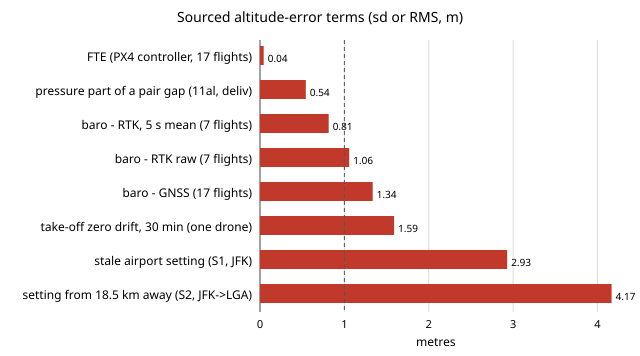

# How far apart should delivery-drone altitude layers be? Spacing a 400 ft stack from measured altitude errors

*Draft v0 of the programme's second paper (milestone 11, the airspace strand), written with AI assistance (Claude Code) from the committed results of milestones 11ah to 11ay (v0 covered 11ah to 11an; 11ao to 11ay were added as sections 6.5 to 6.15). Target (an aim, not a claim of acceptance): the AIAA/IEEE Digital Avionics Systems Conference (DASC) or SESAR Innovation Days for the conference version, *Transportation Research Part C* for the full study. Every number below is checked against the `experiments/hub_airspace/*_results.txt` file it came from by `paper/check_airspace_numbers.py`; the figures are drawn from the same files by `paper/airspace_figures.py`. All results are preliminary (one city, one demand year, a conflict model without avoidance), as each milestone's LOG entry says.*

## Abstract

Layered urban airspace concepts give each drone operator, or each flight direction, its own altitude level, and studies of such layers commonly space the levels 25 ft apart. We ask how far apart the levels should be once drones do not hold altitude exactly, and which altitude error to plan with. On 48 layouts of 12 and 16 delivery operators in New York City (hub sites drawn at random, destinations from 2014 ride-hail pickups, an exact closed form for the en-route, transit and cross-level conflict rates), a planner that ignores altitude error always takes the thinnest spacing: 8 two-level bands under the 400 ft ceiling at 25 ft. With a cross-level leakage term, a 25 ft separation minimum and a 1 m per-drone error, the best spacing is 13.3 m (5 bands), and flying 25 ft levels instead multiplies losses of separation by a median 5.2 (12 operators) and 4.2 (16). The chosen band count is the most bands whose spacing clears the minimum by about three standard deviations of the altitude difference between two drones. We then source the error from public data. A year of NOAA airport pressure reports puts a stale altimeter setting 2.93 m (sd) off true pressure altitude and a setting from an airport 18.5 km away 4.17 m off, but separating barometric from GNSS operators in the stack never pays; drones in one pressure field share most of their barometric drift, so the pressure part of the gap between two delivery drones is about 0.54 m; 17 public PX4 flight logs show the altitude controller holds its own estimate to 0.044 m RMS; and 7 flights with RTK-fixed GNSS show the barometer itself is 1.06 m RMS off true height in level forward flight (0.81 m after 5 s smoothing). At that measured error the planner keeps 5 bands at 13.3 m in 48 of 48 layouts. The planning error is the differential error between two drones (height-keeping noise plus the estimate's own error plus the hub-to-hub pressure difference), not each drone's own drift: reading a 60-minute drift as independent per drone widens the stack to 4 bands and costs 12% more losses of separation.

## 1. Introduction

Delivery drones in a city share a thin column: in the US, 14 CFR 107.51(b) caps small unmanned aircraft at 400 ft above ground. Layered designs split that column into levels by heading or by operator, so that traffic in different levels does not conflict. Simulation studies of layered urban airspace (Doole, Ellerbroek and Hoekstra, DICUAM 2021, as read from search abstracts; full text not opened) use a 25 ft layer spacing. Crewed aviation sets its vertical separation from measured height-keeping performance: the collision risk model of Reich (1966) carries a vertical overlap probability, and the reduced vertical separation minimum (ICAO Doc 9574) was adopted after monitoring how well aircraft hold their flight level (both cited from memory, not opened in this session). We are not aware of the same reasoning applied to the spacing of small-drone layers with a sourced error budget; checking that claim against the UTM and urban-airspace literature is an open item (Section 7).

The programme's earlier airspace milestones (11a to 11ag) built the conflict model this paper rests on: a closed form for the expected en-route conflict rate of hub-and-spoke delivery traffic, checked against an exact closest-approach simulator to within 1% for one hub and 7.4% for several, and later summed exactly over destination pairs (11aa: 0.26% high on average over 24 layouts); a transit term for drones climbing and descending through lower bands (11af, 11ag, checked by Monte Carlo at 0.978); and planners that assign operators to bands. Here we add altitude error. Contributions:

1. A cross-level leakage term in that exact model, so the spacing between levels is chosen rather than swept, and a planning rule for the band count (Section 4).
2. Mixed barometric and GNSS references: when a planner should stack the two classes apart (never, in our layouts) and what the mismatch costs (Section 5).
3. A sourced error budget from public data: NOAA ISD airport pressure, a shared-field drift model, PX4 flight logs and RTK-fixed GNSS logs (Section 6), and the stack it implies.
4. Every script and results file, one command per result, MIT licensed.

## 2. Model

**Traffic.** 48 layouts: 24 with 12 operators and 24 with 16 (11ac's generator, seeds 1200 to 1223 and 1600 to 1623), each operator a hub with a service radius, cruise speed and traffic share, destinations from 2014 NYC ride-hail pickups standing in for delivery addresses, 240 flights/h for the city, 50 m horizontal separation radius R. Legs are straight, launches Poisson, and there is no avoidance or wind; counts are losses of separation to resolve, not collisions.

**Bands and transits.** k bands of two levels each (the semicircular rule splits each band by east/west heading) need (2k - 1) h <= H, with H = 120 m, the whole 400 ft column. A flight cruising in a band climbs through every lower band at its hub and descends through them at its destination; each crossing dwells tau = 2Z (1/5 + 1/4) / 2 s per level crossed (DJI Matrice 300 RTK P-mode climb and descent rates, 5 and 4 m/s). The cost of a labelling of operators to bands is F = sum W_ij [same band] + sum V_ij [j below i] + leakage, W from the exact en-route closed form and V = tau A + B the transit charge (11ag).

**Leakage (11ai).** Two legs n levels apart lose vertical separation with probability p(n) = P(|n h + e| < Z), e the gap error. For independent per-drone errors of sd sigma, e ~ N(0, 2 sigma^2); later sections replace this with sourced, pair-dependent distributions. The other-level traffic of each pair is a new exact closed form X (fast_flux's crossing sum with the other heading bit), checked against a brute-force loop in the tests. Z is the vertical separation minimum: 25 ft (7.62 m) in the main runs, 15 ft (4.57 m) as a sensitivity; both are read from the layered-airspace literature through search abstracts, not from a standard (none exists for small drones).

**Search.** For each spacing on a grid (2 m steps from 5 to 41 m, plus every band count's widest spacing 120 / (2k - 1) m), the best of 200 local-search descents over band labels; at 12 operators the descent matches exhaustive enumeration where that is feasible (11ag). F is reported relative to F_1, one band with exact altitude and no transits.

## 3. Hypotheses and how they fared

Each milestone pre-registered its predictions in a script docstring, committed and pushed before the run; the LOG records which held. The questions this paper answers, with the milestone that settled each:

| | Question | Answer | Where |
|---|---|---|---|
| Q1 | Does a 25 ft spacing fill the 400 ft column well when altitude is exact? | yes: 8 bands, within 0.25% (12 operators) and 2.1% (16) of an uncapped stack | 4.1 (11ah) |
| Q2 | With altitude error, does the spacing widen, and by how much? | yes: 13.3 m (5 bands) at sigma = 1 m; 25 ft levels cost 4 to 5 times | 4.2 (11ai) |
| Q3 | Should barometric and GNSS operators be stacked apart? | no, in 0 of 24 layouts at a 3 m mismatch; forced separation costs 3% to 8% | 5 (11aj) |
| Q4 | How large is the mismatch in a real city? | 2.93 m (stale setting) to 4.17 m (setting 18.5 km away), heavy-tailed; same plans | 6.1 (11ak) |
| Q5 | Is a drone's barometric drift a per-drone error? | no: most is shared; 0.54 m pair term for delivery missions | 6.2 (11al) |
| Q6 | How well do real drones hold altitude? | controller 0.044 m; barometer vs RTK 1.06 m (fleet RMS); 5 bands stand | 6.3, 6.4 (11am, 11an) |
| Q7 | Do airframe speed offsets, unshared between operators, change the stack? | depends on the flights: 5 en-route flights, no (2% to 3%); all 12 flights, 4 bands at 17.14 m (15%); at half the offset, no under both | 6.5, 6.6 (11ao, 11ap) |
| Q8 | Does the planner keep operators with very different offsets out of neighbouring levels? | yes: adjacent-level offset difference a median 0.70 of a random assignment (4 of 5 predictions held) | 6.7 (11aq) |
| Q8 | Does the 3-sigma rule of 4.3 hold for a per-operator offset? | no: it picks one to two bands too few once the offset dominates | 6.6 (11ap) |
| Q9 | Can a rule without the offset-aware search (sort the blind plan's bands by offset, space on the adjacent pairs' difference) replace it? | no: re-ordering bands costs more than it saves at the measured offset; the adjacent-pair 3-sigma rule is still one band too conservative (2 of 5 predictions held) | 6.8 (11ar) |
| Q10 | Does a greedy rule that inserts operators one at a time, in offset order, into the cheapest band replace the search? | not at the measured offset (worse than the blind plan); at twice it, greedy plus one descent is the best cheap planner tested (4 of 5 predictions held) | 6.9 (11as) |
| Q11 | How many restarts does the offset-aware search need, and do greedy starts reach it with fewer? | 10 to 20 random starts per spacing come within 1% (0.1% by 20 to 50); greedy starts are no better; the search is about 3% of the planner's CPU, the pair-cost tables the rest (3 of 5 predictions held) | 6.10 (11at) |
| Q12 | What do the pair-cost tables cost, and can they be built cheaper without changing a plan? | the 64-sd noise mixture is one shared kernel: tables **156 times** cheaper, every plan unchanged (384 of 384); one spacing per band count suffices; the grid lacked a 6-band spacing, which beats the reported plan in 16 to 30 of 96 draws (5 of 7 predictions held) | 6.11 (11au) |
| Q13 | With the grid gap closed (every band count reachable), do the offset-aware band choices and the blind plan's cost change? | the median plan stands (5 bands at the measured offset, 3 at twice it); 6 bands win in 14 to 31 of 96 draws; the blind plan costs a median **1.0438 and 1.0651** of the aware one, not 1.0342 and 1.0183 (5 of 6 predictions held) | 6.12 (11av) |
| Q14 | Do the cheap rules of 6.8 to 6.10 still compare the same way on the corrected grid? | yes: each median moves by at most 0.02 and every ranking holds; one descended random start now beats the (costlier) blind plan in every cell; 20 random starts fall short at 16 operators, 50 suffice (4 of 5 predictions held) | 6.13 (11aw) |
| Q15 | Can a leak-probability budget at the adjacent pairs replace the 3-sigma spacing rule under per-operator offsets? | partly: the 3-sigma-equivalent budget (0.00135) already gains a band at twice the offset, and a budget of **0.07** calibrated on 12 operators matches the search's band count in 40 and 47 of 96 held-out 16-operator draws (3-sigma: 8 and 2); with 50 random starts at the budget's one spacing the plan is a median **1.0138 and 1.0095** of the full search (3-sigma: 1.1117 and 1.3262) (3 of 5 predictions held) | 6.14 (11ax) |
| Q16 | Calibrated on the conflict cost with a leave-one-layout-out cross-validation, does the leak budget hold, and does searching the budget's band count and its two neighbours close the tail? | the budget is stable (**0.05** in 48 of 48 folds) and 50 starts at its one spacing cost a median 1.0016 to 1.0122 held out; searching three spacings brings the median to **1.0000 to 1.0020** at 150 descents instead of 1 600, but the p90 stays above 1.05 at twice the offset (3 of 5 predictions held) | 6.15 (11ay) |

## 4. The spacing is chosen by altitude error

**4.1 Without error, the thinnest spacing wins (11ah).** With no altitude error, levels never leak, so for a fixed plan F only grows with h (thicker levels mean longer transits) and the thinnest spacing wins. At 25 ft (7.62 m) the 120 m column holds 8 bands, and the best 8-band plan leaves a median 0.1738 (12 operators) and 0.1597 (16) of the single-band conflict count, within 1.0025 and 1.0211 of a stack with no ceiling (which would use a median 10 and 13.5 bands). Halving the spacing from 50 ft to 25 ft cuts the best F by a median 31% and 37%. A planner can grow the stack one band at a time and stay within a mean 1.8% of a full re-plan at every band count (worst mean 1.0176). This model prices a separation standard but cannot choose one.

**4.2 With error, the spacing widens (11ai).** Other-level traffic is not small: across cross-operator pairs the en-route weight in the band's other level is a median 1.566 (12 operators) and 1.453 (16) times the same-level weight, because the semicircular rule moves head-on encounters into the next level. With Z = 25 ft and sigma = 1 m, the best spacing on the 2 m grid is 13 m in 24 of 24 layouts at both sizes, and the band-count analysis (Figure A1) gives 5 bands at 13.33 m. At 7.62 m the levels sit exactly Z apart and about half of all neighbouring-level encounters are losses of separation: 11ah's error-free plan costs a median 5.175 (12 operators) and 4.236 (16) times the leakage-aware optimum. The chosen count moves with sigma: at Z = 25 ft, 6 bands at 10.91 m for sigma = 0.5 m, 5 at 13.33 m for 1 m, and 4 at 17.14 m for 2 and 3 m; at Z = 15 ft, 8 to 9 bands for 0.5 m and 7 at 9.23 m for 1 m. At the optimum, cross-level losses are a median 0.001 of F (Z = 25 ft, sigma = 1 m), and up to 0.081 at sigma = 3 m: the optimum sits at the band count where leakage has just become negligible.

**4.3 A planning rule.** Across the sweep the chosen count's spacing clears Z by 2.2 to 4.9 standard deviations of the gap error sigma sqrt 2, about 3 to 4 in the middle of the sweep. So: take the most bands whose spacing h satisfies h - Z >= 3 sigma_gap, with sigma_gap the sd of the altitude difference between two drones. A Laplace error with the same sd picks the same median 13 m (its F at the optimum is 1.5% to 2.2% higher), so the tail shape matters less than the sd at this spacing. The rule was fitted on per-drone noise; for an error that is constant per operator it is too conservative (Section 6.6). With the spacing re-chosen, altitude error at Z = 25 ft and sigma = 1 m still leaves 25% (12 operators) and 30% (16) more losses of separation than the error-free 25 ft plan (median F/F_1 0.218 and 0.207 against 0.174 and 0.160, under 11ah's transit convention).

*Figure A1. Median losses of separation per hour relative to one band with exact altitude, against the number of two-level bands at their widest spacing under 120 m, Z = 25 ft (`experiments/hub_airspace/level_leak_posthoc_results.txt`). Too few bands leave same-level conflicts; too many push the levels inside the altitude error and the curve climbs past one band's count.*

## 5. Mixed altitude references (11aj)

Drones on the same reference share most of its error, which cancels in their gap; between a barometric and a GNSS drone it does not. With half the operators on each reference, Z = 25 ft, sigma = 1 m and a mismatch sd sigma_m = 3 m (swept 0 to 5 m), a planner that knows each operator's reference never stacks the two classes apart: segregated in 0 of 24 layouts at both sizes, and in at most 5 of 24 anywhere in the grid. Forcing the classes into separate blocks of the stack costs a median 3.2% (12 operators) and 8.0% (16) over the aware plan, because it splits operators who should share or neighbour a band for en-route and transit reasons. Ignoring the mismatch costs a median 0.8% and 0.2%; the aware plan is a median 1.026 and 1.035 of one shared reference. The expensive mistake is caution: widening every level to cover the worst pair goes to 17.1 m (4 bands) and costs a median 1.075 and 1.088 of the aware plan. The aware spacing stays at 13.3 m at every sigma_m up to 5 m. A rule requiring one reference would recover the 2.6% to 8% that mixing costs.

## 6. A sourced error budget

**6.1 Reference mismatch from airport pressure (11ak).** NOAA's Integrated Surface Database (Smith, Lott and Vose 2011), 2014 METAR and SPECI reports at five New York airports, quality-controlled altimeter setting and station pressure, 8.32 m per hPa. A barometric operator flying on its own airport's latest setting is off true pressure altitude by an sd of 2.93 m at JFK (2.87 to 2.93 m at all five); a setting taken at JFK and flown near LGA (18.5 km) by 4.17 m, and 3.16 to 5.53 m over all 20 airport pairs. The tails are heavy (excess kurtosis 4.4 to 5.5 for the stale setting; 1.6% to 1.7% beyond three sd against 0.27% for a Gaussian), and the error is largest January to April (monthly sd 3.95 m in January at JFK against 1.87 m in August). Under the measured mismatch with half the operators barometric, the plan keeps 13.33 m in every cell, mixing costs a median 1.0385 (12 operators) and 1.0581 (16) of one shared reference, and a planner assuming a Gaussian of the same sd picks the same plans (median ratio 1.0000, worst single layout 1.0045). A barometer zeroed at take-off and never reset drifts 1.59 m (sd) over a 30-minute flight and 3.05 m over 60 minutes at JFK.

**6.2 Drift is shared (11al).** Two drones in the same pressure field both read the current pressure, which cancels in their gap; what is left is the pressure change between their take-off times plus the pressure difference between their hubs. New York delivery missions in these layouts are short (a median 3.45 min per operator at 12 operators), so a drone's own drift is a median 0.207 m; the pressure part of a pair's gap is a median 0.543 m (12 operators) and 0.554 m (16), mostly the hub-to-hub difference (0.561 m at the median hub separation of 3.8 km, under a field that scales linearly with distance). For long missions the shared field halves the pair error: 0.548 (30 min) and 0.523 (60 min) of the independent figure. The aware planner keeps 13.33 m in 24 of 24 layouts at sigma_n = 1 m for every mission length. A planner that reads the 60-minute drift as an independent per-drone error widens to 17.14 m (4 bands) and costs a median 12.0% (12 operators) and 12.4% (16) more losses of separation. A post hoc check found the station-to-station pressure difference barely grows with distance (sd = 2.189 m + 0.0412 m/km over 10 station pairs), so if that floor were real pressure structure rather than instrument noise the hub-to-hub term would be up to about 2.3 m, still inside the mismatch sweep of Section 5.

**6.3 Height keeping in public flight logs (11am).** From 454 PX4 Flight Review logs matching "Mission" (PX4: Meier, Honegger and Pollefeys 2015), 17 had at least 30 s of level, en-route Mission flight. The flight technical error (altitude estimate minus setpoint) is a median 0.043 m RMS per flight (95% CI 0.035 to 0.050), fleet 0.044 m, near-Gaussian within a flight, with a 1/e correlation time of 1.40 s. At that noise alone the planner would take 7 bands at 9.23 m in 24 of 24 layouts, and the 1 m assumption of Sections 4 and 5 would cost a median 5.2% (12 operators) and 8.4% (16). But the error is measured against the drone's own estimate, which cannot see the estimate's error. On the same flights the detrended barometer-minus-GNSS altitude is a median 0.921 m RMS (fleet 1.336 m), an upper bound that counts GNSS noise as barometer noise, and at that bound the plan returns to 5 bands at 13.33 m.

**6.4 The barometer against RTK height (11an).** An RTK-fixed receiver reports height to a few centimetres. Of 400 downloaded public logs, 98 had RTK-fixed solutions and 7 had 30 s of RTK-fixed level forward flight. Barometric minus RTK altitude, line-detrended, is a median 0.826 m RMS en route (95% CI 0.60 to 1.38) and 0.345 m in hover; fleet RMS en route 1.058 m. Most of it is fast sensor noise (median 1/e time 0.23 s), but after a 5 s centred mean, roughly what an estimator would average over, the en-route median is still 0.420 m and the fleet RMS 0.814 m, because the noisiest flights' error is slow. A speed-dependent static-pressure offset reaches about 1.4 m at 10 m/s on some airframes. With per-flight noise sqrt(FTE^2 + r^2), raw or smoothed, the planner picks 13.33 m (5 bands) in 24 of 24 layouts at both sizes and every mission length, and the 1 m assumption costs a median 1.0000.

**6.5 Airframe speed offsets do not cancel between operators (11ao).** The speed term of 6.4 is a static-pressure (position) error: constant for one airframe at one cruise speed, so it cancels between drones of one operator but not between operators flying different airframes. Each operator drew its offset at random from the 5 measured en-route flights (-4.70, -1.44, +0.81, +1.06 and +1.55 m at 10 m/s; sd of the difference between two operators 3.281 m), scaled by s, 4 draws per layout, delivery ages. At the measured size (s = 1) a planner that knows each operator's offset keeps 13.33 m (5 bands) in the median layout at both sizes (80 and 87 of 96 layout-draws), and the blind 6.4 plan costs a median 1.0342 (12 operators) and 1.0183 (16) under the truth, up to 1.7254 in the worst draw; the offsets cost the aware plan a median 3.6% and 5.4% over no offsets. A planner that knows only the offsets' spread is within a median 1.0277 and 1.0219 of the aware one. At s <= 0.5, a fleet that has calibrated half the offset away, nothing changes (blind/aware 1.0000). At s = 2, a crude stand-in for cruise above 10 m/s, the aware stack thins to **3 bands at 24.00 m** and the blind plan costs a median 1.1631 and 1.1296. So the 5-band stack holds at the measured offsets, but the offset grows as v squared, and at delivery cruise speeds it, not the barometer's noise, would set the spacing unless operators calibrate their static-pressure error.

**6.6 Which flights set the offset, and the rule (11ap).** The 5 flights of 6.5 are those with 30 s of level, RTK-fixed en-route flight. Taking instead every flight whose speeds span 5 m/s (12 distinct flights, -7.44 to +8.86 m at 10 m/s, sd of the difference between two operators 5.655 m; 7 of them less certain, lacking 30 s of level en-route flight) and repeating 6.5 at 12 operators, the measured size gives **4 bands at 17.14 m** in the median layout-draw, and the plan that ignores the offsets costs a median **1.1526** (worst draw 1.9966). At s = 0.5 the stack stays at 13.33 m (92 of 96) with blind/aware 1.0021, so a fleet that calibrates half its offset keeps 5 bands under both sets of flights. At s = 2, a planner that knows only the offsets' spread is a median 1.2759 of one that knows each operator's. The rule of 4.3, with sigma_gap = sqrt(sigma_pair^2 + sd(b_i - b_j)^2) and sigma_pair = 1.061 m (pair noise and pressure), gives 5, 4, 3 and 2 bands at s = 0.25, 0.5, 1 and 2 for the 5-flight set, against the search's 5, 5, 5 and 3; for the 12-flight set 5, 4, 2 and 1 against 5, 5, 4 and 3. The pair-averaged leak probability one level apart at the search's choice is not small (0.0663 at 13.33 m, s = 1, against 0.0488 for a Gaussian of the same sd), so what the search exploits is not the shape of the averaged error but its structure: a few discrete offsets per operator, most pairs within 3 m of each other, and a free choice of which operators neighbour each other. The searches do not record their labellings, so this mechanism was inferred here and is measured in 6.7 (`experiments/hub_airspace/rule_check_results.txt`).

**6.7 The planner sorts operators by offset (11aq).** Rerunning 6.5's aware planner with the same seeds (its band counts reproduce exactly) and recording its labellings tests the mechanism of 6.6 directly. Over operator pairs one level apart, the conflict-weighted mean offset difference is a median **0.7035** (12 operators) and **0.7010** (16) of its mean under 200 random permutations of the same offsets among the operators, at s = 1; it is below 1 in 74 and 84 of 96 layout-draws. The share of adjacent weight on pairs more than 3 m apart (the -4.70 m airframe against any other) falls from 0.3220 to 0.1266 and from 0.3282 to 0.1635. The blind plan of 6.4, which never saw the offsets, gives 0.9060 and 0.9376 on the same statistic (a ratio to a permutation mean has a median somewhat below 1 even with no arrangement), so against it the sorting is about 0.75 to 0.78. Reassigning the offsets at random after planning costs the aware plan a median 1.0482 and 1.0467 (worst 1.7969). The prediction that sorting would be stronger at s = 2 failed (0.7237 and 0.7985), and post hoc this is composition: where the planner keeps 13.33 m at s = 2 it sorts harder (0.3731 and 0.4885), but where it thins to 24.00 m the same-level ratio exceeds 1 in all 107 such draws, because a neighbouring level is out of reach and an offset difference inside one level is itself separation (`experiments/hub_airspace/arrangement_results.txt`, `arrangement_posthoc_results.txt`). A spacing rule for per-operator offsets should therefore use the offset differences of the operators it will make adjacent, after sorting them, not the fleet's spread.

**6.8 A sort-and-space rule does not replace the search (11ar).** 6.7 suggests a rule a practitioner could apply without re-running the planner: keep the offset-blind plan's grouping of operators into bands, re-order the bands by their operators' mean offset (the better of ascending and descending), and size the spacing with the 3-sigma rule on the offset differences of the operators then one level apart (sigma_adj, conflict-weighted, plus the 1.061 m pair term). Against 6.7's aware search, scored under the same truth (the blind labels and every aware score reproduce exactly), re-ordering does not help at the measured offset: with the best of 30 spacings the sorted plan costs a median **1.0995** (12 operators) and **1.1279** (16) of the aware search at s = 1, against **1.0342** and **1.0183** for the blind plan left alone; it beats the blind plan in only 19 and 12 of 96 layout-draws, and one local descent from it still loses to the blind plan in about three quarters of them. At s = 2, where the blind plan is 1.1631 and 1.1296, the sorted plan is 1.1623 and 1.1725, but one descent from it reaches 1.0520 and 1.0605 and beats the blind plan in 76 and 65 of 96 draws. The closed-form spacing gives a median of 4 bands at s = 1 (the fleet-spread rule of 6.6 gives 3, the search 5) and 2 at s = 2 (search 3): after sorting the median sigma_adj at 5 bands is still 2.536 m and 2.869 m, where 5 bands at 13.33 m need at most 1.90 m. At s = 1 the sorted plan at that spacing costs 1.1656 and 1.2328. Two of five pre-registered predictions held (`experiments/hub_airspace/sort_rule.py`, `sort_rule_results.txt`, `sort_rule_posthoc_results.txt`). The reading is that the blind plan's band order is already chosen for the conflict structure and the vertical transit cost, and moving whole bands to suit the offsets breaks that; the aware planner's gain comes from moving single operators while keeping both. A planner should therefore re-run the assignment with the measured offsets rather than patch an offset-blind plan, and the 3-sigma rule, even on adjacent pairs, remains a conservative bound rather than the optimum.

**6.9 A greedy operator-level rule, and where it pays (11as).** 6.8 read the aware search's gain as coming from moving single operators. The natural cheap rule that does that inserts operators one at a time, in order of measured offset (the better of ascending and descending), each into the band that is cheapest given the operators already placed, using the same pair costs as the planner (conflict overlap and climb), with no restarts. Against 6.7's aware search under the same truth (every aware score reproduces exactly over 384 draws), with the best of 30 spacings, the greedy plan costs a median **1.1229** (12 operators) and **1.1402** (16) of the search at s = 1, worse than the blind plan (1.0342 and 1.0183) and even than 6.8's sorted plan (1.0995 and 1.1279); it beats the blind plan in 17 and 7 of 96 draws. At s = 2 it costs **1.0985** and **1.1054**, below the blind plan's 1.1631 and 1.1296, and one local descent from it reaches **1.0408** and **1.0528**, the lowest of every cheap rule tested (sort plus descent: 1.0520 and 1.0605), beating the blind plan in 75 and 68 of 96 draws. The offset order matters: at s = 2 the offset-ordered plan's cost is a median 0.9624 and 0.9593 of the same insertion in order of conflict weight (the largest-first colouring order). Three greedy passes over 30 spacings take a median 0.16 CPU s per layout, against 200 descents per spacing for the search. Four of five pre-registered predictions held; the one refuted said the greedy rule would beat the band sort at both offset sizes (`experiments/hub_airspace/greedy_rule.py`, `greedy_rule_results.txt`). The reading is that at the measured offset the planner's value lies in its restarts over the conflict structure, which no single pass reproduces, while at twice the offset an offset-ordered insertion plus a repair step recovers 60% to 75% of the blind plan's excess for a negligible cost. A practitioner with offsets near the measured ones should keep the full search; with offsets twice as large (delivery cruise speeds, unmeasured) a greedy insertion with one descent is a usable fallback.

*Figure A2. The sourced vertical error terms in metres (sd or fleet RMS): PX4 flight technical error, the pressure part of two delivery drones' gap, barometer minus RTK height (smoothed and raw), barometer minus GNSS, a 30-minute take-off drift, and the two airport-setting mismatches. The dashed line is the 1 m per-drone error behind the 13.3 m spacing. Drawn from `px4_height_stats_results.txt`, `drift_share_stats_results.txt`, `rtk_baro_posthoc_results.txt`, `px4_height_posthoc_results.txt`, `pressure_stats_results.txt` and `pressure_ref_results.txt`.*

**6.10 How many restarts the search needs (11at).** 6.9 concluded that at the measured offset the planner's value lies in its restarts, without measuring how many it needs. Against 6.7's aware search (200 random starts plus 2 warm starts per spacing; every aware score reproduces exactly over 384 draws), the best of R random starts, each followed by a local descent, with the best of 30 spacings, costs at the measured offset a median **1.0396** (12 operators) and **1.0493** (16) of the search at R = 1, **1.0047** and **1.0091** at R = 10, and **1.0004** and **1.0035** at R = 20; at twice the offset R = 10 is already 1.0007 and 1.0006. A fresh 200-start search with a new seed matches the aware search's median exactly (1.0000 in all four cells) and finds a lower cost in up to 8 of 96 draws, so the reference itself is converged on most but not all draws. Starts built from the greedy insertion of 6.9 (its two offset orders, then perturbed orders) do not reach the search sooner: as single starts they cost 1.0773 and 1.0753 against random 1.0396 and 1.0493, and they win against random starts in only 2 of 12 pre-registered comparisons (16 operators, measured offset, R = 5 and 10). Ten greedy starts do beat the blind plan at the measured offset (**1.0059** and **1.0071** against 1.0342 and 1.0183). The decisive figure is cost: 200 starts over 30 spacings and 8 offset draws take a median **7.4 CPU s** per layout, against **252** s for the whole analysis, nearly all of it building the per-pair leak tables. Three of five pre-registered predictions held; the refuted ones said greedy starts would beat random ones and that ten random starts would not suffice (`experiments/hub_airspace/few_start.py`, `few_start_results.txt`). The reading revises 6.9's: the restarts are cheap and few are needed, so the search was never the cost worth saving; a cheap rule is useful only where the pair-cost tables themselves cannot be built.

**6.11 What the tables cost, and a gap in the spacing grid (11au).** 6.10 found the pair-cost tables, not the search, take nearly all of the planner's CPU (a median 252 s per layout over 8 offset draws). Each table entry is a mean over the 64 pair-noise sds and the 120 bins of a pair's support of K_s(y) = Phi((Z - y)/s) - Phi((-Z - y)/s). The sds are the same for every pair, so the mean over them is one even function of one variable; tabulated once on a 1 mm grid and read by linear interpolation, it gives every entry to within **3.65e-08** of the direct computation over all 48 layouts, 8 draws and 30 spacings. 6.7's aware labels rescore to within 6.2e-09 of their recorded cost, and a 20-start search with the same seeds returns the same plan on the kernel tables as on the direct ones in **384 of 384** draws. Building all 240 tables per layout falls from a median **214.8 s** to **1.39 s** (median ratio 156). The search then costs more than the tables (tables / 20-start search a median 2.17), so the next saving is in spacings: F depends on the spacing only through the tables, so for each band count only the widest spacing on the grid needs to be searched. With 10 such spacings instead of 30, the best plan was the same in 379 of 384 draws (median ratio 1.0000 in every cell), and in all 5 exceptions the 30-spacing winner's labels cost less at the wider spacing of its band count (ratios 0.9946 to 0.9979), so the misses came from the random starts, not the rule. A planner with kernel tables, those 10 spacings and 20 starts is a median 1.0014 and 1.0030 (12 and 16 operators) of 6.7's aware search at the measured offset and 1.0000 at twice it, for a median **0.54 and 0.81 CPU s** per layout, 0.3% of the direct tables alone. Of seven predictions, five held: the kernel's accuracy, the reproduced plans, the speed-up and the cheap planner held; the tables staying under half the search's cost was refuted, and one spacing per band count reproducing the 30-spacing best in at least 380 of 384 draws missed by one (379).

Post hoc, the same check exposed a gap in the grid used since Section 4. It adds H/(2k - 1) rounded to six decimals, and for k = 6 (10.909091 m) and k = 11 (5.714286 m) the rounding lands just above H/(2k - 1), so those spacings fit one band fewer: no spacing on the grid has 6 or 11 bands. At the exact H/11 (6 bands at 10.91 m) a 200-start search on kernel tables costs a median 1.0285 and 1.0200 of 6.7's aware plan at the measured offset (12 and 16 operators) and 1.0670 and 1.0467 at twice it, but it is **cheaper than the reported plan in 18 and 30 of 96 draws** at the measured offset (16 and 26 at twice it), by up to 8.6% (ratio 0.9140). Eleven bands at 5.71 m never wins (median 6.2 to 8.3 times). So the median spacing (5 bands at 13.33 m) stands, but the per-draw band counts reported in 6.5 to 6.10 omit a 6-band option that wins in about a fifth to a third of draws; the check over every layout and draw took 72 CPU s with kernel tables.

**6.12 The spacing choices on a grid with every band count (11av).** Section 6.11's gap is closed by adding the exact H/11 (10.91 m, 6 bands) and H/21 (5.71 m, 11 bands) to the 30 spacings, and the planners of 6.5 and 6.7 are rerun on kernel tables with the same seeds. On the old grid the rerun reproduces 6.7's aware plans exactly (band count in 96 of 96 draws per cell). On the corrected grid the aware planner takes **6 bands in 17 and 31 of 96 draws** at the measured offset (12 and 16 operators) and 14 and 26 at twice it, never 11; its median choice is unchanged (5 bands at 13.33 m, 3 at 24 m), and its cost falls in 17 to 31 of 96 draws, by up to **8.60%**. Without offsets the plan of 6.5's base case takes 6 bands in 26 of 48 layouts, and at 16 operators its median spacing becomes **10.91 m**. The blind planner takes that thinner stack too, and under the measured offsets it then costs a median **1.0438 and 1.0651** of the aware plan (6.5 reported 1.0342 and 1.0183 on the old grid) and **1.2048 and 1.2184** at twice the offset (1.1631 and 1.1296). Of six predictions, five held; the one refuted was that the blind-to-aware ratio would move by at most 0.01 (0.03 at twice the offset). Knowing each operator's offset is therefore worth more than 6.5 reported, and the "5 bands" tallies of 6.5 to 6.10 undercount 6.

**6.13 The cheap rules on the corrected grid (11aw).** Sections 6.8 to 6.10 compared the cheap rules with 6.7's aware plan on the grid that lacked a 6-band spacing. Rerunning them on 6.12's corrected grid (32 spacings, kernel tables, the same seeds; 6.12's blind and aware plans reproduce exactly in 384 of 384 draws) leaves each rule's median within 0.02 of its old-grid value: at the measured offset the band sort costs a median **1.0944** and **1.1222** of the aware plan (12 and 16 operators; old grid 1.0995 and 1.1279) and the greedy insertion **1.1227** and **1.1472** (1.1229 and 1.1402), both still worse than the blind plan; at twice the offset greedy plus one descent is still the best cheap rule, at **1.0385** and **1.0517**, beating the blind plan in 88 and 76 of 96 draws. What changes is the comparison with the blind plan, which grew more expensive in 6.12: one random start followed by a single descent under the true offsets now beats it at the median in every cell (**1.0345** against 1.0438 and **1.0473** against 1.0651 at the measured offset; 1.0245 and 1.0400 against 1.2048 and 1.2184 at twice it), where on the old grid it lost at 12 operators (1.0396 against 1.0342). Twenty random starts reach the aware plan's median within 0.1% in three cells but not at 16 operators and the measured offset (**1.0055**, against a pre-registered 1.005), where fifty are needed (1.0000). The closed-form 3-sigma spacing on the adjacent pairs, now free to choose 6 bands, never does (0 of 384 draws; 6 bands need sigma_adj <= 1.10 m, and the median after sorting is 2.26 m and 2.58 m), and its median stays 4 bands at the measured offset and 2 at twice it. Of five predictions, four held; the refuted one is the 20-start bound at 16 operators (`experiments/hub_airspace/exact_rules.py`, `exact_rules_results.txt`). The 3-sigma fleet rule of 6.6 used the exact spacing for each band count all along, so only the search counts it was compared with changed, and 6.12 found their medians unchanged. The conclusions of 6.8 to 6.10 therefore stand on the corrected grid, and 6.5's point strengthens: with the offsets known, almost any search, even a single descended random start, beats a plan made without them.

**6.14 A leak budget instead of the 3-sigma rule (11ax).** The closed form of 6.8 and 6.13 sizes the spacing so that h - Z >= 3 sigma_adj, which for a Gaussian gap error is a leak probability one level apart of Phi(-3) = 0.00135. It sits one band below the search in every cell (a median 4 bands at the measured offset, 2 at twice it) and the sorted plan at its spacing costs a median 1.18 to 1.47 of the aware plan. A budget rule keeps the same practitioner inputs (the measured offsets, the conflict weights, the offset-blind plan sorted by offset, a 1.061 m pair sd) but replaces the sd with the leak itself: at each band count's widest spacing it averages, with conflict weights over the cross-operator pairs one level apart, the probability P(|h + d + e| < Z) with d the pair's offset difference and e ~ N(0, 1.061^2), and takes the most bands whose mean leak is within a budget p. The run replicates 6.13's loop (aware F, the closed form's band count and the sorted cost at its spacing reproduce exactly in 384 of 384 draws). At the 3-sigma-equivalent budget p0 = 0.00135 the rule picks a median 4 bands at the measured offset and **3 at twice it**, one more than the closed form, because the sort leaves few large offset differences between neighbours and the mixture's tail is lighter there than a Gaussian at the same sd. The budget that best matches the search's band count on the 12-operator layouts (192 draws, both offsets) is **p* = 0.07**, about 50 times p0. Applied unchanged to the held-out 16-operator layouts it matches the search's band count in **40 of 96** draws at the measured offset and **47 of 96** at twice it, against 8 and 2 for the closed form (the pre-registered bar of half the draws at the measured offset was missed). The band count alone is a weak target: at twice the offset the search splits between 3 bands (49 of 96) and 5 or 6 (41), and no budget on the grid matches more than 54 of 96 draws in any cell. The spacing is what matters to a planner, and there the rule works: with 50 random starts, each descended, at the budget's one spacing instead of all 32, the plan costs a median **1.0124 and 1.0076** of the full search at 12 operators and **1.0138 and 1.0095** at 16 (held out), against 1.0674, 1.2082, 1.1117 and 1.3262 at the closed form's spacing; sort plus one descent at the budget's spacing costs 1.0830 to 1.0953 (closed form 1.1379 to 1.3762). The fixed budget p0 is as good at twice the offset (random-50 at its spacing 1.0187 and 1.0000) but not at the measured one (1.0310 and 1.0551), so one budget for both offset sizes has to be the larger one. The search's own plans accept a median adjacent leak of 0.0096 (12 operators) and **0.0197** (16) at the measured offset, near zero at twice it, where the planner prefers 3 wide bands in half the draws; the pre-registered bar of 0.01 at both sizes missed at 12 operators by 0.0004. Of five predictions, three held. So for per-operator offsets the 3-sigma reading of Section 4.3 should be replaced by a leak budget of a few per cent per adjacent pair, set by the trade between same-level and cross-level conflicts, not by a safety-style tail probability; the budget picks the spacing, and a 50-start search at that spacing finishes the plan.

**6.15 The leak budget cross-validated on cost, and a three-spacing search (11ay).** Section 6.14 calibrated the budget on band-count agreement and on one split. Here the budget is chosen to minimise the mean cost of the plan it leads to (50 random starts, each descended, at the budget's spacing, as a ratio to 6.13's full search), with a leave-one-layout-out cross-validation over all 48 layouts (both fleet sizes, both offset sizes; 376 training draws per fold), on 52 budgets from 0.0001 to 0.3, using 6.14's saved per-draw leaks and costs (no search is rerun; the whole analysis takes 2 s). Every fold picks the same budget, **0.05** (48 of 48 folds), inside the pre-registered [0.02, 0.1]; held out, 50 starts at its one spacing cost a median **1.0091, 1.0078, 1.0122 and 1.0016** of the full search (12 operators at the measured offset and twice it, then 16 operators), with mean costs at or below the agreement budget's 0.07 in every cell (1.0252 against 1.0259, 1.0432 against 1.0552, 1.0233 against 1.0227, 1.0299 against 1.0488). A second rule searches the budget's band count and its two neighbours, three spacings and 150 descents instead of the full search's 1 600: its held-out median is **1.0000, 1.0000, 1.0020 and 1.0000**, it is within 1% of the full search in 69 to 83 of 96 draws per cell (one spacing: 44 to 56), and it takes a neighbour of the budget's band count in 32 to 52 of 96 draws. The best single spacing chosen with hindsight (the best of the 12 band counts, a bound, not a rule) costs a median 1.0000 in every cell. What the neighbours do not close is the tail at twice the offset: there the three-spacing rule's p90 is **1.0678** (12 operators) and **1.0522** (16), above the pre-registered 1.05 and more than half of the one-spacing rule's excess (p90 1.1042 and 1.0918), and its worst draw at 12 operators still costs 1.5472, where the right band count lies two or more away from the budget's. Of five predictions, three held (`experiments/hub_airspace/budget_cv.py`, `budget_cv_results.txt`). Two things are new. The budget is not an artefact of the split or of the agreement target: on cost it is 0.05 whatever layout is left out, and a planner can fix it once. And the budget is better used as a centre than as an answer: three spacings around it recover the full search's median at under a tenth of its descents; for the tail at large offsets the full search over spacings is still needed.

## 7. Discussion: what a planner should do

1. **Size the spacing by the differential error between two drones, not by each drone's error.** For barometric drones in one city that is the estimate's own error (about 1 m, Section 6.4) plus the hub-to-hub pressure difference (about 0.5 m at 4 km), plus a controller error of a few centimetres. A take-off drift of several metres is mostly shared and must not be added per drone.
2. **With a 25 ft minimum, that gives 5 two-level bands at 13.3 m (about 44 ft) under 400 ft, not 8 at 25 ft.** The rule h - Z >= 3 sigma_gap reproduces the search's choice; under per-operator offsets, where the gap error is not Gaussian, a leak budget of about 0.05 per adjacent pair takes its place (Sections 6.14, 6.15; 0.05 in every fold of a cross-validation on cost), best used as the centre of a three-spacing search; flying 25 ft levels with metre-scale error multiplies losses of separation by 4 to 5.
3. **Do not stack barometric and GNSS operators apart, and do not widen every level for the worst pair.** Fix the mismatch instead (one reference, or a broadcast correction); mixing costs 3% to 6% at New York's measured mismatch.
4. **Calibrate the static-pressure error before widening the stack.** At the measured size the operator-specific speed offset costs a few percent with the 5 en-route flights and 15% with all 12 flights (4 bands); at twice it (faster cruise) the stack thins to 3 bands. Halving it keeps 5 bands under both sets of flights (Sections 6.5, 6.6).
5. **A Gaussian at the measured sd is enough for per-drone and shared-field errors, not for per-operator offsets.** Heavier measured tails changed no plan in any of the four sourced error models of 6.1 to 6.4; for the per-operator offset of 6.5 and 6.6 a Gaussian at the pair sd, through the 3-sigma rule, widens the stack by one to two bands more than the planner needs. Model the offset per operator and let the band assignment absorb it: the planner puts operators with similar offsets in neighbouring levels (Section 6.7), so the offset that matters is the difference between neighbours, not the fleet's spread. That sorting is done operator by operator inside the search: re-ordering an offset-blind plan's bands by offset costs more than it saves at the measured offset (Section 6.8), and a one-pass greedy insertion in offset order does no better there; it pays only at twice the offset, with a descent (Section 6.9). None of this needs saving: the search with 10 to 20 random starts per spacing reaches the full search's plan to within 1%, and all of its starts cost about 3% of the planner's CPU; building the per-pair leak tables is the expensive step (Section 6.10). All of this holds on the grid with every band count, where even one descended random start under the measured offsets beats the offset-blind plan (Section 6.13).

## 8. Limitations

- The spacing grid of Sections 6.5 to 6.10 has no 6- or 11-band spacing (a rounding gap, Section 6.11). Section 6.12 reruns 6.5's and 6.7's planners on a corrected grid (the median plans stand, 6 bands win in 14 to 31 of 96 draws, the blind plan's excess cost grows) and Section 6.13 the cheap rules of 6.8 to 6.10 (each median within 0.02 of its old-grid value); the numbers printed in 6.5 to 6.10 are the old-grid runs as recorded, and 11at's greedy-start curves and 6.6's 12-flight set were not rerun.
- One city (New York), one demand year (2014 ride-hail pickups standing in for delivery addresses), 48 synthetic operator layouts; operator counts and shares are not sourced.
- Conflicts are expected losses of separation in a model with straight legs, Poisson launches, vertical transits, no avoidance and no wind; the planner scores the expected count only, not its spread.
- The separation minima Z (15 and 25 ft) come from the layered-airspace literature through search abstracts; no small-drone vertical separation standard exists.
- The height-keeping data are 17 and 7 flights chosen by their uploaders (tests and demonstrations, not delivery operations); none of the 7 RTK flights flew on barometric height, so the error a barometer-referenced estimate inherits is inferred by smoothing, not observed. The speed term is fitted on ground speed, from 5 flights, and is not extrapolated past 10 m/s; operators draw offsets from those flights at random (Section 6.5).
- Airport pressures stand in for the field at hub scale; ISD cannot resolve it below about 10 km, and hourly reports interpolated linearly understate sub-hourly tails.
- Per-drone noise is independent between drones and constant over a flight; at 16 operators the counts rely on local search, with about 0.5% noise per layout.

## Figures

Figures A1 and A2 are drawn by `python3 paper/airspace_figures.py` (stdlib only, `research/_shared/linefig.py`) from the committed results files.

## Before submission (owner and later sessions)

1. Open and cite the layered-airspace papers properly: Doole, Ellerbroek and Hoekstra (DICUAM 2021) and the 15 ft study behind Z = 4.57 m were read only as search abstracts; the BlueSky reference (Hoekstra and Ellerbroek, ICRAT 2016) is in `PROPOSAL.md` but its venue is unchecked. Open Reich (1966) and ICAO Doc 9574 for the vertical-overlap framing. Survey the UTM literature (NASA UTM, U-space) for prior vertical-spacing analyses before claiming novelty.
2. A second city and a second demand source; logs from barometric-referenced fleets with an RTK receiver logged but not fused (the cleanest test of the estimate's error); a dense urban pressure network for the hub-to-hub term.
3. BlueSky with a conflict-resolution algorithm, to turn losses of separation into delay and energy per delivery.
4. Convert to the venue template and add the bibliography entries to `paper/references.bib` (`smith2011isd` is there; PX4's DOI was checked on 2026-11-18, `cite_check.json`). Submitting is an owner step.

## References

- 14 CFR 107.51, Operating limitations for small unmanned aircraft, (b) altitude. https://www.ecfr.gov/current/title-14/chapter-I/subchapter-F/part-107/subpart-B/section-107.51
- Doole, M., Ellerbroek, J., Hoekstra, J. Layered urban airspace for drone delivery, DICUAM 2021. Read from search abstracts only; title and pages to be checked.
- Hoekstra, J., Ellerbroek, J. BlueSky ATC simulator project, ICRAT 2016. https://github.com/TUDelft-CNS-ATM/bluesky
- ICAO Doc 9574, Manual on a 300 m (1 000 ft) vertical separation minimum between FL 290 and FL 410 inclusive. Cited from memory; not opened.
- Meier, L., Honegger, D., Pollefeys, M. PX4: A node-based multithreaded open source robotics framework for deeply embedded platforms. ICRA 2015. doi:10.1109/ICRA.2015.7140074
- Reich, P. G. Analysis of long-range air traffic systems: separation standards. Journal of Navigation 19, 1966. Cited from memory; not opened.
- Smith, A., Lott, N., Vose, R. The Integrated Surface Database: recent developments and partnerships. Bulletin of the American Meteorological Society 92(6), 704 to 708, 2011. doi:10.1175/2011BAMS3015.1
- DJI Matrice 300 RTK specifications (maximum ascent 5 m/s and descent 4 m/s in P mode), DJI support page, as used in 11ag to 11ai.
