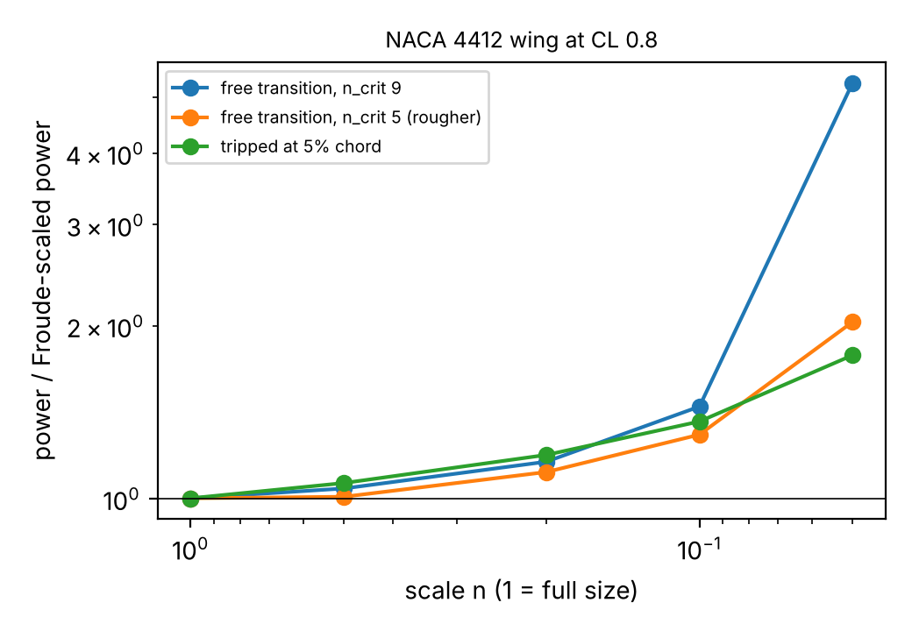
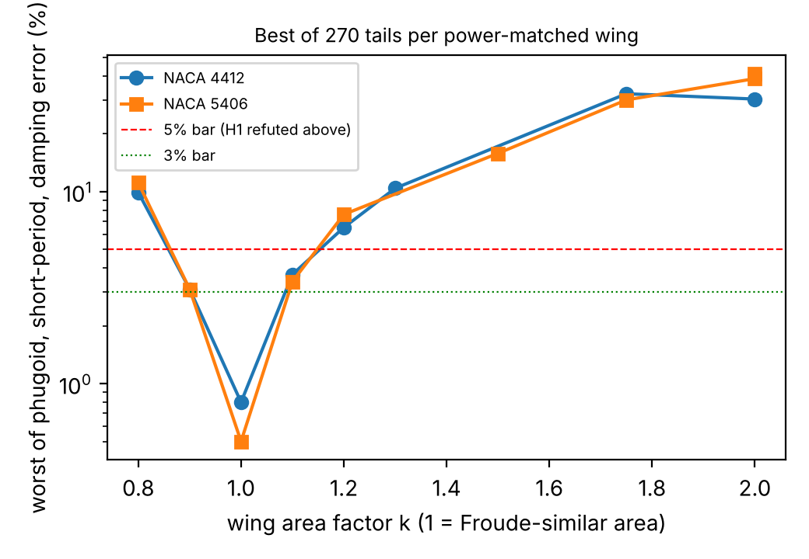
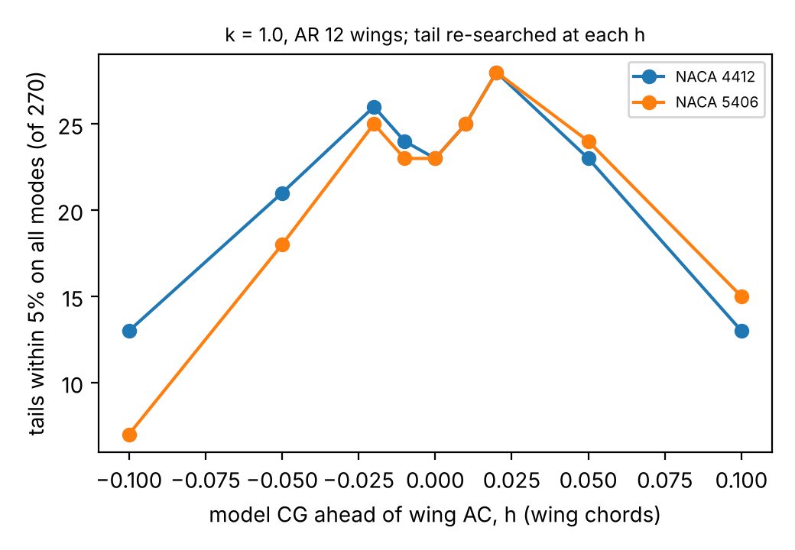

# What a Froude-scaled model of an electric cargo aircraft gets right, and how a designer can fix what it gets wrong

*Draft v0 of the programme paper (milestone 8), written with AI assistance (Claude Code). Target: AIAA SciTech, Aircraft Design or Applied Aerodynamics sessions, 12 to 16 pages. This is a Markdown skeleton with the claims and the numbers; conversion to the AIAA LaTeX template, figures and the full bibliography check are listed under "Before submission". Every number below is checked against the `experiments/*/results.txt` files by `paper/check_numbers.py`.*

## Abstract

Sub-scale models are used to decide whether a cargo aircraft configuration is worth building, but Froude similitude cannot hold Reynolds number, and electric powertrains do not scale with the airframe. We give a per-quantity error budget for a 1,000 kg, aspect-ratio-10 cargo fixed-wing and its Froude models at 1:5 and 1:10, using NeuralFoil polars, a four-state longitudinal model, 151 measured propeller curves and 134 measured drone flights. At 1:10 a geometrically similar model needs 1.29 to 1.45 times the Froude-predicted power and loses 0.37 to 0.52 of the section's maximum lift coefficient; peak propeller efficiency falls about 10 points between Reynolds numbers of 1e5 and 3.2e4. A search over wing sections at geometric similarity cannot restore power to within 5% at 1:5 (best 1.086), and a wing area and aspect-ratio change that does restore it breaks the short-period mode, because the tail, not the wing, sets that error. Redesigning the tail (smaller, longer-armed, thicker) as well gives a non-similar model that matches power to within 4% and the three longitudinal modes to within 1%, but the match tolerates a centre-of-gravity error of only about 3% of a chord, which is 5 to 6 mm on an 8 kg demonstrator. All of this rests on one polar surrogate that is not yet checked against measured low-Reynolds tail data.

## 1. Introduction

Sub-scale flight models are cheap to crash and so are used to test cargo and delivery aircraft before a full-size build. Wolowicz, Brown and Gilbert (NASA TP-1435) give the similitude rules; Chambers (SP-2009-575) records how the practice has gone. Neither gives a per-quantity error for a modern electric cargo aircraft, where Reynolds number falls as n^1.5 and the powertrain behaves differently at small size (Mueller and DeLaurier, 2003). Contributions:

1. Per-quantity errors for Froude models of a cargo fixed-wing at 1:5 and 1:10 (Sections 4.1 to 4.4).
2. A search showing that section changes at similarity cannot recover power, that wing-planform changes can but break the longitudinal modes, and that adding the tail to the design space recovers both (Sections 4.5 to 4.7).
3. The build tolerance of the resulting non-similar demonstrator (Section 4.8).
4. A stdlib calculator and every script, one command per result.

## 2. Setting and method

**Scaling.** The Froude exponents (velocity n^0.5, mass n^3, inertia n^5, power n^3.5, and so on) were derived from the two invariants and checked against Table 4 of NASA TP-1435. **Reference aircraft.** 1,000 kg, aspect ratio 10, NACA 4412, CL 0.8, Re at mean chord 3.06e6; the airframe constants are design choices, not a specific aircraft. **Polars.** NeuralFoil (xxxlarge) at each surface's own Reynolds number; strip theory with Oswald e = 0.8. **Modes.** A four-state longitudinal model (phugoid and short period), tail trimmed at CL 0.05, no elevator or thrust dynamics. **Data.** UIUC Propeller Database (Brandt and Selig, 2011) and the flights of Rodrigues et al. (2022, CC BY 4.0).

## 3. Hypotheses and how they fared

| | Claim | Outcome |
|---|---|---|
| H1 | trim speed and modes within 3% (refuted at 5%) | refuted for similar models flown at the full-size trim angle; modes recoverable with a non-similar tail (4.6) |
| H2 | power at least 20% above Froude at n = 0.1 | supported for a clean NACA 4412 section (4.1) |
| H3 | usable CLmax at least 0.2 lower at n = 0.1 | supported (4.1) |
| H4 | powertrain efficiency at least 10 points lower at n = 0.1 | direction supported inside the data, magnitude at n = 0.1 an extrapolation (4.3) |
| H5 | a correction restores power within 5% at n = 0.2 without breaking H1 | refuted for sections and for the wing alone; **not refuted** once the tail is redesigned (4.5 to 4.7) |

## 4. Results

**4.1 Drag and stall (4a).** With NeuralFoil polars in place of a flat plate, the 1:10 model needs 1.29 to 1.45 times the Froude-predicted power (three boundary-layer states) and loses 0.37 to 0.52 of CLmax. At 1:5 the power ratio is 1.11 to 1.19. The surrogate is unvalidated here and not used at 1:20.

**4.2 Longitudinal modes of a similar model (3a).** For a tripped boundary layer at 1:10, the model at the full-size trim angle trims 6.5% faster in Froude units and its short-period frequency rises 5.1%; at the full-size CL the speed matches and the frequencies stay within 1.3%, but short-period damping falls 6.3%. With free transition at Re 1e5 the short period is overdamped, a bubble regime the surrogate is not trusted in.

**4.3 Powertrain (5a, 6a, 6b).** Over 151 efficiency curves of 34 APC propellers (Re at 0.75 R from 1.5e4 to 1.2e5), peak efficiency rises with blade Reynolds number in 97% of propellers (0.21 per decade, bootstrap interval 0.18 to 0.23). Fits put the fall from Re 1e5 to 3.2e4 at 9.9 and 10.3 points. Full-size Reynolds numbers are outside the database, so the n = 0.1 gap is not reported. On 134 measured flights of one quadcopter, power scales with mass to the power 1.54 (flight bootstrap 1.41 to 1.67; day-cluster bootstrap 1.39 to 1.70; with a dummy per day 1.53), consistent with the m^1.5 of momentum theory, over a 13.6% mass range in one airframe.

**4.4 Energy.** Scaled range gives a model at fixed cell specific energy much more battery margin per body length, so scaled endurance does not test the full-size energy budget.

**4.5 Sections cannot fix it (7a).** At n = 0.2 the uncorrected model needs 1.157 times the Froude power. Of 178 section and boundary-layer cases with CL within 6% and lift slope within 5%, the best reaches 1.086.

**4.6 Planform and tail (7b to 7d).** Allowing wing area and aspect ratio to change, 17 of 144 cases match power within 5%, but only 2 keep CL within 6%, and none of 17 keeps phugoid frequency, short-period frequency and damping within 5% of the full-size aircraft: the short-period frequency is 13% to 25% high in every case, including the uncorrected model, because the tail's Reynolds number is 1.7e5 against 1.9e6. Searching 270 tail designs per wing, 6 of 17 wings have a tail that restores all three modes to within 5%. The best (NACA 5406 or 4412, k = 1.0, aspect ratio 12, NACA 0015 tail of 0.15 of the similar wing area, tail aspect ratio 5, arm 3.5 chords) matches power to within 4% and the modes to within 1%.

**4.7 Robustness (7e to 7g).** The result is insensitive to tail mass (a point-mass tail, 0 to 6% of total mass, leaves the passing set at 78 to 81 tails). With the tail re-chosen at each CG position the match persists from 0.05 chords ahead to 0.05 behind the reference. With the tail fixed at its design, the best symmetric CG tolerance is 0.035 chords (0.030 on the NACA 5406 wing).

**4.8 Demonstrator (7h).** At n = 0.2 the model is 8.0 kg with a 2,078 mm span and 173 mm chord. The CG must lie within 6.1 mm (NACA 4412 wing) or 5.2 mm (NACA 5406) of the design position, the binding tolerance of the design.

**4.9 Gust response (9a, 9b).** For a 1-cos vertical gust of 5, 12.5 and 25 chords (length scaled by n, speed by sqrt(n)) the uncorrected similar n = 0.2 model keeps the peak load-factor increment within 2.0% of full size but is 26.8% to 32.6% high in peak pitch rate and 19.8% to 21.6% high in peak pitch attitude; none of the 17 power-matched wings with the original tail is within 10% on all three metrics. With the tail redesigned, 72 of the 78 mode-matched designs are within 10% at 12.5 chords and 24 are within 5% at all three lengths; the best is within 1.2%. This rests on the same unvalidated tail slope as 4.6, and it does not survive it being lower: with the slope scaled by 0.75 to 1.0 (9c) none of the 78 designs keeps all gust peaks within 10% at every scale (median worst error 21.5% at 0.75, against 13.4% for the modes), so the tail slope must be measured before the claim can be made for a built demonstrator.

## 5. Limitations

- One polar surrogate (NeuralFoil) for wing, tail and reference. The tail-slope check against UIUC low-speed airfoil data (Selig et al.) was done for NACA 0009 only (`experiments/uiuc_tail_slope`): NeuralFoil's section slope is 0.72, 0.99, 1.15 and 1.18 times the measured value at Re 4.1e4, 6.1e4, 8.0e4 and 1.0e5, and the ratio moves by up to 0.3 with the fit window; a second check (`experiments/uiuc_naca241x`) on the cambered NACA 2414 and 2415 at Re 1e5 to 2e5 finds NeuralFoil's slope 1.22 to 1.67 times the measured value, so the surrogate's tail slope is probably too high by 20% to 35% at the tail's Re; the headline tail (NACA 0015, Re 1.5e5) is itself not in the data, and a 2% tail-slope error already moves the short period by about 1%. A match of 0.8% to 3% is inside the surrogate's likely error, so "within 5%" is a statement about the model.
- Four-state model, point-mass inertia, no elevator, thrust or gust dynamics; strip theory with fixed Oswald efficiency; one reference aircraft; a grid, not an optimiser.
- Full-size propeller Reynolds numbers are outside the measured data. The power-law check is within one quadcopter, not across scale.
- No wind-tunnel or flight data of a scaled model. Everything about the non-similar design is a model prediction until a demonstrator is built.

## Figures

*Figure 1. Power relative to Froude-scaled power for the NACA 4412 wing at CL 0.8 (`experiments/airfoil_polars/results.txt`), three boundary-layer assumptions.*

*Figure 2. Worst longitudinal-mode error of the best of 270 tails for each power-matched wing at n = 0.2 (`experiments/tail_search/results.txt`). Only k = 0.9 to 1.1 are within 5%, and only k = 1.0 (AR 12) is within 3%.*

*Figure 3. Tails within 5% on all three modes as the model CG moves, tail re-searched at each offset (`experiments/cg_margin/results.txt`). Re-searching hides the fixed-tail tolerance of Section 4.8.*

## Before submission (owner and later sessions)

1. (Slope-scaled tail search done, milestone 8e: none of the 78 passing tails stays within 5% for slopes 0.75 to 1.0 of NeuralFoil's; best worst case 7.1%; `experiments/robust_tail`.) Find measured NACA 0012/0015 polars at Re 1e5 to 2e5 (8c: NACA 0009 disagrees with NeuralFoil by 15 to 28%; 8d: NACA 2414/2415 by 22% to 67%; Vols. 1 to 3 hold no symmetric 12 or 15% section).
2. (Gust response done, milestone 9a: the similar n = 0.2 model keeps the peak load-factor increment within 2% but is 27 to 33% high in peak pitch rate; none of the 17 power-matched models is within 10% on all three metrics; `experiments/gust_response`. Not yet in Section 4.) A thrust law.
3. Convert to the AIAA template (the three figures exist: `paper/make_figures.py` draws `figures/fig1_power_ratio.png`, `fig2_mode_errors.png` and `fig3_cg_margin.png` from the committed results files; a tolerance-interval figure needs the per-tail intervals of `fixed_tail`, which the results file lists only for the five best tails), run `cite_check.py` on the final bibliography and open Drela 1989, Raymer 6th ed. and Jordan et al. proceedings.
4. Submitting is an owner step.

## References

See [`../PROPOSAL.md`](../PROPOSAL.md), "Related work" and "Citation status" (DOIs and NTRS records machine-checked 2026-10-27).
