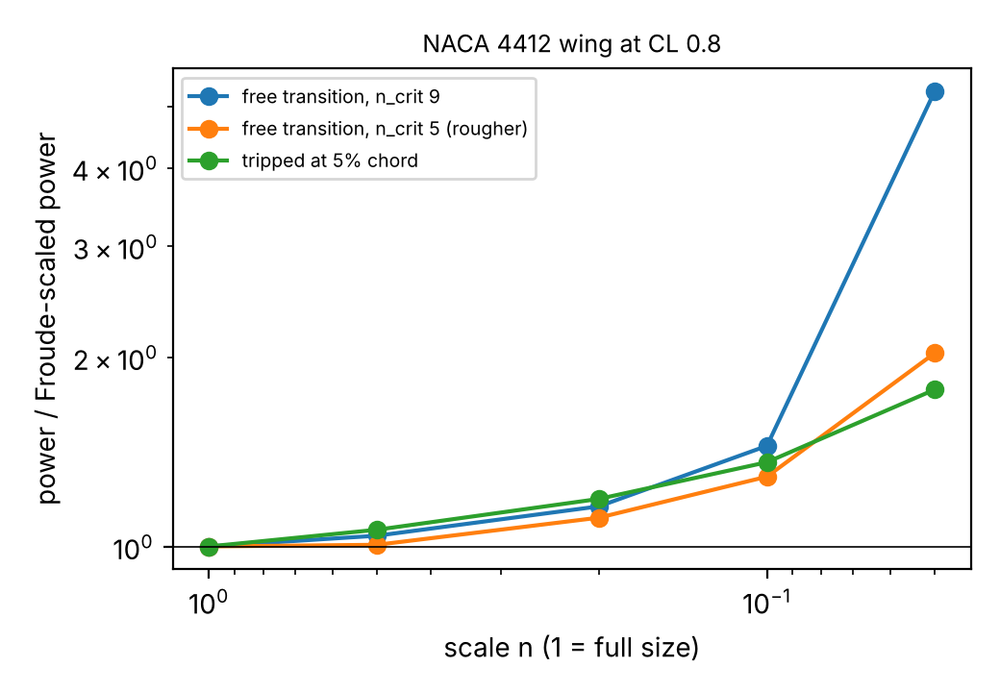
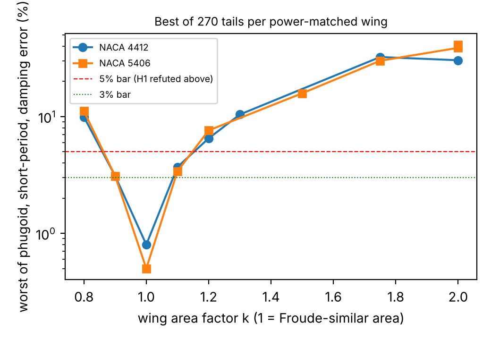
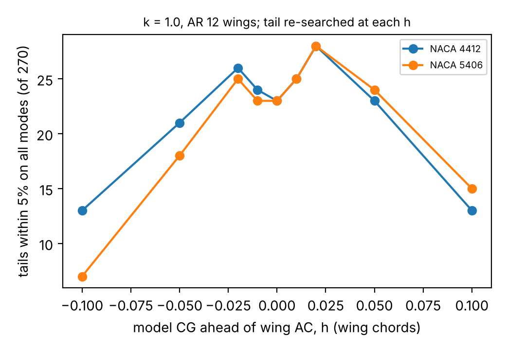

# What a Froude-scaled model of an electric cargo aircraft gets right, and how a designer can fix what it gets wrong

*Draft v0 of the programme paper (milestone 8), written with AI assistance (Claude Code). Target: AIAA SciTech, Aircraft Design or Applied Aerodynamics sessions, 12 to 16 pages. This is a Markdown skeleton with the claims and the numbers; conversion to the AIAA LaTeX template, figures and the full bibliography check are listed under "Before submission". Every number below is checked against the `experiments/*/results.txt` files by `paper/check_numbers.py`.*

## Abstract

Sub-scale models are used to decide whether a cargo aircraft configuration is worth building, but Froude similitude cannot hold Reynolds number, and electric powertrains do not scale with the airframe. We give a per-quantity error budget for a 1,000 kg, aspect-ratio-10 cargo fixed-wing and its Froude models at 1:5 and 1:10, using NeuralFoil polars, a four-state longitudinal model, 151 measured propeller curves and 134 measured drone flights. At 1:10 a geometrically similar model needs 1.29 to 1.45 times the Froude-predicted power and loses 0.37 to 0.52 of the section's maximum lift coefficient; peak propeller efficiency falls about 10 points between Reynolds numbers of 1e5 and 3.2e4. A search over wing sections at geometric similarity cannot restore power to within 5% at 1:5 (best 1.086), and a wing area and aspect-ratio change that does restore it breaks the short-period mode, because the tail, not the wing, sets that error. Redesigning the tail (smaller, longer-armed, thicker) as well gives a non-similar model that matches power to within 4% and the three longitudinal modes to within 1%, but the match tolerates a centre-of-gravity error of only about 3% of a chord, which is 5 to 6 mm on an 8 kg demonstrator. All of this rests on one polar surrogate that is not yet checked against measured low-Reynolds tail data.

## 1. Introduction

Sub-scale flight models are cheap to crash and so are used to test cargo and delivery aircraft before a full-size build. Wolowicz, Brown and Gilbert (NASA TP-1435) give the similitude rules; Chambers (SP-2009-575) records how the practice has gone. Neither gives a per-quantity error for a modern electric cargo aircraft, where Reynolds number falls as n^1.5 and the powertrain behaves differently at small size (Mueller and DeLaurier, 2003). Contributions:

1. Per-quantity errors for Froude models of a cargo fixed-wing at 1:5 and 1:10 (Sections 4.1 to 4.4).
2. A search showing that section changes at similarity cannot recover power, that wing-planform changes can but break the longitudinal modes, and that adding the tail to the design space recovers both (Sections 4.5 to 4.7).
3. The build tolerance of the resulting non-similar demonstrator (Section 4.8).
4. A stdlib calculator and every script, one command per result.

## 2. Setting and method

**Scaling.** The Froude exponents (velocity n^0.5, mass n^3, inertia n^5, power n^3.5, and so on) were derived from the two invariants and checked against Table 4 of NASA TP-1435. **Reference aircraft.** 1,000 kg, aspect ratio 10, NACA 4412, CL 0.8, Re at mean chord 3.06e6; the airframe constants are design choices, not a specific aircraft. **Polars.** NeuralFoil (xxxlarge) at each surface's own Reynolds number; strip theory with Oswald e = 0.8. **Modes.** A four-state longitudinal model (phugoid and short period), tail trimmed at CL 0.05, no elevator or thrust dynamics. **Data.** UIUC Propeller Database (Brandt and Selig, 2011) and the flights of Rodrigues et al. (2022, CC BY 4.0).

## 3. Hypotheses and how they fared

| | Claim | Outcome |
|---|---|---|
| H1 | trim speed and modes within 3% (refuted at 5%) | refuted for similar models flown at the full-size trim angle; modes recoverable with a non-similar tail (4.6) |
| H2 | power at least 20% above Froude at n = 0.1 | supported for a clean NACA 4412 section (4.1) |
| H3 | usable CLmax at least 0.2 lower at n = 0.1 | supported (4.1) |
| H4 | powertrain efficiency at least 10 points lower at n = 0.1 | direction supported inside the data, magnitude at n = 0.1 an extrapolation (4.3) |
| H5 | a correction restores power within 5% at n = 0.2 without breaking H1 | refuted for sections and for the wing alone; **not refuted** once the tail is redesigned (4.5 to 4.7) |

## 4. Results

**4.1 Drag and stall (4a).** With NeuralFoil polars in place of a flat plate, the 1:10 model needs 1.29 to 1.45 times the Froude-predicted power (three boundary-layer states) and loses 0.37 to 0.52 of CLmax. At 1:5 the power ratio is 1.11 to 1.19. The surrogate is unvalidated here and not used at 1:20.

**4.2 Longitudinal modes of a similar model (3a).** For a tripped boundary layer at 1:10, the model at the full-size trim angle trims 6.5% faster in Froude units and its short-period frequency rises 5.1%; at the full-size CL the speed matches and the frequencies stay within 1.3%, but short-period damping falls 6.3%. With free transition at Re 1e5 the short period is overdamped, a bubble regime the surrogate is not trusted in.

**4.2a Thrust law and phugoid damping (5b to 5d).** The 3a phugoid has constant thrust and is slightly unstable at full size. Over 137 measured APC curves the fixed-RPM thrust-speed slope s = dlnT/dlnV has median -2.25 (5th/95th percentile -2.86 / -1.54) with no detectable Reynolds dependence within propellers (+0.23 per decade, 95% interval [-0.24, 0.73]). Putting s into the 4-state model, the full-size phugoid real part (in omega sqrt(b/g) units, free transition) is +0.0127 at s = 0, +0.0087 at s = -1 (constant power) and +0.0037 at s = -2.25, so its sign depends on the thrust law; the model is more damped at n = 0.2 by 0.0065 to 0.0083 (L/D falls from 25.2 to 21.2), but crosses zero only at the fixed-RPM slopes. The scaling direction is robust; the sign is not. The s = -1 constant-power law holds only near the propeller's efficiency peak: on 104 APC curves (71 propellers), the median constant-power slope s_P is -0.88 at 0.9 of the peak-efficiency advance ratio, -1.10 at the peak and -1.33 at 1.1 (-0.67 at 0.8, -1.54 at 1.2; 5e), so the phugoid sign inherits the uncertainty of the cruise advance ratio. Limits: constant propeller efficiency for s = -1 (relaxed in 5e only to the extent of the fitted slope); APC thin-electric props on a different airframe; no thrust-line offset.

**4.3 Powertrain (5a, 6a, 6b).** Over 151 efficiency curves of 34 APC propellers (Re at 0.75 R from 1.5e4 to 1.2e5), peak efficiency rises with blade Reynolds number in 97% of propellers (0.21 per decade, bootstrap interval 0.18 to 0.23). Fits put the fall from Re 1e5 to 3.2e4 at 9.9 and 10.3 points. Full-size Reynolds numbers are outside the database, so the n = 0.1 gap is not reported. On 134 measured flights of one quadcopter, power scales with mass to the power 1.54 (flight bootstrap 1.41 to 1.67; day-cluster bootstrap 1.39 to 1.70; with a dummy per day 1.53), consistent with the m^1.5 of momentum theory, over a 13.6% mass range in one airframe.

**4.4 Energy.** Scaled range gives a model at fixed cell specific energy much more battery margin per body length, so scaled endurance does not test the full-size energy budget.

**4.5 Sections cannot fix it (7a).** At n = 0.2 the uncorrected model needs 1.157 times the Froude power. Of 178 section and boundary-layer cases with CL within 6% and lift slope within 5%, the best reaches 1.086.

**4.6 Planform and tail (7b to 7d).** Allowing wing area and aspect ratio to change, 17 of 144 cases match power within 5%, but only 2 keep CL within 6%, and none of 17 keeps phugoid frequency, short-period frequency and damping within 5% of the full-size aircraft: the short-period frequency is 13% to 25% high in every case, including the uncorrected model, because the tail's Reynolds number is 1.7e5 against 1.9e6. Searching 270 tail designs per wing, 6 of 17 wings have a tail that restores all three modes to within 5%. The best (NACA 5406 or 4412, k = 1.0, aspect ratio 12, NACA 0015 tail of 0.15 of the similar wing area, tail aspect ratio 5, arm 3.5 chords) matches power to within 4% and the modes to within 1%.

**4.7 Robustness (7e to 7g).** The result is insensitive to tail mass (a point-mass tail, 0 to 6% of total mass, leaves the passing set at 78 to 81 tails). With the tail re-chosen at each CG position the match persists from 0.05 chords ahead to 0.05 behind the reference. With the tail fixed at its design, the best symmetric CG tolerance is 0.035 chords (0.030 on the NACA 5406 wing).

**4.8 Demonstrator (7h).** At n = 0.2 the model is 8.0 kg with a 2,078 mm span and 173 mm chord. The CG must lie within 6.1 mm (NACA 4412 wing) or 5.2 mm (NACA 5406) of the design position, the binding tolerance of the design.

**4.9 Gust response (9a, 9b).** For a 1-cos vertical gust of 5, 12.5 and 25 chords (length scaled by n, speed by sqrt(n)) the uncorrected similar n = 0.2 model keeps the peak load-factor increment within 2.0% of full size but is 26.8% to 32.6% high in peak pitch rate and 19.8% to 21.6% high in peak pitch attitude; none of the 17 power-matched wings with the original tail is within 10% on all three metrics. With the tail redesigned, 72 of the 78 mode-matched designs are within 10% at 12.5 chords and 24 are within 5% at all three lengths; the best is within 1.2%. This rests on the same unvalidated tail slope as 4.6, and it does not survive it being lower: with the slope scaled by 0.75 to 1.0 (9c) none of the 78 designs keeps all gust peaks within 10% at every scale (median worst error 21.5% at 0.75, against 13.4% for the modes), so the tail slope must be measured before the claim can be made for a built demonstrator.

**4.10 An adjustable tail and its identification (9d to 9i).** If the true tail lift slope is 0.75 to 1.0 of NeuralFoil's, a tail-area multiplier f set in flight recovers all three modes within 5% for 76 of the 78 mode-matched designs at every slope scale tried (9d); the needed f tracks 1/slope (median 1.27 at 0.75, 0.95 at 1.0), so the tail's effective area has to vary by 15% to 35%. The same f also restores the gust peaks: 67 of 78 designs keep every peak within 10% at all four slope scales, against none for any fixed tail (9e, 9c). The correction is only as good as the in-flight identification. With independent Gaussian errors on the identified modes, the share of draws within 10% on gust is 84% to 86% at 2% error, 58% to 61% at 5% and 33% to 35% at 10%, and no design is reliable (90% of draws) at 5% (9f). Choosing f from the short-period frequency alone needs that frequency good to about 2% (51 of 78 designs reliable at 2%, none at 5%; 9g). Replacing assumed errors with a fit of a simulated noisy free response, an equation-error least squares meets the 2% to 3% level at 1% channel noise and one phugoid period but gets worse with longer records (short-period frequency error 0.33%, 0.70%, 4.45% at 1, 2, 4 periods; 9h); an output-error fit removes that artefact (0.21% to 0.33% at 1 to 4 periods at 3% noise; 66 of 78 designs reliable at 4 periods against 13 for least squares; 9i). At 10% noise (9j) the output-error fit still gives a median short-period frequency error of 0.74% and 0.71% at 1 and 2 phugoid periods (least squares: 19.1% and 52.7%) and keeps 85% of draws within 10% on gust, but a 4-period record degrades it (1.25%, 62% of draws, 170 of 1560 fits failed or in the wrong basin). Starting the fit by continuation from a 1-period fit (9k) cuts those failures from 144 to 9 and lifts the gust share from 63% to 77% at 4 periods, still below the 1 to 2 period records, so the advice is a record of one to two phugoid periods. Estimating the four initial states instead of assuming them (9l, 2 periods, 10% noise, 26 designs, 10 draws each) changes the short-period frequency error from 0.65% to 0.71% and the share within 10% on gust from 88% to 89%, so the known-initial-state assumption did not flatter the fit at this record length. Limits: white noise on all four states, no turbulence, no input-shape or actuator-lag effects on the initial state, a third of the designs and 10 draws in 9l, one seed per experiment; the tail slope itself is still unmeasured, so a built demonstrator needs this identification.

**4.10a Correlated sensor noise and how to fit through it (9m to 9p).** Real IMU and air-data errors are correlated in time, and the white-noise results above are optimistic for them. With AR(1) noise (rho 0.9, same rms, 2 periods, 10% noise, 26 designs, 260 draws) the output-error fit does not fail outright (0 failures) but drifts silently: median short-period frequency error 1.51% against 0.67% for white noise, damping-ratio error 2.55% against 1.51%, and the share of draws within 10% on gust falls from 86% to 69% (9m). Fitting AR(1)-whitened residuals with rho given recovers 14 of the 17 points (83%; 9n), and estimating rho from the residuals by two generalised-least-squares iterations costs nothing measurable (83%, median estimated rho 0.878 against a true 0.9; short-period frequency error 1.21%; 9o). Where the noise is correlated the gust margin of about 1.5x is prudent for an unweighted fit and about 1.2x for an iterated GLS fit. When the generator is AR(2) (coefficients 1.2 and -0.4) and the estimator is still AR(1), the same fit recovers only 6 of the 12 points (gust share 74% unweighted, 80% whitened, 86% white; short-period frequency error 1.41% and 1.57%, so no gain on the modes; 9p), so the 1.5x margin is the safe one. With 1/f noise the result is the same: 76% unweighted, 81% whitened, 86% white, half of the 10-point gap (damping error 2.56% to 1.94%; 9q). Giving the AR(2) noise an AR(2) estimator (coefficients recovered to within 0.03 of 1.2 and -0.4) does not help gust share: 77% against 80% for the AR(1) fit, with slightly smaller mode errors (9r), so the half-recovery is not an estimator-order penalty. In continuous Dryden vertical turbulence (L 25 to 125 full-size chords, scaled with n) the similar n = 0.2 model keeps rms load factor within 2% but is 24 to 29% high in rms pitch rate and 35 to 40% high in rms attitude, and none of the 17 power-matched designs is within 10% on all three at any L (best worst case 14.8%; 9s). That assumed the air shrinks with the model; with Dryden's L fixed in metres (the model sees 5 times more chords) the similar model's rms load factor is 38 to 53% low, its pitch rate +34%, +10% and -9% across the three L, its attitude +34 to +184%, none of the 17 power-matched designs is within 10% at any L, and the equal-sigma_w level factor 1/sqrt(n) = 2.24 doubles the pitch response again (9t). A datasheet check puts the 10% noise level in context: a commodity MEMS IMU (Bosch BMI088, 0.014 deg/s/sqrt(Hz) gyro, 190 ug/sqrt(Hz) accelerometer) sampled at t_sp/20 adds white noise equal to 10% of the signal only when the pitch-rate rms is 0.3 to 0.7 deg/s, and about 2% at 1.4 to 3.5 deg/s (9u), so 10% is conservative for white IMU noise and silent on bias drift and air-data noise. The same data sheet gives a zero-rate offset of 1 deg/s and a zero-g offset of 20 mg, each larger than the whole signal for pitch-rate rms under 1 deg/s or load-factor rms under 20 mg, so the noise model presupposes a static zeroing; after one, the temperature coefficient (0.015 deg/s/K, at most 0.2 mg/K) is the floor, 0.075 deg/s and 1 mg for a 5 K change, equal to 10% of the signal at a pitch-rate rms of 0.75 deg/s (9v). Putting a constant offset of random sign on every channel of the 10%-noise fit (26 designs, 8 draws, 1 and 2 periods) raises the output-error fit's median short-period frequency error from 0.7% to 1.1 to 1.4% at an offset of 5% of rms, 2.3 to 2.5% at 10% and 4.8 to 5.1% at 20%, and cuts the share of draws within 10% on gust from 84 to 86% to 56 to 61% at 10%; adding four fitted offset parameters holds the error at 0.65 to 0.77% and the share at 84 to 88% at every offset, and costs nothing at zero offset (9w). A linear drift ramp (total 10 or 20% of rms over the record; 20 designs, 8 draws) hurts less than a constant offset: at 20% the median short-period frequency error is 1.6% at one period and 0.9% at two against 0.7% undrifted; the constant-offset fit of the previous sentence repairs none of it at one period and is worse at two (2.1%, gust share 60% against 74%), while adding a fitted slope restores 0.9 / 0.65% and 79 / 75% (9x). A Gaussian random walk of the same end-point size (20% of rms) hurts a little more (1.9 / 1.2% at 1 / 2 periods; gust share 54 / 74%); the fitted slope repairs it at one period (1.0%, 73%) but not at two (1.4%, 67%, worse than no drift parameter at all; 9y). Limits: one correlation coefficient, one AR(2) shape, a third of the designs, 10 draws, one seed; published Allan-variance figures are compared with these sizes in the next paragraph (9z).

**4.10b How large are real gyro drift and noise on this record? (9z.)** The drift and noise sizes of 9x and 9y (10 to 20% of the channel rms) were assumed. Taking the measured MPU-6050 Allan parameters (Sensors 2020, PMC7506677: angle random walk 0.0091 to 0.0100 deg/s/sqrt(Hz), bias instability 0.0013 to 0.0025 deg/s) and the ADIS16488A datasheet typicals (0.26 deg/sqrt(hr), 5.1 deg/hr), on the 20 mode-matched designs at n = 0.2 with records of 1 to 2 phugoid periods (10 to 20 s, pitch-rate rms 0.068 to 0.091 rad/s), bias instability taken as the whole end-point drift is 2.7e-4 to 6.8e-4 of the rms and white noise at the model's 0.094 s sample interval is 2.7e-3 to 9.1e-3 of it. Both are under 1%, as predicted before the run, 15 to 40 times below the 10% noise and 150 to 700 times below the smallest drift tested. Drift would reach 10% of the rms only at about 1,300 to 1,400 deg/hr, and noise at about 0.12 deg/s/sqrt(Hz), 13 times the MPU-6050 figure. For a real pitch-rate gyro the identification result at zero drift is therefore the one to quote, and the drift and noise runs are stress tests. Limits: only the pitch-rate channel is sized (airspeed and incidence come from other sensors); bias instability is the floor of the Allan curve, so using it as end-point drift is generous to the sensor; vibration, temperature drift, scale factor and cross-axis error are not included; the ADIS figures come from a search extract of the datasheet, not the PDF.

**4.10c Does a pitot-sensor error break the fit, and does a fitted bias repair it? (9aa to 9ad.)** Sizing the airspeed channel from the MS4525DO datasheet (accuracy 0.25% of span, total error band 1% of span; a 1 psi span is my assumption, and the figures come from a search extract of the datasheet, not the PDF), the sensor's offset error is 0.37 (accuracy) to 1.48 (1% band) of the u-channel rms of 1.80 m/s, at a trim dynamic pressure of 272 Pa, 4.0% of that span (9aa; prediction held). Unlike the gyro, then, this channel's offset alone can exceed the whole velocity perturbation. Re-running the 10%-noise fit with that constant offset on u (20 mode-matched designs, scale 0.75, 8 draws each, 9ab), plain output-error (OE) fitting degrades from a 0.78% median short-period error to 2.76% at one phugoid period (offset 0.37) and fails in 160 of 160 draws at offset 1.48, while the same fit with one fitted bias per channel (OE+b) stays at 0.69% and 0.80% (2 of 160 failures at 1.48). Adding a ramp is no better (12 and 5 failures). A speed-proportional error (9ac) acts as a gain (1+eps) plus an offset eps x V0; at eps = 1% plain OE has a 1.96% phugoid error at one period against 0.23% with none, at 5% 9.0% (damping 12%), and OE+b stays within 2x of the error-free value at every eps. The gain alone cannot move the modes (a diagonal similarity transform); 9ad re-ran 9ab with the first-order gain a constant offset implies (0.970 and 0.894) and OE+b moved by under 0.1 percentage points, with one cost: 8 of 160 fits failed at 1% and two periods (none in 9ab), read as lower signal-to-noise in u and not checked further. The practical advice is to fit a bias on the airspeed channel; the offset, not the noise, is what the pitot error costs. Limits: offset held constant over the record, only u offset, one scale, 20 designs, 8 draws, no repeat seed; gain isolated only by the 9ad inference; the incidence channel is not yet sized.

**4.10d Does a bias on the incidence (alpha) channel break the fit, and where does the repair stop? (9ae to 9ak.)** A pure airspeed gain (9ae, gain on u only, eps up to 5%) leaves plain OE unchanged (short-period median 0.65 to 0.76% against 0.78% at eps 0, no failures in 160), so 9ac's damage came from the offset eps x V0, not the gain. The incidence channel is far more fragile (9af): the bias is swept (0.25 to 2 degrees, random sign) because no vane or five-hole figure could be fetched, against a 2.9 degree release disturbance. Plain OE at one period fails 27 of 160 fits at 0.25 degrees and all 160 at 1 degree; OE with one fitted bias per channel (OE+b) has 0 failures at 1 degree at both record lengths and short-period medians 0.65% (one period) and 0.65% (two). At 2 degrees OE+b fails 21 of 160 at one period and 80 of 160 at two (replicate 77; the draw-to-draw spread is about 14, 9ag). Bisecting at two periods (9ah): OE+b fails 2 of 160 at 1.25 degrees and 86 of 160 at 1.5 degrees, a cliff within a 0.25 degree interval, with the drift-augmented fit (OE+b+d) already failing 79 of 160 at 1.25. So a fitted bias tolerates an alpha-vane bias of about 1.25 degrees (0.43 of the release amplitude) at this scale and noise and fails abruptly by 1.5; a sourced uncalibrated five-hole probe on a small UAV had an estimated alpha bias of -2.49 degrees (standard deviation 0.56; Sun and Gebre-Egziabher 2020, Table 6), about twice the tolerance, so an uncalibrated probe would sit on the failing side, while a CFD upwash on a blended-wing-body sUAS (perceived alpha = 1.19 alpha + 0.596 degrees; Sasse et al. 2022, Table 4) would add about 0.6 degrees of offset, under the tolerance, plus a 19% slope error (9aj). Simulating that sourced error directly (9ak: alpha gain 1.19 and offset 0.596 degrees together, same harness, new draws) OE+b fails 4 of 160 fits at two periods and 0 of 160 at one, with 76% of draws within 10% on gust at both lengths, as good as the 0.5 and 1 degree rows of 9af; plain LS and OE return a fit on many draws (LS 0 and 87 of 160 failures at one and two periods) but a wrong one, 0% of draws within 10% on gust at two periods. A first run with the initial state left in unscaled units wrongly suggested the gain hurt; it was a harness bug, fixed and kept as `results_gain_offset_x0bug.txt`. A post-calibration flight residual is still not sourced. Limits: bias swept not sourced; one scale (0.75), noise 10%, 8 draws, one seed; the bracket is not a located onset; mechanism untested.

**4.11 Energy per package from measured flights (2a to 2c).** The 134 route flights of Rodrigues et al. (one 3.7 kg quadcopter) give a cruise-only energy of 86.4 J/m [81.2, 91.5] pooled, 63 J/m at 8 m/s and 48 J/m at 10 m/s; against a sourced truck figure of 7.8 MJ/package (Stolaroff et al. 2018) the energy break-even one-way distance is 63 km at 8 m/s and 83 km at 10 m/s. That comparison does not describe the aircraft: 77.4% [73.8, 80.8] of whole-flight energy is climb, hover and acceleration (legs average 467 m), whole-flight energy is 153.8 J/m at 8 m/s against 60.1 cruise-only, and one battery pack at 80% usable buys about 1 to 3 km one way. Each extra 25 m of cruise altitude costs 9.6 kJ [8.9, 10.3] per flight (about 384 J per metre climbed against 38 J/m of potential energy), and the cruise slope is not identified (interval -13 to 103 J/m) because cruise windows are under 150 m, so no range figure is quoted. Limits: one small airframe, so nothing here applies to a 500 kg cargo VTOL; pack capacity is from a retailer listing; altitude may be confounded with route and time of day. A cargo-class comparison needs a lift-plus-cruise sizing model with the Froude table (milestone 2 proper).

**4.12 How far a battery cargo VTOL gets (10a to 10d).** A stdlib mass-fraction sizing model (momentum-theory hover, lift-plus-cruise at L/D 12, 20% reserve, payload at least 15% of MTOW) with assumed structure 0.35 reaches 203 km one way at a 250 Wh/kg cell, linear at 88 km per 100 Wh/kg (10a). Its non-energy fraction (structure plus motors, 0.402) was then checked against seven NASA NDARC concept vehicles (Johnson, Silva and Solis, NTRS 20180003381): their fractions are 0.48 to 0.62 (10b, 10c), and the energy model reproduces their fuel weights at an implied sfc 1.07 to 1.20 times the published one. Re-running the sizing with the band (10d) gives 166, 131 and 97 km at 250 Wh/kg for fractions 0.48, 0.55 and 0.62, and 200 km needs 298, 367 and 478 Wh/kg cells. Limits: the band is from concept studies, not flown aircraft; the fraction is held fixed with size. **Against a flown aircraft (10e to 10i).** Checked on the Wingcopter 198 (25 kg MTOW, two 814 Wh packs, 90 km/h cruise, 94 km published range, 75 km at 6 kg; manufacturer and press figures, several read as search-result summaries), 10a's L/D 12 model gives 167 km, 1.8 times the published 94 km (10e). The L/D times propulsive efficiency implied by 94 km is 5.7 (L/D 6.8 at 0.85), and is insensitive to disk loading (5.5 to 5.8 for 50 to 200 N/m&sup2;) because hover is only 107 Wh of 1,628: the gap is cruise efficiency, not hover. A drag polar with the sourced 1.98 m span (10g; wing area unpublished, swept 0.3 to 1.0 m&sup2;; e 0.8 assumed) needs a zero-lift CD0 of 0.105, 0.075 and 0.053 at wing areas 0.5, 0.7 and 1.0 m&sup2; for L/D 6.8, against 0.035 for a clean airframe, which would reach L/D 9.7 at 0.7 m&sup2;. The excess is equivalent to a flat-plate area of 0.035, 0.028 and 0.018 m&sup2; (10h), and the published 8 motors (secondary source, 10i) explain it if about 4 rotors with 2 blades of 0.003 m&sup2; each sit stopped in cruise (L/D 7.7, 7.1, 6.4 at those areas), not if all 8 do (6.0, 5.6, 5.1). That is a plausibility range, not a demonstration: blade size, which rotors tilt or fold, wing area and the reserve behind the 94 km are not published. The model's optimism on a real aircraft is therefore a cruise-drag term, which a mass-fraction model with a fitted L/D cannot supply, and the paper's range figures should be read with that factor.

**4.13 Does a hybrid cargo VTOL beat the battery one once the engine has mass? (10e, 10j, 10k.)** Adding an engine-plus-generator mass (specific power swept 0.5 to 4 kW/kg, tank 0.25 of fuel mass, non-energy fraction 0.479 from 4.12) to the sizing model, a hover-sized hybrid has a finite range (1,273 km at 1 kW/kg and chain efficiency 0.20) but beats the 250 Wh/kg battery aircraft only beyond 67 km at 1 kW/kg (145 to 167 km at 0.5 kW/kg, 4 to 7 km at 4 kW/kg): engine specific power dominates, chain efficiency and tank fraction barely matter (10e). Sizing the engine for 1.2 times cruise power at 30 m/s and carrying a hover battery (sized by energy and peak power, pack 1.5 kW/kg) cuts the break-even to 35 km at 1 kW/kg (52 to 59 km at 0.5, 21 to 23 km at 4) and the payload fraction at 150 km to 0.40, against 0.34 hover-sized and 0.18 for the battery aircraft (10j). Adding climb (100 m at 2 m/s) and a 30 s transition moves the break-even to 47 km at 1 kW/kg (33 km at 4); it depends on climb rate (41, 47, 59 km at 1, 2, 4 m/s) and hardly on height or transition time, because the pack is sized by peak power, not energy (10k). The hybrid still beats the battery aircraft from about 33 to 59 km under every swept climb. Limits: engine and pack specific power, climb and transition parameters are swept, not taken from datasheets (the hosts were unreachable from the session); no engine part-load penalty; a fixed non-energy fraction; a 1,500 km range cap hides some sensitivities. Preliminary.

**4.14 What decides the hybrid's break-even, and what datasheet cells give (10m to 10p, 10r).** Drawing all 12 inputs of the 10k model together over ranges I chose (pack peak power 800 to 3,000 W/kg, engine 0.5 to 4 kW/kg, and ten more), the break-even against the 250 Wh/kg battery aircraft has a median of 40 km and a 10th to 90th percentile of 22 to 70 km (10m). Saltelli sampling with Jansen estimators (N = 20,000, 280,000 runs, 10n) gives pack peak power a first-order index of 0.562 and a total effect of 0.650; engine specific power 0.189 and 0.208; climb height (0.026, 0.112), climb rate (-0.002, 0.106) and cell energy density (0.011, 0.067) matter almost only through interactions. Five inputs carry essentially all the variance and the other seven have total effect at most 0.013. This corrects 10m's binned first-order sum (0.82) to 0.70. Feeding four Molicel 21700 cells' published energy density, maximum current and mass as paired inputs (10o; pack power = max current x 3.6 V / cell mass x 0.7) gives base-case break-evens of 44 km (P42A), 42 (P45B), 32 (P50B) and 22 (P50S); the high-rate cell is worst because its 100 A rating is a maximum, not a flight continuous rating. Derating that current by d (10p; d is swept, not read from a datasheet) roughly doubles the break-even for each halving: P42A 44, 58, 86, 130, 170 km at d = 1, 0.75, 0.5, 0.33, 0.25; P50S 22, 28, 40, 60, 78 km; the ordering of cells never changes. Coupling pack peak power and cell energy density with a Gaussian copula at rank correlation −0.9 to +0.3 (10r; rho swept, not measured) leaves the median at 40 km (38 km at +0.3) and the 10th to 90th percentile at 22 to 68 km (24 to 68 at −0.9), so the independence assumption of 10m and 10n does not change the result: pack peak power decides it, not the trade-off with energy density. Limits: ranges and kpack 0.7 are mine, the datasheet PDFs and continuous-discharge curves were not readable (hosts returned 403), engine specific power is still unsourced. Preliminary.

**4.15 What binds at a delivery hub: pads, chargers or packs? (6, 6b, 6c, 6d, 6f.)** A discrete-event model of pads, chargers and spare packs, checked against Erlang C (simulated mean wait within 0.6% at utilisation 0.5, 0.7 and 0.85), with swap time and charge time taken from vendor figures for two small multicopter systems (Matternet, DJI Dock 2). With 4 pads and 4 chargers, charge-in-place saturates at 9.8 flights/h; battery swap raises the pad limit to 80/h, but the charger limit is 10.7/h, so swapping gains 1.09x, not 8x: chargers bind in every swap case swept (6). Giving the hub the sized cargo VTOL's own pack (100 kg payload, 250 Wh/kg cells, 11.6 kWh at 100 km) and 8 chargers at 1C (42 min for 20 to 90%), the charger limit is 11.4 flights/h and the grid draw 0.09 MW at 100 km (0.19 MW at 150 km), an ordinary three-phase service rather than a grid project; the binding cost is a 23 to 24 pack inventory, 1.6 t of cells at 100 km (6b). That spare-pack rule is a Poisson rule: when orders arrive in batches of 8 at 70% load, the spares needed for a p95 wait under 300 s rise from 12 (single orders) to 48, and the p95 wait at 24 spares is 4,964 s (6c). A constant-current, constant-voltage charge curve fitted to two Molicel INR-21700-P45B datasheet numbers (1C then 4.2 V to 90 mA in 1.5 h) gives 43.1 min for 20 to 90% at 1C, within 3% of the linear 42, so the linear model was fair for that window; charging 30 to 100% takes 72.0 min, cuts the 8-charger limit to 6.7 flights/h and raises the spares needed at 6 flights/h from 9 to 24 (6d). Scaling the time-of-day shape of City of Chicago ride-hail trips (two days, 15-minute bins, peak 1.76 and 1.68 times the daily mean; a stand-in for delivery demand, not a delivery trace) to the same mean rate, the spares needed for a p95 wait under 300 s rise from 12 (Poisson) to 16 at 70% load, and from 16 to 32 (Wednesday) and 40 (Saturday) at 85% load; the daily peak is a smaller effect than the order bursts of 6c but doubles the inventory near the charger limit (6f). Limits: one cell type and one datasheet version; the CV decay shape and its time constant at other C-rates are assumed; batch sizes are swept and the daily shape comes from ride-hail, not delivery orders; no thermal derating or ageing; sizing inputs come from 4.12. Preliminary.

## 5. Limitations

- One polar surrogate (NeuralFoil) for wing, tail and reference. The tail-slope check against UIUC low-speed airfoil data (Selig et al.) was done for NACA 0009 only (`experiments/uiuc_tail_slope`): NeuralFoil's section slope is 0.72, 0.99, 1.15 and 1.18 times the measured value at Re 4.1e4, 6.1e4, 8.0e4 and 1.0e5, and the ratio moves by up to 0.3 with the fit window; a second check (`experiments/uiuc_naca241x`) on the cambered NACA 2414 and 2415 at Re 1e5 to 2e5 finds NeuralFoil's slope 1.22 to 1.67 times the measured value, so the surrogate's tail slope is probably too high by 20% to 35% at the tail's Re; the headline tail (NACA 0015, Re 1.5e5) is itself not in the data, and a 2% tail-slope error already moves the short period by about 1%. A match of 0.8% to 3% is inside the surrogate's likely error, so "within 5%" is a statement about the model.
- Four-state model, point-mass inertia, no elevator, thrust or gust dynamics; strip theory with fixed Oswald efficiency; one reference aircraft; a grid, not an optimiser.
- Full-size propeller Reynolds numbers are outside the measured data. The power-law check is within one quadcopter, not across scale.
- No wind-tunnel or flight data of a scaled model. Everything about the non-similar design is a model prediction until a demonstrator is built.

## Figures

*Figure 1. Power relative to Froude-scaled power for the NACA 4412 wing at CL 0.8 (`experiments/airfoil_polars/results.txt`), three boundary-layer assumptions.*

*Figure 2. Worst longitudinal-mode error of the best of 270 tails for each power-matched wing at n = 0.2 (`experiments/tail_search/results.txt`). Only k = 0.9 to 1.1 are within 5%, and only k = 1.0 (AR 12) is within 3%.*

*Figure 3. Tails within 5% on all three modes as the model CG moves, tail re-searched at each offset (`experiments/cg_margin/results.txt`). Re-searching hides the fixed-tail tolerance of Section 4.8.*

## Before submission (owner and later sessions)

1. (Slope-scaled tail search done, milestone 8e: none of the 78 passing tails stays within 5% for slopes 0.75 to 1.0 of NeuralFoil's; best worst case 7.1%; `experiments/robust_tail`.) Find measured NACA 0012/0015 polars at Re 1e5 to 2e5 (8c: NACA 0009 disagrees with NeuralFoil by 15 to 28%; 8d: NACA 2414/2415 by 22% to 67%; Vols. 1 to 3 hold no symmetric 12 or 15% section).
2. (Thrust slope measured, milestone 5b: at fixed RPM dlnT/dlnV is -2.25 at peak efficiency over 137 APC curves, with no detectable Reynolds dependence within propellers, +0.23 per decade, 95% interval [-0.24, 0.73]; not yet in the mode model.) (Gust response done, milestone 9a: the similar n = 0.2 model keeps the peak load-factor increment within 2% but is 27 to 33% high in peak pitch rate; none of the 17 power-matched models is within 10% on all three metrics; `experiments/gust_response`. Section 4.9.) A thrust law. (Adjustable tail and its identification, milestones 9d to 9i, are in Section 4.10; 9j to 9l extend it to 10% noise and an estimated initial state, 9m to 9p to correlated noise (Section 4.10a); turbulence done, 9s and 9t (real-air length); real IMU noise density and offset drift done, 9u and 9v; offset in the fit done, 9w; drift ramp in the fit done, 9x; gyro Allan-variance sizing done, 9z (Section 4.10b); airspeed channel sizing and offset, scale-factor and gain fits done, 9aa to 9ad (Section 4.10c); incidence-channel bias fit and its failure cliff done, 9ae to 9ah (Section 4.10d); alpha gain plus upwash offset done, 9ak; still open: a post-calibration alpha-vane residual (an uncalibrated bias and an upwash error are sourced, 9ai to 9aj).) A lift-plus-cruise energy model for the cargo class (Section 4.11; checked against NASA concepts and the Wingcopter 198, Section 4.12, 10a to 10i; hybrid variant Section 4.13, 10e, 10j, 10k; a datasheet wing area and rotor tilt split would close it).
3. (`paper/references.bib` written, milestone 8b; `pdflatex` is not installed in the cloud container, so the AIAA class cannot be compiled here.) Convert to the AIAA template (the three figures exist: `paper/make_figures.py` draws `figures/fig1_power_ratio.png`, `fig2_mode_errors.png` and `fig3_cg_margin.png` from the committed results files; a tolerance-interval figure needs the per-tail intervals of `fixed_tail`, which the results file lists only for the five best tails), run `cite_check.py` on the final bibliography and open Drela 1989, Raymer 6th ed. and Jordan et al. proceedings.
4. Submitting is an owner step.

## References

Machine-readable list: [`references.bib`](references.bib) (14 entries; each entry's `note` says what was checked and what was not). Ten were confirmed on 2026-10-27 by `research/_shared/cite_check.py`, Crossref or the NTRS API; on 2026-11-03 the Brandt and Selig venue and the author lists of Stolaroff et al. and Rodrigues et al. were read from Crossref, and Drela 1989 (DOI), Selig's *Summary of Low-Speed Airfoil Data* (Vol. 1, SoarTech, 1995), Raymer 6th ed. (AIAA, 2018, ISBN) and Sharpe 2021 (an S.M. thesis, not a PhD thesis as an earlier draft said) were checked by web search against catalogue and library records. Drela's chapter and Raymer's book were not opened, so their pages stay open under "Before submission". The longer annotated list is in [`../PROPOSAL.md`](../PROPOSAL.md), "Related work" and "Citation status".
