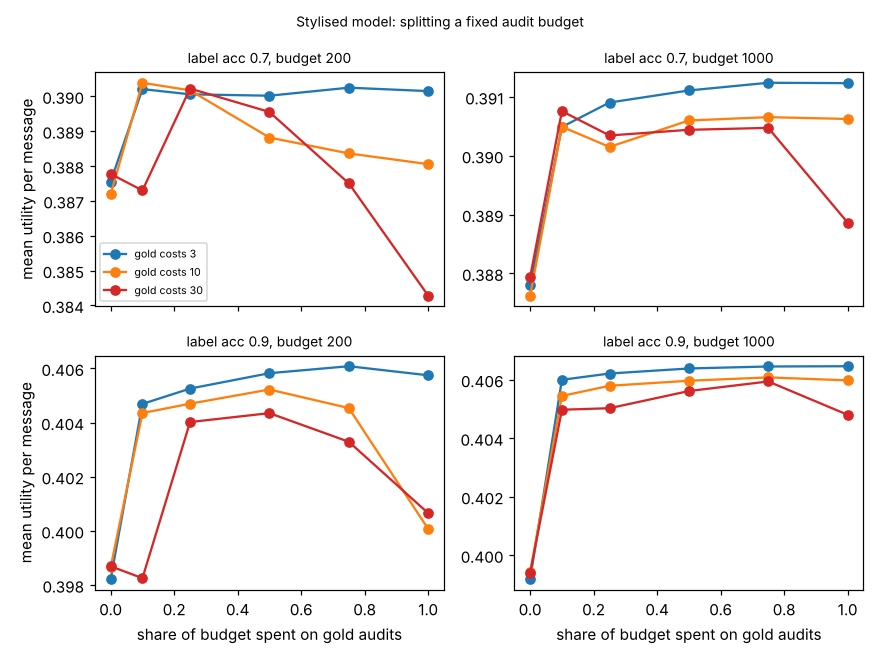

# ambient-auditbudget: splitting a fixed audit budget between gold and noisy audits

Track 2 (ambient AI assistant), follow-up to `ambient-goldaudit` (its first "Next step": price a gold audit against a noisy one and choose the budget split). Produced with AI assistance. **Stylised, simulated results only**: every parameter is a round figure I chose, the label and the auditor are made-up uniform-error confusion matrices, and nothing is a claim about a real user, device or product.

**Live page:** https://duncan-haywood.github.io/monorepo-projects/research/ambient-auditbudget/

## Motivation

`ambient-goldaudit` showed that a few gold audits (true class observed) plus many noisy ones, fitted jointly by EM, beat either alone, but it fixed the number of each. Someone with a real audit budget must choose: a gold audit costs more than a noisy one. For a budget B (in noisy-audit units) and a gold audit costing c, how much should go to gold?

## Builds on (and does not claim affiliation with)

- `research/ambient-goldaudit` in this repository: the utility model, the four-class decision rule and the joint EM (`src/ambient_auditbudget/` is a copy; the only change is an optional EM start accuracy `a0`, used by `experiments/start.py`).
- Horvitz (1999), "Principles of mixed-initiative user interfaces", CHI (<https://doi.org/10.1145/302979.303030>; citation as listed in `PROJECTS.md`, not re-read here): choosing an action by expected utility.
- Dawid and Skene (1979), "Maximum likelihood estimation of observer error-rates using the EM algorithm", *Applied Statistics* 28(1), 20-28 (citation from memory, not re-read here).

No research group from `prompt.md` is built on; there is no lab tag.

## Method

As in `ambient-goldaudit`: 48 contexts, three urgency classes (mix 50/35/15%), four presentation modes, classifier label accuracy 0.7 or 0.9, auditor true accuracy 0.8 that no estimator is told. A budget B buys G gold audits at cost c each and N = B - cG noisy audits at cost 1. A share `frac` of B goes to gold (G = floor(frac*B/c)). The estimator fits what was bought: noisy audits read as truth if G = 0, gold only if N = 0, joint EM otherwise. Each resulting rule is scored exactly under the true mix and matrix. Grid: B in {200, 1000}, c in {3, 10, 30}, frac in {0, 0.1, 0.25, 0.5, 0.75, 1}, 100 audit sets per cell.

## Reproduce

```bash
cd research/ambient-auditbudget
pip install numpy pytest matplotlib
PYTHONPATH=src python3 -m pytest -q tests                                # 5 tests
PYTHONPATH=src python3 experiments/run.py > experiments/results.txt     # about 70 s; also writes experiments/budget.png
PYTHONPATH=src python3 experiments/start.py > experiments/start.txt     # EM start sensitivity
```

## Results (all from `experiments/results.txt` and `experiments/start.txt`; mean utility per message)

Reference: blind 0.3824; true-parameter Bayes 0.3917 (label 0.7) and 0.4066 (label 0.9).

1. **Spending everything on noisy audits is the worst or near-worst choice in every one of the 12 (label, B, c) cells.** All-noisy gives 0.3872-0.3879 at label 0.7 and 0.3982-0.3994 at label 0.9, whatever B; the best split in each cell is 0.3902-0.3912 and 0.4044-0.4065.
2. **There is no single best share, but a middle split is safe.** The best share in the cells ranged from 0.10 to 1.00. Putting 25% of the budget on gold was within 0.0009 of the best share's mean in all 12 cells, and 50% within 0.0016 (differences of about 0.001 are inside the noise; see the std in the file).
3. **When gold is cheap (c = 3), more gold is as good as any split**: at B = 1000 the shares 0.5, 0.75 and 1.0 all give 0.3911-0.3912 (label 0.7) and 0.4064-0.4065 (label 0.9).
4. **When gold is expensive, all-gold is a mistake.** At B = 200, c = 30, all gold buys 6 audits (and 20 noisy): 0.3843 at label 0.7, below all-noisy (0.3878), and with a std of 0.0069. At B = 200, c = 10, all gold (20 audits) gives 0.3881 and 0.4001, against 0.3904 and 0.4052 for the best split.
5. **Very few gold audits already help once the noisy ones are fitted jointly.** B = 200, c = 30, frac 0.25 buys 1 gold and 170 noisy audits: 0.3902 (label 0.7), against 0.3878 all-noisy. The same cell with the noisy audits discarded ("gold_only_G" column) gives 0.3792, below blind (0.3824). So the benefit is the joint fit, not the single gold audit.
6. **The EM start did not matter here.** In `experiments/start.txt`, starting EM at auditor accuracy 0.5, 0.8 (the true value) or 0.95 changed the means by at most 0.0009 (0.3898 against 0.3907, G = 3, label 0.7) over six cells, and by 0.0000 at label 0.9 and for G = 1.



## Limitations

- The ordering is a property of this model: three classes, uniform-error matrices, one auditor accuracy (0.8), one class mix, round-number utilities. None was varied except as shown.
- Result 5 and 6 are about this model. Why one gold audit plus many noisy ones is enough (the two-label structure of the noisy audits may identify the matrices up to a relabelling that a symmetric start resolves) is my reading and was not tested.
- Costs are a single ratio c; real audits differ in latency, privacy cost and who can do them. Gold audits are assumed error-free.
- Auditor errors are independent of the message and classifier (see `ambient-dscorr`/`ambient-dshard` for what correlated errors do to EM).
- 100 audit sets per cell, and G is small in the expensive-gold cells; "best share" is within noise of its neighbours in most cells, so treat it as a rough guide.

## Next steps

- Non-uniform and correlated auditor errors in the same budget grid.
- A real classifier matrix and real audit labels, if the owner supplies them.

## Outside dependencies

None beyond numpy (plus pytest and matplotlib for the tests and the figure). No model, dataset, service or hardware is used.
