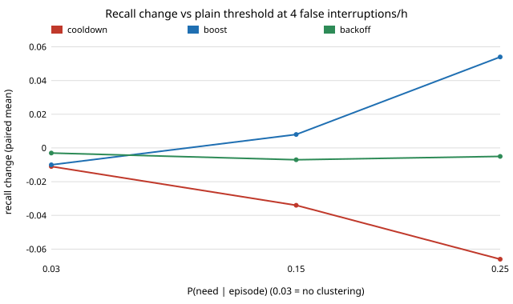

# ambient-cluster: when moments of need cluster in time, does a cooldown, a boost or a back-off help an always-on assistant at equal annoyance?

Track 2 (ambient AI assistant), a follow-up to `ambient-interject`'s first next step. That
project drew every listening window independently. Real moments of need come in bursts (a
conversation, a task), so a policy that remembers what just happened might beat a memoryless
threshold. I add a hidden episode/quiet chain that makes needs cluster, keep the overall need
rate fixed, and compare a plain threshold with three stateful rules at the **same budget of false
interruptions per hour**. Produced with AI assistance. **Stylised, simulated results only**:
every distribution is chosen by me, nothing is fitted to real conversations, and nothing is a
claim about a real user, device or product.

**Headline.** With strongly clustered needs, an *episode-aware boost* (lower the threshold for a
while after the user accepts help) raises recall by 0.04 (budget 1 false/h) to 0.05 (budget 4)
over a plain threshold; a *cooldown* (stay quiet after speaking) costs recall at every setting
tried, up to 0.07; a *back-off* after a dismissal is within noise or slightly negative. With no
clustering nothing helps. The boost's gain is real but partly paid for in a slightly higher false rate (below).

Live page: https://duncan-haywood.github.io/monorepo-projects/research/ambient-cluster/

## Builds on (and does not claim affiliation with)

- `research/ambient-interject` (this repository): the window model, the wake and intent-score
  signals and the equal-annoyance comparison. Its "Next steps" asked for clustered needs and a
  cooldown test; this is that step. The world here is re-implemented, not imported.
- Horvitz (1999), "Principles of mixed-initiative user interfaces", CHI: the background for
  treating interruption as a cost-benefit decision. Cited from `PROJECTS.md`; I did not re-check
  it against the paper, and nothing here reproduces it.

No research group from `prompt.md` is built on; there is no lab tag.

## Method

10 s windows, 360 per hour. A hidden two-state chain marks *episodes* (10% of windows, mean
length 12 windows = 2 min). P(need) is `p_ep` inside an episode and is set outside so the overall
rate stays 0.03 (about 11 needs per hour). `p_ep` = 0.03 is no clustering; 0.15 and 0.25 are
moderate and strong. Each window has a wake flag (0.15 when needed, 0.002 otherwise) and an
intent score N(2, 1) when needed, N(0, 1) otherwise. The wake phrase is always answered. After
speaking the assistant learns whether help was wanted. Policies, all with threshold `tau`:

| policy | rule |
|---|---|
| plain | speak if score > tau |
| cooldown(k) | after any utterance, stay silent (wake phrase aside) for k windows |
| boost(k, d) | after an *accepted* utterance, use tau &minus; d for k windows |
| backoff(k, d) | after a *dismissed* utterance, use tau + d for k windows |

For each policy, `tau` is bisected on 30 training hours to the false-interruption budget, and the
parameters (k, d) from a small grid are chosen by best training recall. Evaluation is on fresh
100 h worlds, 10 seeds. The same seeds are used for every policy, so differences are paired.

## Reproduce

```bash
cd research/ambient-cluster
PYTHONPATH=src python3 -m pytest -q tests        # 7 tests
PYTHONPATH=src python3 experiments/run.py        # about 90 s, writes experiments/results.txt
python3 experiments/figure.py                    # writes experiments/paired.svg
```



## Results (all from `experiments/results.txt`)

Paired mean change in recall against the plain threshold (standard error over 10 seeds):

| budget | P(need&#124;episode) | cooldown | boost | backoff |
|---|---|---|---|---|
| 1 /h | 0.03 (none) | &minus;0.002 (0.001) | &minus;0.000 (0.004) | &minus;0.001 (0.001) |
| 1 /h | 0.15 | &minus;0.007 (0.002) | +0.012 (0.004) | +0.001 (0.001) |
| 1 /h | 0.25 | &minus;0.015 (0.002) | +0.039 (0.006) | +0.002 (0.002) |
| 4 /h | 0.03 (none) | &minus;0.011 (0.002) | &minus;0.010 (0.003) | &minus;0.003 (0.002) |
| 4 /h | 0.15 | &minus;0.034 (0.002) | +0.008 (0.003) | &minus;0.007 (0.002) |
| 4 /h | 0.25 | &minus;0.066 (0.003) | +0.054 (0.006) | &minus;0.005 (0.003) |

1. **Boost wins only when needs cluster.** At strong clustering and 4 false/h, recall goes from
   0.467 (plain) to 0.521. With no clustering the best boost setting is no better than plain
   (&minus;0.010 at 4/h, because the chosen parameters overfit 30 training hours).
2. **Cooldown never helped.** It removes speech right after an utterance, which is when the next
   need is most likely in this world. Its loss grows with clustering (0.011 to 0.066 at 4/h).
3. **Back-off is a wash.** False alarms here are independent of the episode state, so a dismissal
   tells the assistant nothing about the next window; the tiny differences are noise or small losses.
4. **Budget caveat.** On the test hours every policy overshoots the nominal budget a little because
   30 training hours is a small sample. At budget 1 the boost overshoots more (1.19 vs 1.11 false/h at
   strong clustering), so some of its recall gain is bought with extra false alarms. At budget 4 the
   boost is, if anything, below plain (4.03 vs 4.11), so the headline 0.054 there is not explained by that.

## Limitations

- Clustering of needs is the only thing that differs from `ambient-interject`; false alarms are
  independent of the episode state. If false alarms also cluster (the same noisy room), back-off
  and cooldown could look better. I did not test that.
- The accepted/dismissed signal is exact and immediate. A real user ignores, mumbles or answers late.
- The annoyance cost is a count of false interruptions only; no cost for interrupting in an
  episode, no per-person tolerance, no speech content.
- Episode share, length and rates are round numbers I chose; the ordering of policies is a
  property of this model, the sizes are not estimates for any product.
- Parameters are chosen from a small grid on 30 h; 10 seeds give standard errors of 0.001 to 0.006.

## Next steps

- Let false alarms cluster too (a noisy-room state) and re-test back-off and cooldown.
- Learn the boost online (a bandit over k and d) instead of a grid.
- Fit episode length and burstiness to a permissively licensed dialogue corpus (the owner's call on data).

## Consent and privacy

This is a simulation with no audio. A real always-on assistant needs the consent of the people
it records where the law requires it (some US states need every party's). Process audio on the device.

## Outside dependencies

numpy only (plus pytest; the figure is stdlib-only SVG). No model, dataset, service or hardware.
