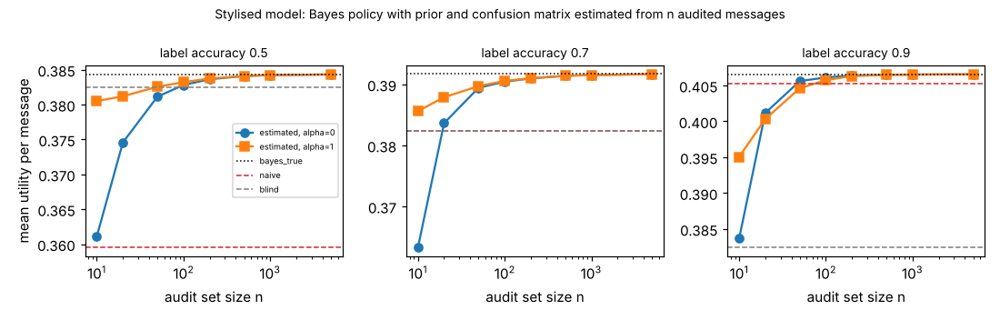

# ambient-confest: how many audited messages does an always-on assistant need before it can trust a noisy urgency label? (stylised utility model)

Track 2 (ambient AI assistant), follow-up to `ambient-misread` (its "Next steps": estimate the confusion matrix and prior, and measure what a wrong estimate costs). Produced with AI assistance. **Stylised, simulated results only**: every parameter is a round figure I chose, the classifier is a made-up confusion matrix, and nothing is a claim about a real user, device or product.

**Live page:** https://duncan-haywood.github.io/monorepo-projects/research/ambient-confest/

## Motivation

`ambient-misread` showed that a Bayesian reading of a noisy urgency label never loses to ignoring it, but only if the assistant knows the label's prior mix and confusion matrix exactly. A real assistant must estimate both from an audit set: messages whose true urgency someone has labelled. How large must that set be, and does smoothing the estimate help?

## Builds on (and does not claim affiliation with)

- `research/ambient-misread` in this repository: the Bayes, naive, blind and oracle policies and the label model. `src/ambient_confest/sim.py` is a copy of its utility model (originally from `ambient-urgency`), so the project stays self-contained.
- Horvitz (1999), "Principles of mixed-initiative user interfaces", CHI (<https://doi.org/10.1145/302979.303030>; citation as listed in `PROJECTS.md`, not re-read here): choosing an action by expected utility under uncertainty.

No research group from `prompt.md` is built on; there is no lab tag.

## Method (`src/ambient_confest/est.py`)

The 48 contexts, three urgency classes (mix 50/35/15%) and four delivery modes are those of `ambient-misread`. The label has uniform errors at accuracy 0.5, 0.7 or 0.9. An audit set of n messages is drawn: true class from the true mix, observed label from the confusion matrix. The assistant estimates the prior from the class frequencies and each row of the confusion matrix from that class's label frequencies, with additive smoothing alpha (0 = maximum likelihood; a class never seen gets a uniform row; 1 = add one to every count). It then picks, for each observed label, the mode with the highest expected utility under the estimated posterior. That label-to-mode map is scored exactly (closed form) under the true prior and confusion matrix, as the mean over 48 contexts, for 300 independent audit sets per cell. The audit labels are assumed noise-free and drawn independently from the true mix; the experiment does not model labelling errors.

## Reproduce

```bash
cd research/ambient-confest
pip install numpy pytest matplotlib
PYTHONPATH=src python3 -m pytest -q tests        # 6 tests
PYTHONPATH=src python3 experiments/run.py > experiments/results.txt   # about a minute; also writes experiments/audit.png
```

## Results (all from `experiments/results.txt`; mean utility per message over contexts)

Reference values (oracle 0.4166 throughout): at accuracy 0.5, Bayes with the true parameters 0.3844, naive 0.3595, blind 0.3824; at 0.7, 0.3917, 0.3824, 0.3824 (naive equals blind at the 0.703 break-even of `ambient-misread`); at 0.9, 0.4066, 0.4052, 0.3824.

1. **Small audit sets are worse than ignoring the label, unless smoothed.** With maximum-likelihood estimates and n = 10, the estimated-Bayes policy has mean utility 0.3611 (0.5 accuracy), 0.3633 (0.7) and 0.3837 (0.9). Against blind (0.3824) it is lower in 100%, 58% and 18% of audit sets; the spread across sets is large (std 0.026 to 0.045). At n = 20 the mean at accuracy 0.7 is back at 0.3836, still below blind in 15% of sets.
2. **About 50 audited messages are enough at moderate to high accuracy.** At n = 50 and accuracy 0.7 the mean is 0.3894 (76% of the gain of true-parameter Bayes over blind) and it is below blind in 1% of sets; at accuracy 0.9 it is 0.4056, 96% of that gain. At n = 200 the shares are 92% (0.7) and 99% (0.9). By n = 500 the policy is within 0.0003 of true-parameter Bayes at all three accuracies.
3. **At 50% accuracy the label is barely worth using.** True-parameter Bayes beats blind by only 0.0020, so noise in the estimate costs more than the label offers until n is about 200 (alpha = 0: below blind in 9% of sets at n = 200, 0% at n = 500). Do not read the "gain share" column there: its denominator is tiny.
4. **Smoothing (alpha = 1) helps at small n when the label is poor and costs a little when it is good.** At n = 10, alpha = 1 gives 0.3805, 0.3856 and 0.3951 at the three accuracies, against 0.3611, 0.3633 and 0.3837 unsmoothed; the spread across sets falls by a factor of 7 to 12. But at accuracy 0.9 and n = 10 to 20 it falls below naive in 100% of sets at n = 10 and 20 (naive 0.4052) and 50% at n = 50, because the shrunken posterior drifts toward ignoring the label; the two settings are level by about n = 100, when smoothing is only 0.0004 below unsmoothed at 0.9.
5. **No cell has a mean above true-parameter Bayes** (this is an identity: that policy is the best label-to-mode map).



## Limitations

- The ordering is a property of this model. The sizes depend on my round-number utilities, on a three-class label with uniform errors and on one class mix; a different mix (a rarer high class needs more audited messages to see it at all) or real classifier errors would move them. This was not varied.
- Audit labels are noise-free and drawn from the true mix. A real audit set would be small, possibly biased toward messages the user noticed, and labelled by a person who may disagree with themselves.
- Only two smoothing values and no Bayesian or hierarchical shrinkage. Estimation is done once, not online, and the estimate is not shared across contexts.
- 300 audit sets per cell; the stds in the table are across those sets.

## Next steps

- Shrink toward a prior over confusion matrices (Dirichlet with a stated prior accuracy) rather than a flat alpha, and choose it by cross-validation on the audit set.
- Estimate from the assistant's own accept/dismiss feedback (see `ambient-ips`), where the true class is never observed directly.
- A noisy-audit variant, and a non-uniform mix.
- A real classifier's confusion matrix, if the owner supplies one.

## Outside dependencies

None beyond numpy (plus pytest and matplotlib for the tests and the figure). No model, dataset, service or hardware is used.
