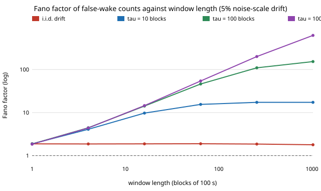

# ambient-driftwindow: how does the burstiness of an always-on trigger's false-wake counts grow with the counting window when the noise level drifts for hours?

Track 2 (ambient AI assistant), a follow-up to [`ambient-wakeburst`](../ambient-wakeburst), whose "Next steps" asked for persistent drift and the Fano factor against window length. Produced with AI assistance. **Stylised**: scores are Gaussian AR(1), the drift is an assumed log-scale AR(1) process, and no audio was used.

**Live page:** https://duncan-haywood.github.io/monorepo-projects/research/ambient-driftwindow/

## Question

`ambient-wakeburst` drew a fresh noise level for every window, so counting over a longer window changed nothing (Fano factor 9.5, 9.5, 9.8 for 1x, 4x, 16x windows). Real noise (day and night, a TV on, a room change) persists. If the noise scale drifts with a correlation time of `tau`, how does the Fano factor (variance / mean of the wake count) of a day's false wakes depend on the window length `K`?

## Headline (m = 3, phi = 0.9; blocks of 10,000 frames = 100 s; 2,000,000 blocks per cell)

- **With persistent drift the Fano factor grows with the window, then saturates near `1 + lambda * cv^2 * 2 tau` once the window is much longer than `tau`.** At a 5% log-scale sd and about 5.5 wakes per block, windows of 1, 16, 256 and 1,024 blocks (100 s to 28 h) give Fano 1.9, 14, 110 and 150 for `tau` = 100 blocks (2.8 h), against a flat 1.9 for i.i.d. drift. For `tau` = 1,000 blocks (28 h) it is still rising at 28 h: 14.5, 200, 620.
- **Counts at the day scale are heavy-tailed, not Poisson, even for tiny drift.** At 5% drift a 28 h window with tau = 100 has mean 5,640 wakes and variance 153 times that. The mean moves only 5% from the no-drift value (5.24 to 5.53 per block), so the average false-wake rate would look fine while single days differ by tens of percent.
- **Rarer triggers have a more variable rate for the same drift.** Calibrated to 0.2 wakes per block (about one per 500 s), 5% drift gives relative rate sd cv = 0.73 against 0.40 for the 5-per-block trigger. Their Fano factors stay lower at short windows because the rate is lower (i.i.d. drift: 1.14 against 1.87), but with tau = 1,000 blocks the rare trigger still reaches 94 at 28 h.
- **A closed form tracks the simulation.** For a Poisson count whose rate has relative sd `cv` and autocorrelation `rho^lag`, the Fano factor of a `K`-block window is `1 + lambda * cv^2 * [K + 2 sum_{j<K} (K-j) rho^j] / K`. Over the 36 busy cells in section B the mean absolute error is 2% and the worst is 11%; over the 36 rare cells it is 5% and the worst 30% (all at K = 1,024, where the heavy lognormal-like tail and the clipped drift break the `rho^lag` assumption).
- **The shortcut is checked.** Section C simulates every frame (no Poisson-given-scale assumption) at sigma = 0.05, tau = 100: K = 4 gives Fano 4.68 (frame level) against 4.71 (Cox); K = 64 gives 43.8 against 43.5, each inside the other's bootstrap interval.
- Cross-check with `ambient-wakeburst`: its 1,000 s window (K = 10, about 50 wakes) at 5% i.i.d. drift gave Fano 9.4; the formula gives `1 + 50 * 0.157 = 8.9` with this project's rate curve (different threshold calibration, so only roughly comparable).



## Builds on (and does not claim affiliation with)

- No lab from `prompt.md` is built on; there is no lab tag. The Fano factor of a Poisson process with a random (Cox) intensity is textbook; nothing here is claimed as new theory. I cite no paper for any number.

## Method

`src/ambient_driftwindow/sim.py`. Frame scores are unit-variance Gaussian AR(1) (`ar1`, copied from `ambient-wakeburst` so this project stands alone). A wake is the frame where a run at or above the threshold first reaches `m` = 3 frames. Scores in block `b` are multiplied by `exp(x_b)`, where `x` is a stationary AR(1) across blocks with sd `sigma` and correlation time `tau` blocks (`drift_path`; tau = 0 is i.i.d.).

Two levels: (1) the **rate curve** `rate_curve` measures mean wakes per block at 19 constant log-scales from -0.45 to 0.45 (10,000 blocks each, frame level), and `log_rate_fit` interpolates its log; (2) the **Cox model** `cox_counts` draws each block's count as Poisson(rate(scale)) for 2,000,000 blocks and sums non-overlapping windows. The Cox level is what makes day-long windows affordable (2,000,000 blocks is 2 * 10^10 frames); `framelevel_window_counts` is the full-frame check. Thresholds are calibrated by bisection to 5 ("busy") and 0.2 ("rare") wakes per block at scale 1. A first version fitted log-rate with a quadratic and extrapolated to absurd rates in the tails (the run crashed); interpolation with clipping replaced it before any result was kept.

## Reproduce

```bash
cd research/ambient-driftwindow
pip install numpy pytest matplotlib
PYTHONPATH=src python3 -m pytest -q tests                                     # 10 tests, a second
PYTHONPATH=src python3 -u experiments/run.py > experiments/results.txt        # about 15 minutes
python3 experiments/figure.py                                                 # writes experiments/fano_vs_window.svg
```

## Results

`experiments/results.txt`: A the rate curves and the relative rate sd for each sigma, B Fano factor by regime, sigma, tau and K (with bootstrap interval and the closed form), C frame level against Cox, D the figure's data.

## Limitations

- **The drift is assumed.** Log-scale AR(1) with sigma 0.02 to 0.1 and tau 10 to 1,000 blocks was chosen to span plausible values; none of it was measured from a device. The headline numbers scale with these choices. What carries over is the shape: Fano grows roughly linearly in the window up to about `2 tau`.
- **"Rare" is one wake per 500 s, not one a day.** A daily-rate trigger needs a rate curve at a much higher threshold, which this run did not simulate; the closed form says its Fano factor would be closer to 1 for the same cv but the daily count would stay heavy-tailed.
- **Counts are Poisson given the scale.** Checked at frame level for one setting (section C), not for all.
- **Bootstrap intervals resample windows**, which are weakly dependent when tau exceeds the window, and with tau = 1,000 blocks there are only about 2 correlation times per 2,000 windows at K = 1,024. Treat those intervals (and the tau = 1,000, K = 1,024 cells) as optimistic.
- Drift is clipped at +-0.45 in log scale (4.5 sd at sigma = 0.1). No lockout, no real detector, no speech-like background (see `ambient-falsewake`).

## Next steps

- Measure sigma and tau from a real always-on device's score logs, if the owner has one (owner step).
- A daily-rate rate curve with importance sampling, and a lockout under persistent drift.
- A drift-aware threshold (track the noise scale and re-calibrate) and the daily-count tail it removes.

## Owner steps

None.

## Outside dependencies

numpy, pytest, matplotlib. No model, dataset, service or hardware.
