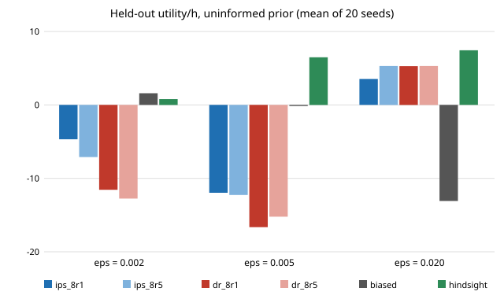

# ambient-drrepeat: do repeated random fold assignments stabilise validation-based cap selection?

Track 2 (ambient AI assistant), follow-up to `ambient-drablate`, whose first next step was "repeated random splits (e.g. 5 assignments averaged)". Produced with AI assistance. **Stylised, simulated results only**: every distribution is chosen by me and nothing is a claim about a real user, device or product. **Mixed / preliminary**: averaging 5 fold assignments helps clearly in one cell (&epsilon; = 0.02, IPS score) and not at all in the others; every selector stays far below the label-matched control.

**Live page:** https://duncan-haywood.github.io/monorepo-projects/research/ambient-drrepeat/

## Motivation

In `ambient-drablate` each random-fold selector used one fold assignment, and that assignment was seeded by the fit hour only, so every seed, prior and &epsilon; shared the same permutation. Whether "random folds help" was a property of random folds or of that one assignment was therefore untested. Here the assignment is drawn fresh for each seed, and one assignment (`_8r1`) is compared with the average of 5 (`_8r5`; the first assignment is the one `_8r1` uses).

## Builds on (and does not claim affiliation with)

- `research/ambient-drablate`, `ambient-drvalid`, `ambient-capcv`, `ambient-crossfit`, `ambient-drclip`: world, &epsilon;-greedy policy, MAP logistic fit, DR pseudo-labels and the IPS/DR validation values, copied into `src/ambient_drrepeat/core.py` so the project is self-contained.
- Dud&iacute;k, Langford and Li (2011), "Doubly robust policy evaluation and learning", ICML (arXiv:1103.4601), for the DR estimator.

No research group from `prompt.md` is built on; there is no lab tag.

## Method

Same world, seeds, fit hour (100), &epsilon; &isin; {0.002, 0.005, 0.02}, 20 held-out 100 h streams and cap grid {2, 5, 10, 20, 50, 100, &infin;} as in `ambient-drablate`, but only the **uninformed prior** (the informed prior showed no differences between selectors there). Selectors: `ips_8r1`, `dr_8r1` (8 random folds, one assignment), `ips_8r5`, `dr_8r5` (validation score averaged over 5 assignments). Assignments are seeded by (hour, seed, repeat). The final fit is the plug-in DR fit at the chosen cap. Fixed caps, `biased`, `hindsight` (best cap by held-out utility, unavailable in practice) and `random_matched` are as before.

## Reproduce

```bash
cd research/ambient-drrepeat
pip install numpy pytest
PYTHONPATH=src python -m pytest -q tests        # 8 tests
PYTHONPATH=src python experiments/run.py        # 3 processes, roughly 30 minutes, writes experiments/results.txt
python experiments/figure.py                    # writes experiments/selectors.svg from results.txt
```

## Results (held-out utility per hour, mean over 20 seeds, uninformed prior; oracle 12.71)

| &epsilon; | ips_8r1 | ips_8r5 | dr_8r1 | dr_8r5 | biased | hindsight | random_matched |
|---|---|---|---|---|---|---|---|
| 0.002 | &minus;4.68 | &minus;7.10 | &minus;11.56 | &minus;12.76 | 1.59 | 0.79 | 12.15 |
| 0.005 | &minus;11.97 | &minus;12.27 | &minus;16.65 | &minus;15.23 | &minus;0.15 | 6.49 | 12.18 |
| 0.020 | 3.54 | 5.30 | 5.28 | 5.30 | &minus;13.08 | 7.44 | 12.52 |

Seed standard deviations (in `results.txt`) are 10&ndash;27 for the selectors at &epsilon; &le; 0.005 and 6.5&ndash;12 at 0.02.

1. **&epsilon; = 0.02: averaging helps the IPS score.** Mean 3.54 &rarr; 5.30 and std 12.3 &rarr; 6.5; the DR score is already at 5.28 with one assignment and does not change (5.30). With 5 assignments IPS and DR are indistinguishable (5.30 vs 5.30) and sit between `hindsight` (7.44) and the other fixed-cap fits.
2. **&epsilon; &le; 0.005: no gain from averaging.** Means move by 0.3&ndash;2.4 in either direction against stds of 10&ndash;27. I would not rank `_8r1` against `_8r5` there.
3. **The single-assignment results here differ from `ambient-drablate`'s.** At &epsilon; = 0.02, `ips_8r1` is 3.54 here vs 6.33 for `ips_8r` there, and at &epsilon; = 0.005 `dr_8r1` is &minus;16.65 here vs &minus;9.62. The runs use the same seeds and data; the only change is the fold permutation (one shared permutation there, a fresh one per seed here). So differences of this size between fold assignments are within what one assignment can produce, which supports the caution in the `ambient-drablate` write-up about ranking selectors there.
4. **The bottleneck is unchanged.** In every cell all four selectors are below `random_matched` (about 12) and, at &epsilon; &le; 0.005, mostly below the unweighted `biased` fit (&minus;0.15 to 1.59). Validation-based cap selection does not rescue learning from the assistant's own feedback in this world.



## Limitations

- Same stylised world as `ambient-crossfit`: independent windows, instant noise-free feedback, costs chosen by me. 20 seeds, one fit hour, one prevalence, no significance tests; most differences are inside seed noise.
- Uninformed prior only; five repeats only; 8 folds only.
- Random folds are valid here only because windows are independent; for real conversations they would leak across neighbouring windows.
- The DR value ignores the wake phrase, as the IPS value did.

## Next steps

- Matched comparison on identical fold permutations between this project and `ambient-drablate` to quantify assignment-to-assignment variance directly (here: 1 vs 5 only).
- A better outcome model for the uninformed prior, which remains the bottleneck.
- Real accept/dismiss logs, if the owner opts in to collecting them.

## Outside dependencies

numpy (and pytest for the tests). No model, dataset, service or hardware is used.
