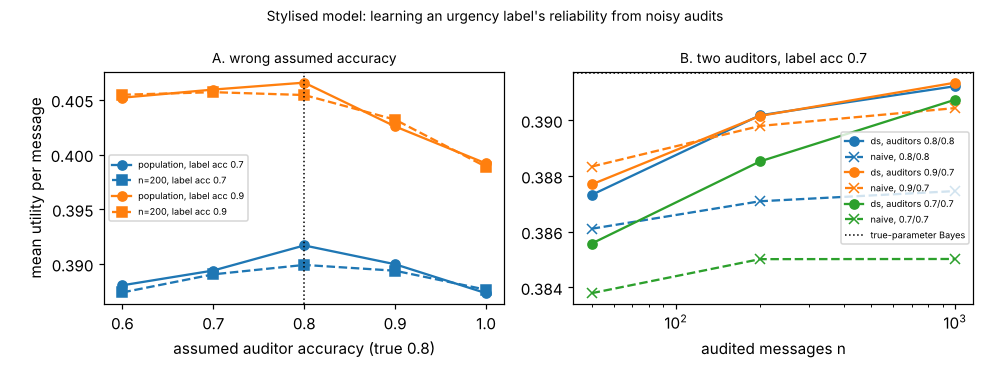

# ambient-dsaudit: can an always-on assistant learn its urgency label's reliability from two noisy auditors, and what does a wrongly assumed auditor accuracy cost? (stylised utility model)

Track 2 (ambient AI assistant), follow-up to `ambient-noisyaudit` (its first "Next step": Dawid-Skene with two auditors, and wrong assumed accuracies). Produced with AI assistance. **Stylised, simulated results only**: every parameter is a round figure I chose, the classifier and both auditors are made-up uniform-error confusion matrices, and nothing is a claim about a real user, device or product.

**Live page:** https://duncan-haywood.github.io/monorepo-projects/research/ambient-dsaudit/

## Motivation

`ambient-noisyaudit` fixed the bias from a noisy auditor by giving the estimator the auditor's exact accuracy. That is not available in practice. This project asks two things: (A) how much does it cost to assume the wrong accuracy, and (B) if every audited message gets a second, independent auditor, can the estimator learn all three confusion matrices itself (Dawid-Skene), and how close does it get to the version that was told the answer?

## Builds on (and does not claim affiliation with)

- `research/ambient-noisyaudit`, `ambient-confest`, `ambient-misread` in this repository: the Bayes policy, the 48 contexts, the 3 urgency classes (mix 50/35/15%), the four modes and the estimation set-up. `src/ambient_dsaudit/sim.py` is a copy of the utility model and `est.py` copies its single-auditor estimators, so the project stays self-contained.
- Dawid and Skene (1979), "Maximum likelihood estimation of observer error-rates using the EM algorithm", *Applied Statistics* 28(1), 20-28 (citation from memory, not re-read here). The EM here is the standard fully-unknown case with three conditionally independent observers (two auditors and the classifier), which is identifiable in this model (tests check recovery from exact population counts).
- Horvitz (1999), "Principles of mixed-initiative user interfaces", CHI (<https://doi.org/10.1145/302979.303030>; citation as listed in `PROJECTS.md`, not re-read here): choosing an action by expected utility.

No research group from `prompt.md` is built on; there is no lab tag.

## Method

Each audited message has a true class from the mix, a classifier label, and one or two auditor labels, all conditionally independent given the true class, each from a uniform-error confusion matrix. Estimators, each followed by Bayes' rule on the estimated prior and classifier matrix and scored exactly under the truth, as the mean over 48 contexts:

- **naive**: auditor 1's label is taken as truth, smoothing alpha = 1.
- **em-known(n)**: EM over the unseen true class with auditor 1's matrix assumed (A: assumed accuracy varied; B: exactly right, i.e. an oracle).
- **em-known(2n)**: the same oracle given 2n singly audited messages, i.e. the same number of audit labels as Dawid-Skene uses on n doubly audited messages.
- **ds(n)**: Dawid-Skene EM on n messages with both auditors; no matrix known. Started from diagonal-dominant matrices (accuracy 0.7), which fixes the label-switching symmetry.

Part A: one auditor of true accuracy 0.8, assumed accuracy 0.6 to 1.0 (1.0 is the naive estimator). Part B: auditor pairs 0.8/0.8, 0.9/0.7 and 0.7/0.7. Classifier label accuracy 0.7 or 0.9. Finite cells: n = 50, 200, 1000, 200 independent audit sets each; "population" uses exact expected counts.

## Reproduce

```bash
cd research/ambient-dsaudit
pip install numpy pytest matplotlib
PYTHONPATH=src python3 -m pytest -q tests        # 6 tests
PYTHONPATH=src python3 experiments/run.py > experiments/results.txt   # about 3 minutes; also writes experiments/dsaudit.png
```

## Results (all from `experiments/results.txt`; mean utility per message over contexts)

Reference values: blind 0.3824; Bayes with the true parameters 0.3917 (label accuracy 0.7) and 0.4066 (0.9). The label's gain over blind is therefore 0.0093 and 0.0242.

1. **A wrong assumed accuracy costs, and over-trusting the auditor costs most when the label is good.** In the population limit with a true 0.8 auditor and label accuracy 0.9, assuming 0.6 loses 0.0014 (6% of the gain), assuming 0.9 loses 0.0040 (17%) and assuming a perfect auditor (naive) loses 0.0074 (31%). At label accuracy 0.7 the loss is closer to symmetric: 0.0036 (39%) for 0.6, 0.0017 (18%) for 0.9, 0.0044 (47%) for 1.0. So in this model, hedging toward a noisier auditor than the truth is the cheaper mistake at 0.9, and not at 0.7.
2. **No assumed value fell below blind** in any population cell, and at n = 200 the share of audit sets below blind was at most 0.01.
3. **Dawid-Skene with two auditors recovers the truth in the population limit** in every one of the six cells (0.3917 and 0.4066 exactly to four places), with no accuracy supplied.
4. **At finite n it beats the naive estimator and sits near the oracle given the same number of labels.** At n = 1000 ds is 0.0037 above naive (label 0.7, auditors 0.8/0.8: 0.3912 against 0.3875) and 0.0128 above at label 0.9 with two 0.7 auditors (0.4063 against 0.3935). Against em-known(2n) it is behind by 0.0016 to 0.0020 at n = 50 in the label-0.7 cells (0.3873 against 0.3889 with 0.8/0.8; 0.3877 against 0.3897 with 0.9/0.7) and by 0.0003 to 0.0010 at the label-0.9 cells; by at most 0.0015 at n = 200 (worst: label 0.7, auditors 0.7/0.7, 0.3885 against 0.3900); and within 0.0005 at n = 1000 (ds is ahead by 0.0001 in one cell). That gap is the price of not knowing the auditor accuracy.
5. **Small n and bad auditors remain risky.** With label 0.7 and two 0.7 auditors at n = 50, ds fell below blind in 18% of audit sets (naive 28%, em-known(2n) 7%); by n = 200 that is 3%.
6. **Against em-known(n)** (only n labels, but exactly known accuracy) **ds is mixed**: at n = 200 it is within 0.0007 either way (ahead in three cells, behind in two, level in one), and behind at n = 50 for auditors 0.9/0.7 at label 0.7 (0.3877 against 0.3885). A second label per message is not free; this comparison is about information, not cost per message.



## Limitations

- All three observers have uniform errors and are conditionally independent given the true class. Real auditors disagree on the same hard messages; correlated errors break the identifiability argument and would bias Dawid-Skene. Not tested.
- One class mix, one set of utilities, three classes. Sizes depend on these round numbers; only the ordering is the claim, and even that is for this model.
- Dawid-Skene was fitted with unrestricted confusion matrices, not the uniform-error structure the data came from. Imposing it would likely help at small n; not tested.
- EM is a local optimiser; I used one start (accuracy 0.7 diagonal-dominant) and did not check multiple optima beyond the population-recovery tests.
- 200 audit sets per cell; stds are across those sets. Citations are from memory and were not re-read.

## Next steps

- Correlated auditor errors (shared hard messages), adjacent-only errors and a non-uniform mix.
- Dawid-Skene with a uniform-error parameterisation, and a gold-subset variant: how many perfectly audited messages replace how many noisy ones?
- Decide adaptively which messages get a second auditor.
- A real classifier's confusion matrix and real audit labels, if the owner supplies them.

## Outside dependencies

None beyond numpy (plus pytest and matplotlib for the tests and the figure). No model, dataset, service or hardware is used.
