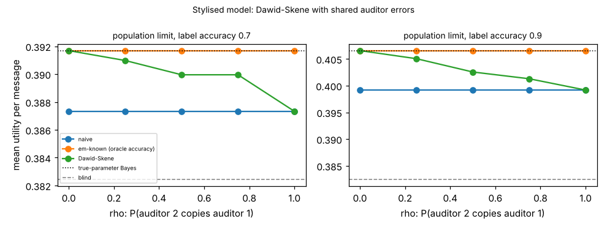

# ambient-dscorr: what does Dawid-Skene do when the two auditors share their errors? (stylised utility model)

Track 2 (ambient AI assistant), follow-up to `ambient-dsaudit` (its first "Next step": correlated auditor errors). Produced with AI assistance. **Stylised, simulated results only**: every parameter is a round figure I chose, the classifier and auditors are made-up uniform-error confusion matrices, and nothing is a claim about a real user, device or product.

**Live page:** https://duncan-haywood.github.io/monorepo-projects/research/ambient-dscorr/

## Motivation

`ambient-dsaudit` showed that Dawid-Skene (DS) learns an urgency classifier's reliability from two auditors with no accuracy supplied, but only when the auditors err independently. Real auditors tend to get the same hard messages wrong. This project asks how much that breaks DS, and whether DS then does worse than just trusting one auditor.

## Builds on (and does not claim affiliation with)

- `research/ambient-dsaudit`, `ambient-noisyaudit`: the utility model, 48 contexts, 3 urgency classes (mix 50/35/15%), Bayes policy and the DS/EM estimators. `src/ambient_dscorr/{sim,est}.py` are copies, plus the two correlated-auditor functions at the end of `est.py`, so the project is self-contained.
- Dawid and Skene (1979), "Maximum likelihood estimation of observer error-rates using the EM algorithm", *Applied Statistics* 28(1), 20-28 (citation from memory, not re-read here).

No research group from `prompt.md` is built on; there is no lab tag.

## Method

Shared-error model: for each message, with probability rho auditor 2 copies auditor 1's label (so a mistake is shared), otherwise it labels independently. Each auditor's own accuracy stays 0.8 at every rho; only the dependence changes. rho = 0 is `ambient-dsaudit`'s case, rho = 1 means the second auditor adds nothing. The classifier (label accuracy 0.7 or 0.9) is independent of both given the true class. Estimators (Bayes policy from the estimate, scored exactly under the truth, mean over 48 contexts): **naive** (auditor 1 taken as truth, alpha = 1), **em-known** (EM given auditor 1's true accuracy, ignores auditor 2; an oracle), **ds** (DS on both auditors, started at accuracy 0.7, assuming independence). "Population" uses exact expected counts; finite cells have n = 200 and 1000, 100 audit sets each.

## Reproduce

```bash
cd research/ambient-dscorr
pip install numpy pytest matplotlib
PYTHONPATH=src python3 -m pytest -q tests        # 4 tests
PYTHONPATH=src python3 experiments/run.py > experiments/results.txt   # about 1 minute; also writes experiments/dscorr.png
```

## Results (all from `experiments/results.txt`; mean utility per message)

Reference: blind 0.3824; true-parameter Bayes 0.3917 (label 0.7, gain 0.0093) and 0.4066 (label 0.9, gain 0.0241).

1. **Shared errors make DS over-trust the auditors.** In the population limit the accuracy DS assigns to auditor 1 rises from the true 0.800 at rho = 0 to 0.858, 0.909, 0.957 and 1.000 at rho = 0.25, 0.5, 0.75, 1: agreement between the auditors is read as correctness.
2. **The cost grows smoothly with rho and DS never falls below naive in this model.** Population utility of DS at label 0.9: 0.4066, 0.4051, 0.4026, 0.4013, 0.3992 for rho = 0 to 1; naive is 0.3992 throughout. At rho = 1 DS equals naive exactly (it sees one auditor twice and believes it perfect). At label 0.7: 0.3917, 0.3910, 0.3900, 0.3900, 0.3873 against naive 0.3873.
3. **The loss is real but partial.** At label 0.9 and rho = 0.5, DS keeps 0.4026 - 0.3992 = 0.0034 of the 0.0074 that the oracle recovers over naive (46%); at rho = 0.75 it keeps 0.0021 (28%). At label 0.7 and rho = 0.5 it keeps 0.0027 of 0.0044 (61%).
4. **The oracle that ignores auditor 2 is unaffected by rho**, since auditor 1's marginal accuracy is fixed (0.3917 / 0.4066 at every rho). At n = 1000 DS is level with or slightly ahead of the oracle at rho = 0 (by 0.0001 / 0.0002), and the oracle is ahead by 0.0015 (label 0.7) / 0.0035 (label 0.9) at rho = 0.5. So with shared errors a known single-auditor accuracy beats a second auditor; without it, DS is still at least as good as naive.
5. **Finite n tells the same story**: at n = 1000, label 0.9, DS is 0.4065, 0.4052, 0.4028, 0.4010, 0.3993 for rho = 0 to 1. DS fell below ignoring the label in none of the audit sets at n = 200 in any cell.



## Limitations

- "Shared error" is one specific model (the second auditor copies the first). Other dependence, such as both auditors failing on the same hard messages while being right otherwise, would give different numbers; DS being no worse than naive may not hold for all of them. Not tested.
- Uniform-error matrices, one class mix, one set of utilities; only the ordering is the claim, and only in this model. Only auditors of equal accuracy 0.8 were varied; label accuracy has two values.
- One DS start (accuracy 0.7); no check for multiple optima beyond population recovery in `ambient-dsaudit`'s tests. 100 audit sets per finite cell.
- Citation from memory, not re-read.

## Next steps

- Hard-message model: a fraction of messages is hard for both auditors, who then err together at a higher rate; check whether DS can still fall below naive.
- Estimate rho or a shared-error component (for example a DS with a per-pair dependence parameter) and see what an unlabelled-agreement test can detect.
- Use one cheap and one expensive auditor with different dependence on the classifier.

## Outside dependencies

None beyond numpy (plus pytest and matplotlib). No model, dataset, service or hardware is used.
