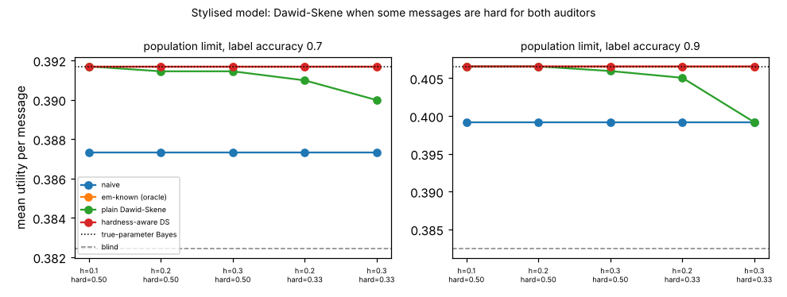

# ambient-dshard: what if the two auditors only share errors on hard messages, and can a hardness-aware EM fix Dawid-Skene? (stylised utility model)

Track 2 (ambient AI assistant), follow-up to `ambient-dscorr` (its first "Next step": a hard-message model). Produced with AI assistance. **Stylised, simulated results only**: every parameter is a round figure I chose, the classifier and auditors are made-up uniform-error confusion matrices, and nothing is a claim about a real user, device or product.

**Live page:** https://duncan-haywood.github.io/monorepo-projects/research/ambient-dshard/

## Motivation

`ambient-dscorr` made the auditors share errors by letting the second copy the first, and found Dawid-Skene (DS) reads their agreement as correctness. Copying is the harshest form of dependence. A more realistic one is that some messages are simply hard for everyone. This project asks whether DS suffers as much then, and whether an estimator that knows about hardness repairs it.

## Builds on (and does not claim affiliation with)

- `research/ambient-dscorr`, `ambient-dsaudit`, `ambient-noisyaudit` in this repository: the utility model, 48 contexts, 3 urgency classes (mix 50/35/15%), Bayes policy, the naive, known-accuracy EM and DS estimators. `src/ambient_dshard/{sim,est}.py` are copies, plus the hard-message functions at the end of `est.py`, so the project is self-contained.
- Dawid and Skene (1979), "Maximum likelihood estimation of observer error-rates using the EM algorithm", *Applied Statistics* 28(1), 20-28 (citation from memory, not re-read here).

No research group from `prompt.md` is built on; there is no lab tag.

## Method

Hard-message model: each message is hard with probability `h`. On a hard message both auditors use a uniform-error matrix of accuracy `hard_acc` (0.5, or 1/3 which is chance for three classes); on an easy one both use a higher accuracy chosen so that each auditor's overall accuracy stays exactly 0.8. Given hardness and the true class the auditors are independent, so each auditor's marginal confusion matrix is unchanged and only the dependence between them changes. The classifier (label accuracy 0.7 or 0.9) is unaffected by hardness. Cells (`h`, `hard_acc`): (0.1, 0.5), (0.2, 0.5), (0.3, 0.5), (0.2, 1/3), (0.3, 1/3).

Estimators, each followed by Bayes' rule and scored exactly under the truth, as the mean over 48 contexts: **naive** (auditor 1's label taken as truth), **em-known** (EM given auditor 1's true overall matrix; an oracle that ignores auditor 2, unaffected by `h`), **ds** (plain Dawid-Skene, assuming independence), and **dsH** (a hardness-aware DS: latent easy/hard flag, one matrix per flag shared by both auditors, one classifier matrix; started from an informed guess of easy accuracy 0.9, hard 0.5, P(hard) 0.3, classifier 0.7). dsH has the generator's structure built in, so it is a best case, not a practical estimator. "Population" uses exact expected counts; finite cells use n = 200 and 1000 with 60 audit sets each.

## Reproduce

```bash
cd research/ambient-dshard
pip install numpy pytest matplotlib
PYTHONPATH=src python3 -m pytest -q tests        # 7 tests
PYTHONPATH=src python3 experiments/run.py > experiments/results.txt   # about 5 minutes; also writes experiments/dshard.png
```

## Results (all from `experiments/results.txt`; mean utility per message over contexts)

Reference: blind 0.3824; true-parameter Bayes 0.3917 (label 0.7) and 0.4066 (label 0.9), gains over blind of 0.0093 and 0.0241.

1. **DS still over-trusts the auditors, but mildly.** With auditors 0.8 overall, the population fit assigns auditor 1 accuracy 0.810, 0.822, 0.837 at h = 0.1, 0.2, 0.3 (hard accuracy 0.5), and 0.850 / 0.878 at h = 0.2 / 0.3 with hard accuracy at chance. In `ambient-dscorr` the same figure was 0.909 at half copying.
2. **The utility cost is small in most cells.** At label 0.9, h = 0.3, hard accuracy 0.5, DS has 0.4060 against the true-parameter 0.4066 (a loss of 0.0006, about 2.5% of the gain); at label 0.7 the loss is 0.0003 (3%) in the same cell.
3. **The extreme cell erases DS's edge but not below it.** At h = 0.3 with hard messages at chance, easy messages must be perfectly labelled to keep 0.8 overall; DS then reads the auditors as 0.878 and gets 0.3992 at label 0.9, exactly the naive estimator's 0.3992 (loss 0.0074 against the true parameters, 31% of the gain: all of DS's advantage over naive). At label 0.7 it keeps 0.3900 of the 0.3917 (loss 0.0017, 18% of the gain), still above naive's 0.3873. In no cell, population or finite (n = 200, 1000), did DS fall below naive, and P(DS below blind) was at most 0.02 at n = 200.
4. **The hardness-aware EM recovers the classifier and the policy.** At the population level dsH's classifier accuracy is 0.700 (label 0.7; 0.699 in the extreme cell) and 0.898-0.900 (label 0.9), and its policy utility equals the true-parameter value to four decimals in every cell. At n = 1000 it is within 0.0001 of em-known in every cell. At n = 200 it is behind em-known by 0.0002 to 0.0010 at label 0.7 and between 0.0003 ahead and 0.0006 behind at label 0.9, plausibly because it fits more parameters from 200 messages.
5. **The hard share is not identified.** Fitting the population joint at label 0.7, h = 0.3, hard accuracy 0.5 from three different starts gives P(hard) = 0.282, 0.242, 0.354 (easy accuracy 0.923, 0.911, 0.945; hard accuracy 0.486, 0.452, 0.535), all with the right classifier matrix, the right class mix and overall auditor accuracy 0.800: a one-parameter family fits the same distribution of (auditor 1, auditor 2, classifier) labels. (The unit test `test_hard_aware_ds_recovers_classifier_and_reproduces_joint_but_not_hardness` pins this.) What the policy needs, the classifier's matrix, is identified; hardness itself, and each auditor's accuracy on hard messages, are not.



## Limitations

- One dependence model (a binary hardness flag shared by both auditors, uniform-error matrices, equal auditors, one class mix, one utility set). Other structures, such as class-specific hardness or hardness that also affects the classifier, are not tested; DS never falling below naive holds for this model only.
- dsH assumes the generator's structure and is started near the truth. Its robustness to a wrong start, a wrong structure or more than two auditors was not tested, and the non-identification in result 5 suggests starts matter for the auditor parameters.
- 60 audit sets per finite cell, so small differences (0.0001-0.0003) at finite n are within sampling noise. Citation from memory, not re-read.

## Next steps

- Hardness that also affects the classifier (hard for the model too), which would make the shared flag informative about the classifier and could break dsH's recovery.
- A third auditor, which may identify the hard share.
- Use one cheap and one expensive auditor with different dependence on the classifier (carried over from `ambient-dscorr`).

## Outside dependencies

None beyond numpy (plus pytest and matplotlib). No model, dataset, service or hardware is used.
