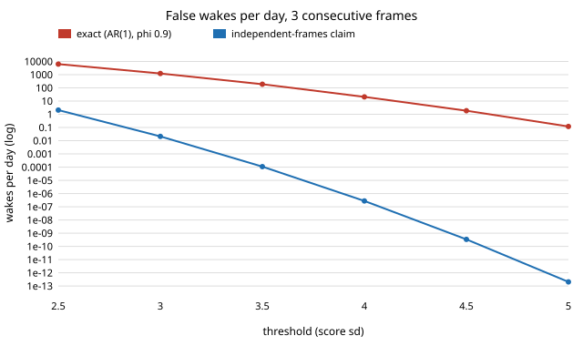

# ambient-falsewake: how many false wakes a day does an always-on assistant get when its frame scores are correlated, and what does "three frames in a row" really buy?

Track 2 (ambient AI assistant), a new question rather than another step of the audit chain: every earlier `ambient-*` trigger study scored *per-message* policies; none asked how the **frame-level** threshold behind a wake word turns into false wakes per day. Produced with AI assistance. **Stylised**: the detector score is a Gaussian AR(1) process, not the output of any real wake-word model, and no audio was used.

**Live page:** https://duncan-haywood.github.io/monorepo-projects/research/ambient-falsewake/

## Question

A trigger sees one score per 10 ms frame (8,640,000 frames a day) and fires after `m` frames in a row at or above a threshold. A designer wanting at most one false wake a day on background noise often sets the per-frame tail so that `P(score >= theta)^m = 1/day`, which treats frames as independent. Real frame scores are not independent: a model's output is smooth over tens of milliseconds. What does the independent rule get wrong, and by how much?

## Headline (AR(1) scores, unit variance, lag-1 correlation phi)

- **For a single-frame threshold (m = 1) the independent rule is nearly right.** Counting upcrossings, phi = 0.9 gives 0.78 wakes a day at the threshold chosen for 1 (5.172 sd), phi = 0.95 gives 0.60. Correlation makes it slightly *safer*.
- **For m >= 2 it is badly wrong, in the unsafe direction.** Requiring `m` frames in a row with the threshold from `P^m = 1/day` gives, at phi = 0.9, **613 wakes a day for m = 2, 4,793 for m = 3 and 20,993 for m = 5**; even phi = 0.5 gives 101, 402 and 943. Correlated frames exceed together, so `P^m` is far below the true run probability.
- **The fix is a higher threshold, found from the exact rate.** For 1 wake a day at phi = 0.9, m = 3 needs theta = 4.61, not 2.59 (2.02 sd higher); m = 5 needs 4.26 against 1.74 (2.52 sd). Requiring more frames *does* lower the threshold you need, but far less than the independent rule says: at phi = 0.9 the threshold falls from 5.13 (m = 1) to 4.26 (m = 5), where independence promises 1.74.
- **The gap at one threshold grows without bound.** At phi = 0.9, m = 3 the exact rate is 6,352 a day at theta = 2.5 and 0.12 a day at 5.0, while the independent claim is 2.1 and 2e-13. The ratio is 3e3 at 2.5 sd and 6e11 at 5 sd (figure).
- **The exact computation matches simulation** (6 cells, 6 million frames each, phi = 0.9, m = 1, 3, 5): the largest |z| against a Poisson standard deviation is 1.69.



## Builds on (and does not claim affiliation with)

- No lab from `prompt.md` is built on; there is no lab tag. The framing (a daily false-accept budget for an always-on detector) is common practice in keyword spotting; I cite no specific paper for a number and use none.
- Run-length statistics of a Markov chain are textbook; nothing here is claimed as new theory. The contribution is the worked numbers for a pendant-scale frame budget.

## Method

`src/ambient_falsewake/chain.py`. The AR(1) score is discretised on a 1,200-cell midpoint grid over [-8, 8] sd, giving a transition matrix `P`. The wake rate per frame is the probability that the frame `m` steps back was below theta and the next `m` frames were all at or above it, computed by `m` vector-matrix products from the stationary weights. This counts each exceedance run once, when it first reaches `m` frames. `independent_rate` is `P(s >= theta)^m`. `simulate_rate` generates AR(1) scores in chunks and counts the same event. `threshold_for_rate` bisects. Because the grid makes the rate a step function of theta (cell width 0.0133 sd), thresholds are good to about 0.01.

## Reproduce

```bash
cd research/ambient-falsewake
pip install numpy pytest matplotlib
PYTHONPATH=src python3 -m pytest -q tests                              # 6 tests, a few seconds
PYTHONPATH=src python3 experiments/run.py > experiments/results.txt    # about 10 s
python3 experiments/figure.py                                          # writes experiments/wakes_vs_threshold.svg
```

## Results (all from `experiments/results.txt`)

Section A tabulates `m` in {1, 2, 3, 5} and phi in {0, 0.5, 0.8, 0.9, 0.95}: the independent threshold, the true wakes a day at it, and the exact threshold for 1 a day. At phi = 0 the two agree to 0.01 sd (a check on the grid). Section B compares exact and Monte Carlo; section C is the figure's data.

## Limitations

- **Gaussian AR(1) is a model, not a detector.** A real score is not Gaussian, its tail may be heavier, and its correlation is not one lag. A smoother score (for example a moving average of AR(1)) would cut single-frame upcrossings much more than AR(1) does; I did not run it. phi = 0.9 at 10 ms is a time constant of about 95 ms, an assumed value, not a measurement.
- **Speech-like background is not noise.** Real false wakes come from speech, TV and music that resemble the wake phrase. They are bursts, not stationary noise, and an exceedance model says nothing about how often they occur.
- **Wakes cluster.** The expected count is exact; the day-to-day spread is not computed, and the Poisson z-scores in section B are a rough guide only.
- **Stationarity.** Day and night, and the room, change the score distribution; one fixed phi and unit variance are assumed.
- The grid truncates at 8 sd, which is far beyond the thresholds used (at most 5.2).

## Next steps

- Score a real keyword-spotting model on licensed non-speech audio, fit its score autocorrelation, and compare the predicted and observed false-wake rate (the owner's call, as it concerns data and models).
- Run smoothed and non-Gaussian score models, and compute the daily-count spread (Fano factor) from the run-length clustering.

## Owner steps

None.

## Outside dependencies

numpy, pytest, matplotlib. No model, dataset, service or hardware.
