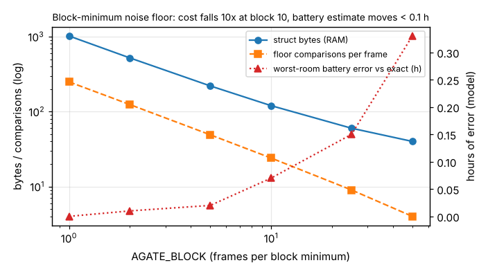

# ambient-gatefw: can a noise-adaptive voice gate fit in about 120 bytes of RAM on a pendant microcontroller, and does a cheaper noise floor cost battery life?

Track 2 (ambient AI assistant), the first "next step" of `ambient-gateroc`: port its adaptive energy gate to C. Produced with AI assistance. **Stylised, synthetic results only**: the audio is `ambient-gateroc`'s generated audio, the battery model is `ambient-wearable`'s, and nothing was run on a microcontroller or on real speech. Sizes are host `gcc` struct sizes; cost is a count of comparisons, not measured cycles.

**Live page:** https://duncan-haywood.github.io/monorepo-projects/research/ambient-gatefw/

## Question

`ambient-gateroc` found that a noise-adaptive threshold (open when frame energy is at least 4x the minimum energy of the last 5 s) works across rooms where one fixed threshold does not, but only in Python. The obvious port keeps the last 250 frame energies and scans them every 20 ms. On a Cortex-M4-class pendant with 256 kB of RAM that is cheap, but is it as cheap as it could be? Keeping one minimum per block of frames shrinks both the RAM and the scan. What does that cost in gate decisions, recall and battery life?

## Headline (synthetic audio, 20 seeds x 120 s per room, k = 4, hangover 200 ms)

- **The C port reproduces the Python gate exactly.** With one frame per block it agrees with `ambient-gateroc`'s `noise_floor`/`adaptive_gate` on every frame of a 60 s stream (a test), and the recall and battery figures it prints (1.000/0.531/82.4 h in the -60 dBFS room, 0.885/0.439/90.0 h at -30) are `ambient-gateroc`'s own.
- **The exact floor costs 1020 bytes of state and about 244 comparisons per frame** (a 249-entry ring of uint32 plus the current frame, scanned each 20 ms).
- **Keeping the minimum of every 10 frames instead cuts that to 120 bytes and about 24 comparisons per frame**, a tenth. The window becomes 241-250 frames instead of 250. Against the exact gate it flips 0.02-0.08% of frame decisions depending on room, changes mean recall by at most 0.0002 and the modelled battery life by at most 0.07 h of about 82-90 h.
- **Cost falls roughly in proportion to the block, error rises slowly, then faster.** Block 25 (60 bytes, 9 comparisons) moves battery life by at most 0.15 h and recall by 0.0006; block 50 (40 bytes, 4 comparisons) by 0.33 h and 0.0018. Larger blocks make the window shorter and ragged (201-250 frames), so the floor rises a little and the gate opens a little less.
- **After a 25 dB step up in room noise** (-60 to -35 dBFS), the open fraction in the following 10 s is 0.736 for the exact floor and 0.727 for block 10; block-50 gives 0.683. The coarser floors open slightly less after the step; I did not check whether what they close on is speech or noise.



## Builds on (and does not claim affiliation with)

- `research/ambient-gateroc` (simulator, scoring, the adaptive gate and its 5 s running-minimum floor) and `research/ambient-wearable` (`firmware/vad_gate.c`, the fixed gate this extends, and the battery model). No lab from `prompt.md` is built on; there is no lab tag.
- Minimum-statistics noise tracking is textbook material (for example Martin 2001, *IEEE Trans. Speech and Audio Processing* 9(5); cited from memory, not re-read). The block-minimum ring is a simple decimated running minimum, not Martin's method.

## Method

`firmware/adaptive_gate.c` (plain C99, no allocation) computes the mean-square of each frame like `vad_gate.c`, takes the floor as the minimum of the current partial block and the last `250 / AGATE_BLOCK - 1` finished block minima, opens when `ms >= k * max(floor, 1)` (a 64-bit product, so no overflow) and holds the gate open for the hangover. `AGATE_BLOCK` is a compile-time constant: 1 is the exact 250-frame window; 10 gives a window of 241-250 frames. `firmware/test_adaptive_gate.c` is a plain-C unit test. `src/ambient_gatefw/native.py` compiles the C with `gcc` and runs whole streams through it with `ctypes`; `ref.py` holds the Python reference (`block_floor`) and imports `ambient-gateroc`'s simulator.

## Reproduce

```bash
cd research/ambient-gatefw
pip install numpy pytest matplotlib      # gcc is also needed
for B in 1 10; do gcc -std=c99 -Wall -Wextra -DAGATE_BLOCK=$B -o /tmp/t firmware/adaptive_gate.c firmware/test_adaptive_gate.c && /tmp/t; done
PYTHONPATH=src python3 -m pytest -q tests                                # 6 tests, need gcc
PYTHONPATH=src python3 experiments/run.py > experiments/results.txt      # about 2 minutes
PYTHONPATH=src python3 experiments/figure.py                             # writes experiments/block_tradeoff.png
```

## Results (all from `experiments/results.txt`)

| AGATE_BLOCK | window (frames) | struct bytes | floor comparisons per frame | worst-room recall change | worst-room battery change |
|---|---|---|---|---|---|
| 1 (exact) | 250 | 1020 | 249 (244 mean over a run) | 0 | 0 |
| 2 | 249-250 | 520 | 124 | 0.0000 | 0.01 h |
| 5 | 246-250 | 220 | 49 | 0.0001 | 0.02 h |
| 10 | 241-250 | 120 | 24 | 0.0002 | 0.07 h |
| 25 | 226-250 | 60 | 9 | 0.0006 | 0.15 h |
| 50 | 201-250 | 40 | 4 | 0.0018 | 0.33 h |

Struct bytes are `4 * (250 / block - 1) + 24` (host, 32-bit fields, no padding; an ARM build would be the same size, unchecked). For scale, the energy sum itself costs 320 multiply-accumulates per 20 ms frame, so 24 comparisons are well under a tenth of it.

## Limitations

- **Synthetic audio only.** The question "does a decimated floor still track real noise" is answered only for stationary pink-ish noise with short transients. Real noise (babble, music, HVAC cycling) is not tested, and a floor that is a little high matters most where speech is close to the noise.
- **No cycle count and no ARM build.** There is no `arm-none-eabi-gcc` here. Cost is the number of floor comparisons from an instrumented host build; the code's real cycles, flash size and power on a Cortex-M4 are not measured. The 1% `vad_load` of the battery model is unchanged.
- **Recall is the frame-level recall of `ambient-gateroc`** (no onset clipping or latency measured). Differences of 0.0002 in recall and 0.07 h in battery are far below the seed-to-seed spread, and no confidence intervals were computed; the claim is only that the block variant tracks the exact one closely, not that it is better.
- **A zero-energy frame (for example a dropped or muted frame) enters the floor as 0, clamped to 1, and keeps the gate in a permissive state for the next 5 s.** The code does not special-case it; a real driver would need to.
- **The step test** is a single 25 dB step with 20 seeds; it reports open fraction only. It is not a study of how fast a floor recovers in a room that goes loud and stays loud.
- Battery hours inherit every limit of `ambient-wearable`'s model.

## Next steps

- Cross-compile for Cortex-M4 (needs `arm-none-eabi-gcc`) and report flash, stack and cycles per frame.
- Run both floors on a real, licensed speech-in-noise recording set and measure onset clipping.
- Try the two-stage gate from `ambient-gateroc`: a small classifier only when energy is open and the room is loud.

## Owner steps

None beyond those in `ambient-wearable` (hardware, purchases).

## Outside dependencies

numpy, pytest, matplotlib; `gcc` for the tests and experiment. No model, dataset, service or hardware is used.
