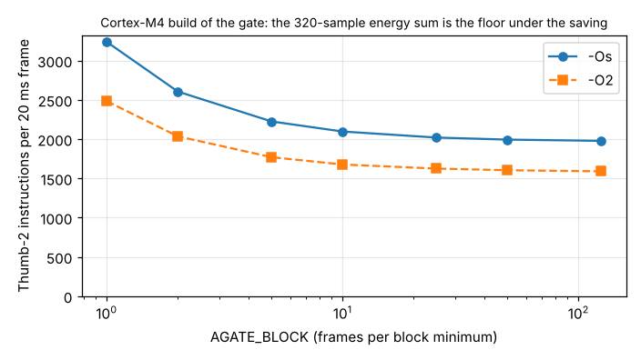

# ambient-gatem4: what does the adaptive voice gate cost on a Cortex-M4, in flash and instructions per frame, and is the block-minimum floor worth it?

Track 2 (ambient AI assistant), the first "next step" of `ambient-gatefw`: build its C gate for Cortex-M4. Produced with AI assistance. **Stylised, synthetic results only, and no hardware.** The audio is `ambient-gateroc`'s generated audio. Cortex-M4 here means clang 18 targeting `thumbv7em` with soft float, run in the Unicorn emulator, which counts executed instructions and has no pipeline, wait-state or flash-cache model. Instructions are not cycles, and no cycle figure is claimed. `arm-none-eabi-gcc` is not installed in the session, so this is clang, not the toolchain a vendor SDK would use.

**Live page:** https://duncan-haywood.github.io/monorepo-projects/research/ambient-gatem4/

## Question

`ambient-gatefw` showed that keeping one minimum per 10 frames cuts the gate's noise-floor state from 1020 to 120 bytes and the floor scan from about 244 to 24 comparisons per frame, on a host build. Does that saving survive contact with a Cortex-M4 instruction stream? The 320-sample energy sum runs every frame whatever the block size, so the saving could be small against it.

## Headline (60 s of synthetic audio in each of four rooms, k = 4, hangover 200 ms)

- **The Thumb-2 build is bit-exact with the Python reference.** For every block size tested, the floor on every frame equals `block_floor`, and for block 1 the open/closed decision equals `adaptive_gate` (a test; results table "agrees" column).
- **Flash is tiny: 236-258 bytes of code at `-Os`, 512-532 at `-O2`**, for the gate function alone (`llvm-size` of `adaptive_gate.o`). Block size barely changes it.
- **The only library call is the 64-bit unsigned divide (`__aeabi_uldivmod`), once per frame**, from `acc / n` in the energy mean. On a Cortex-M4 that is a libgcc/compiler-rt routine, so a build has to link one. Its cost is not counted here (the emulator computes it on the host), so the instruction numbers below are a lower bound.
- **The block-minimum floor saves less than the comparison count suggested.** At `-Os` the exact gate runs 3237 instructions per frame; block 10 runs 2096, a 35% cut, and block 50 runs 1993. The floor scan is 39% of the exact gate's instructions, 5.7% at block 10, and the remaining ~1980 are the energy sum and bookkeeping. At `-O2` the figures are 2482 (exact) and 1676 (block 10).
- **Rough load, with an assumption stated:** even at three cycles per instruction (a pessimistic guess, not a measurement) the exact `-Os` gate is 3237 x 3 x 50 frames/s, about 0.49 million cycles per second, under 1% of a 64 MHz core. Whether the block-minimum floor is worth its 0.07 h battery-model error is `ambient-gatefw`'s question; this result says the energy sum, not the floor, is where a cycle-conscious port should look next.



Full tables: [`experiments/results.txt`](experiments/results.txt).

## Builds on (and does not claim affiliation with)

`research/ambient-gatefw` (the C gate, compiled unchanged from `../ambient-gatefw/firmware/`) and `research/ambient-gateroc` (the simulator and Python reference). No lab from `prompt.md` is built on; there is no lab tag. Unicorn (GPL-2.0, QEMU-based) is a dev-time test dependency only and is not bundled.

## Method

`src/ambient_gatem4/m4.py` compiles `adaptive_gate.c` and a 6-line driver (`firmware/bench.c`) with clang for `thumbv7em-none-eabi -mcpu=cortex-m4 -mfloat-abi=soft -ffreestanding`, links with `ld.lld` to a flat binary, loads it into Unicorn (Thumb, M-class), and calls `bench_push` once per 20 ms frame, counting instructions with a code hook. Calls to `__aeabi_uldivmod` are intercepted, computed on the host and returned without counting. Steady state means frames 260 onward, after the 250-frame window fills.

## Reproduce

```
PY=$(python3 platform/ci/pyenv.py pytest numpy matplotlib unicorn)
cd research && PYTHONPATH=ambient-gatem4/src "$PY" ambient-gatem4/experiments/run.py > ambient-gatem4/experiments/results.txt
PYTHONPATH=ambient-gatem4/src "$PY" -m pytest ambient-gatem4
```

Needs `clang`, `ld.lld`, `llvm-nm`, `llvm-objcopy`, `llvm-size` (LLVM 18); tests skip without them. A run takes about 3 minutes.

## Limitations

- Instruction counts, not cycles. Cortex-M4 loads, taken branches and flash wait states cost more than one cycle, and the 64-bit multiply-accumulate and the divide are excluded or approximated.
- One compiler (clang 18), two optimisation levels, one 6-line driver. A vendor GCC would differ.
- Synthetic audio from one seed per room; instruction counts barely depend on the audio (the branches are few), so more seeds were not run.
- No real microcontroller, flash, RAM map or interrupt load. Stack use was not measured.

## Next steps

- Replace the 64-bit divide: a fixed 320-sample frame lets the mean be a multiply-and-shift, and the comparison `ms >= k*floor` can run on the sum directly. Check it stays exact.
- Run on a real Cortex-M4 board (an owner step) and read the DWT cycle counter.
- Try 16-bit samples with a SIMD dual-multiply (`SMLAD`) energy loop, since the energy sum is now the cost.

## Owner steps

Optional: a Cortex-M4 development board to read real cycle counts. None otherwise.

## Outside dependencies

clang/LLVM, numpy, pytest, matplotlib and Unicorn (an emulator) for the experiment. No model, dataset, service or hardware is used.
