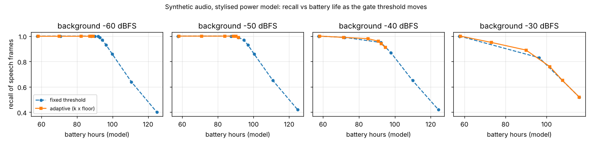

# ambient-gateroc: does a fixed energy-gate threshold survive different rooms on an always-on audio pendant, and what does an adaptive one buy in battery life?

Track 2 (ambient AI assistant), follow-up to `ambient-wearable`; free of the Dawid-Skene chain the last ten ambient projects extended, because that chain had gone to micro-variants. Produced with AI assistance. **Stylised, synthetic results only**: the audio is generated, the power model is `ambient-wearable`'s (vendor figures plus my assumptions), and nothing was measured on hardware or on real speech.

**Live page:** https://duncan-haywood.github.io/monorepo-projects/research/ambient-gateroc/

## Question

`ambient-wearable` ships a 74-byte energy gate (`firmware/vad_gate.c`) with a fixed threshold, and says the threshold is "untuned on real audio". A pendant is worn in a quiet flat, on a street and in a café. Does one fixed threshold work in all of them, how much battery life does it give, and does a noise-adaptive threshold fix it?

## Headline (synthetic audio, 20 seeds x 120 s per room)

- **Any fixed threshold that keeps speech recall at 0.9 or more in every room leaves the gate open nearly all the time in the loudest room.** Thresholds of -34 dBFS rms or lower give worst-room recall 0.93 or more, and a worst-room battery life of 57.6 h, the always-streaming figure: no gating gain there. The loud room only gets gated at a threshold of -26 dBFS (96.4 h, recall 0.83 there), and by then the quieter rooms are down to recall 0.64-0.65. No single fixed setting in the sweep does both.
- **One adaptive threshold (4x a 5 s running-minimum noise floor) gives 82-90 h in all four rooms at recall 0.89-1.00** (mean 85.3 h, mean recall 0.97), against a perfect-gate bound of 119 h and 57.6 h always streaming.
- **Within one room the two designs trade recall for battery along almost the same curve** (figure). A fixed threshold tuned to a known quiet room does as well as the adaptive gate there (for example -34 dBFS: 96.4 h at recall 0.93 in the -60 dBFS room, against 82-89 h at 0.98-1.00 for k = 4 to 8). The adaptive gate's gain is that **one setting transfers across rooms**, not a better curve.
- **The hangover is the biggest single lever on battery.** At k = 4, hangover 0, 5, 10, 25, 50 frames (20 ms each) gives 111.5, 93.8, 82.4, 71.9, 64.6 h in the quietest room, and recall 0.96-1.00 in the three quieter rooms (hangover 0 loses 4% at -40 dBFS) but 0.73, 0.87, 0.89, 0.98, 0.99 in the -30 dBFS room. A long hangover buys recall by staying open, not by detecting better.



## Builds on (and does not claim affiliation with)

- `research/ambient-wearable`: the gate (`firmware/vad_gate.c`, mean-square energy of a frame against a threshold, with a hangover) and the average-current model. `src/ambient_gateroc/power.py` is a copy of its `vad_gate` mode with the open fraction as input (the same assumptions: 150 mAh cell, 0.6 mA microphone, 32 kbit/s codec, 2x link overhead; vendor figures there were read through a summarising tool and not re-checked). A test checks that the all-open case reproduces its 57.6 h always-streaming figure, and another that the Python gate agrees frame by frame with the compiled C.
- Energy and noise-floor-tracking voice activity detection is textbook material (for example minimum-statistics noise estimation, Martin 2001, *IEEE Trans. Speech and Audio Processing* 9(5); cited from memory, not re-read here). The tracker here is the simplest running minimum, not Martin's method.

No lab from `prompt.md` is built on; there is no lab tag.

## Method

`src/ambient_gateroc/sim.py` generates 16 kHz int16 audio:

- background: pink-ish noise at -60, -50, -40 or -30 dBFS rms, plus transients (about 0.4 per second: 30 ms decaying noise bursts 6-20 dB above the background);
- speech-like bursts: a 100-220 Hz harmonic source with vibrato and 30% noise, a 3-5 Hz syllabic envelope, 1-4 s per utterance with 1-5 s gaps, utterance rms uniform in -36 to -20 dBFS (so some speech is at or below the loudest room's noise: unrecoverable by any energy gate);
- a frame (20 ms) is "active" if its syllabic envelope is above 10% of its utterance peak. Active frames are 19.6% of all frames.

Gates run on per-frame mean-square energy. **Fixed**: energy >= threshold. **Adaptive**: energy >= k x the causal running minimum of frame energy over the last 250 frames (5 s). Both open for `hangover` frames after the last exceeding frame, as in the C. Scores: **recall** (share of active frames with the gate open), **open** (share of all frames open, which sets the battery draw), **wasted** (open frames more than 200 ms from any active frame). Battery hours come from the open fraction through the copied power model.

## Reproduce

```bash
cd research/ambient-gateroc
pip install numpy pytest matplotlib
PYTHONPATH=src python3 -m pytest -q tests                              # 8 tests (the firmware parity test needs gcc)
PYTHONPATH=src python3 experiments/run.py > experiments/results.txt    # about 1 minute
PYTHONPATH=src python3 experiments/figure.py                           # writes experiments/gate_tradeoff.png
```

## Results (all from `experiments/results.txt`)

Rooms are background rms in dBFS. Cells are recall / open fraction / wasted / hours.

| setting | -60 | -50 | -40 | -30 |
|---|---|---|---|---|
| fixed -42 dBFS | 0.99 / 0.41 / 0.00 / 92.9 | 0.99 / 0.42 / 0.02 / 91.5 | 1.00 / 1.00 / 0.49 / 57.6 | 1.00 / 1.00 / 0.51 / 57.6 |
| fixed -34 dBFS | 0.93 / 0.37 / 0.00 / 96.4 | 0.93 / 0.37 / 0.00 / 96.9 | 0.95 / 0.42 / 0.03 / 92.2 | 1.00 / 1.00 / 0.51 / 57.6 |
| fixed -30 dBFS | 0.86 / 0.34 / 0.00 / 99.8 | 0.86 / 0.34 / 0.00 / 100.3 | 0.87 / 0.36 / 0.01 / 97.8 | 1.00 / 1.00 / 0.50 / 57.7 |
| adaptive k = 4 | 1.00 / 0.53 / 0.08 / 82.4 | 1.00 / 0.51 / 0.08 / 83.8 | 0.98 / 0.50 / 0.08 / 85.0 | 0.89 / 0.44 / 0.08 / 90.0 |
| adaptive k = 8 | 1.00 / 0.46 / 0.03 / 88.1 | 1.00 / 0.44 / 0.02 / 90.2 | 0.94 / 0.41 / 0.03 / 92.4 | 0.65 / 0.27 / 0.02 / 107.8 |

Reading it: a fixed threshold sits at one absolute level, so it is below the noise floor, and the gate is permanently open, in any room louder than it (the -42 dBFS gate in the -40 dBFS room; the -34 and -30 dBFS gates in the -30 dBFS room, where recall 1.00 is just "always open"). The adaptive gate's open fraction moves little with room level (0.44-0.53 at k = 4) because it scales with the room. Its k does the same job as the fixed gate's level: k = 4 favours recall, k = 8 favours battery, and at k = 8 the loud room loses a third of the speech, which is the physics of speech at -36 to -20 dBFS against -30 dBFS noise rather than a gate flaw.

Full tables (all 11 fixed thresholds, 6 values of k, the worst-room summary and the hangover sweep) are in `experiments/results.txt`.

## Limitations

- Synthetic audio. No real speech, no real noise, no babble or music, no reverberation, no microphone response. The transient model (about 0.4 per second) is a guess, and the "wasted" share of the adaptive gate (0.08) is mostly transients plus hangover.
- The speech-level range (-36 to -20 dBFS) and the room levels were chosen by me and decide where the loud room breaks; the *absolute* thresholds and hours are not portable. The robust finding is only that a fixed threshold is tied to one room level and an adaptive one is not.
- "Recall" is over frames with a syllabic envelope above 10% of peak, not a human labelling; no latency (onset clipping) is measured, only whether frames are open.
- The running-minimum floor is the simplest tracker. It would be fooled by a room that goes loud and stays loud (it tracks up only after 5 s) or a stationary hum, and its start-up is the first 5 s (not scored separately). No comparison with a learned VAD, which would cost more current.
- The adaptive gate is Python only; the C firmware has a fixed threshold. A port is small (a rolling minimum needs a 250-sample ring buffer, or a decimated one) but is not built or costed here, and its CPU load is taken as the existing `vad_load` of 1%.
- Battery hours inherit every limit of `ambient-wearable`'s model. 20 seeds per room; no confidence intervals were computed, and differences of a point or two in recall are noise.

## Next steps

- Port the adaptive floor into `vad_gate.c` (ring buffer, compiled for Cortex-M4) and check size and cycle cost.
- Test on a real recording set with a licence that allows it (speech plus noise corpora), and measure onset clipping.
- Consider a two-stage gate: energy first, a small classifier only when the energy gate is open and the room is loud.

## Owner steps

None beyond those in `ambient-wearable` (hardware, purchases).

## Outside dependencies

None beyond numpy (plus pytest and matplotlib; gcc for the optional firmware parity test). No model, dataset, service or hardware is used.
