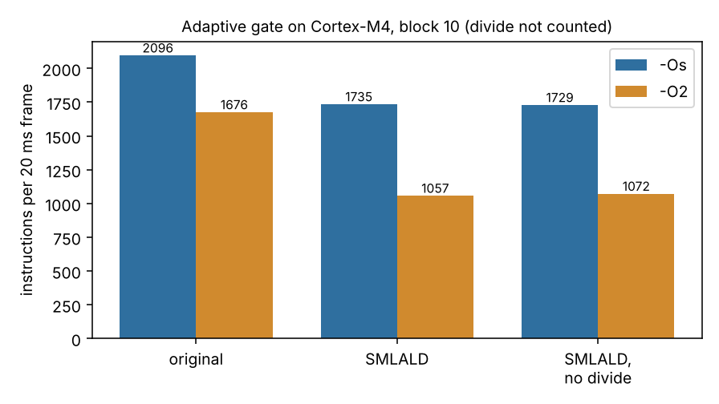

# ambient-gatesimd: do a dual-MAC energy loop and a divide-free threshold make the Cortex-M4 voice gate cheaper?

Track 2 (ambient AI assistant), following the first and third "next steps" of `ambient-gatem4`: that project found the energy sum dominates the gate's cost and the 64-bit divide is its only library call. Produced with AI assistance. **Stylised, synthetic audio only, instruction counts from an emulator, and no hardware.** The audio is `ambient-gateroc`'s synthetic speech-in-noise.

**Live page:** https://duncan-haywood.github.io/monorepo-projects/research/ambient-gatesimd/

## Question

Can the DSP dual multiply-accumulate `SMLALD` (two samples per instruction) and a threshold test done on sums instead of means (no divide) make `ambient-gatefw`'s adaptive voice gate cheaper on a Cortex-M4, and what does it cost in code size and RAM?

## Headline (3 seeds x 4 rooms x 60 s, k = 4, hangover 200 ms; clang 18, Unicorn Thumb-2)

- **With the block-minimum floor (block 10) the SMLALD loop cuts instructions per frame by 17% at `-Os` (2096 to 1735) and 37% at `-O2` (1676 to 1057).** Dropping the divide changes that by under 1.5% either way (1729 and 1072); the divide itself is *not counted* in any column (see Limitations), so this is where its saving would show up on hardware, unmeasured.
- **Without the block-minimum floor (block 1) it is slower: 3780 vs 3237 at `-Os`, 2880 vs 2482 at `-O2`.** The floor scan then dominates, and the SMLALD variants keep 64-bit ring entries (the sum of squares does not fit in 32 bits), so every comparison costs more.
- **RAM doubles**: 120 to 224 bytes at block 10, 1020 to 2024 at block 1, from the 64-bit ring. **Code roughly grows by 60%** at `-Os` (258 to 406-426 bytes) and 55% at `-O2` (532 to 824-828).
- **The divide-free decision is identical here**: 0 of 36000 frames differ from the original gate in every configuration. The sum-domain rule `sum >= k * max(floor_sum, n)` skips the floor of the mean, so it can differ at very low floors; these rooms never hit that, and I did not look for the rooms that would.
- **The only library call goes away** (`__aeabi_uldivmod`) in the divide-free variant, so a build needs no libgcc.



Full tables: [`experiments/results.txt`](experiments/results.txt).

## Builds on (and does not claim affiliation with)

`research/ambient-gatem4` (emulator harness, imported unchanged), `research/ambient-gatefw` (the C gate and Python reference) and `research/ambient-gateroc` (the simulator). `SMLALD` is from the Arm Cortex-M4 DSP extension (ACLE `__smlald`). No lab from `prompt.md` is built on; there is no lab tag.

## Method

`firmware/gate_simd.c` keeps `ambient-gatefw`'s state layout and block-minimum floor. Variant 1 sums energy with `__smlald`; variant 2 also keeps block minima and the floor as sums of squares and opens when `sum >= k * max(floor_sum, n)`, with no divide. Variant 0 is `ambient-gatefw` unchanged. All are built with clang for `thumbv7em-none-eabi -mcpu=cortex-m4 -mfloat-abi=soft` and run frame by frame in Unicorn, counting executed instructions in `bench_push` in steady state.

## Reproduce

```
PY=$(python3 platform/ci/pyenv.py pytest numpy matplotlib unicorn)
cd research && "$PY" ambient-gatesimd/experiments/run.py > ambient-gatesimd/experiments/results.txt   # ~15 min
"$PY" ambient-gatesimd/experiments/figure.py
"$PY" -m pytest ambient-gatesimd
```

Needs `clang`, `ld.lld` and the LLVM binutils (tests skip without them).

## Limitations

- Instruction counts, not cycles; the 64-bit divide of variants 0 and 1 is replaced by a host computation and **not counted**, so the divide-free saving is unmeasured. `SMLALD` is single-cycle on a real M4 while loads and branches are not; cycle ratios may differ.
- One compiler, two optimisation levels, one driver. Synthetic audio, four noise levels, three seeds.
- The decision-agreement check cannot show the sum-domain rule is equivalent in general, only that it matched here.
- Stack use was not measured.

## Next steps

- Keep a 32-bit ring by storing the block minimum scaled down (e.g. `sum >> 8`) and check decisions still match.
- Read DWT cycle counts on a real Cortex-M4 board (owner step) to get the divide and `SMLALD` cost.

## Owner steps

Optional: a Cortex-M4 development board.

## Outside dependencies

clang/LLVM, numpy, pytest, matplotlib and Unicorn. No model, dataset, service or hardware.
