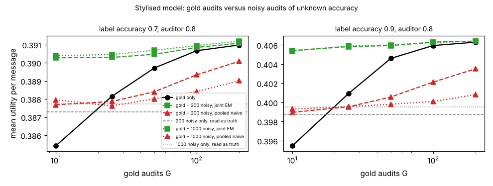

# ambient-goldaudit: gold-labelled audits versus noisy ones when the auditor's accuracy is unknown

Track 2 (ambient AI assistant), follow-up to `ambient-noisyaudit` (its "Next steps": a gold-subset variant). Produced with AI assistance. **Stylised, simulated results only**: every parameter is a round figure I chose, the label and the auditor are made-up uniform-error confusion matrices, and nothing is a claim about a real user, device or product.

**Live page:** https://duncan-haywood.github.io/monorepo-projects/research/ambient-goldaudit/

## Motivation

`ambient-noisyaudit` showed that reading a noisy auditor's labels as truth biases the estimate of the urgency classifier, and that EM fixes this only if the auditor's accuracy is known. A single noisy label per message cannot identify that accuracy. A small set of gold audits (the true class is observed) can: it pins the classifier's confusion matrix, and the noisy audits then reveal the auditor's. The question: how many gold audits replace how many noisy ones, and does a joint estimate that uses both beat discarding the noisy ones?

## Builds on (and does not claim affiliation with)

- `research/ambient-noisyaudit` and `research/ambient-confest` in this repository: the utility model (`src/ambient_goldaudit/sim.py` is a copy), the Bayes label-to-mode rule and the estimation set-up.
- Horvitz (1999), "Principles of mixed-initiative user interfaces", CHI (<https://doi.org/10.1145/302979.303030>; citation as listed in `PROJECTS.md`, not re-read here): choosing an action by expected utility under uncertainty.
- Dawid and Skene (1979), "Maximum likelihood estimation of observer error-rates using the EM algorithm", *Applied Statistics* 28(1), 20-28 (citation from memory, not re-read here): fitting error rates by EM over an unseen true class. The EM here is a simplified case with one auditor and a gold subset.

No research group from `prompt.md` is built on; there is no lab tag.

## Method (`src/ambient_goldaudit/est.py`)

48 contexts, three urgency classes (mix 50/35/15%) and four modes, as in `ambient-misread`. The classifier's label has accuracy 0.7 or 0.9. The auditor has true accuracy 0.8 and **no estimator is told it**. An audit set has G gold audits (true class t and classifier label o) and N noisy audits (auditor label a and o). Four estimators of the mix and the classifier's matrix, each followed by the Bayes rule:

- **gold_only**: the G gold audits, smoothing alpha = 1.
- **noisy_naive**: the N noisy audits read as truth, alpha = 1.
- **pooled_naive**: gold and noisy counts pooled and read as truth.
- **joint_em**: EM over the unseen true class of the noisy audits, fitting the mix, the classifier's matrix and the auditor's matrix together (pseudo-count 0.5 per row, started from the gold estimate and an auditor accuracy of 0.8, up to 2000 iterations).

Each rule is scored exactly under the true mix and matrix (mean over contexts). Grid: G in {0, 10, 25, 50, 100, 200}, N in {0, 200, 1000}, 150 audit sets per cell. "Matched" below means the smallest G on that grid whose gold_only mean is at least the noisy_naive mean.

## Reproduce

```bash
cd research/ambient-goldaudit
pip install numpy pytest matplotlib
PYTHONPATH=src python3 -m pytest -q tests        # 7 tests
PYTHONPATH=src python3 experiments/run.py > experiments/results.txt   # about a minute; also writes experiments/gold.png
```

## Results (all from `experiments/results.txt`; mean utility per message, std across audit sets in the file)

Reference: blind 0.3824; true-parameter Bayes 0.3917 (label 0.7) and 0.4066 (label 0.9).

1. **A few gold audits beat many noisy ones read as truth.** 200 or 1000 noisy audits read as truth give 0.3873 and 0.3877 at label 0.7, and 0.3988 and 0.3995 at label 0.9: more noisy audits do not help, because the bias stays. 25 gold audits already match them (0.3881 and 0.4009); 10 do not (0.3854 and 0.3955). The grid is coarse and the gold_only std at G = 25 is 0.003, so "25" means "between 10 and 25 or so", not an exact exchange rate.
2. **Pooling the noisy audits as truth hurts.** At G = 200, N = 1000, label 0.9: pooled_naive 0.4008 against gold_only 0.4063. The noisy rows pull the estimate away from the truth.
3. **Using the noisy audits properly helps a lot at small G.** joint_em with G = 10, N = 200 gets 0.3903 (label 0.7) and 0.4054 (label 0.9), against gold_only 0.3854 and 0.3955 at G = 10, and 0.3917 and 0.4066 for the true parameters. At label 0.9 that is 0.0012 below the truth, versus 0.0111 for gold alone. joint_em at G = 10 beats gold_only at G = 50 in label 0.7 (0.3903 vs 0.3897) and almost matches it at label 0.9 (0.4054 vs 0.4046, ahead).
4. **The gain shrinks as G grows.** At G = 200 joint_em and gold_only agree within 0.0003 at N = 200 and N = 1000 (for example 0.4064 and 0.4063 at label 0.9).
5. **More noisy audits add little here once the structure is fitted**: joint_em at G = 10 moves only from 0.3903 (N = 200) to 0.3904 (N = 1000) at label 0.7. Most of the benefit arrives with the first 200.



## Limitations

- The ordering is a property of this model. The sizes depend on my round-number utilities, three classes, uniform errors for classifier and auditor, one auditor accuracy (0.8) and one class mix. None was varied.
- The EM starts from an auditor accuracy of 0.8, which happens to be the true value. A different start, or a non-uniform auditor, was not tried, and EM is a local optimiser.
- Gold audits are assumed free of error and drawn from the true mix, at the same unit cost in the exchange rate; I did not price gold versus noisy audits, so "how many noisy audits equal one gold" is only read off the utility grid, and results 1 and 2 hold regardless of N.
- Auditor errors are independent of the message and the classifier. Real disagreement is likely to correlate with hard messages.
- 150 audit sets per cell; differences below about 0.001 are within noise.

## Next steps

- Price a gold audit against a noisy one and choose the budget split.
- Wrong or non-uniform auditor structure and several EM starts.
- A real classifier's matrix and real audit labels, if the owner supplies them.

## Outside dependencies

None beyond numpy (plus pytest and matplotlib for the tests and the figure). No model, dataset, service or hardware is used.
