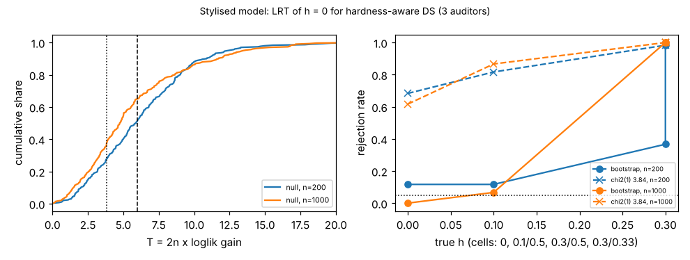

# ambient-hlrt: can a likelihood-ratio test tell "no hard messages" from "some", and is the chi-square cutoff usable? (stylised utility model)

Track 2 (ambient AI assistant), follow-up to `ambient-startcount` (its second "Next step": a likelihood-ratio test of h = 0 against h > 0). Produced with AI assistance. **Stylised, simulated results only**: every parameter is a round figure I chose, and the classifier and auditors are made-up uniform-error confusion matrices; nothing is a claim about a real user, device or product. It seemed worth doing because the hardness-aware estimator reports a fitted P(hard) even when there are no hard messages, and nobody here had checked how to decide whether that number means anything.

**Live page:** https://duncan-haywood.github.io/monorepo-projects/research/ambient-hlrt/

## Builds on (and does not claim affiliation with)

- `research/ambient-startcount` (and through it `ambient-multistart`, `ambient-third`): simulator and the hardness-aware three-auditor Dawid-Skene EM. `src/ambient_hlrt/{sim,est}.py` are copies; the null fit, the statistic and the parametric bootstrap are added at the end of `est.py`.
- Dawid and Skene (1979), *Applied Statistics* 28(1), 20-28 (from memory, not re-read). The non-standard asymptotics of likelihood-ratio tests in mixtures (boundary and unidentified parameters) are textbook knowledge that I did not look up in a source here; I cite no specific paper for them.

No research group from `prompt.md` is built on; there is no lab tag.

## Method

Same data model: three auditors of overall accuracy 0.8, a fraction h of messages hard for all three, classifier accuracy 0.7. Null model: one confusion matrix shared by the three auditors (h = 0). Alternative: the hardness-aware model, fitted from the first 2 of the nested grid starts and the better log-likelihood kept (`ambient-startcount` found 2-4 starts enough). Statistic T = 2n (loglik_alt - loglik_null), clipped at 0. Compared:
- fixed chi-square cutoffs 3.84 (1 df) and 5.99 (2 df);
- a parametric bootstrap: refit null and alternative on B = 39 data sets drawn from the fitted null, p = (1 + #{T* >= T})/(B + 1), reject at p <= 0.05.

Part A: 300 null draws per n for the distribution of T. Part B: 60 draws per cell.

## Reproduce

```bash
cd research/ambient-hlrt
pip install numpy pytest matplotlib
PYTHONPATH=src python3 -m pytest -q tests        # 4 tests
PYTHONPATH=src python3 experiments/run.py > experiments/results.txt   # about 25 minutes on 4 cores; also writes experiments/hlrt.png
```

## Results (all from `experiments/results.txt`)

1. **The chi-square cutoffs are unusable.** Under h = 0, T has median 5.9 (n = 200) and 4.8 (n = 1000), 95th percentile 12.4 and 13.5. The 1-df cutoff 3.84 rejects 72% and 62% of null data sets; even 5.99 rejects 49% and 35%. The alternative can always fit noise with a hard class, and the extra parameters are not identified under the null.
2. **The parametric bootstrap holds its level, roughly.** Null rejection at nominal 5%: 7/60 (0.117) at n = 200 and 0/60 at n = 1000. With 60 draws and B = 39 these are coarse (standard error about 0.04 near 0.05); I would not claim more than "not wildly off".
3. **Power depends on how hard the hard messages are.** Bootstrap rejection: h = 0.1, hard accuracy 0.5: 0.12 (n = 200), 0.07 (n = 1000), i.e. no power. h = 0.3, hard accuracy 0.5: 0.37 and 1.00. h = 0.3, hard accuracy 1/3: 0.98 and 1.00. (The chi-square rows reject nearly everything in the alternative cells, which says nothing since they also reject the null.)
4. **Reading.** Mild hardness (h = 0.1) is undetectable at n = 1000, and weak hardness needs n well above 200. This is consistent with `ambient-startcount`, where that regime was also where the likelihood surface was flat.



## Practical reading (stylised)

Report the fitted P(hard) only alongside a bootstrap p-value (about 40 refits is enough to see the gross picture); never use a chi-square cutoff for this model.

## Limitations

- One dependence model, uniform errors, equal auditors, one class mix; the null and alternative match the generator's structure.
- 60 draws per power cell and B = 39: rejection rates have standard errors up to about 0.06, and the level estimates (0.117, 0.000) are noisy.
- Only 2 starts for the alternative; the clipped-at-0 statistic never hit 0 in the null draws (share T = 0 was 0.00).
- No comparison with a plain-DS (separate matrices) null, an information criterion, or a score test.
- Citations from memory, not re-read.

## Next steps

- More draws and larger B for the level, and a search over n between 200 and 1000 for the power curve at h = 0.1 to 0.3.
- Compare with BIC and a separate-matrices null.
- Hardness that also affects the classifier.

## Outside dependencies

None beyond numpy (plus pytest and matplotlib). No model, dataset, service or hardware is used.
