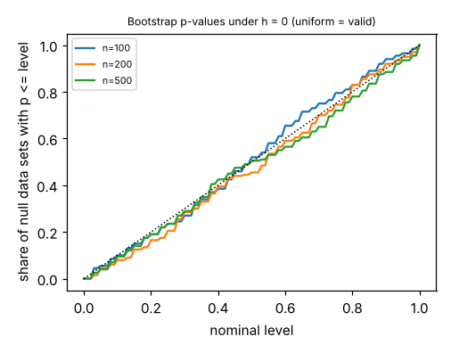

# ambient-hlrtlevel: does the bootstrap likelihood-ratio test of "no hard messages" hold its level? (stylised utility model)

Track 2 (ambient AI assistant), follow-up to `ambient-hlrt`, whose level estimates (7/60 at n = 200, 0/60 at n = 1000) were too coarse to say anything and whose first "Next step" asked for more draws. Produced with AI assistance. **Stylised, simulated results only**: every parameter is a round figure I chose and the auditors and classifier are made-up uniform-error confusion matrices; nothing here is a claim about a real user or product. No lab from `prompt.md` is built on; there is no lab tag.

## Builds on

- `research/ambient-hlrt`: the simulator, the h = 0 null fit, the statistic and the parametric bootstrap (`src/ambient_hlrtlevel/{sim,est}.py` are copies). Only `stats.py` (an exact binomial interval) is new.
- Clopper and Pearson (1934), *Biometrika* 26, for the exact binomial interval (from memory, not re-read; the code is checked against the interval's defining property in a test).

## Method

Null data only (h = 0): three auditors of accuracy 0.8, classifier accuracy 0.7, n in {100, 200, 500}, 200 independent draws per n. Each draw gets a parametric-bootstrap p-value with B = 39 refits and 2 alternative starts, exactly as in `ambient-hlrt`. If the test is valid, p is close to uniform, so the share with p <= 0.05 should be about 0.05 and p <= 0.10 about 0.10.

## Reproduce

```bash
cd research/ambient-hlrtlevel
pip install numpy pytest matplotlib
PYTHONPATH=src python3 -m pytest -q tests        # 4 tests
PYTHONPATH=src python3 experiments/run.py > experiments/results.txt   # about 40 minutes on 4 cores; also writes experiments/level.png
```

## Results (all from `experiments/results.txt`)

| n | reject at 0.05 | exact 95% CI | reject at 0.10 | exact 95% CI | mean p |
|---|---|---|---|---|---|
| 100 | 11/200 = 0.055 | [0.028, 0.096] | 20/200 = 0.100 | [0.062, 0.150] | 0.495 |
| 200 | 9/200 = 0.045 | [0.021, 0.084] | 16/200 = 0.080 | [0.046, 0.127] | 0.524 |
| 500 | 8/200 = 0.040 | [0.017, 0.077] | 19/200 = 0.095 | [0.058, 0.144] | 0.523 |

1. **With 200 draws per n the bootstrap level is consistent with nominal at all three sizes.** Every interval contains 0.05 (at 0.05) and 0.10 (at 0.10), and mean p is near 0.5, as for a uniform p-value.
2. **The 7/60 at n = 200 in `ambient-hlrt` was most likely noise.** Here n = 200 gives 9/200; the earlier figure of 0.117 sits outside this run's interval [0.021, 0.084] but inside the earlier run's own wide one. I did not rerun that earlier setup, so this is a reading, not a test.
3. The intervals are still about +/-0.03 wide, so a true level of 0.08 would not be ruled out.



## Limitations

- One dependence model; the null and alternative match the generator, so this is a best case for the test. Level under model misspecification is not examined.
- 200 draws and B = 39 (the smallest attainable p is 1/40 = 0.025, so "p <= 0.05" is p in {0.025, 0.05}).
- Only the level was studied, not power; `ambient-hlrt` has power at 60 draws per cell.
- The Clopper-Pearson citation is from memory.

## Next steps

- Larger B and more draws to narrow the intervals; the same under a misspecified null (for example unequal auditors).
- Compare with BIC and a separate-matrices null (open from `ambient-hlrt`).

## Outside dependencies

None beyond numpy (plus pytest and matplotlib). No model, dataset, service or hardware is used.
