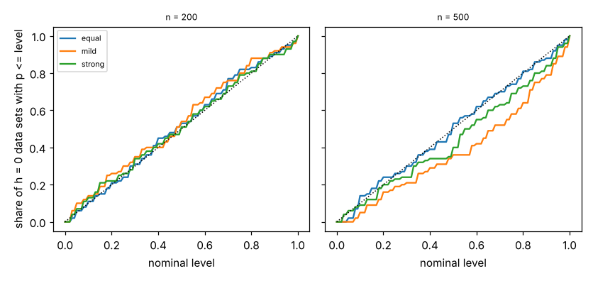

# ambient-hlrtmis: does the bootstrap likelihood-ratio test of "no hard messages" keep its level when the auditors differ in accuracy? (stylised utility model)

Track 2 (ambient AI assistant), follow-up to `ambient-hlrtlevel`, whose first "Next step" asked for the level under a misspecified null. Produced with AI assistance. **Stylised, simulated results only**: every parameter is a round figure I chose and the auditors and classifier are made-up uniform-error confusion matrices; nothing here is a claim about a real user or product. No lab from `prompt.md` is built on; there is no lab tag.

## Builds on

- `research/ambient-hlrtlevel` (and through it `ambient-hlrt`): simulator, estimators, parametric bootstrap and the exact binomial interval (`src/ambient_hlrtmis/{sim,est,stats}.py` are copies). New: `draw3_unequal` in `est.py`.
- Clopper and Pearson (1934), *Biometrika* 26, for the interval (from memory, not re-read).

## Method

Data have **no hard messages** (h = 0) but the three auditors have different accuracies, independent given the true class. The tested null fits one confusion matrix shared by all three auditors, so it is misspecified; the alternative (shared easy/hard matrices) is also not the generator. Mean auditor accuracy is 0.8 in every configuration: equal (0.8, 0.8, 0.8) as a control, mild (0.9, 0.8, 0.7), strong (0.95, 0.8, 0.65). Classifier accuracy 0.7, n in {200, 500}, 100 independent draws per cell, bootstrap B = 39 with 2 starts as before. A test that "holds its level" rejects about 5% at p <= 0.05; a rise would mean unequal auditors get misread as hard messages.

## Reproduce

```bash
cd research/ambient-hlrtmis
pip install numpy pytest matplotlib
PYTHONPATH=src python3 -m pytest -q tests        # 5 tests
PYTHONPATH=src python3 experiments/run.py > experiments/results.txt   # about 1.5 hours on 4 cores; also writes experiments/level.png
```

## Results (all from `experiments/results.txt`)

| auditor accuracies | n | reject at 0.05 | exact 95% CI | reject at 0.10 | exact 95% CI | mean p |
|---|---|---|---|---|---|---|
| equal (0.8, 0.8, 0.8) | 200 | 6/100 | [0.022, 0.126] | 11/100 | [0.056, 0.188] | 0.491 |
| equal | 500 | 2/100 | [0.002, 0.070] | 14/100 | [0.079, 0.224] | 0.506 |
| mild (0.9, 0.8, 0.7) | 200 | 10/100 | [0.049, 0.176] | 14/100 | [0.079, 0.224] | 0.470 |
| mild | 500 | 0/100 | [0.000, 0.036] | 5/100 | [0.016, 0.113] | 0.619 |
| strong (0.95, 0.8, 0.65) | 200 | 7/100 | [0.029, 0.139] | 13/100 | [0.071, 0.212] | 0.492 |
| strong | 500 | 6/100 | [0.022, 0.126] | 9/100 | [0.042, 0.164] | 0.556 |

1. **No sign that unequal auditors inflate the level.** Five of six intervals at 0.05 contain 0.05; the pooled rejection rates are 8/200 (equal), 10/200 (mild) and 13/200 (strong) at 0.05, with no upward trend in the spread of accuracies.
2. **The one cell that misses nominal is conservative, not liberal**: mild at n = 500 rejected 0/100 (interval [0, 0.036]) and has mean p 0.62. I do not know why and did not investigate; with six cells, one interval excluding 0.05 is not surprising by chance either.
3. **The n = 200 mild cell is the closest to a problem** (10/100, lower end of its interval 0.049) and 100 draws cannot rule out a true level near 0.10 there. The control row also shows how noisy 100 draws are (2/100 at 0.05 but 14/100 at 0.10 at n = 500).



## Limitations

- 100 draws per cell: intervals are about +/-0.05 wide, so a level up to roughly 0.12 is not excluded in any cell.
- Only auditor accuracy heterogeneity with the *same* uniform-error shape; no class-specific bias, no auditor correlation (that is the alternative, h > 0), no classifier misspecification.
- B = 39, so the smallest p is 0.025; level only, no power.
- The Clopper-Pearson citation is from memory.

## Next steps

- 300+ draws for the mild n = 200 cell and a larger B.
- Misspecify the confusion shape (auditor biased toward one class) instead of the accuracy.
- Compare with BIC and a separate-matrices null (open from `ambient-hlrt`).

## Outside dependencies

None beyond numpy (plus pytest and matplotlib). No model, dataset, service or hardware is used.
