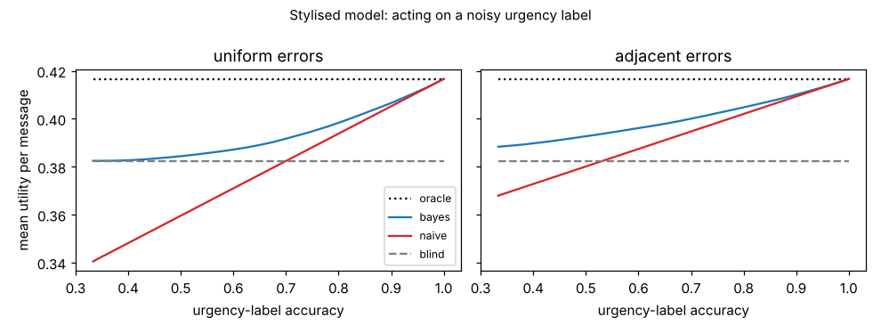

# ambient-misread: how accurate must an always-on assistant's urgency label be before acting on it beats ignoring it? (stylised utility model)

Track 2 (ambient AI assistant), follow-up to `ambient-urgency` (its "Next steps": let the assistant infer urgency with error). Produced with AI assistance. **Stylised, simulated results only**: every parameter is a round figure I chose, the classifier is a made-up confusion matrix, and nothing is a claim about a real user, device or product.

**Live page:** https://duncan-haywood.github.io/monorepo-projects/research/ambient-misread/

## Motivation

`ambient-urgency` assumed the assistant knows each message's urgency. A real one has to guess it. If the guess is wrong, a high-urgency message may get a silent glance, or a low-urgency one a spoken interruption. The question: above what label accuracy does using the label beat ignoring it, and how much does a Bayesian reading of the label recover?

## Builds on (and does not claim affiliation with)

- `research/ambient-urgency` in this repository: the utility model (`src/ambient_misread/sim.py` is a copy, so the project stays self-contained).
- Horvitz (1999), "Principles of mixed-initiative user interfaces", CHI (<https://doi.org/10.1145/302979.303030>; citation as listed in `PROJECTS.md`, not re-read here): choosing an action, including doing nothing, by expected utility under uncertainty about the user's need.

No research group from `prompt.md` is built on; there is no lab tag.

## Method (`src/ambient_misread/infer.py`)

The 48 contexts and three urgency classes (low, normal, high, mix 50/35/15%) are those of `ambient-urgency`. A classifier reports a label with confusion matrix C[true, observed]: correct with probability `acc`, otherwise wrong either uniformly over the other two classes ("uniform") or only to a neighbouring class ("adjacent"). Four policies per context, all scored by expected utility under the true class:

- **oracle**: knows the true class (the `ambient-urgency` result).
- **blind**: ignores the label; one mode per context, best for the prior mix.
- **naive**: treats the label as true and picks that class's best mode.
- **bayes**: picks the mode with the highest expected utility under P(true | label), using the prior mix and C. It needs both to be known.

Closed form; a Monte Carlo check samples messages.

## Reproduce

```bash
cd research/ambient-misread
pip install numpy pytest matplotlib
PYTHONPATH=src python3 -m pytest -q tests        # 8 tests
PYTHONPATH=src python3 experiments/run.py > experiments/results.txt   # a few seconds; also writes experiments/accuracy.png
```

## Results (all from `experiments/results.txt`)

1. **Headline numbers.** Mean utility per message: oracle 0.4166, blind 0.3824, so perfect urgency knowledge is worth 0.0342 here (partly by construction, since high-urgency messages carry twice the weight).
2. **Break-even.** With uniform errors, acting naively on the label stops being worse than ignoring it at about 70% accuracy (0.703 on a 0.005 grid; at 0.7 the difference is -0.0001). With adjacent-only errors, about 53.5%, because confusing neighbours costs less than confusing low with high.
3. **Naive can hurt a lot.** At 50% accuracy with uniform errors the naive policy loses 0.0229 per message against blind, which is 67% of the oracle's gain turned into a loss. At 0.7, naive is worse than blind in 18 of 48 contexts, worst -0.069 (12 words, noise 0.5, others talking, eyes busy).
4. **Bayes never loses to blind in the model**, and recovers 6%, 27% and 71% of the oracle's gain at 50%, 70% and 90% accuracy (uniform errors), against -67%, 0% and +67% for naive. At 95% or more the two are within 0.0005.
5. **Needs the right prior.** At 70% uniform accuracy, Bayes with the true mix gets 0.3917, with a flat prior 0.3866 and with a prior that over-weights high urgency (10/30/60%) 0.3693, which is below blind (0.3824). A wrong prior can turn the Bayesian policy into the worst one.
6. **Check.** Closed form and simulation agree to 0.0016 at worst (3 contexts, 4 policies, 200,000 messages).



## Limitations

- All utility parameters are the round numbers of `ambient-urgency`; the ordering of policies is a property of the model, the sizes are not estimates. No human study, no real classifier, no measured confusion matrix.
- Accuracy is the same for every class and context, which real classifiers would not satisfy. The 70% and 53.5% break-evens hold only for this prior, these contexts and these two error shapes.
- Bayes assumes the confusion matrix is known exactly; estimating it needs labelled data, which an assistant that learns only from accept/dismiss feedback may not have (see `ambient-bandit`, `ambient-ips`).
- One message at a time; the assistant does not learn from dismissals or hedge with a softer mode.

## Next steps

Estimate the confusion matrix and prior from logged feedback and measure what a wrong estimate costs; add a "hedge" mode (chime only) chosen for uncertain labels; fit to a real classifier's confusion matrix if the owner supplies one.

## Outside dependencies

None beyond numpy (plus pytest and matplotlib for the tests and the figure). No model, dataset, service or hardware is used.
