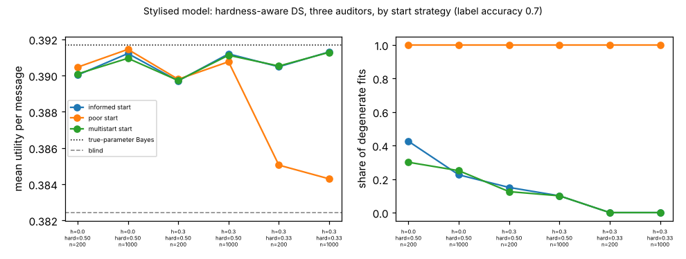

# ambient-multistart: does a likelihood-ranked multi-start make hardness-aware Dawid-Skene robust to a poor start? (stylised utility model)

Track 2 (ambient AI assistant), follow-up to `ambient-third` (its second "Next step": multi-start or likelihood-ranked starts so the degenerate point is rejected without a good guess). Produced with AI assistance. **Stylised, simulated results only**: every parameter is a round figure I chose, the classifier and auditors are made-up uniform-error confusion matrices, and nothing is a claim about a real user, device or product.

## Motivation

`ambient-third` found that the three-auditor hardness-aware EM (dsH3) identifies the hard-message share at the population level, but only from a good start: a start with no easy/hard difference stays at a degenerate point (P(hard) 0.5, lower likelihood). A practitioner would not know a good start. Does fitting from a small grid of starts and keeping the highest-likelihood fit fix that, with no start near the truth?

## Builds on (and does not claim affiliation with)

- `research/ambient-third` (and through it `ambient-dshard`, `ambient-dscorr`, `ambient-dsaudit`): the utility model (48 contexts, 3 urgency classes), Bayes policy, simulator and estimators. `src/ambient_multistart/{sim,est}.py` are copies; `estimate_ds3_hard_multistart` and `START_GRID` are added at the end of `est.py`.
- Dawid and Skene (1979), "Maximum likelihood estimation of observer error-rates using the EM algorithm", *Applied Statistics* 28(1), 20-28 (citation from memory, not re-read here).

No research group from `prompt.md` is built on; there is no lab tag.

## Method

Same model as `ambient-third`: three auditors, overall accuracy 0.8; a fraction h of messages is hard for all three (accuracy `hard_acc`); classifier label accuracy 0.7. Multi-start = run dsH3 from each of 8 grid starts (easy accuracy {0.95, 0.85} x hard accuracy {0.4, 0.6} x P(hard) {0.15, 0.4}, classifier 0.7; none equals the truth) and keep the fit with the highest log-likelihood. Compared with a single informed start (0.9, 0.5, 0.3, 0.7) and a single poor start (0.8, 0.8, 0.5, 0.6; no easy/hard difference). Cells: h = 0 (the null: no hardness), h = 0.3 with hard accuracy 0.5, and h = 0.3 with hard accuracy 1/3; n = 200 and 1000, 40 draws each. "Degenerate" is a crude flag I chose: estimated P(hard) above 0.45 or below 0.02. Utility is scored exactly under the truth.

## Reproduce

```bash
cd research/ambient-multistart
pip install numpy pytest matplotlib
PYTHONPATH=src python3 -m pytest -q tests        # 8 tests
PYTHONPATH=src python3 experiments/run.py > experiments/results.txt   # about 5 minutes; also writes experiments/multistart.png
```

## Results (all from `experiments/results.txt`)

Reference: blind 0.3824; true-parameter Bayes 0.3917.

1. **At the population level the multi-start picks the right fit and rejects the degenerate one.** With h = 0.3 the multi-start gives P(hard) 0.300 (log-likelihood -3.400945 per message at hard accuracy 0.5, -3.070421 at 1/3), equal to the informed start; the poor start sits at 0.500 with a lower log-likelihood (-3.418695 and -3.140679). So ranking by likelihood removes the dependence on the start in this model.
2. **At finite n it matches the informed start, no better.** At hard accuracy 1/3, n = 1000: P(hard) 0.290 (sd 0.021) for multi-start vs 0.290 (0.020) informed, utility 0.3913 for both. At hard accuracy 0.5, n = 1000: 0.357 (0.085) vs 0.352 (0.082), utility 0.3911 vs 0.3912. The multi-start's 8 starts did not find a materially better optimum than one informed start.
3. **The single poor start is the failure the multi-start fixes.** It returns P(hard) 0.500 in every one of the 40 draws in every cell, and at hard accuracy 1/3 its classifier-accuracy error is 0.11 (vs 0.02) and its utility 0.3843-0.3851 (vs 0.3905-0.3913), below blind (0.3824) in 23% of n = 200 draws and in none at n = 1000. At hard accuracy 0.5 its utility is within 0.0005 of the others.
4. **Where hardness is weak or absent, nothing identifies P(hard), and the multi-start does not help.** At h = 0 the three starts give the same population log-likelihood (-3.555904) and P(hard) of 0.255, 0.500 and 0.138: the flag is not identified when there is no easy/hard difference. At finite n the h = 0 draws give P(hard) estimates averaging 0.32-0.39 (sd 0.13-0.16) for the informed and multi-start fits, so a fitted "hard share" of that size is not evidence that hardness exists. The utility cost is nil here (0.3901-0.3914 vs true-parameter 0.3917).
5. **Even with good starts, finite samples flag "degenerate" fits often when hardness is mild.** At h = 0.3, hard accuracy 0.5, n = 200, 12% of multi-start fits (15% informed) have P(hard) above 0.45 or below 0.02. At n = 1000 the multi-start share is 10%. Hard accuracy 1/3 gives 0%.



## Limitations

- One dependence model (binary hardness shared by all auditors, uniform errors, equal auditors, one class mix, classifier unaffected by hardness) and one label accuracy (0.7). The three-start comparison is not a general theorem about EM.
- dsH3 has the generator's structure built in. A wrong structure is untested.
- 40 draws per cell; differences of 0.0001-0.0005 in utility are within sampling noise. The 8-start grid was chosen once, not tuned, and I did not test grids of other sizes or random starts.
- The degenerate flag (P(hard) above 0.45 or below 0.02) is ad hoc.
- Citation from memory, not re-read.

## Next steps

- Hardness that also affects the classifier (the other open step from `ambient-third`).
- Does the number of grid starts matter? Compare 2, 4, 8 and 16 starts and random starts at equal compute.
- A likelihood-ratio test of h = 0 against h > 0 to flag when a fitted hard share is not evidence of hardness (result 4).

## Outside dependencies

None beyond numpy (plus pytest and matplotlib). No model, dataset, service or hardware is used.
