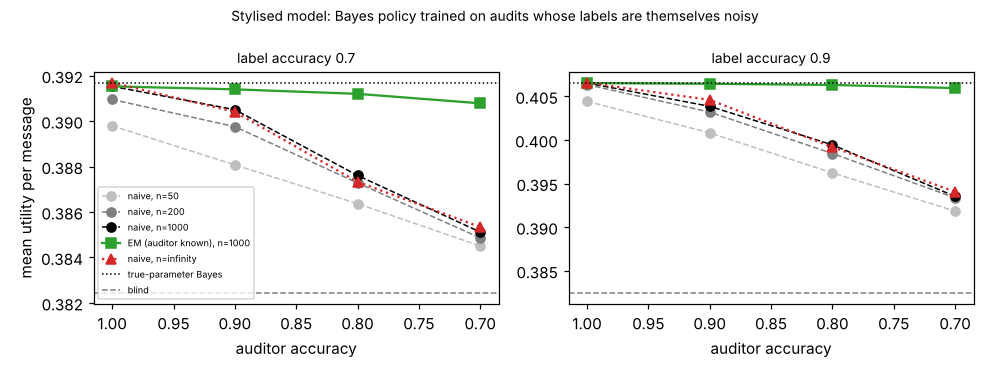

# ambient-noisyaudit: what happens to an always-on assistant that learns its urgency label's reliability from a noisy auditor? (stylised utility model)

Track 2 (ambient AI assistant), follow-up to `ambient-confest` (its "Next steps": a noisy-audit variant). Produced with AI assistance. **Stylised, simulated results only**: every parameter is a round figure I chose, both the label and the auditor are made-up uniform-error confusion matrices, and nothing is a claim about a real user, device or product.

**Live page:** https://duncan-haywood.github.io/monorepo-projects/research/ambient-noisyaudit/

## Motivation

`ambient-confest` estimated the urgency label's class mix and confusion matrix from an audit set whose labels were assumed to be the truth. A person labelling audit messages disagrees with themselves and others. If the assistant takes those labels at face value, its estimate of the classifier is biased (the auditor's mistakes look like the classifier's). How much utility does that cost, and does correcting for a known auditor accuracy recover it?

## Builds on (and does not claim affiliation with)

- `research/ambient-confest` and `research/ambient-misread` in this repository: the Bayes policy, the estimation set-up and the utility model (`src/ambient_noisyaudit/sim.py` is a copy of the model originally from `ambient-urgency`, so the project stays self-contained).
- Horvitz (1999), "Principles of mixed-initiative user interfaces", CHI (<https://doi.org/10.1145/302979.303030>; citation as listed in `PROJECTS.md`, not re-read here): choosing an action by expected utility under uncertainty.
- Dawid and Skene (1979), "Maximum likelihood estimation of observer error-rates using the EM algorithm", *Applied Statistics* 28(1), 20-28 (citation from memory, not re-read here): the idea of fitting error rates by EM over an unseen true class. The EM here is a simplified case in which one observer's matrix is known and only the classifier's matrix and the mix are fitted.

No research group from `prompt.md` is built on; there is no lab tag.

## Method (`src/ambient_noisyaudit/est.py`)

The 48 contexts, three urgency classes (mix 50/35/15%) and four modes are those of `ambient-misread`. The classifier's label has uniform errors at accuracy 0.7 or 0.9. Each audited message has a true class from the mix, a classifier label o, and an auditor label a, with the auditor also a uniform-error matrix (accuracy 1.0, 0.9, 0.8 or 0.7). Two estimators of the mix and the classifier's confusion matrix, each followed by the Bayes rule for the label-to-mode map:

- **naive**: take a as the true class and smooth with alpha = 1 (the `ambient-confest` estimator).
- **em**: maximum likelihood over the unseen true class, with the auditor's matrix known exactly, by EM (up to 500 iterations, tolerance 1e-12, started from the smoothed naive estimate).

Each map is scored exactly under the true mix and matrix, as the mean over 48 contexts. "Population limit" uses the exact expected audit counts (n = infinity); finite cells use n = 50, 200 and 1000 with 200 independent audit sets each.

## Reproduce

```bash
cd research/ambient-noisyaudit
pip install numpy pytest matplotlib
PYTHONPATH=src python3 -m pytest -q tests        # 7 tests
PYTHONPATH=src python3 experiments/run.py > experiments/results.txt   # about a minute; also writes experiments/audit.png
```

## Results (all from `experiments/results.txt`; mean utility per message over contexts)

Reference values: blind 0.3824; Bayes with the true parameters 0.3917 at label accuracy 0.7 and 0.4066 at 0.9.

1. **The naive estimator is biased and the bias does not shrink with n.** In the population limit with an auditor of accuracy 0.8 and a classifier of accuracy 0.7, the naive estimate implies a label accuracy of 0.569 and a high-urgency share of 0.205 (true 0.700 and 0.150). With a 0.7 auditor the implied accuracy is 0.515 and the share 0.233. The naive map's utility there is 0.3873 and 0.3853, against 0.3917 for the true parameters: it loses 0.0044 and 0.0064, i.e. 47% and 69% of the 0.0093 gain over blind. At label accuracy 0.9 the same auditors cost 0.0074 (0.8) and 0.0125 (0.7), 31% and 52% of the 0.0242 gain.
2. **A mildly noisy auditor costs little.** A 0.9 auditor costs 0.0013 (label 0.7) and 0.0020 (label 0.9) in the population limit, 14% and 8% of the gain.
3. **Naive-learned policies stayed above blind in this model.** In every population-limit cell the naive map beat blind (lowest 0.3853 against 0.3824). At finite n the fraction of audit sets with naive below blind was 0.21 at n = 50 and 0.11 at n = 200 for the worst cell (label 0.7, auditor 0.7), falling to 0.02 at n = 1000. So the damage here is a lost share of the gain, not a harmful policy, except for small audit sets with a poor classifier.
4. **Correcting for a known auditor removes the bias.** EM reaches the true-parameter value in the population limit in every cell (0.3917 and 0.4066), and at n = 1000 it is within 0.0009 of it for every auditor accuracy (worst: label 0.7, auditor 0.7, 0.3908 against 0.3917), where naive is 0.0066 below at label 0.7 / auditor 0.7 and 0.0131 below at label 0.9 / auditor 0.7.
5. **EM is not free at small n.** At n = 50 with label 0.7 and auditor 0.7 EM has mean 0.3838 against naive 0.3845, with a larger spread (std 0.0079 against 0.0031) and 23% of audit sets below blind against 21%. With noisy labels and few audits the extra latent-class uncertainty costs about what the bias does. By n = 200 EM is ahead in every noisy-auditor cell (for example 0.3891 against 0.3849 in that cell).
6. **A perfect auditor reproduces `ambient-confest`'s pattern**: naive and EM agree to within 0.0002 once n is 200 or more (at n = 50, label 0.9: naive 0.4044, EM 0.4055, because naive keeps the alpha = 1 smoothing and EM does not).



## Limitations

- The ordering is a property of this model. The sizes depend on my round-number utilities, a three-class label, uniform errors for both the classifier and the auditor, and one class mix. None of those was varied here.
- EM is given the auditor's confusion matrix exactly. In practice that matrix is unknown, and a single noisy auditor's accuracy is not identifiable from one label per message. It would need repeated or multiple auditors (Dawid-Skene-style), or a gold subset. I did not test a wrong assumed auditor accuracy, which could make EM worse than naive.
- Auditor errors are independent of the message and the classifier's error. Real disagreement is likely to correlate with hard messages.
- EM is a local optimiser; I started it from the naive estimate and did not check for multiple optima beyond the tests.
- The audit sets are drawn from the true mix, not biased toward messages the user noticed.
- 200 audit sets per cell; stds are across those sets.

## Next steps

- Jointly estimate the auditor's accuracy from two auditors per message (Dawid-Skene) and measure the cost of wrong assumed accuracies.
- A gold-subset variant: how many perfectly audited messages replace how many noisy ones?
- Correlated auditor errors, a non-uniform mix and adjacent-only errors.
- A real classifier's confusion matrix and real audit labels, if the owner supplies them.

## Outside dependencies

None beyond numpy (plus pytest and matplotlib for the tests and the figure). No model, dataset, service or hardware is used.
