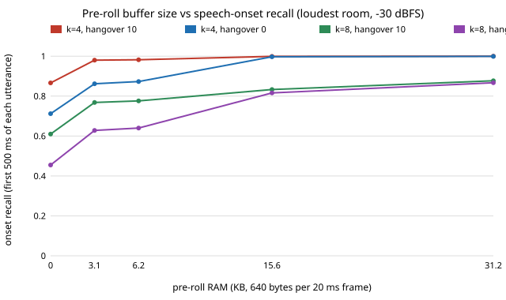

# ambient-preroll: how much pre-roll buffer does an energy-gated audio pendant need to stop clipping the first word, and what does it cost in RAM and battery?

Track 2 (ambient AI assistant), follow-up to `ambient-gateroc`. It asks a new question about the gate rather than extending the Dawid-Skene chain, which had gone to micro-variants. Produced with AI assistance. **Stylised, synthetic results only**: the audio is generated, the power model is `ambient-wearable`'s (via `ambient-gateroc`), and nothing was measured on hardware or on real speech.

**Live page:** https://duncan-haywood.github.io/monorepo-projects/research/ambient-preroll/

## Question

`ambient-gateroc` scored whether frames were open, and said "no latency (onset clipping) is measured". A gate that opens a few frames after speech starts loses the first syllable, which is the part a speech recogniser or a wake phrase needs most. The standard fix is a ring buffer of the last N frames, flushed when the gate opens. How many frames is enough, what does it cost in RAM and battery, and when is it worth having?

## Headline (synthetic audio, 20 seeds x 120 s per room, 20 ms frames)

- **In rooms well below speech level the gate already opens on the first frame, so pre-roll buys nothing and costs battery.** At -60 and -50 dBFS (adaptive gate, k = 4, 10-frame hangover) the mean onset lag is 0.00 frames, onset recall is 1.000 with no buffer, and a 5-frame buffer takes the model from 82.4 h to 76.9 h.
- **In the loud room (-30 dBFS), a small buffer recovers most of the loss.** At k = 4 the gate opens 2.34 frames late on average, and 11.6% of utterances more than 5 frames late. Onset recall (the first 500 ms of each utterance) is 0.866 with no buffer, 0.980 with 5 frames (3.1 KB of RAM) and 0.999 with 25 frames (15.6 KB). The share of utterances with no onset frame lost goes 0.327, 0.884, 0.998. The price: 90.0 h, 81.1 h, 69.7 h.
- **A buffer cannot rescue a gate that is set too deaf.** At k = 8 in the -30 dBFS room the mean lag is 12.6 frames and 18.9% of utterances open more than 25 frames late. Even 50 frames (31 KB) lifts onset recall only from 0.610 to 0.877. Fix the threshold first.
- **Pre-roll and hangover cost the same battery per frame** (both widen the sent mask by one frame per frame), so they trade against each other. In the -40 dBFS room at k = 4, hangover 10 with no buffer and hangover 0 with a 10-frame buffer both give 85 h, recall 0.982 vs 0.980, and clean utterances 0.827 vs 0.784. Hangover protects the gaps between syllables, pre-roll protects the start; neither replaces the other.



## Builds on (and does not claim affiliation with)

- `research/ambient-gateroc`: the synthetic audio generator, the energy and adaptive gates and the hangover logic (`src/ambient_preroll/sim.py` is a copy), and `research/ambient-wearable`'s average-current model (`power.py`, also copied, same assumptions: 150 mAh cell, 0.6 mA microphone, 32 kbit/s codec, 2x link overhead).
- Pre-roll (pre-trigger) buffering is standard practice in voice-triggered capture; no specific source is cited because none was read for this project.

No lab from `prompt.md` is built on; there is no lab tag.

## Method

`src/ambient_preroll/preroll.py`:

- **Sent mask**: with a `P`-frame ring buffer flushed on every gate opening, frame `i` is sent if the gate is open on any of frames `i..i+P`. This includes openings caused by transients, so each false opening also sends `P` frames of noise. RAM is `P x 640` bytes (320 int16 samples per frame, raw, no compression).
- **Utterances**: runs of active frames (from `synth`) merged when separated by under 25 frames (500 ms), a start per merged run (about 440 per room).
- **Onset lag**: frames from an utterance's first active frame to the first frame with the gate open, searching 50 frames ahead (capped at 50).
- **Onset recall**: share of the active frames in the first 25 frames of each utterance that are sent. **Clean**: share of utterances with no active onset frame lost. **Sent**: share of all frames sent, from which the battery hours follow.
- Four gate settings: adaptive k in {4, 8} x hangover in {0, 10} frames; pre-roll in {0, 5, 10, 25, 50} frames.

## Reproduce

```bash
cd research/ambient-preroll
pip install numpy pytest matplotlib
PYTHONPATH=src python3 -m pytest -q tests                              # 7 tests
PYTHONPATH=src python3 experiments/run.py > experiments/results.txt    # about 1 minute
PYTHONPATH=src python3 experiments/figure.py                           # writes experiments/onset_recall_vs_preroll.svg
```

## Results (all from `experiments/results.txt`)

Adaptive k = 4, hangover 10. Cells are recall / onset recall / clean / sent / hours.

| pre-roll (frames, KB) | -60 | -40 | -30 |
|---|---|---|---|
| 0 (0 KB) | 1.000 / 1.000 / 1.000 / 0.531 / 82.4 | 0.982 / 0.983 / 0.827 / 0.498 / 85.0 | 0.885 / 0.866 / 0.327 / 0.439 / 90.0 |
| 5 (3.1 KB) | 1.000 / 1.000 / 1.000 / 0.609 / 76.9 | 1.000 / 0.999 / 0.991 / 0.599 / 77.6 | 0.994 / 0.980 / 0.884 / 0.549 / 81.1 |
| 25 (15.6 KB) | 1.000 / 1.000 / 1.000 / 0.759 / 68.2 | 1.000 / 1.000 / 1.000 / 0.752 / 68.5 | 0.999 / 0.999 / 0.998 / 0.731 / 69.7 |
| 50 (31.2 KB) | 1.000 / 1.000 / 1.000 / 0.872 / 62.8 | 1.000 / 1.000 / 1.000 / 0.864 / 63.1 | 0.999 / 1.000 / 1.000 / 0.849 / 63.8 |

The file also has the -50 dBFS room, the k = 4 hangover-0 and k = 8 settings, and the onset-lag distributions. At k = 4 with hangover 0, onset recall in the -30 dBFS room goes 0.712, 0.862, 0.873, 0.997, 0.999 across the five buffer sizes.

Reading it: the buffer is worth having only where the gate is late, which here means a room within about 10 dB of the quieter speech. It turns "the first word is gone" into "the first word is there" for about 3 to 16 KB of RAM, against 256 KB on an nRF52840-class part (a datasheet figure I recalled, not re-read), but each frame of buffer also costs battery on every opening, false ones included. The model's cost is the sent fraction; a real device could cut it by flushing only when a second stage confirms speech.

## Limitations

- Synthetic audio, no real speech, noise, reverberation or microphone response. The onset of the synthetic speech is a sine-envelope rise, which makes the gate late by construction at low level; real consonant onsets (fricatives, plosives) differ and are probably harder.
- "Active" is the envelope above 10% of the utterance peak, not a human label, and "onset" is the first 500 ms of a merged run. An onset the ASR needs may start before the labelled frame.
- The cost counts every opening, so false openings from the transient model (about 0.4 per second, a guess) add much of the battery cost; a real transient rate would move the hours.
- The buffer is raw int16. Compressed pre-roll (say 4-bit ADPCM) would cut RAM about 4x; not modelled. The flush burst on the radio is averaged into the same duty model, not scheduled.
- 20 seeds per room, no confidence intervals; differences of a point or two are noise. Battery hours inherit every limit of `ambient-wearable`'s model. No firmware ring buffer was written or compiled.

## Next steps

- Write the ring buffer next to `ambient-wearable/firmware/vad_gate.c` and measure its size and copy cost on the Cortex-M4 emulator used in `ambient-gatem4`.
- Gate the flush on a second-stage speech check, so a transient opening does not send pre-roll.
- Repeat on real speech and noise recordings under a licence that allows it.

## Owner steps

None.

## Outside dependencies

numpy, pytest, matplotlib. No model, dataset, service or hardware.
