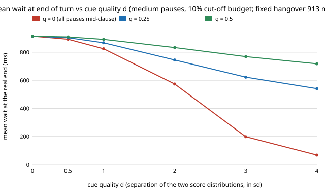

# ambient-semend: can a "this sentence is complete" cue let a voice assistant stop waiting so long before it replies? (stylised model on assumed pauses)

Track 2 (ambient AI assistant), follow-up to [`ambient-speculate`](../ambient-speculate), whose result 5 said a
single fixed end-of-speech hangover "cannot separate paused from finished" when pauses are long or widely
spread. Rather than another variant of that sweep, this asks the obvious next question: what if the endpointer
also looks at *what was said*? Produced with AI assistance. **Stylised**: the completeness cue is a
signal-detection model (two unit-variance Gaussians `d` apart), pause durations are an assumed lognormal,
and no audio, transcript or language model was used. Only the 682 ms median reply chain is measured
(from `ambient-pipeline`).

**Live page:** https://duncan-haywood.github.io/monorepo-projects/research/ambient-semend/

## Question

An always-on assistant must decide when you have finished speaking. A short hangover (silence it waits for)
makes replies quick but cuts you off at mid-sentence pauses; a long one is safe but slow. If a cue says
"the sentence is complete" with quality `d`, the assistant can wait `Hs` after a complete-looking sentence
and a longer `Hl` otherwise. How much does the mean wait fall for a given cut-off budget, and how good must
the cue be?

## Headline (medium pauses: 2 per turn, median 250 ms, lognormal sigma 0.8; 10% of turns may be cut off)



- **Fixed hangover:** 913 ms keeps cut-offs at 10%. A cue with no information (`d` = 0) gives no gain (915 ms
  on the grid; the 2 ms is grid slack).
- **A good cue helps a lot only if pauses sit mid-clause.** With no pause at a complete point (`q` = 0) the mean
  wait falls to 825 ms at `d` = 1, 574 ms at `d` = 2 and 67 ms at `d` = 4 (Hs = 50 ms, Hl = 1450 ms).
- **But people pause at clause boundaries.** If a quarter of pauses (`q` = 0.25) sit where the cue sees a
  complete sentence, the cue is blind to them and the best wait is 868, 753 and 572 ms at `d` = 1, 2, 4. At
  `q` = 0.5 it is 892, 837 and 752 ms. The cue's value is capped by the share of pauses it can see.
- **The gain grows when a fixed hangover is hopeless.** With long pauses (median 400 ms) at a 5% budget a fixed
  hangover needs 1902 ms; a cue with `d` = 3 and `q` = 0 needs 571 ms. With wide-spread pauses (sigma 1.2) the fixed
  hangover is 2592 ms at 5%, against 873 ms at `d` = 3, `q` = 0.
- **Reply latency** adds the 61 ms endpoint offset and the 682 ms median chain: at 10% cut-off, medium pauses,
  `d` = 2 and `q` = 0 the reply arrives in 1317 ms against 1656 ms with the fixed hangover (913 + 61 + 682).
- Closed forms agree with a 200,000-turn Monte Carlo (cut-off within 0.002, wait within 1.2 ms).
- Full tables: `experiments/results.txt` (4 pause models x 2 budgets x 6 values of `d` x 3 values of `q`).

## Builds on (and does not claim affiliation with)

- `research/ambient-speculate` and `research/ambient-pipeline` in this repository: the pause model's form and the
  measured chain (copied to `experiments/inputs.json`; the project stays self-contained).
- Equal-variance signal detection (`d'`) is textbook; two-threshold (short or long) timeout rules for
  endpointing are an obvious design, and I claim nothing as new. I did not search the turn-taking or
  endpointing literature and cite no paper for any number. No lab from `prompt.md` is built on; there is no lab tag.

## Method (`src/ambient_semend/model.py`)

At the start of each silence a cue scores completeness. A real end scores N(+d/2, 1). A within-turn pause
scores N(-d/2, 1) if it sits mid-clause; with probability `q` it sits at a complete point and scores like a
real end. Score above `tau` means wait `Hs`, else `Hl` (Hs <= Hl). Pauses per turn are Poisson; a pause longer
than the hangover it receives cuts the turn off. So `P(cut-off) = 1 - exp(-n [FPR sf(Hs) + (1-FPR) sf(Hl)])`
and the mean wait at the real end is `TPR Hs + (1-TPR) Hl`, with `TPR = Phi(d/2 - tau)` and
`FPR = q TPR + (1-q) Phi(-d/2 - tau)`. `best` grid-searches Hs (50 to 1000 ms), Hl (100 to 3000 ms) and
`tau` (-3 to 3) for the lowest mean wait within the budget. The fixed baseline is solved by bisection.

## Limitations (what the twin leaves out)

- **Pause durations and the cue are assumed.** No speech, transcript or language model was used. A real
  completeness cue (a small text model on the partial transcript, prosody, or both) has an unknown `d`, and
  its scores are not Gaussian or independent of pause length. `q` is a free parameter, not an estimate.
- **Pause length is independent of the cue.** In real speech a pause at a clause boundary tends to be longer
  and a hesitation mid-clause shorter, which would help or hurt differently; not modelled.
- **Grid slack.** Results at `d` = 0 or large `q` can exceed the exact fixed hangover by 3 to 4% because
  `tau` is limited to [-3, 3] and times to 50 ms steps. "none" in `results.txt` means no setting with Hl up to
  3000 ms met the budget.
- **Cut-off cost and latency cost are not weighed.** The budget is a hard cap; no listening study says which
  latency feels natural, and the cost of a cut-off turn (re-asking) is not modelled.
- **Only the mean wait is optimised**, not its tail: a wrong "incomplete" call waits `Hl` in full.

## Reproduce

```
pip install -e . pytest
pytest -q tests
python experiments/run.py      # writes experiments/results.txt (seconds)
python experiments/figure.py   # writes experiments/wait_vs_cue.svg
```

## Next steps

- Measure `d` and `q` for a real partial-transcript completeness classifier on a consented, labelled
  conversation corpus (a text-only baseline first), and replace the assumed cue.
- Let the long hangover depend on the cue score (a continuous hazard) instead of two levels.
- Combine with the `ambient-speculate` hold policy: speculate during `Hl` only when the cue says incomplete.

## Outside dependencies

None beyond numpy (and pytest for the tests). The reply chain comes from `ambient-pipeline`; no model,
dataset, service or hardware is used here.
