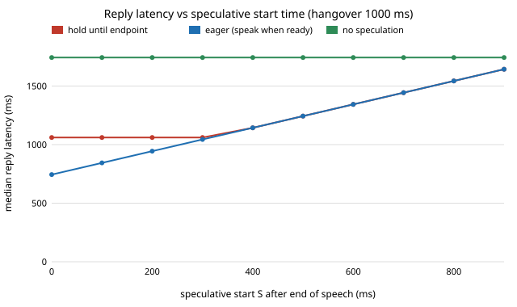

# ambient-speculate: how much reply latency can an always-on assistant hide by starting its pipeline before the speaker has finished? (measured stage times, assumed pauses)

Track 2 (ambient AI assistant), follow-up to `ambient-pipeline` (its "Next steps": overlap the stages
instead of running them in sequence after end of speech). I asked a new question rather than another
variant of the stylised utility models: the chain of ASR, LLM and TTS takes about 0.7 s, and the
end-of-speech hangover takes 0.2 to 1.2 s, so the two can overlap. Produced with AI assistance.
**Partly measured, partly assumed**: the stage times are the measured ones from `ambient-pipeline`
(one run, six synthetic utterances, one server CPU); how long people pause inside a turn is **my
assumption**, swept over five settings, and nothing here is a claim about real speakers or a phone.

**Live page:** https://duncan-haywood.github.io/monorepo-projects/research/ambient-speculate/

## Motivation

`ambient-pipeline` found that a reply costs the hangover (the silence the VAD waits for before it
believes the turn is over) plus ASR, an LLM first sentence and a TTS first chunk, run one after the
other. A long hangover avoids cutting people off at a mid-sentence pause but adds its whole length
to every reply. If the chain starts after only S ms of silence, on the transcript so far, its time
can be spent *during* the hangover. If the speaker resumes, the run is wasted.

## Builds on (and does not claim affiliation with)

- `research/ambient-pipeline` in this repository: the per-utterance ASR, LLM and TTS times and the
  measured endpoint offsets (copied to `experiments/inputs.json`; the project stays self-contained).
- Speculative execution is an old idea in systems; I do not claim it as new for voice assistants and
  did not search the literature for prior voice-agent work. No citation is made beyond the
  repository's own measurements.

No research group from `prompt.md` is built on; there is no lab tag.

## Method (`src/ambient_speculate/model.py`)

Times are from the true end of the last word. Chain C<sub>i</sub> = ASR + LLM first sentence + TTS
first chunk of measured utterance i (531 to 803 ms, median 682). The endpoint fires at H + 61 ms (mean
of the four measured offsets). Policies:

- **Baseline(H):** reply = H + 61 + C<sub>i</sub>.
- **Hold(S, H):** the chain starts at S + 61 ms of silence; the reply is held until the hangover H
  confirms the turn is over: max(H + 61, S + 61 + C<sub>i</sub>). Never faster than the endpoint, never
  slower than baseline, and no extra risk of talking over anyone.
- **Eager(S):** speak as soon as the speculative chain finishes: S + 61 + C<sub>i</sub>. Faster, but talks
  over the speaker if they resume in that window.

Pause model (assumed): a Poisson number of within-turn pauses per turn (mean 2), each lognormal with a
median of 150 to 400 ms. A pause longer than H cuts the turn off. A pause longer than S that ends before
H starts a speculative run baseline(H) would not have started (an "extra run"); I count it as one full
chain, which is an upper bound because a run can be cancelled early. Closed forms are checked against a
60,000-turn Monte Carlo in `tests/test_model.py` (agreement within 0.015).

## Results (`experiments/results.txt`)

Baseline median reply latency (6 measured utterances): 944 ms at H = 200, 1044 at 300, 1244 at 500, 1544
at 800, 1744 at 1000, 1944 at 1200.



1. **Hold saves exactly min(chain, H &minus; S).** Starting early enough hides the whole chain: at H = 1000
   the median reply drops from 1744 to 1061 ms (a 682 ms saving, the median chain) once S &le; 300 ms. The
   floor is the endpoint itself (H + 61), so speculation only helps when H is long. This is arithmetic on
   the measured times, not a surprise.
2. **The cheapest start that still hides everything is just in time:** S = H &minus; max chain. Under the medium
   pause model at H = 1000 that is S = 197 and 1.15 extra runs per turn; starting at S = 0 costs 1.92.
   Waiting longer saves compute but gives back latency (S = 500: 1244 ms, 0.30 extra runs).
3. **Speculation moves the cut-off versus latency trade-off.** To hold cut-offs under a budget you must
   lengthen H. For example, with medium pauses a 10% cut-off budget needs H = 1000 ms (8.0% cut-off) and
   a 1744 ms baseline reply; hold with a just-in-time start gives 1061 ms at the same cut-off rate, at
   the price of about one extra pipeline run per turn. With short pauses (median 150 ms) a 5% budget
   needs H = 800 ms: 1544 ms baseline, 861 ms with an immediate start.
4. **Eager replies are fast and rude.** Eager(S = 200) answers in 944 ms at H = 1000, but with medium pauses
   there is a pause that resumes inside the window in 57% of turns (37% with short pauses). Eager needs a talk-over cost in the objective; I did not put one
   in, so I make no recommendation about it.
5. **The answer depends on the pause model.** With median 400 ms pauses, or a wide spread (sigma 1.2), no hangover in
   the grid (up to 1.2 s) meets even a 10% cut-off budget: a fixed hangover cannot separate
   "paused" from "finished" in that regime, and speculation does not fix that.

## Limitations (what the twin leaves out)

- **Pause durations are assumed.** Lognormal, mean 2 pauses per turn, five hand-picked settings.
  No pause data was used and I did not review the literature on within-turn pauses; results 1 and 2
  are arithmetic on the measured times, the cut-off numbers are only as good as this assumption.
- **Stage times from six synthetic utterances on one server CPU**, 4 threads, one run. A phone is
  slower and its stages contend for cores while speculation runs, which this model ignores.
- **The chain is assumed unchanged by the extra partial-transcript runs.** Real ASR and LLM runs on a
  prefix may differ from the final run (a different transcript, a different first sentence); here the
  speculative result is the final result whenever speech does not resume.
- **Wasted work is counted in runs, not joules or dollars**, and as full chains (an upper bound).
- **A pause longer than H is exactly a cut-off**, ignoring frame quantisation (about 32 ms) and the
  VAD's own errors; the cut-off turn's later reply is not modelled.
- **No listening study**: which latency feels natural is not measured here.

## Reproduce

```
pip install -e . pytest
pytest -q tests
python experiments/run.py      # writes experiments/results.txt
python experiments/figure.py   # writes experiments/latency_vs_start.svg
```

## Next steps

- Measure pause durations on a real, consented conversation corpus and replace the assumed model.
- Run ASR and the LLM on a prefix for real, to measure how often the speculative reply differs from the
  final one, and add cancellation to cut the wasted cost.
- Put a talk-over cost into the objective and choose between hold and eager by expected utility, in
  the `ambient-interject` framework.

## Outside dependencies

None beyond numpy (and pytest for the tests, matplotlib not needed). The stage times come from the
models measured in `ambient-pipeline`; no model, dataset, service or hardware is used here.
