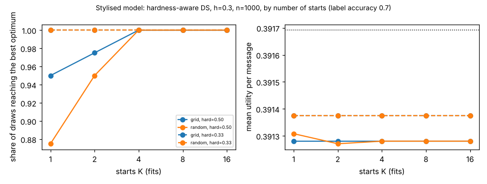

# ambient-startcount: how many starts does a likelihood-ranked multi-start need, and are grid starts better than random ones? (stylised utility model)

Track 2 (ambient AI assistant), follow-up to `ambient-multistart` (its second "Next step": compare 2, 4, 8 and 16 starts, and random starts, at equal compute). Produced with AI assistance. **Stylised, simulated results only**: every parameter is a round figure I chose, the classifier and auditors are made-up uniform-error confusion matrices, and nothing is a claim about a real user, device or product. It seemed worth doing because `ambient-multistart` fixed 8 grid starts once and never asked whether that is too many or too few.

## Builds on (and does not claim affiliation with)

- `research/ambient-multistart` (and through it `ambient-third`): the utility model, simulator and hardness-aware three-auditor Dawid-Skene EM (dsH3). `src/ambient_startcount/{sim,est}.py` are copies; the nested grids, random starts and `best_of_first` are added at the end of `est.py`.
- Dawid and Skene (1979), "Maximum likelihood estimation of observer error-rates using the EM algorithm", *Applied Statistics* 28(1), 20-28 (citation from memory, not re-read here).

No research group from `prompt.md` is built on; there is no lab tag.

## Method

Same data model as `ambient-multistart`: three auditors of overall accuracy 0.8, a fraction h of messages hard for all three, classifier label accuracy 0.7. Per simulated data set, dsH3 is fitted once from each of 16 nested grid starts (the first 8 are `ambient-multistart`'s grid; 1, 2 and 4 starts are prefixes of it; the last 8 add hard accuracy {0.3, 0.5}) and once from each of 16 random starts (easy accuracy U(0.7, 1), hard accuracy U(0.3, 0.7), P(hard) U(0.05, 0.5)). A K-start strategy keeps the highest-log-likelihood fit among its first K, so compute is K fits (same iteration cap 2000 and tolerance 1e-10 for every fit; I did not count iterations). "Hit" = the kept fit's per-message log-likelihood is within 1e-7 of the best of all 32 fits for that data set. Cells: h = 0 (null), h = 0.3 with hard accuracy 0.5, and h = 0.3 with hard accuracy 1/3; n = 200 and 1000; 40 draws each. "Degenerate" is the same ad hoc flag as before (P(hard) above 0.45 or below 0.02).

## Reproduce

```bash
cd research/ambient-startcount
pip install numpy pytest matplotlib
PYTHONPATH=src python3 -m pytest -q tests        # 5 tests
PYTHONPATH=src python3 experiments/run.py > experiments/results.txt   # about 20 minutes; also writes experiments/startcount.png
```

## Results (all from `experiments/results.txt`)

Reference: blind 0.3824; true-parameter Bayes 0.3917.

1. **When hardness is strong or the sample is large, one start is almost enough.** At h = 0.3, hard accuracy 1/3, n = 1000, every strategy at every K hits 100%. At hard accuracy 0.5, n = 1000, a single grid start hits 95% and a single random start 88%; K = 4 hits 100% for both.
2. **The hard cell is small n with mild hardness (and the null).** At h = 0.3, hard accuracy 0.5, n = 200: grid K = 1, 2, 4, 8, 16 hit 72%, 78%, 85%, 85%, 97%; random K = 1, 2, 4, 8, 16 hit 62%, 75%, 82%, 88%, 93%. At h = 0, n = 1000: grid 30%, 33%, 55%, 57%, 97%; random 33%, 38%, 60%, 70%, 72% for K = 1, 2, 4, 8, 16. More starts keep finding better optima there; 8 starts is not enough in the null cell.
3. **Grid vs random is mixed.** The 16-start grid beats 16 random starts in several cells (h = 0.3, hard 0.5, n = 200: 97% vs 93%; null, n = 1000: 97% vs 72%) and loses elsewhere (null, n = 200: 90% vs 88% is a tie; h = 0.3, hard 1/3, n = 200: grid plateaus at 97% from K = 2 while random reaches 100% at K = 16). K = 4 and K = 8 grids give identical results in several cells because the extra grid points never win. I would not claim either design is better on this evidence.
4. **The remaining log-likelihood gaps do not change the decision.** Mean utility differs by at most about 0.0002 across all K and both designs within a cell (for example 0.3897-0.3899 at h = 0.3, hard 0.5, n = 200; true-parameter Bayes is 0.3917). Fitted P(hard) moves by a few hundredths with K at n = 200 and is essentially identical at n = 1000 for h = 0.3. The degenerate share is not reduced by more starts at n = 200 (23-35% at hard accuracy 0.5, with the best-likelihood fit itself degenerate): that is finite-sample noise in the optimum, not a failed search.
5. **Where more starts help is the null.** At h = 0 the likelihood is nearly flat in P(hard), so many near-ties exist and "hit" counts differ for reasons that do not matter: utility is 0.3895-0.3912 at every K.



## Practical reading (stylised)

For hardness-aware EM in this model, 4 starts of either kind are enough when hardness is present (h = 0.3) and either strong or n is around 1000 (hit 93-100%); spending more compute improves the likelihood in the weak-hardness, small-sample and null cells but not the utility of the resulting policy. A cheap rule: use 4 starts, and more only if the fitted hard share is itself going to be reported.

## Limitations

- One dependence model, uniform errors, equal auditors, one class mix, one label accuracy (0.7); dsH3 has the generator's structure built in.
- "Hit" is judged against the best of the 32 fits I ran, not a proven global optimum, and some gaps may reflect hitting the 2000-iteration cap rather than a distinct local optimum; I did not separate the two.
- Compute is counted as fits, not iterations or seconds. 40 draws per cell, so shares have a standard error up to about 0.08 and differences of one or two draws (0.025-0.05) are noise.
- The grids and the random-start ranges were chosen once, not tuned.
- Citation from memory, not re-read.

## Next steps

- Count EM iterations (and wall time) per fit so "equal compute" is exact; separate cap-limited fits from true local optima by raising the cap.
- A likelihood-ratio test of h = 0 against h > 0 (the open step from `ambient-multistart`, result 4).
- Hardness that also affects the classifier.

## Outside dependencies

None beyond numpy (plus pytest and matplotlib). No model, dataset, service or hardware is used.
