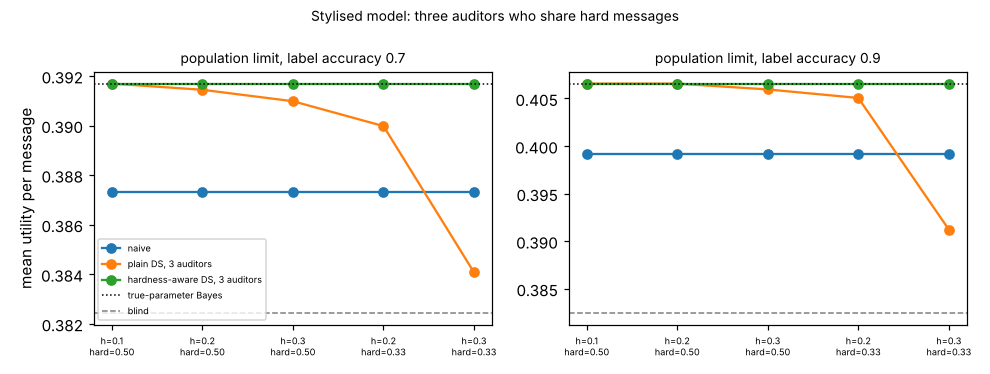

# ambient-third: does a third auditor identify the hard-message share, and what does it do to plain Dawid-Skene? (stylised utility model)

Track 2 (ambient AI assistant), follow-up to `ambient-dshard` (its second "Next step": a third auditor). Produced with AI assistance. **Stylised, simulated results only**: every parameter is a round figure I chose, the classifier and auditors are made-up uniform-error confusion matrices, and nothing is a claim about a real user, device or product.

**Live page:** https://duncan-haywood.github.io/monorepo-projects/research/ambient-third/

## Motivation

`ambient-dshard` found that with two auditors who share errors on hard messages, a hardness-aware EM recovers the classifier but cannot identify the hard share (a one-parameter family fits the same joint). Does a third auditor change that, and does it help or hurt plain Dawid-Skene (DS)?

## Builds on (and does not claim affiliation with)

- `research/ambient-dshard`, `ambient-dscorr`, `ambient-dsaudit` in this repository: the utility model (48 contexts, 3 urgency classes), Bayes policy and estimators. `src/ambient_third/{sim,est}.py` are copies, with the three-auditor functions (`joint3_hard`, `draw3_hard`, `estimate_ds3`, `estimate_ds3_hard`) added at the end of `est.py`.
- Dawid and Skene (1979), "Maximum likelihood estimation of observer error-rates using the EM algorithm", *Applied Statistics* 28(1), 20-28 (citation from memory, not re-read here).

No research group from `prompt.md` is built on; there is no lab tag.

## Method

Same hard-message model as `ambient-dshard`, with three auditors: a message is hard with probability `h` for all three, who then use accuracy `hard_acc`; on easy messages they use an accuracy chosen to keep each auditor at 0.8 overall. Given hardness and the true class the auditors and the classifier (label accuracy 0.7 or 0.9, unaffected by hardness) are independent. Estimators, scored exactly under the truth as the mean utility over 48 contexts: **naive** (auditor 1 as truth), **ds3** (plain DS, three auditors, each with its own matrix) and **dsH3** (hardness-aware DS, latent flag, matrices shared by the auditors; it has the generator's structure built in, so it is a best case). Finite cells: n = 200 and 1000, 40 audit sets each. The identification check fits the population joint from several starts and also repeats finite-sample fits.

## Reproduce

```bash
cd research/ambient-third
pip install numpy pytest matplotlib
PYTHONPATH=src python3 -m pytest -q tests        # 5 tests
PYTHONPATH=src python3 experiments/run.py > experiments/results.txt   # about 2 minutes; also writes experiments/third.png
```

## Results (all from `experiments/results.txt`)

Reference: blind 0.3824; true-parameter Bayes 0.3917 (label 0.7) and 0.4066 (label 0.9).

1. **A third auditor identifies the hard share at the population level.** Fitting the population joint at label 0.7, h = 0.3, hard accuracy 0.5 from four informed starts gives P(hard) = 0.300, easy accuracy 0.929, hard accuracy 0.500, classifier accuracy 0.700 every time, with the same log-likelihood. With two auditors the same fit gave P(hard) from 0.24 to 0.35. (Test `test_hard_ds_recovers_classifier_and_hard_share_from_three_starts`.) A fifth, poor start (0.8, 0.8, 0.5, 0.6: no easy/hard difference) stays at a degenerate point with P(hard) 0.5, no easy/hard difference and a lower log-likelihood (-3.4187 vs -3.4009 per message), so the start still matters; the estimator is only locally reliable.
2. **Finite samples identify it only loosely.** Starting at the truth-near guess, the estimated P(hard) (truth 0.300) over 20 draws has mean 0.337, sd 0.074, range 0.246-0.494 at n = 1000, and mean 0.299, sd 0.038, range 0.246-0.383 at n = 5000.
3. **dsH3 recovers the policy.** Population utility equals the true-parameter value to four decimals in every cell; at n = 1000 it is within 0.0005 of it (for example 0.3912-0.3914 vs 0.3917 at label 0.7, 0.4064-0.4065 vs 0.4066 at label 0.9).
4. **More auditors make plain DS worse in the extreme cell, and it can fall below naive.** At h = 0.3 with hard messages at chance, DS reads the three auditors as 0.854 (label 0.7) and 0.848 (label 0.9) accurate against a true 0.8, and its population utility is 0.3841 (label 0.7, naive 0.3873) and 0.3912 (label 0.9, naive 0.3992), where in `ambient-dshard` the two-auditor DS only matched naive (0.3992 at label 0.9). At label 0.7 it is barely above blind (0.3824), and at n = 200 DS fell below blind in 17% of audit sets (0.00 for dsH3). In milder cells DS stays above naive (for example 0.4060 vs 0.3992 at label 0.9, h = 0.3, hard accuracy 0.5). Mechanism, not tested directly: three agreeing auditors look like stronger evidence of correctness, so the independence assumption is more wrong.



## Limitations

- One dependence model (binary hardness shared by all auditors, uniform errors, equal auditors, one class mix). Results 1-4 are for this model only.
- dsH3 matches the generator's structure and is started near the truth; the degenerate start in result 1 shows it is not robust to the start. A wrong structure (class-specific hardness, hardness that also affects the classifier) is untested.
- 40 audit sets per finite cell and 20 draws for result 2, so differences of 0.0001-0.0003 at finite n are within sampling noise. Citation from memory, not re-read.

## Next steps

- Hardness that also affects the classifier, which makes the shared flag informative about it.
- Multi-start or likelihood-ranked starts for dsH3 so the degenerate point is rejected without a good guess.
- Use one cheap and one expensive auditor with different dependence on the classifier.

## Outside dependencies

None beyond numpy (plus pytest and matplotlib). No model, dataset, service or hardware is used.
