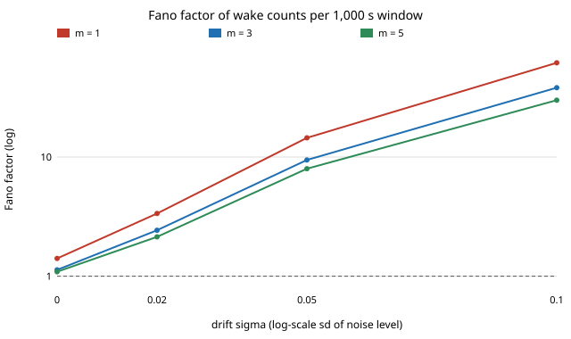

# ambient-wakeburst: how much do an always-on trigger's false-wake counts vary from one stretch to the next, and what does a lockout buy?

Track 2 (ambient AI assistant), a follow-up to [`ambient-falsewake`](../ambient-falsewake), which computed the *expected* false wakes per day and listed the day-to-day spread as a next step. Produced with AI assistance. **Stylised**: the detector score is a Gaussian AR(1) process, not the output of a real wake-word model, and no audio was used.

**Live page:** https://duncan-haywood.github.io/monorepo-projects/research/ambient-wakeburst/

## Question

A trigger fires after `m` frames in a row at or above a threshold. Its mean false-wake count is known, but a user feels the *spread*: a quiet day and a day with a burst of wakes. The Fano factor (variance / mean of the count in a window) is 1 for a Poisson count. Do correlated frame scores make counts burstier than Poisson, does a drifting noise level, and does a lockout (ignore wakes for `L` frames after one) help?

## Headline (counts per 100,000-frame window, i.e. 1,000 s; 2,000 windows per cell; threshold calibrated to about 50 wakes a window)

- **Correlation alone barely matters.** On stationary AR(1) scores the Fano factor is 1.05 (m = 5) to 1.48 (m = 1) at phi = 0.9, and 1.46 at phi = 0.95 (m = 3). Counts are close to Poisson.
- **A drifting noise level is what makes counts bursty.** If the score scale changes between windows by a lognormal factor `exp(sigma*z)`, the Fano factor at phi = 0.9, m = 3 goes 1.13 (sigma 0), 2.4 (0.02), 9.4 (0.05), **38 (0.10)**. m = 1 is worse (62 at sigma 0.10) and m = 5 slightly better (30). A 5% change in noise scale already makes the variance about ten times the mean, while the mean moves only 4%. This is a property of any tail event: a small scale change moves a far-tail rate a lot.
- **A lockout helps with burstiness mostly by removing wakes.** With no drift, a lockout of 1,000 frames (10 s) gives Fano 0.47 but also cuts the mean from 51 to 32 wakes a window; with sigma = 0.05 it cuts Fano from 9.8 to 2.5 and the mean from 54 to 32. A 10 to 50 frame lockout (0.1 to 0.5 s) changes the mean by 5 to 10% and the Fano factor by about 10 to 20%. It does not remove drift-driven burstiness.
- **Window length does not change the Fano factor here** (9.5, 9.5, 9.8 for windows 1x, 4x, 16x at sigma = 0.05), because the drift is drawn independently per window. Drift that persists for hours would give a Fano factor growing with the window; I did not simulate that.



## Builds on (and does not claim affiliation with)

- No lab from `prompt.md` is built on; there is no lab tag. Fano factors for point processes are textbook; nothing here is claimed as new theory. The setup (m consecutive frames, AR(1) scores) is that of `ambient-falsewake`; I cite no paper for any number.

## Method

`src/ambient_wakeburst/sim.py`. AR(1) scores are generated in vectorised chunks (`ar1`, checked against the moments and autocorrelation in the tests). A wake is the frame where a run at or above the threshold first reaches `m` frames. `lockout` drops wakes within `L` frames of the last kept one. `simulate_counts` counts wakes in independent windows, each with its own noise scale. Thresholds are calibrated by bisection on a 100-window pilot (seed 5) to about 50 wakes a window, so the cells have comparable means. The Fano interval is a percentile bootstrap over windows (1,000 resamples).

## Reproduce

```bash
cd research/ambient-wakeburst
pip install numpy pytest matplotlib
PYTHONPATH=src python3 -m pytest -q tests                              # 9 tests, a few seconds
PYTHONPATH=src python3 experiments/run.py > experiments/results.txt    # about 15 minutes
python3 experiments/figure.py                                          # writes experiments/fano_vs_drift.svg
```

## Results

All numbers are in `experiments/results.txt`: A stationary cells, B drift, C lockout, D window length, E the figure's data.

## Limitations

- **Windows are 1,000 s at about 50 wakes**, not a day at about 1 wake. The deployed target is far rarer; the Fano factor from drift grows with the mean (variance is about `mean^2 * CV^2`), so at 1 a day the same drift gives a Fano factor nearer 1 but a heavy tail in the daily count. I did not simulate that rate.
- **Drift is i.i.d. lognormal per window and applies to the score scale.** Real changes (day and night, a TV on) are autocorrelated and not lognormal; the sigma values are assumed, not measured.
- **Gaussian AR(1) is a model, not a detector**, and speech-like background is bursty in ways this does not capture (see `ambient-falsewake`).
- The phi = 0.5 cell needed a different chunk length in the AR(1) generator; a test covers it. Fano estimates of 1.05 to 1.2 for stationary cells are within about 2 bootstrap half-widths of each other, so I do not rank them.

## Next steps

- Persistent drift (an AR(1) noise scale across windows) and the Fano factor as a function of window length.
- Rare-event version: daily counts at 1 wake a day with importance sampling.

## Owner steps

None.

## Outside dependencies

numpy, pytest, matplotlib. No model, dataset, service or hardware.
