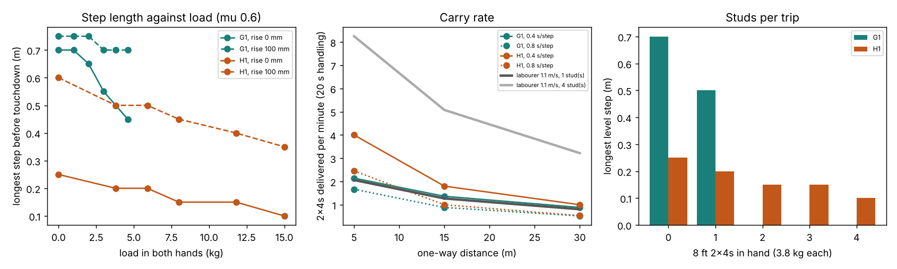

# buildbot-carry: how long a step can a stock Unitree G1 or H1 take with a stud in its arms, and does that beat a labourer's carry rate?

Fourth project of track 20, robots on the residential building site (`PROJECTS.md`, milestone 3). [`buildbot-payload`](../buildbot-payload) showed what a standing humanoid can hold; this asks what it can hold while walking. It is a **model-based envelope, not a learned walking policy and not a falls-and-drops score**: the milestone's learned policy, falls, drops and energy per item are still open (see Limitations). Produced with AI assistance (Claude).

**Live page:** https://duncan-haywood.github.io/monorepo-projects/research/buildbot-carry/

**Headline.** For the instant before touchdown (the hardest of a step) with a stud-carry pose (reach 0.3 m, height 0.6 m), the simulated **G1 can take a 0.70 m step unloaded, 0.50 m with one 3.8 kg 2x4, and 0.45 m at 4.6 kg** (its waist pitch motor binds under load). It **cannot carry two studs** (7.6 kg is above its static capacity). The **H1 takes 0.25 m unloaded, 0.20 m with one stud and 0.10 m with 15 kg**, and cannot step up a 7¾ in (0.197 m) riser at all. Friction matters: at mu 0.3 the G1's loaded step halves to 0.35 m. Turned into carry rates (8 ft 2x4s, 5 to 30 m trips, 20 s handling, step time 0.4 to 0.8 s): a G1 carrying one stud delivers **0.64 to 1.10 times** what a labourer carrying one stud at 1.1 m/s does and **0.16 to 0.27 times** what a labourer with a bundle of four does; an H1 carrying 3 to 4 studs gets **0.66 to 1.94 times** the one-stud labourer and **0.16 to 0.48 times** the bundle-carrier. So under these assumptions neither robot beats a labourer who takes a bundle; the H1 beats one who takes a single stud when the trip is short.



**Not a rated speed or a safety case.** Community models at peak torque, one stated gait, nothing tested on hardware. The H1 numbers are far below what Unitree claims for it (3.3 m/s peak, a vendor claim) because this gait is restrictive (below); do not read them as its walking ability. A robot carrying lumber near people is a falling-object hazard needing a risk assessment (ISO 10218, ISO/TS 15066).

## Method (`src/buildbot_carry/model.py`; builds on `buildbot_payload`)
- **The instant.** In the linear inverted pendulum model with the zero-moment point (ZMP) held at the stance foot's sole point, a periodic gait of step length L has its worst moment just before touchdown: the swing foot is about to land L ahead of (and `s` higher than) the stance foot, the centre of mass (CoM, robot plus load) is L/2 ahead of the stance sole point, and it accelerates forward at a = g (L/2) / h, h being its height over the sole.
- **Pose** (`stride_pose`). Whole-body inverse kinematics (the Levenberg-Marquardt solver of `buildbot_payload`): stance sole planted flat, swing sole flat at its landing spot, feet 0.2 m apart sideways (the Menagerie home poses stand wider, ±0.2 m for the H1, which made even a 0.3 m step unreachable; 0.15 to 0.25 m is swept), both hands at the carry pose, CoM at the target above. The H1 has no ankle roll joint, so its soles are left free to tilt about their forward axis (edge contact).
- **Torques** (`stride_torques`). Gravity is tilted by a (d'Alembert), the load enters at the hands, and the stance foot's 6-component ground wrench balances the floating base. The tests check the result against MuJoCo's forward dynamics (every acceleration below 10<sup>-6</sup>) with contacts and stops disabled. A step passes if every joint is inside its peak torque (the `actuatorfrcrange` or `ctrlrange` of Menagerie, as in `buildbot_payload`), the ground force is positive and the friction needed, a/g, is at most mu (0.6 by default, swept 0.3 to 0.6).
- **Step length** (`max_step`). The longest step on a 5 cm grid, warm-starting the IK from the last solved step (a long step fails from the home pose); stops after two failing lengths in a row.
- **Rate** (`carry_rate`, `best_pieces`). Trip time = 2D/v + handling; v = min(L/T, vendor peak). The robot picks how many studs per trip to maximise its rate; for the labourer I show one stud and a bundle of four.

| Input | Value | Source |
|---|---|---|
| Models | G1, H1 at Menagerie `cda5236f` | BSD-3-Clause, fetched not copied (`buildbot-payload`) |
| Stud | 8 ft SPF 2x4, 3.8 kg; carry pose reach 0.3 m, height 0.6 m | `buildbot-payload`, `buildbot-taskbook` |
| Riser | 0.197 m (7¾ in) | IRC R311.7.5.1 maximum riser (my recollection of the code; not re-checked this run) |
| Vendor walking speed | G1 2 m/s, H1 3.3 m/s | Unitree's claims: G1 launch release (May 2024, seen in search results), H1 product page; peaks, unloaded |
| Labourer speed | 0.83, 1.1, 1.4 m/s | no primary source read. 0.83 m/s is the 3 km/h of a load-carriage treadmill study at 20 kg (PMC5260636, found by search and not opened); the rest bracket it. The tables show 1.1 |
| Step time T, handling time, distance, labourer bundle of 4, friction mu, foot gap | swept | **not sourced**: no robot figure was found |

## Reproduce
```bash
pip install mujoco numpy matplotlib pytest
cd research/buildbot-carry
python -m pytest -q tests          # 7 tests; first run clones the two models (git + network)
python experiments/run.py > experiments/results.txt   # about 8 min on one CPU, deterministic
python experiments/figure.py
```

## Results (`experiments/results.txt`, `results.json`)
- **G1, level ground, mu 0.6.** Longest step 0.70 m unloaded and with 1 kg, 0.65 at 2, 0.55 at 3, 0.50 at 3.8, 0.45 at 4.6 kg. The binding joint at the longest step moves from the ankle pitch (0 to 1 kg) to the hip roll (2 kg) to the waist pitch (3 kg and above; 0.87 of its limit at 4.6 kg). It steps up a 0.197 m riser with up to 3.8 kg (0.75 m), but with 4.6 kg only 0.05 m passes, which I did not investigate.
- **H1.** 0.25, 0.20, 0.20, 0.15, 0.15, 0.10 m at 0, 3.8, 5.9, 8, 11.8, 15 kg; the ankle then the hip pitch binds (0.93 of the limit at 15 kg). No step passes for a 0.197 m riser. The longest step is not monotone in the rise (0.25 level, 0.60 at 0.10 m, 0.50 at 0.15 m): I read it as a pose artefact of the flat-sole, straight-stance model, not a finding, and did not resolve it.
- **Sensitivity.** Foot gap 0.15 to 0.25 m changes the G1's loaded step by 0.05 m and the H1's by 0.1 m. At mu 0.3 the G1 drops to 0.35 m both unloaded and loaded; the H1 is unaffected (reach-limited).
- **Carry rate** (20 s handling, labourer 1.1 m/s). G1 (one stud, 1.25 to 0.62 m/s as T goes 0.4 to 0.8 s): 0.88 to 2.14 studs/min against 0.80 to 2.06 for a one-stud labourer, and 3.2 to 8.3 for a bundle of four. H1 (3 to 4 studs at 0.19 to 0.37 m/s): 0.53 to 4.00 studs/min. The vendor cap never binds.

## Limitations
- **Not a walking policy.** No simulation of a walking controller, so no falls, dropped items, slip or metres-per-minute were measured, and no energy per item (no sourced motor constants). The milestone's scoring over `terrain-twin` ramps is not done; only a flat step and a riser are.
- **Restrictive, so not a bound.** Flat soles, ZMP at the sole point (the ZMP check in the tests is true by construction), CoM exactly L/2 ahead at touchdown, no double support and no foot-roll rocking. It leaves out swing-leg inertia, angular momentum, joint speeds, impacts and lateral sway. The H1's 0.25 m versus Unitree's 3.3 m/s claim shows the gait, not the robot, is limiting.
- **The labourer side is mine.** Speed, bundle size and handling time are assumptions; the conclusions about the bundle-carrier follow from the bundle size I chose.
- **Peak torque, static pose** at the carry pose of `buildbot-payload`; continuous torque is lower. The non-monotone H1 rise result and the G1 4.6 kg riser result are unexplained.

## Next steps
Rock the CoM and shift the ZMP within the foot to relax the gait; train or hand-tune a walking controller on these poses and score falls and drops in MuJoCo; add ramps and thresholds from `terrain-twin`; replace the labourer assumptions with a time study.

## Owner steps
None needed. A hardware trial would need a G1 or H1, a risk assessment against ISO 10218 and ISO/TS 15066, and a spotter.

## Outside dependencies (vitamins)
MuJoCo (Apache-2.0), NumPy, Matplotlib, pytest; reads `../buildbot-payload`, whose Unitree models come from MuJoCo Menagerie (BSD-3-Clause, © Unitree Robotics). No group in `prompt.md` covers construction, and none is claimed.
