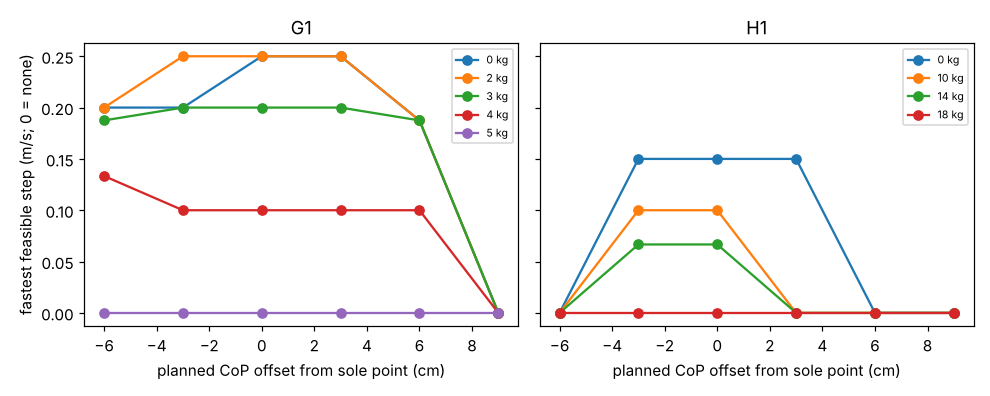

# buildbot-carrycop: does planning the centre of pressure off the middle of the sole let a stock humanoid carry faster?

Track 20, robots on the residential building site (`PROJECTS.md`, milestone 3). It tests the first idea in [`buildbot-carryphase`](../buildbot-carryphase)'s "Next steps" and [`buildbot-carry`](../buildbot-carry)'s ("shift the ZMP within the foot"): the carry gait there plans the centre of pressure (CoP) at the middle of the stance foot, and its speeds were called lower bounds because the CoP leaves the sole before a torque limit binds. If the plan puts the CoP at a better place on the sole, does the Menagerie G1 or H1 carry a load faster? Produced with AI assistance (Claude). Simulated and preliminary; **the answer is mostly no**, which is why it is worth writing down.

**Live page:** https://duncan-haywood.github.io/oss-monorepo/research/buildbot-carrycop/

**Headline.**
- **A constant CoP offset does not raise the speed ceiling.** Over 1,944 cases (G1 at 0 to 5 kg, H1 at 0 to 18 kg, six CoP offsets from 6 cm behind to 9 cm ahead of the sole point, a 6 x 6 grid of step length and single-support time), the fastest feasible step with the CoP at the foot's middle (offset 0) reproduces `buildbot-carryphase`: G1 0.25 m/s unloaded, 0.20 m/s at 3 kg, 0.10 m/s at 4 kg, none at 5 kg; H1 0.15, 0.10 and 0.07 m/s at 0, 10 and 14 kg, none at 18 kg.
- **The best offset moves the answer by one grid cell at most.** G1 at 4 kg gains from 0.10 to 0.13 m/s with the CoP 6 cm behind the sole point (one cell, L 0.2 m in 1.5 s); no other payload gains, and the H1 does not gain at all. Offsets of 3 cm ahead tie or slightly trail 0 for the G1; 9 cm ahead is infeasible for every case.
- **Why: torque, not the sole, is the wall.** At every offset about 125 to 150 of the G1's 180 cases per offset exceed a joint torque limit (the waist pitch, as in `buildbot-carryphase`), whatever the CoP does; moving the CoP shifts which cases leave the sole (114 to 180 per offset) but the cases that pass are the slow ones the torques already allow. The H1's failures are mostly inverse kinematics (73 to 87 of 144 cases cannot reach the pose with a pitch-only ankle) and torque. So the earlier note that trunk compensation would raise the ceiling is **not supported by this one-parameter version**; it does not rule out a controller that moves the trunk and arms in time, which this does not model.



**Not a safety case and not a rated payload.** Nothing here was tested on a robot. A robot carrying lumber is a falling-object, trip and crush hazard (ISO 10218, ISO/TS 15066, OSHA).

## Method (`src/buildbot_carrycop/model.py`)
With the CoP held at offset c from the stance sole point, the pendulum obeys x'' = (g/z)(x − c) (Kajita et al. 2001, ICRA), and the symmetric step still runs from −L/2 to +L/2 about the foot. The solution is x = c + A cosh(t/Tc) + B sinh(t/Tc) with Tc = √(z/g), A = −L/2 − c, and B from x(T) = L/2. The module swaps this orbit into `buildbot_carryphase`'s gait and scores it with that project's inverse kinematics, MuJoCo inverse dynamics, torque limits and sole test, unchanged. Same carry pose (hands 0.3 m ahead, 0.6 m up), flat floor, same L and T grid, Menagerie commit as `buildbot-payload` (BSD-3-Clause, fetched not copied).

| Input | Value | Source |
|---|---|---|
| Robot models, limits | Menagerie G1, H1 | vendor model, not validated |
| Sole extent | G1 −9.0 to +9.0 cm, H1 −6.2 to +11.4 cm about the sole point | contact spheres of the model |
| CoP offset | −6, −3, 0, 3, 6, 9 cm | swept (no source for a better value) |
| Step length, time, payload, pose | as `buildbot-carryphase` | see that README |

## Reproduce
```bash
pip install mujoco numpy matplotlib pytest
cd research/buildbot-carrycop
python -m pytest -q tests          # 6 tests: the orbit's endpoints, its equation of motion, and that offset 0 equals carryphase's
python experiments/run.py          # 1,944 cases, about 40 minutes on 4 CPUs, deterministic; writes results.json, results.txt
python experiments/figure.py
```

## Results (`experiments/results.txt`)
The table of fastest feasible step by payload and offset is in `results.txt`; the headline lists the cells that matter. Cases passing per offset (G1, of 180): 32, 34, 38, 36, 20, 0 for −6, −3, 0, 3, 6, 9 cm. H1 (of 144): 0, 6, 8, 6, 0, 0.

## Follow-up: a CoP that travels heel to toe (`experiments/run_ramp.py`, `results_ramp.txt`)
The "Next steps" asked for a time-varying CoP. This tests the simplest one: the planned CoP moves linearly from c0 to c1 over single support. For linear c(t), x = c(t) solves the pendulum equation exactly, so the orbit is closed-form (`lipm_x_ramp`, tested against the equation of motion). 8 ramps x 36 gaits x 5 payload cases (G1 0, 3, 4 kg; H1 0, 10 kg) = 1,440 cases, scored by `buildbot-carryphase` unchanged.
- **Result: still one grid cell at most.** G1 at 4 kg gains 0.10 to 0.13 m/s with ramps -3>3, -6>6 and -6>3 cm (the same cell the constant -6 cm offset reached); G1 at 0 and 3 kg do not gain. H1 unloaded gains 0.15 to 0.20 m/s with -3>3 cm; H1 at 10 kg does not. Wider H1 ramps (-6>6 and others) pass nothing: its failures are inverse kinematics, as before.
- Reverse ramps (3>-3, 6>-6) never beat the control; 6>-6 loses speed at 0 kg (0.25 to 0.19 m/s).
- Torque remains the wall (waist pitch is the binding joint for the G1). A linear CoP plan is still only a plan: no trunk or arm motion, no controller, no falls scored, so this does not bound what a ZMP-preview or learned policy could do. Rerun: `python experiments/run_ramp.py` (about 30 minutes on 4 CPUs).

## Limitations
- **A constant offset is a weak form of compensation.** A real controller shifts the CoP during the phase (heel to toe), swings the arms and leans the trunk; none of that is here, so this tests only one parameter. The negative result is about that parameter.
- Everything in `buildbot-carryphase`'s limitations holds: prescribed gait, zero double support, no impact, point-mass load, torque limits are the model's peak values, grid resolution (0.10 to 0.13 m/s is one cell).
- No falls, drops or energy are scored, and no walking policy is trained.

## Next steps
A time-varying CoP (ZMP preview control, Kajita et al. 2003) with torso and arm motion, or a MuJoCo Playground G1 locomotion policy trained with domain randomisation, scored on falls and metres per minute.

## Owner steps
None needed.

## Outside dependencies (vitamins)
MuJoCo (Apache-2.0), NumPy, Matplotlib, pytest; `buildbot-payload` and `buildbot-carryphase` in this repository; Menagerie G1 and H1 (BSD-3-Clause, © Unitree Robotics). No group in `prompt.md` covers construction, and none is claimed.
