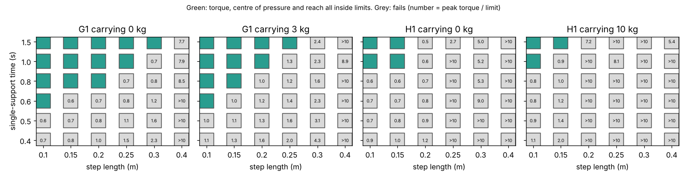

# buildbot-carryphase: can a stock Unitree G1 or H1 carry a stud across a site floor as fast as a labourer?

Track 20, robots on the residential building site (`PROJECTS.md`, milestone 3). A sibling to [`buildbot-carry`](../buildbot-carry), which another run landed on the same day: that one scores the worst instant before touchdown with a sourced vendor speed cap; this one scores a whole single-support phase by inverse dynamics, adds ramps and a step-up, and asks what speed a one-piece robot trip would need to match a labourer. [`buildbot-payload`](../buildbot-payload) found what a standing G1 or H1 can hold; [`buildbot-cohold`](../buildbot-cohold) kept it standing. This asks what happens when it walks: one single-support phase of a step, with the load in its hands, scored against the Menagerie joint torque limits. Produced with AI assistance (Claude). Simulated and preliminary. **This is a model-based check of a prescribed gait, not a walking policy**: nothing is learned, nothing falls, and the milestone's falls, drops and energy per item are not scored (see Limitations).

**Live page:** https://duncan-haywood.github.io/oss-monorepo/research/buildbot-carryphase/

**Headline.**
- **The prescribed gait is slow, and the model says why.** For the **G1** the fastest step that stays inside every joint's torque limit with the centre of pressure on the sole is **0.25 m/s** unloaded and with 1 to 2 kg, **0.20 m/s** at 3 kg, **0.10 m/s** at 4 kg and **none** at 5 kg (the standing limit at this pose is 4.6 kg). The **H1** manages 0.15 m/s unloaded, 0.10 m/s at 10 kg, 0.07 m/s at 14 kg, none at 18 or 23 kg. These are **lower bounds**: the gait has no trunk or arm compensation, so the centre of pressure drifts off the sole well before a torque limit is reached (140 of the G1's 216 flat-floor cases leave the sole; 140 exceed a torque limit). They are not the robots' walking speed; the vendor quotes about 2 m/s for the G1 (reseller pages, unverified).
- **Even at that vendor speed, one piece per trip loses to a labourer who carries three.** A person walking 1.2 m/s with three 5.8 kg pieces (17 kg, under the NIOSH 23.1 kg constant) moves 3 pieces per trip. A robot holding one piece per trip would have to walk **4.4 to 13 m/s** over a 40 m haul to match, or **1.2 m/s** to match a person who also carries one piece (`results.txt`, section G). This holds whatever the gait's ceiling, because it only uses the trip arithmetic.
- **Which robot can carry a stud at all.** A framing piece averages 5.8 kg ([`buildbot-taskbook`](../buildbot-taskbook)). The G1's standing limit at the carry pose is 4.6 kg, so a stud is out of its reach even before walking. The H1's is 18.8 kg, but the model finds a walking step only up to 14 kg, at 0.07 m/s.
- **Ramps and steps.** A 1:12 ramp (the ADA's maximum new-construction slope) leaves the G1's fastest step unchanged at 0.20 m/s and a 1:8 slope cuts it to 0.07 m/s; the H1 finds no feasible step on either. Stepping up with the swing foot: the G1 passes up to 10 cm unloaded and with 2 kg, and 1 of 4 cells at 15 cm; the H1 passes none (its ankle has no roll axis, its feet roll with the leg, and its legs reach less far in this IK).
- **Joint that binds.** The G1's **waist pitch** sets its loaded limits,, as in the standing case. The H1's are the **ankle** and **hip pitch**.



**Not a safety case and not a rated payload.** Nothing here was tested with a robot. A robot carrying lumber across a floor is a falling-object, trip and crush hazard; any trial needs a risk assessment (ISO 10218, ISO/TS 15066, the site's OSHA duties). Numbers from this model do not predict what hardware does.

## Method (`src/buildbot_carryphase/model.py`)
- **Gait.** For step length L and single-support time T, the combined centre of mass (robot plus load) follows the linear inverted pendulum orbit (Kajita et al., 2001, ICRA) over the stance foot, from L/2 behind it to L/2 ahead, with the centre of pressure planned at the foot centre. The swing foot goes from one footprint behind to one ahead (minimum-jerk in x, 5 cm clearance), 15 cm sideways of the stance foot. The hands hold the load 0.3 m ahead of the centre of mass at 0.6 m height, buildbot-payload's carry pose. Double support is zero length, so L / T is a speed upper bound for that gait.
- **Kinematics.** Whole-body inverse kinematics (the Levenberg-Marquardt solver of `buildbot_payload`) at 13 instants: stance foot pinned flat, swing foot and hands on target, centre of mass over the stance foot sideways. The H1's foot roll is left free, since its ankle only pitches. A degree-8 polynomial in time (tangent space of the free joint) smooths the poses to get velocities and accelerations.
- **Dynamics.** MuJoCo `mj_inverse` at 25 instants gives the generalised forces for that motion; the load enters as a force `m(g - a_hand)` split between the hands; the stance foot's six-component wrench is solved from the six floating-base rows. The joint torques are what is left. Ramps tilt gravity in the foot frame; a step-up raises the swing foot's landing point.
- **Feasible** means: IK residual under 5 mm, every joint torque under the model's peak limit, the centre of pressure inside the sole's contact spheres, and the foot pressing down. The friction coefficient the foot needs (|F<sub>tangent</sub>| / F<sub>normal</sub>) is reported, not limited.

| Input | Value | Source |
|---|---|---|
| Robot model, joint limits | Menagerie G1, H1 at commit `cda5236f` | vendor model, BSD-3-Clause (Unitree Robotics); not validated |
| Foot size | contact spheres of the model (G1 sole 18 x 7 cm) | the model |
| Carry pose | hands 0.3 m ahead, 0.6 m up | `buildbot-payload` / `buildbot-taskbook` |
| Step width, clearance | 0.15 m, 0.05 m | my choices, not sourced |
| Step length, time | L 0.1 to 0.4 m, T 0.4 to 1.5 s (grid) | swept |
| Ramp slope | 1:12 (4.76 deg), 1:8 (7.13 deg) | ADA Standards 405.2 limits (Access Board ramp guide); 1:8 is the steepest allowed for existing sites |
| Step-up | 5 to 20 cm | swept; the stair riser limit in the IRC was not checked |
| Piece mass | 5.8 kg mean framing piece | `buildbot-taskbook` (itself the author's takeoff) |
| Person's walking speed | 1.0 to 1.4 m/s | Bohannon and Andrews (2011), *Physiotherapy* 97:182-189 (1.43 m/s men 40-49, 1.26 m/s men 70-79, read from a summary and a handout, not the paper's table) |
| Pick-up and put-down time, haul distance | 6 to 24 s, 10 to 40 m | not sourced; swept |
| Person's pieces per trip | 1 or 3 | 3 x 5.8 kg under the NIOSH constant (Waters et al. 1993); an assumption about practice |

## Reproduce
```bash
pip install mujoco numpy matplotlib pytest
cd research/buildbot-carryphase
python -m pytest -q tests                 # 9 tests; five need the Menagerie clone (git + network)
python experiments/run.py                 # 636 cases, about 12 minutes on 4 CPUs, deterministic; writes results.json/results.txt
python experiments/figure.py
```

## Results (from `experiments/results.txt`)
- **A. Standing:** G1 4.6 kg, H1 18.8 kg at the carry pose.
- **B. Flat floor,** fastest feasible step (cells of a 6 x 6 L-T grid per payload): see Headline. Peak torque ratios at the best cell are 0.62 (0 kg) to 0.99 (4 kg) for the G1 and 0.57 to 0.99 for the H1; positive joint work per step is 23 to 38 J. The best cells have centre-of-pressure margins of 0 to 24 mm, i.e. they sit at the edge of the sole.
- **C. Ramps, D. Step-up:** see Headline; per-payload rows in `results.txt`.
- **E. Why cases fail.** G1: 1 of 216 IK failures, 140 torque, 140 centre of pressure. H1: 124 of 216 IK failures (a long step is out of reach with the foot's roll free), 181 torque, 202 centre of pressure.
- **F, G. Rates.** At the measured speeds the robot moves 5 to 38 pieces/hour against the labourer's 35 to 532, depending on haul and handling time. Break-even speeds are in section G.
- **Checks.** Tests recover the orbit's endpoints and its equation of motion (acceleration = g/z x position), the foot force of a slow step as the robot's weight (within 6%), the load's weight added to it (within 15%), on a slope weight x cos and friction = tan of the angle (within 6% and 25%), and that a fast long step fails where a slow short one passes.

## Limitations
- **Not a policy.** The gait is prescribed. There is no controller, no balance recovery, no sensing; "falls" and "items dropped" are not scored, and energy per item is not either (no sourced efficiency; mechanical work per step is in `results.json`).
- **The speeds are pessimistic.** A real controller moves the trunk and arms to keep the centre of pressure on the sole; this gait does not, and the best cells have a 0 to 24 mm margin. Read the speeds as what an uncompensated pendulum gait allows, and the sweep of payload, slope and step as a comparison between conditions. Torque limits are the model's peak values.
- **Idealised phases.** Zero-length double support, no touchdown impact, no lateral sway beyond the centre of mass sitting over the stance foot, uniform contact on a rigid flat foot, no slip limit (friction is reported only). The load is a point mass at the hands with no grip model; a stud is long and swings, which is not modelled.
- **The H1 is handled differently.** Its roll-free feet make its lateral balance a thin line contact (the sole is 2.8 cm wide), which is why it is infeasible so often; this says little about the real H1's gait.
- **The person's side is arithmetic.** Walking speed is sourced from a secondary read; pieces per trip, handling time and haul are my assumptions and swept.
- **One stance leg model, one load pose.** No carrying on a shoulder, no two-person carry, no stairs.

## Next steps
Add trunk compensation (a ZMP-preview or MPC controller in MuJoCo) to find the real speed ceiling, then train a walking policy with domain randomisation (MuJoCo Playground has G1 locomotion) and score it with falls and metres per minute; measure energy per item from a sourced efficiency; replace the arithmetic person with a time study; carry on the H1 with a shoulder or cradle grip (`buildbot-skills`).

## Owner steps
None needed. A hardware trial would need a G1 or H1, a risk assessment against ISO 10218 and ISO/TS 15066, and a spotter.

## Outside dependencies (vitamins)
MuJoCo (Apache-2.0), NumPy, Matplotlib and pytest. The Unitree G1 and H1 models come from MuJoCo Menagerie (BSD-3-Clause, © Unitree Robotics) at a pinned commit, fetched not copied. The solver and fetch code come from `buildbot-payload`. Kajita et al. (2001), "The 3D linear inverted pendulum mode", ICRA, for the gait. No group in `prompt.md` covers construction, and none is claimed.
