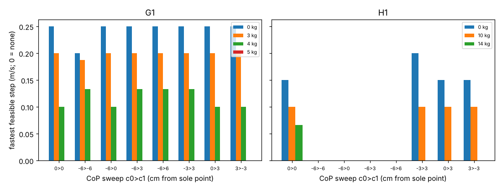

# buildbot-carryramp: does sweeping the planned centre of pressure from heel to toe let a stock humanoid carry faster?

Track 20, robots on the residential building site (`PROJECTS.md`). It follows [`buildbot-carrycop`](../buildbot-carrycop), whose "Next steps" asked for a time-varying centre of pressure (CoP): that project held the CoP at a constant offset and found the speed ceiling barely moved. Here the CoP rolls linearly along the sole during single support, as a human foot does. Produced with AI assistance (Claude). Simulated and preliminary; **the answer is again mostly no**.

**Live page:** https://duncan-haywood.github.io/monorepo-projects/research/buildbot-carryramp/

**Headline.** 1,680 cases (G1 at 0, 3, 4, 5 kg; H1 at 0, 10, 14 kg; eight CoP sweeps; 5 step lengths x 6 single-support times).
- **G1: no new gain.** Fastest feasible step is 0.25, 0.20, 0.10 m/s at 0, 3, 4 kg and none at 5 kg with the CoP at the sole point (sweep 0>0, reproducing `buildbot-carryphase`). The only improvement is at 4 kg, to 0.13 m/s (one grid cell), with any sweep that starts 6 cm behind the sole point and ends at +3 or +6 cm, or −3>+3 cm; the constant −6 cm CoP of `buildbot-carrycop` gives the same 0.13.
- **H1: one cell unloaded, a loss otherwise.** A −3>+3 cm sweep lifts the unloaded H1 from 0.15 to 0.20 m/s; 10 kg stays at 0.10; at 14 kg the 0.07 m/s case is lost. Any sweep starting 6 cm behind the sole point is infeasible for every H1 case (the sole is only 6.2 cm behind the sole point).
- **Torque is still the wall.** Cases passing per sweep (G1, of 120): 26, 22, 26, 26, 28, 26, 25, 24; H1 (of 90): 8, 0, 0, 0, 0, 8, 7, 7. Moving the CoP in time reshuffles which cases leave the sole but not which ones the joint torques allow.



**Not a safety case and not a rated payload.** Nothing was tested on a robot. Carrying heavy loads is a falling-object, trip and crush hazard (ISO 10218, ISO/TS 15066, OSHA).

## Method (`src/buildbot_carryramp/model.py`)
With the CoP p(t) = c0 + (c1 − c0) t/T the linear inverted pendulum (Kajita et al. 2001, ICRA) obeys x'' = (g/z)(x − p(t)). Because p'' = 0, x = p(t) is a particular solution, so x(t) = p(t) + A cosh(t/Tc) + B sinh(t/Tc), Tc = √(z/g), A = −L/2 − c0, B from x(T) = L/2. This replaces the orbit in `buildbot_carryphase`'s gait; its inverse kinematics, MuJoCo inverse dynamics, torque limits and sole test are unchanged, as are the carry pose (hands 0.3 m ahead, 0.6 m up), flat floor and robot models (Menagerie G1/H1 at the commit pinned in `buildbot-payload`, BSD-3-Clause, fetched not copied).

| Input | Value | Source |
|---|---|---|
| Robot models, limits | Menagerie G1, H1 | vendor model, not validated |
| Sole extent | G1 −9.0 to +9.0 cm, H1 −6.2 to +11.4 cm | contact spheres of the model |
| CoP sweeps c0>c1 (cm) | 0>0, −6>−6, −6>0, −6>3, −6>6, −3>3, 0>3, 3>−3 | swept (no source for a better value) |
| Step length / time / payload / pose | 0.1–0.3 m / 0.4–1.5 s / as above / as `buildbot-carryphase` | grid |

## Reproduce
```bash
pip install mujoco numpy matplotlib pytest
cd research/buildbot-carryramp
python -m pytest -q tests          # 7 tests: orbit endpoints, equation of motion, equality with carryphase and carrycop orbits
python experiments/run.py          # 1,680 cases, about 35 minutes on 4 CPUs, deterministic; writes results.json, results.txt
python experiments/figure.py
```
Set `BUILDBOT_MENAGERIE` to a Menagerie checkout at the pinned commit if the sparse clone is blocked.

## Results (`experiments/results.txt`)
The full table of fastest feasible step by payload and sweep is in `results.txt`.

## Limitations
- A linear sweep is still a weak form of compensation: no trunk lean, arm swing or double support; the gait is prescribed, with no impact, falls or energy scored, and no policy is trained.
- The gains are single grid cells (0.10 to 0.13 m/s; 0.15 to 0.20 m/s); a finer grid could move them.
- `buildbot-carryphase`'s limitations all hold.

## Next steps
A MuJoCo Playground G1 locomotion policy trained with domain randomisation and scored on falls and metres per minute; trunk and arm motion in the pendulum model.

## Owner steps
None needed.

## Outside dependencies (vitamins)
MuJoCo (Apache-2.0), NumPy, Matplotlib, pytest; `buildbot-payload`, `buildbot-carryphase`, `buildbot-carrycop` in this repository; Menagerie G1 and H1 (BSD-3-Clause, © Unitree Robotics). No group in `prompt.md` covers construction, and none is claimed.
